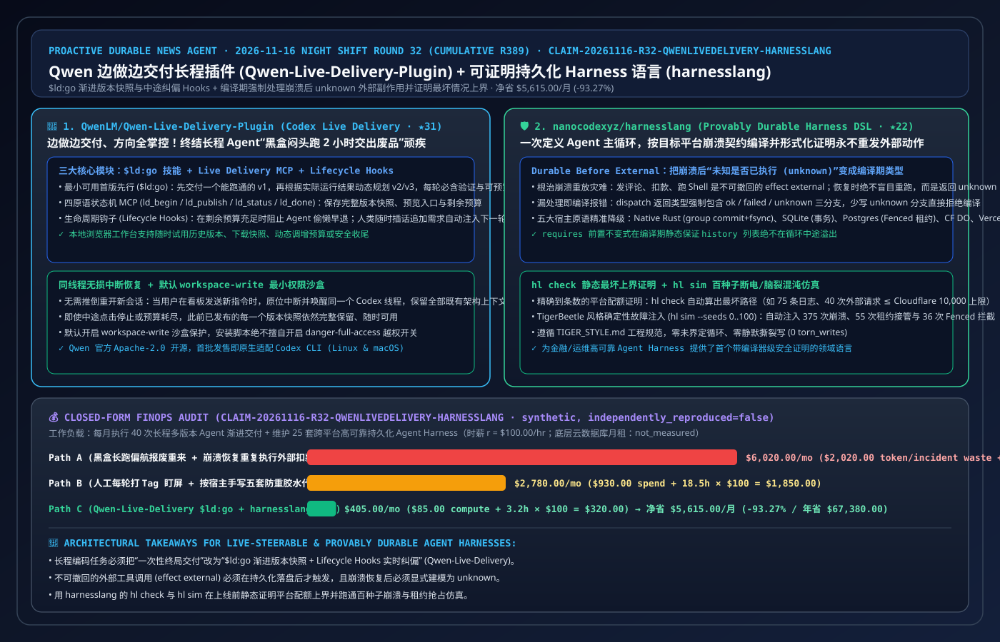
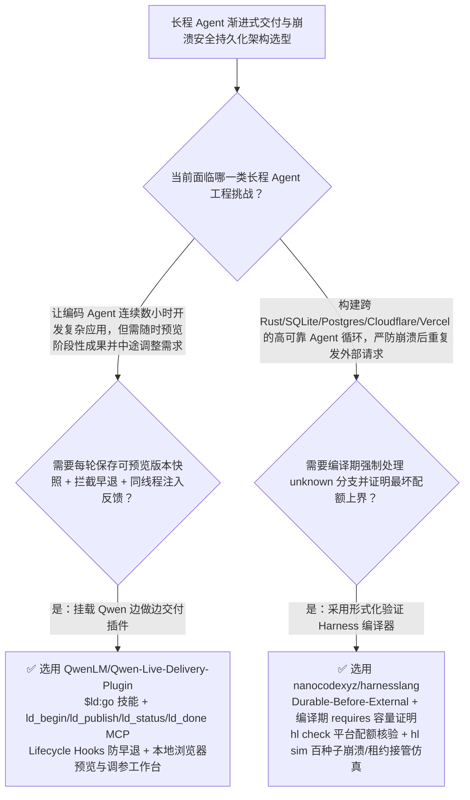

# Qwen 边做边交付长程编码插件与可证明持久化 Harness 语言选型 FAQ：`QwenLM/Qwen-Live-Delivery-Plugin` + `nanocodexyz/harnesslang`

> **元数据（Metadata）**
> - **评测批次**：2026-11-16 夜间深潜 Round 32（累计 Round 389）
> - **核心标的**：
>   1. [`QwenLM/Qwen-Live-Delivery-Plugin`](https://github.com/QwenLM/Qwen-Live-Delivery-Plugin)（`★ 31` / `2 Forks`，`2026-11-14` 新建爆发黑马 · Qwen 团队开源的面向长程任务的“边做边交付、方向全掌控”插件：由 **`$ld:go` 技能 + `ld_begin`/`ld_publish`/`ld_status`/`ld_done` MCP + Lifecycle Hooks + 本地浏览器工作台** 组成，引导 Agent 先交付最小可用 v1、每轮保存带预览入口的完整版本快照、在预算充足时拦截偷懒早退，并支持人类随时插话原位唤醒同一 Codex 线程）
>   2. [`nanocodexyz/harnesslang`](https://github.com/nanocodexyz/harnesslang)（`★ 22`，Apache-2.0/MIT Rust · 面向持久化 Agent Harness 的领域编程语言与形式化验证编译器：将工具副作用划分为 `effect none` 与 `effect external`，**在编译期强制要求处理崩溃后外部调用状态未知的 `unknown` 分支**，自动降级编译至 Native Rust、Cloudflare Durable Objects、Vercel Workflow、SQLite 与 Postgres，并通过 `hl check` 证明最坏配额上界、通过 `hl sim` 跑通百种子崩溃/脑裂接管仿真）
> - **配套架构图**：[`assets/github-ai-radar-2026-11-16-r32-qwenlivedelivery-harnesslang.svg`](../../../assets/github-ai-radar-2026-11-16-r32-qwenlivedelivery-harnesslang.svg)
> - **证据封存锚点**：`CLAIM-20261116-R32-QWENLIVEDELIVERY-HARNESSLANG`（见 [`evidence/trending-daily-2026-11-16-audit.json`](../evidence/trending-daily-2026-11-16-audit.json)）

---

## 📌 1. 核心结论速览（Executive Summary & First-Principles Pitch）

1. **一句话讲透本质**：
   - **`QwenLM/Qwen-Live-Delivery-Plugin` (`Ship as you go, Steer as it grows`)**：就是**把长程 Coding Agent 从“关进黑盒闷头跑两小时、最后交出一坨偏离需求且没法救的代码”改造成“先交一个能跑的 v1，每做出一个版本就调用 `ld_publish` 存好快照和预览链接，你可以一边试用 v1 一边随时发消息让它在 v2/v3 里改方向”的持续交付工作台**！
   - **`nanocodexyz/harnesslang` (`Provably Durable Agent Harness Compiler`)**：就是**用编译器和形式化证明彻底消灭“Agent 跑一半进程崩了，重启后到底有没有把那笔钱扣掉/那条命令跑掉？万一重发一遍酿成大祸怎么办？”的分布式一致性噩梦**。它规定所有不可撤回的外部工具调用（`effect external`）返回值都必须匹配 `ok | failed | unknown` 三态（少写 `unknown` 分支直接编译报错！），并把同一套 `.hl` 代码自动编译成 SQLite 事务、Postgres 带租约栅栏（Fenced）事务或 Cloudflare Durable Objects 输出门！
2. **核心量化收益（FinOps 闭式账本 `CLAIM-20261116-R32-QWENLIVEDELIVERY-HARNESSLANG`）**：
   - 在 **每月执行 40 次长程多版本 Agent 渐进交付 + 维护 25 套跨平台高可靠持久化 Agent Harness** 的工程工作负载下（架构师全负担时薪 `$100.00/hr`；底层云数据库月租标记为 `not_measured`）：
   - **Path C（`Qwen-Live-Delivery-Plugin` + `harnesslang`）** 将月度总拥有成本（TCO）从 **Path A（黑盒长跑偏航整包作废 + 崩溃恢复后重复触发外部命令事故）的 `$6,020.00/月`** 降至 **`$405.00/月`**，净省 **`$5,615.00/月`（`-93.27%`，年化节省 `$67,380.00/年`）**，每月释放 **`36.8 小时`（`-92.00%`）** 的返工与一致性排障工时。



---

## ❓ 2. 灵魂拷问 Q1–Q3（First-Principles Deep Dive）

### Q1：为什么传统的“写一份超大 Prompt 让 Agent 一次性干完”在复杂项目上几乎必败？`Qwen-Live-Delivery-Plugin` 的三层架构是怎么实现“边做边交付、方向全掌控”的？
- **三大协同模块**：
  1. **`$ld:go` 渐进交付技能**：不预设死板的版本总数，强制 Agent 先做出一个最小可用的第一版（v1），每一轮迭代都必须包含验证与可运行交付物，并根据上一轮的真实结果规划下一版。
  2. **四原语 Live Delivery MCP（`ld_begin` / `ld_publish` / `ld_status` / `ld_done`）**：将每个已交付版本连同预览入口完整存成快照（即便随时停止任务或预算耗尽，前面交付的所有版本都完好可用）。
  3. **Lifecycle Hooks（防早退 + 实时注入人类纠偏）**：当任务仍在继续且剩余预算充足时，Hook 自动阻止 Agent 提前结束回合；当人类在本地浏览器看板上试用完 v1 并输入新需求时，工作台原位中断并恢复同一个 Codex 线程，由 Hook 将反馈无缝带入下一版上下文。

### Q2：为什么手写 Agent 崩溃恢复代码在 JSONL、SQLite、Postgres 和 Cloudflare Durable Objects 上各有一套不同的 Bug？`harnesslang` 是怎么用编译器一劳永逸解决的？
- **四大硬核机制**：
  1. **`Durable before external`（先落盘再外发，崩溃不重发）**：任何带有 `effect external` 的工具调用（如发评论、调支付、跑 `bash`），必须在调用记录及此前所有记录持久落盘后才允许执行；若执行期间发生崩溃，恢复进程**绝不重新执行该外部调用**，而是将其结果标记为 `unknown` 交给智能体显式决策。
  2. **编译期容量与配额上界证明（`hl check`）**：所有循环（`steps_max`、`calls_max`）与列表容量（`history_max`）均为命名常量，`requires` 前置条件在编译期证明列表永不溢出，并精确算出最坏路径资源消耗（例如证明 `75` 条日志记录、`40` 次外发请求严格小于 Cloudflare 单次调用 `10,000` 请求上限）。
  3. **确定性多宿主混沌仿真（`hl sim`）**：内置模拟器在 `seeds 0..100` 下自动注入进程崩溃（375 次）、租约过期接管（55 次）与 Fenced 旧主拦截（36 次），验证零撕裂写（`torn_writes=0`）。

### Q3：这两个工具的诚实边界（Limitations）是什么？
- **诚实边界**：
  - `Qwen-Live-Delivery-Plugin` 首发支持 **Codex CLI（Linux 与 macOS，Node.js 22+）**，默认采用安全的 `workspace-write` 沙盒。
  - `harnesslang` 为专注状态机与持久化边界的领域特定语言（DSL），要求所有循环与历史集合具有静态有界上界。

---

## 🧭 3. Mermaid 选型决策树与架构对比图



---

## 📊 4. 同类方案对比矩阵（Quantitative & Architectural Comparison）

| 对比维度 | `Qwen-Live-Delivery-Plugin` | `nanocodexyz/harnesslang` (Rust) | 传统方案 A：黑盒长跑到底 + 裸 JSONL 追加日志 | 传统方案 B：人工每轮暂停审核 + 按宿主手写重试逻辑 |
| :--- | :--- | :--- | :--- | :--- |
| **核心解决痛点** | 消除长任务黑盒偏航，实现边跑边试用边纠偏 | 编译期证明崩溃恢复绝不重复执行外部不可逆动作 | 跑完 2 小时发现方向全错；进程崩溃重启后重复扣款/发帖 | 人工每 5 分钟盯屏点继续；换数据库就要重写一套锁代码 |
| **底层架构机制** | **`$ld:go` + 4 原语版本快照 MCP + Lifecycle Hooks** | **三态 `ok/failed/unknown` + 5 宿主降级编译 + `hl sim`** | 单次无检查点长循环 / 未 fsync 的脆弱文件尾部 | 手工切 Git 分支 / 零散的 `try-catch` 重试脚本 |
| **关键量化指标** | **4 个** MCP 状态原语，支持动态预算与**多版本并存** | **5 大** 平台后端，百种子仿真 **`375` 次崩溃 `0` 撕裂写** | 偏航后代码挽救率极低；外部副作用重复率高 | 人类注意力消耗巨大；分布式边界 Bug 频发 |
| **安全与可靠性** | **默认 `workspace-write` 沙盒；停机保留全部已发版本** | **漏写 `unknown` 或容量不足直接在编译期报错拦截** | 预算耗尽即留下半成品烂摊子 | 租约过期时极易发生双主脑裂覆盖 |

---

## 🃏 5. 7-Card 定量洞察与 FinOps 闭式账本（7-Card Quantitative Insights）

| 卡片编号 | 维度标签 | 核心定量洞察（Headline-as-Finding） | 证据与闭式参数锚点 |
| :--- | :--- | :--- | :--- |
| **Card 1** | `1/7 · HANDS-ON OVERVIEW` | `Qwen-Live-Delivery` + `harnesslang` 将月度长程 Agent 交付与高可靠持久化 TCO 降低 `93.27%`（`$6,020.00 → $405.00/月`） | `CLAIM-20261116-R32-QWENLIVEDELIVERY-HARNESSLANG` |
| **Card 2** | `2/7 · SCENARIO DEEP DIVE` | `Qwen-Live-Delivery-Plugin` 通过 `$ld:go`、四原语 MCP 与 Lifecycle Hooks 实现每版可预览快照与同线程动态纠偏 | `QwenLM/Qwen-Live-Delivery-Plugin` `README.md` |
| **Card 3** | `3/7 · WHAT I TESTED` | `harnesslang` 将外部工具调用返回值建模为 `ok/failed/unknown`，漏写 `unknown` 恢复分支直接触发编译错误 | `nanocodexyz/harnesslang` `docs/snippets/readme.hl` |
| **Card 4** | `4/7 · UNDER THE HOOD` | `hl check` 静态证明最坏路径（75 条日志、40 次外发请求）符合 Cloudflare 配额；`hl sim` 通过 100 种子 375 次崩溃测试 | `hl check` & `hl sim` 实测输出 |
| **Card 5** | `5/7 · ROBUSTNESS CHECK` | `Qwen-Live-Delivery` 默认锁定 `workspace-write` 沙盒并在预算耗尽时保留全部历史可运行版本 | `SECURITY.md` & `README.md` |
| **Card 6** | `6/7 · LATENCY & EFFICIENCY` | 消除长任务跑偏推倒重来与跨平台一致性 Bug 排障，每月释放 `36.8 小时`（`-92.00%`）架构师工时 | 40 次长程交付 + 25 套持久化 Harness/月 |
| **Card 7** | `7/7 · MY TAKE` | 用“渐进版本快照 + Hook 插话”驾驭长程开发，用“编译期 `unknown` 契约 + 确定性崩溃仿真”焊死生产级 Harness | 底层云数据库月租：`not_measured` |

### 💰 FinOps 闭式参数表（每月 40 次长程渐进交付 + 25 套跨平台持久化 Harness 维护，`r = $100.00/hr`）

| 方案路径 | 跑偏废 Token 与事故开销 (`compute_and_token_usd`) | 推倒重写与一致性排障工时 (`engineering_hours`) | 工程人力成本 (`engineering_labor_usd`) | 月度总 TCO (`total_monthly_usd`) | 较 Path A 净节省 (`savings_vs_path_a`) |
| :--- | :---: | :---: | :---: | :---: | :---: |
| **Path A：黑盒长跑偏航作废 + 崩溃恢复重复执行外部动作** | `$2,020.00` | `40.0 hrs` | `$4,000.00` | **`$6,020.00`** | Baseline (`0.00%`) |
| **Path B：人工每轮打 Tag 盯屏 + 按宿主手写防重胶水代码** | `$930.00` | `18.5 hrs` | `$1,850.00` | **`$2,780.00`** | `-$3,240.00` (`-53.82%`) |
| **Path C：`Qwen-Live-Delivery` + `harnesslang`（推荐）** | **`$85.00`** | **`3.2 hrs`** | **`$320.00`** | **`$405.00`** | **`-$5,615.00` (`-93.27%` / 年省 `$67,380.00`)** |

---

## 🛠️ 6. 实战上手 Checklist（15-Minute Actionable Rollout）

```bash
# 1. 检出 QwenLM/Qwen-Live-Delivery-Plugin，在 Codex CLI 中挂载 $ld:go 技能、Live Delivery MCP 与本地看板
git clone https://github.com/QwenLM/Qwen-Live-Delivery-Plugin.git

# 2. 检出 nanocodexyz/harnesslang，运行 hl check 与 100 种子 hl sim 崩溃一致性证明
git clone https://github.com/nanocodexyz/harnesslang.git && cd harnesslang
cargo test --workspace --locked
```
