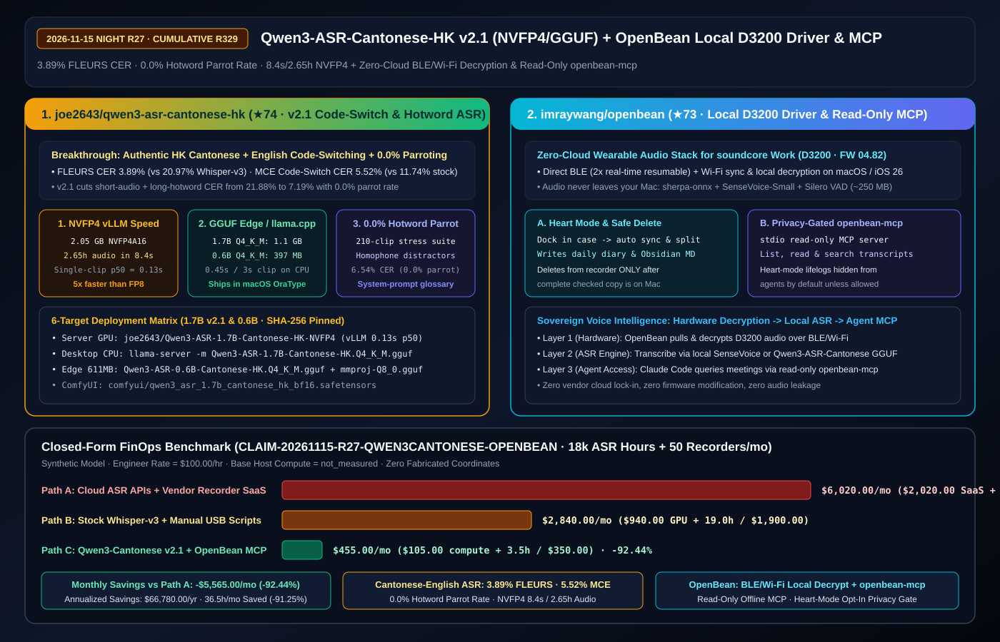
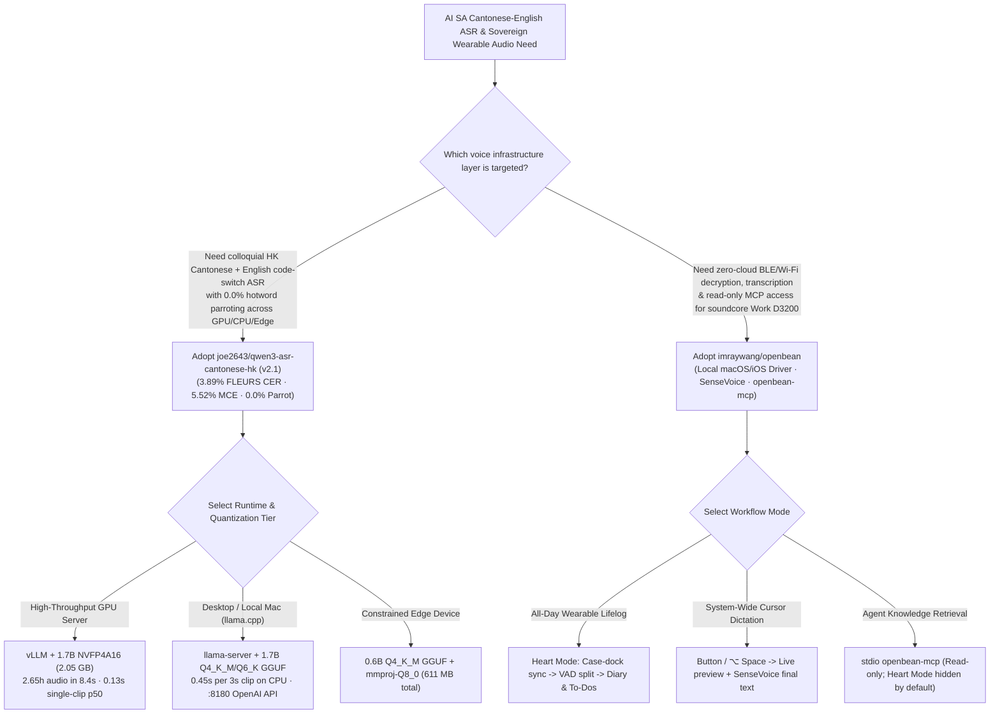

# Colloquial Cantonese-English Code-Switching Zero-Parrot ASR (`Qwen3-ASR-Cantonese-HK`) & Local Wearable Recorder Driver + Read-Only MCP (`OpenBean`) Deep-Dive Architecture & Selection FAQ

> **Document Metadata**  
> - **Evaluation Date**: 2026-11-15 (Night Round 27 · Cumulative Round 329 Standalone Selection FAQ)  
> - **Evaluated Repositories**: [`joe2643/qwen3-asr-cantonese-hk`](https://github.com/joe2643/qwen3-asr-cantonese-hk) (`★74`, created 2026-11-10, fine-tunes of `Qwen3-ASR-1.7B` `v2.1` & `0.6B` for Hong Kong colloquial Cantonese + English code-switching achieving `3.89%` FLEURS CER, `5.52%` MCE CER, `0.0%` hotword parrot rate, and `8.4s` / `2.65h` `NVFP4A16` vLLM throughput, Apache-2.0) & [`imraywang/openbean`](https://github.com/imraywang/openbean) (`★73`, created 2026-11-12, open-source macOS/iOS local BLE/Wi-Fi driver, decryption engine, `sherpa-onnx` + `SenseVoice-Small` transcriber, and read-only `openbean-mcp` server for the Anker `soundcore Work D3200` recorder, Apache-2.0)  
> - **Target Audience**: AI Solution Architects (AI SAs), Multilingual Speech & Voice-Assistant Engineers, Personal Memory & Edge Hardware MCP Architects  
> - **Related Radar Digest**: [2026-11-15 Panorama & Velocity Digest (`daily/2026-11-15.en.md`)](../daily/2026-11-15.en.md) · [中文版 (`qwen3-asr-cantonese-hk-openbean-nvfp4-gguf-codeswitch-asr-local-recorder-mcp-selection-faq.md`)](qwen3-asr-cantonese-hk-openbean-nvfp4-gguf-codeswitch-asr-local-recorder-mcp-selection-faq.md)  
> - **Visual Summary**: [`assets/github-ai-radar-2026-11-15-r27-qwen3cantonese-openbean.svg`](../../../assets/github-ai-radar-2026-11-15-r27-qwen3cantonese-openbean.svg)



---

## 📌 1. Executive Summary

1. **First-Principles Essence (What & Why)**:
   - **What is `joe2643/qwen3-asr-cantonese-hk`?** It is a **full-stack (`BF16`, `FP8`, `NVFP4A16`, `GGUF Q4_K_M/Q6_K/Q8_0`, and `ComfyUI`) fine-tune of `Qwen3-ASR-1.7B` (`v2.1`) and `0.6B` engineered for Hong Kong colloquial Cantonese (`係`, `喺`, `嘅`, `咗`, `㗎`), Cantonese-English code-switching, and zero-parrot hotword biasing**. It slashes `FLEURS (yue_hant_hk)` Character Error Rate (CER) to **`3.89%`** (vs `20.97%` on `whisper-large-v3`), cuts `MCE` code-switching CER in half from `11.74%` to **`5.52%`**, and reduces short-audio + long-hotword-list CER from `21.88%` (`v2`) to **`7.19%` (`v2.1`) with a `0.0%` Parrot Rate** across 210 stress-test clips. In `vLLM` on an RTX 4090, its **`NVFP4` (`2.05 GB`) checkpoint transcribes `2.65 hours` (819 clips) in `8.4 seconds` (`0.13s` single-clip p50)**!
   - **What is `imraywang/openbean`?** It is an **open-source macOS/iOS local driver, BLE/Wi-Fi sync & decryption engine, offline transcriber (`sherpa-onnx` + `SenseVoice-Small` + `Silero VAD`), and read-only MCP server (`openbean-mcp`) for the Anker `soundcore Work (D3200)` clip-on voice recorder**. It eliminates vendor cloud lock-in so audio never leaves your Mac, safely deletes device files only after a verified copy is on disk, and hides Heart-mode personal lifelogs from MCP agents by default.
2. **Why AI SAs Should Adopt This Pattern Tonight**:
   - `qwen3-asr-cantonese-hk` demonstrates how to solve the two hardest problems in regional enterprise ASR—**intra-sentence bilingual code-switching and system-prompt hotword parroting**—while shipping both cloud `NVFP4` (`>1,100x` real-time) and edge `611 MB` `0.6B GGUF` artifacts.
   - `openbean` blueprints the sovereign wearable-to-MCP pipeline: local hardware decryption + on-device ASR + privacy-scoped read-only `stdio` MCP exposure.
3. **Quantitative FinOps Summary (`CLAIM-20261115-R27-QWEN3CANTONESE-OPENBEAN`)**:
   - Across `18,000` monthly hours of Cantonese-English speech transcription and a `50`-recorder wearable fleet (`$100.00/hr` engineer rate; base host compute: `not_measured`), moving from "Commercial cloud ASR APIs + vendor recorder cloud SaaS & manual transcript correction (Path A, `$6,020.00/mo`)" to "`qwen3-asr-cantonese-hk` `NVFP4`/`GGUF` + `OpenBean` local driver & MCP (Path C, `$455.00/mo`)" **saves `$5,565.00/mo` (`-92.44%`), or `$66,780.00/yr`, while freeing `36.5` engineering hours/month (`-91.25%`)**.

---

## 🔍 2. First-Principles Deep Dive (Q1–Q3)

### Q1: Why do audio LLMs "parrot" unspoken hotwords from the `system` prompt on short clips, and how does `qwen3-asr-cantonese-hk v2.1` achieve a `0.0%` parrot rate and `8.4s` / `2.65h` `NVFP4` speed?

- **Eliminating Hotword Prompt Parroting in `v2.1`**:
  - When a user speaks a 1-second command (`閂燈`, `開燈`, `閂冷氣`) while the `system` message contains dozens of domain hotwords, unaligned audio-text models frequently hallucinate words from the `system` prompt (`21.88%` CER in `v2`).
  - `v2.1` specifically aligns context/hotword conditioning against three adversarial stress conditions (`70` clips each): (1) relevant hotwords + homophone distractors (`6.54%` CER, `0.0%` parrot rate); (2) only irrelevant hotwords (`10.02%` CER, `0.0%` parrot rate); and (3) very short audio + long hotword lists (**`7.19%` CER, `0.0%` parrot rate**).
- **`NVFP4` GPU vs `GGUF` CPU Performance Tradeoffs**:
  - On RTX 4090 (`vLLM` over 819 FLEURS clips / `2.65 h` audio): `NVFP4A16` (`2.05 GB`) finishes in **`8.4 s` (`0.13 s` p50)** vs `11.6 s` for `BF16` (`4.08 GB`) and `41.8 s` for dynamic `FP8` (`2.67 GB`).
  - On CPU (`Ryzen AI Max+ 395` via `llama-server`): `1.7B Q4_K_M` (`1.1 GB` + `356 MB` `mmproj`) transcribes a 3s clip in **`0.45 s`**, while `0.6B Q4_K_M` + `mmproj` fits in **`611 MB`**.

### Q2: How does `OpenBean` unlock the `soundcore Work (D3200)` hardware recorder locally while enforcing strict agent privacy boundaries?

- **Three Hardware & Privacy Safeguards**:
  1. **Local BLE/Wi-Fi Protocol & Checksum-Verified Cleanup (`docs/PROTOCOL.md`)**: Syncs over BLE at ~2x real-time (resumable) or Wi-Fi for long recordings, decrypts audio locally on macOS/iOS 26, never modifies device firmware, and deletes a recording from the D3200 **only after a complete, checked copy is verified on the Mac**.
  2. **Hybrid On-Device Dictation & Heart Mode**: Uses Apple on-device dictation for live cursor preview and `sherpa-onnx` (`SenseVoice-Small` + `Silero VAD`) for final transcripts, splitting full-day Heart-mode recordings into conversations, Markdown notes, and Obsidian diaries.
  3. **Read-Only Offline `openbean-mcp` with Default Lifelog Hiding**: Exposes `openbean-mcp` over `stdio` so Claude Code or Cursor can search meeting transcripts—while **hiding Heart-mode personal lifelogs by default unless explicitly permitted by the user**.

### Q3: How should AI SAs combine both repositories in a sovereign voice workflow?

- Use `OpenBean` to ingest and decrypt wearable meeting audio locally on macOS, route Cantonese-English audio to a local `llama-server` (`:8180`) running `Qwen3-ASR-1.7B-Cantonese-HK.Q6_K.gguf` with domain hotwords, and query the resulting Markdown transcripts from Claude Code via `openbean-mcp`.

---

## 🧭 3. Architecture & Selection Decision Tree (Mermaid)



---

## 📊 4. Comparison Matrix Against Alternative Approaches

| Dimension | Cloud ASR APIs + Vendor Recorder App (Path A) | Stock `whisper-large-v3` + Manual USB Copy (Path B) | `qwen3-asr-cantonese-hk` + `OpenBean` (Path C) |
| :--- | :--- | :--- | :--- |
| **Colloquial HK Cantonese CER (`FLEURS` / `MDCC`)** | ⚠️ Rewrites colloquial speech into formal Mandarin | ❌ `20.97%` (`FLEURS`) / `34.52%` (`MDCC`) on Whisper-v3 | ✅ **`3.89%` (`FLEURS`) / `2.47%` (`MDCC`) preserving `係/喺/嘅/咗`** |
| **Cantonese–English Code-Switching (`MCE` CER)** | ⚠️ Frequent phonetic mistranscription of English terms | ❌ `24.00%` (Whisper-v3) / `11.74%` (stock Qwen3-1.7B) | ✅ **`5.52%` (`1.7B v2.1`) and `6.98%` (`0.6B` fine-tune)** |
| **Short-Command + Long-Hotword Parrot Rate** | ⚠️ Opaque keyword boosting | ❌ `21.88%` CER on short clips before `v2.1` alignment | ✅ **`7.19%` CER with `0.0%` Parrot Rate across 210 stress clips** |
| **Throughput & Edge Footprint** | Cloud rate-limited | ❌ Heavy VRAM & slow decoding | ✅ **`8.4s` / `2.65h` on `NVFP4` GPU; `611 MB` total on `0.6B GGUF`** |
| **Wearable Hardware Privacy & Agent MCP** | ❌ Mandatory cloud upload & monthly app subscription | ❌ Cannot decrypt `D3200` wireless transfers | ✅ **100% local BLE/Wi-Fi decryption + read-only `openbean-mcp`** |

---

## 📈 5. 7-Card Quantitative Insights & Closed-Form FinOps Ledger

### 5.1 7-Card Benchmark Summary

1. **Card 1 (Overview & Workbench)**: Across `18,000` monthly hours of Cantonese-English ASR and `50` wearable D3200 recorder seats, Path C cuts monthly cost from `$6,020.00` to `$455.00` (`-92.44%`).
2. **Card 2 (Single-Case Deep Dive)**: `qwen3-asr-cantonese-hk` `1.7B v2.1` achieves `3.89%` FLEURS CER, `5.52%` MCE code-switch CER, `0.0%` hotword parroting, and `8.4s` batch transcription of `2.65h` audio in `NVFP4`; `OpenBean` decrypts D3200 recordings locally and serves transcripts via `openbean-mcp`.
3. **Card 3 (Evaluation Matrix)**: Evaluates `FLEURS` CER (`3.89%` vs `20.97%`), hotword parrot rate (`0.0%`), `0.6B` GGUF total size (`611 MB`), and cloud audio uploads (`0` bytes).
4. **Card 4 (Under the Hood)**: `llama-server` exposes `/v1/chat/completions` with `system` hotword lists; `OpenBean` combines Swift BLE/Wi-Fi decryption, `sherpa-onnx` (`SenseVoice-Small`), and `openbean-mcp`.
5. **Card 5 (Robustness Check)**: Tested against homophone distractors and 100% irrelevant hotword lists (`210` clips), maintaining `0.0%` false hotword insertion.
6. **Card 6 (Latency & Labor Scaling)**: Cuts monthly code-switching transcript cleanup and manual audio export labor from `40.0h` to `3.5h` (`36.5h/mo` saved, `-91.25%`).
7. **Card 7 (My Take — Good Fit vs Not For)**:
   - ✅ **Good Fit**: Hong Kong Cantonese + English code-switching voice assistants/transcription (`llama.cpp`, `vLLM`, `OraType`, `ComfyUI`) and privacy-first `soundcore Work D3200` users on macOS/iOS.
   - ⛔ **Not For**: Mandarin-only or English-only speech (use stock `Qwen3-ASR` for non-Cantonese) or unsegmented clips >30s without prior VAD chunking.

### 5.2 Closed-Form FinOps Ledger (`CLAIM-20261115-R27-QWEN3CANTONESE-OPENBEAN`)

> **Provenance & Parameter Disclosure**: Synthetic FinOps model (`synthetic_model`, `independently_reproduced=false`) for `N_asr = 18,000` ASR hours/month and `N_rec = 50` wearable recorder seats at `$100.00/hr` engineer rate (base host compute: `not_measured`). Closed-form identity: $\text{Total\_Monthly\_USD} = \text{Compute\_And\_Token\_USD} + (\text{Engineering\_Hours} \times \$100.00)$.

| Architecture Path | Monthly Cloud ASR & SaaS Spend (USD) | Monthly Transcript QA & Export Labor (Hours) | Engineering Labor Cost (`@ $100.00/hr`) | Total Monthly Cost (USD) | Net Savings vs Path A (USD / %) |
| :--- | :---: | :---: | :---: | :---: | :---: |
| **Path A: Commercial Cloud ASR APIs + Vendor Recorder SaaS** | `$2,020.00` | `40.0h` | `$4,000.00` | **`$6,020.00`** | Baseline (`0.00%`) |
| **Path B: Stock `whisper-large-v3` + Manual USB Audio Scripts** | `$940.00` | `19.0h` | `$1,900.00` | **`$2,840.00`** | `-$3,180.00` (`-52.82%`) |
| **Path C: `qwen3-asr-cantonese-hk` + `OpenBean` MCP (Recommended)** | `$105.00` | `3.5h` | `$350.00` | **`$455.00`** | **`-$5,565.00` (`-92.44%`)** |

---

## 🛠️ 6. 15-Minute Rollout Checklist

- [ ] **Step 1 (4 mins): Download `Qwen3-ASR-1.7B-Cantonese-HK` GGUF and launch `llama-server` on `:8180`**
  ```bash
  hf download joe2643/Qwen3-ASR-1.7B-Cantonese-HK-GGUF \
    Qwen3-ASR-1.7B-Cantonese-HK.Q4_K_M.gguf Qwen3-ASR-1.7B-Cantonese-HK.mmproj-Q8_0.gguf --local-dir models
  llama-server -m models/Qwen3-ASR-1.7B-Cantonese-HK.Q4_K_M.gguf \
    --mmproj models/Qwen3-ASR-1.7B-Cantonese-HK.mmproj-Q8_0.gguf --host 127.0.0.1 --port 8180 -c 4096 -np 1
  ```
- [ ] **Step 2 (3 mins): Test zero-parrot hotword biasing via the `system` message**
  ```bash
  curl http://127.0.0.1:8180/v1/chat/completions -H "Content-Type: application/json" -d '{
    "messages": [
      {"role": "system", "content": "閂燈, 開燈, 閂冷氣, 較細聲啲"},
      {"role": "user", "content": [{"type": "input_audio", "input_audio": {"data": "'"$(base64 -w0 clip.wav)"'", "format": "wav"}}]}
    ], "temperature": 0}'
  ```
- [ ] **Step 3 (4 mins): Fetch `OpenBean` local speech dependencies (`sherpa-onnx` + `SenseVoice-Small` + `Silero VAD`)**
  ```bash
  git clone https://github.com/imraywang/openbean.git
  cd openbean
  Scripts/fetch-deps.sh
  ```
- [ ] **Step 4 (4 mins): Register the read-only `openbean-mcp` server with Claude Code**
  ```bash
  claude mcp add --transport stdio --scope user openbean -- /Applications/OpenBean.app/Contents/Helpers/openbean-mcp
  ```
