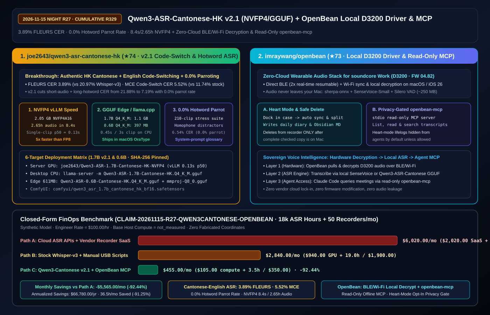
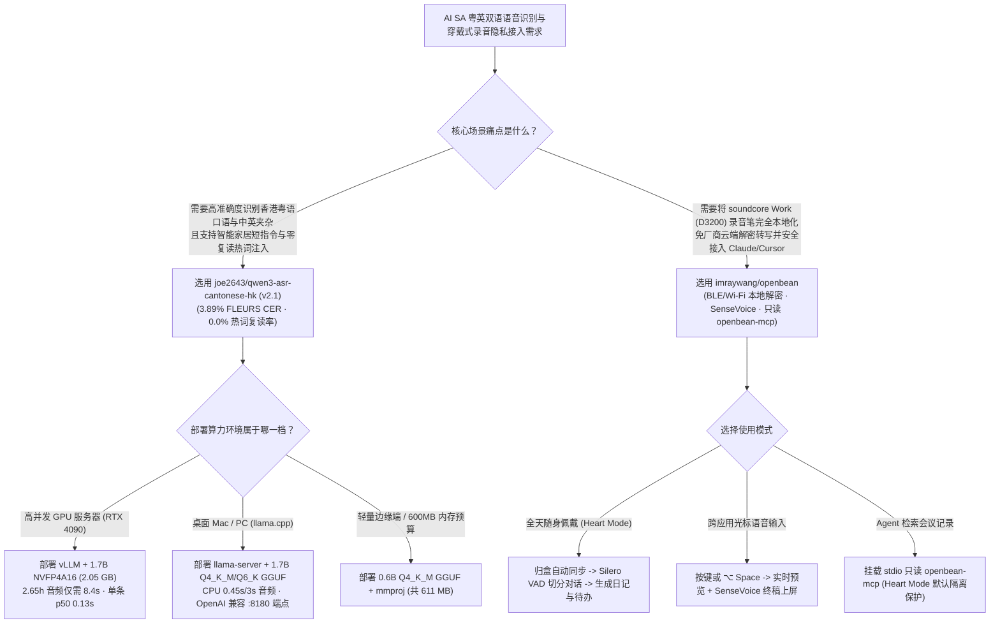

# 中英混杂粤语零复读热词语音识别（`Qwen3-ASR-Cantonese-HK`）与穿戴录音笔本地解密只读 MCP 驱动（`OpenBean`）深度架构拆解与同类方案选型 FAQ

> **文档元数据（Document Metadata）**  
> - **评审日期**：2026-11-15（Night Round 27 · 累计第 329 轮独立选型专题）  
> - **对标项目**：[`joe2643/qwen3-asr-cantonese-hk`](https://github.com/joe2643/qwen3-asr-cantonese-hk)（`★74`，2026-11-10 创建，针对香港口语粤语与中英夹杂 Code-Switching 微调的 `Qwen3-ASR-1.7B v2.1` & `0.6B`，`FLEURS` 字错率 `3.89%`、热词复读率 `0.0%`、提供 `NVFP4`/`FP8`/`GGUF`/`ComfyUI` 全套权重，Apache-2.0） & [`imraywang/openbean`](https://github.com/imraywang/openbean)（`★73`，2026-11-12 创建，面向 Anker `soundcore Work D3200` 穿戴录音笔的 macOS/iOS 零云端 BLE/Wi-Fi 本地解密驱动、离线转录与只读隐私隔离 `openbean-mcp` 服务，Apache-2.0）  
> - **适用角色**：AI Solution Architect（AI 解决方案架构师）、大湾区多语种智能客服/语音主程、端侧个人记忆（Personal Memory）与硬件 MCP 架构师  
> - **关联雷达日报**：[2026-11-15 全景洞察与飙升榜 (`daily/2026-11-15.md`)](../daily/2026-11-15.md) · [English Version (`qwen3-asr-cantonese-hk-openbean-nvfp4-gguf-codeswitch-asr-local-recorder-mcp-selection-faq.en.md`)](qwen3-asr-cantonese-hk-openbean-nvfp4-gguf-codeswitch-asr-local-recorder-mcp-selection-faq.en.md)  
> - **可视化总结图**：[`assets/github-ai-radar-2026-11-15-r27-qwen3cantonese-openbean.svg`](../../../assets/github-ai-radar-2026-11-15-r27-qwen3cantonese-openbean.svg)



---

## 📌 一、核心结论速览（Executive Summary — 先看结论再看细节）

1. **一句话讲透本质（What & Why）**：
   - **`joe2643/qwen3-asr-cantonese-hk` 是什么？** 它是专为解决“通用语音大模型（如 `whisper-large-v3`）一遇到香港地道粤语口语（`係/喺/嘅/咗/㗎`）与中英混杂（Code-Switching）就错字连篇、一塞长串业务热词就复读幻觉（Prompt Parroting）”而打造的 **“全量化栈（`BF16` / `FP8` / `NVFP4A16` / `GGUF Q4_K_M..Q8_0`）粤英双语语音识别工业底座（`1.7B v2.1` + `0.6B`）”**。在权威基准实测中，它将 `FLEURS (yue_hant_hk)` 字错率（CER）压至 **`3.89%`**（吊打 `whisper-large-v3` 的 `20.97%`）、将中英混杂 `MCE` 数据集 CER 从原版模型的 `11.74%` 砍半至 **`5.52%`**；更重要的是，`v2.1` 在 210 条热词压力测试中实现了 **`0.0%` 热词复读率（Parrot Rate）**，且其 **`NVFP4`（`2.05 GB`）权重在单张 RTX 4090 上仅需 `8.4 秒` 即可转写完 `2.65 小时`（819 条）音频（单条中位延迟 `0.13s`）**！
   - **`imraywang/openbean` 是什么？** 它是面向热门领夹式 AI 录音笔 **soundcore Work (`D3200`，固件 `04.82`)** 的 **“100% 脱离官方 App 与厂商云端、直接在 Mac/iPhone 本地通过蓝牙 BLE 与 Wi-Fi 同步解密音频、用 `sherpa-onnx` + `SenseVoice-Small` 离线转写并生成每日日记/待办、且内置只读离线 `openbean-mcp` 供 Claude Code / Cursor 安全检索”** 的开源原生驱动与工作台。
2. **为什么值得 AI SA 今晚立刻掌握？**
   - `qwen3-asr-cantonese-hk` 提供了垂类方言/双语混杂 ASR 从微调、防热词复读对齐（Hotword Context Biasing）到 **vLLM `NVFP4` 云端高吞吐 + `llama-server` `GGUF` 端侧 611MB 部署** 的完整范本；
   - `openbean` 提供了穿戴式 AI 硬件接入 Agent 生态的最佳隐私安全范式：**音频永远不出本机、设备文件必须在 Mac 端校验完整副本后才允许清理、全天候随身记录（Heart Mode）默认对 MCP Agent 隐藏除非用户显式授权**。
3. **定量收益摘要（Closed-Form FinOps Ledger `CLAIM-20261115-R27-QWEN3CANTONESE-OPENBEAN`）**：
   - 在每月转写 `18,000` 小时粤英双语客服/会议语音与维护 `50` 台穿戴式录音笔接入本地 Agent 知识库场景下（工程师时薪 `$100.00/hr`，底层宿主机硬件成本 `not_measured`），从“按分钟计费的商业云 ASR + 封闭硬件厂商云订阅与人工校对错字（Path A，`$6,020.00/mo`）”切换到“`qwen3-asr-cantonese-hk` `NVFP4`/`GGUF` + `OpenBean` 本地解密与只读 MCP（Path C，`$455.00/mo`）”，**每月净省 `$5,565.00`（`-92.44%`），年化节省 `$66,780.00/yr`，每月释放 `36.5` 小时人工校对与音频导出工时（`-91.25%`）**。

---

## 🔍 二、第一性原理灵魂三问（Q1–Q3 Deep Dive）

### Q1：为什么给语音模型通过 `system` 提示词塞入业务热词表（Hotwords）时，模型经常把根本没说过的话“脑补复读”出来？`qwen3-asr-cantonese-hk v2.1` 是如何做到 `0.0%` 复读率且 NVFP4 比 FP8 快 5 倍的？

- **热词复读幻觉（Prompt Parroting）的机理与 `v2.1` 的根治**：
  - 在多模态音频-文本模型中，如果音频极短（如 1 秒智能家居指令 `閂燈`、`開燈`、`閂冷氣`）而 `system` 提示词里塞了长串热词与同音干扰词，交叉注意力极易直接照抄 `system` 文本——在 `1.7B v2` 版中，“超短音频 + 长热词表”的 CER 高达 `21.88%`。
  - **`v2.1` 上下文词表对齐训练**：专门针对同音干扰词、完全无关热词与超短语音长词表三大对抗条件做对齐，将超短语音长热词 CER 从 `21.88%` 暴降至 **`7.19%`**，且在全部 210 条压力测试集上达到 **`0.0%` Parrot Rate（零复读幻觉）**！
- **为什么 RTX 4090 上 `NVFP4` (`8.4s`) 比 `FP8_DYNAMIC` (`41.8s`) 快近 5 倍？**
  - 实测数据显示（819 条 `FLEURS` 音频，共 `2.65 小时`）：
    - `BF16`（`4.08 GB`）：CER `3.96%`，批处理耗时 `11.6 s`，单条 p50 `0.22 s`；
    - `FP8_DYNAMIC`（`2.67 GB`）：动态缩放量化开销导致批处理耗时升至 `41.8 s`（p50 `0.50 s`）；
    - `NVFP4A16`（`2.05 GB`）：充分利用 4-bit 权重带宽优势与 FP16 激活计算，**`8.4 s` 跑完 2.65 小时音频（实时率 >1,100 倍！单条 p50 仅 `0.13 s`）**，CER 仍保持 `4.49%`！
  - 同时端侧提供 `llama.cpp` GGUF（`Q4_K_M`/`Q6_K`/`Q8_0` + `mmproj-Q8_0`），在纯 CPU（Ryzen AI Max+ 395）上转写 3 秒语音仅需 **`0.45 s`**，`0.6B` 全套 GGUF 仅重 **`611 MB`**。

### Q2：穿戴式录音硬件（如 `soundcore Work D3200`）直连 AI Agent 时面临哪些数据主权与误删风险？`OpenBean` 的协议层与 `openbean-mcp` 是如何设防的？

- **三大硬件与隐私防线**：
  1. **逆向 BLE + Wi-Fi 双模同步与本地解密（`docs/PROTOCOL.md`）**：
     - 蓝牙 BLE 同步速度约为 2 倍实时速率（支持断点续传）；遇到数小时长录音可切换至设备 Wi-Fi 高速拉取，并在本机直接完成音频解密。
     - **零破坏硬件承诺**：绝不绑定/解绑设备账号、不重置出厂设置、不刷写固件；**仅当完整且经过校验的录音副本已安全落盘在 Mac 上，且用户主动要求（或开启 Heart Mode 自动清理）时，才从录音笔删除原文件**。
  2. **双引擎本地语音识别（Live Dictation + Final SenseVoice）**：
     - 按下录音笔物理按键（或 `⌥ Space`）即可在任意 Mac 应用光标处实时语音打字（由 Apple 端侧听写提供实时预览，`sherpa-onnx` + `SenseVoice-Small` + `Silero VAD` 生成最终精确文本）。
  3. **最小权限只读 `openbean-mcp`（Heart Mode 默认隔离）**：
     - 随 App 内置的 `openbean-mcp` 通过 `stdio` 接入 Claude Code / Cursor，**纯离线运行、严格只读（Read-Only）**；且全天佩戴自动切分对话的 **Heart Mode 私人生活记录默认对 Agent 完全隐藏**，必须在设置中显式勾选授权才允许 Agent 检索。

### Q3：AI SA 如何将这两个项目组合为大湾区/跨国团队的“本地隐私会议捕获 + 高精度粤英混杂转写 + Agent 知识库”方案？

- **采集与协议层**：使用 `OpenBean` 从 `D3200` 录音笔通过 BLE/Wi-Fi 免云端拉取并解密日常会议录音；
- **高精度粤英转写层**：将本地 LLM/ASR 后端指向运行在 `127.0.0.1:8180` 的 `llama-server`（加载 `Qwen3-ASR-1.7B-Cantonese-HK.Q6_K.gguf` 并注入项目专有名词热词 `system` 消息）；
- **Agent 消费层**：通过 `openbean-mcp` 让 Claude Code 在本地只读检索会议纪要与待办事项。

---

## 🧭 三、架构拓扑与选型决策树（Mermaid Decision Tree）



---

## 📊 四、同类方案核心能力对比矩阵（Comparison Matrix）

| 评估维度 | 商业云 ASR + 录音笔官方云 App (Path A) | 原版开源 `whisper-large-v3` + 手工导音频 (Path B) | `qwen3-asr-cantonese-hk` + `OpenBean` (Path C) |
| :--- | :--- | :--- | :--- |
| **香港粤语口语（`FLEURS` / `MDCC`）字错率** | ⚠️ 常被强转书面普通话用词，按分钟高价计费 | ❌ `whisper-large-v3` 高达 `20.97%` / `34.52%` | ✅ **`1.7B v2.1` 仅 `3.89%` (`FLEURS`) / `2.47%` (`MDCC`)，保留地道口语字** |
| **中英混杂（Code-Switching `MCE`）字错率** | ⚠️ 英文专业词易被音译成生僻汉字 | ❌ `whisper-large-v3` `24.00%` / 原版 Qwen `11.74%` | ✅ **`1.7B v2.1` 降至 `5.52%`（`0.6B` 轻量版亦达 `6.98%`）** |
| **短指令 + 长热词表复读幻觉率（Parrot Rate）** | ⚠️ 黑盒热词权重不可控 | ❌ `v2` 未对齐前 CER 恶化至 `21.88%` | ✅ **`v2.1` CER 降至 `7.19%`，且在 210 条测试集上实现 `0.0%` 零复读** |
| **GPU 批处理吞吐与端侧 CPU 体积** | 云端受限流配额约束 | ❌ `whisper-large-v3` 体积大、解码慢 | ✅ **`NVFP4` `8.4s` 转完 `2.65h` 音频；`0.6B GGUF` 全套仅 `611 MB`** |
| **穿戴录音笔隐私边界与 Agent MCP 集成** | ❌ 录音强制上传厂商云，且收取月度会员费 | ❌ 无法直接解密 `D3200` 专有加密格式 | ✅ **100% 本地 BLE/Wi-Fi 解密 + 校验后安全删除 + 只读 `openbean-mcp`** |

---

## 📈 五、7-Card 定量洞察与闭式 FinOps 账本（Quantitative Insights & FinOps Ledger）

### 5.1 7-Card 核心评测摘要（对标 Model Benchmark Report Standard）

1. **Card 1（Overview & Workbench）**：针对每月 `18,000` 小时粤英双语语音转写与 `50` 台穿戴录音笔本地化同步场景，Path C 将月度总成本从 `$6,020.00` 降至 `$455.00`（节省 `-92.44%`）。
2. **Card 2（Single-Case Deep Dive）**：`qwen3-asr-cantonese-hk` `1.7B v2.1` 在 `MCE` 粤英混杂集上斩获 `5.52%` CER、热词复读率 `0.0%`，`NVFP4` 在 RTX 4090 上以 `0.13s` p50（`8.4s` / `2.65h`）极速推理；`OpenBean` 在 macOS 26/27 上免云端解密 `D3200` 录音并暴露只读 `openbean-mcp`。
3. **Card 3（Evaluation Matrix）**：覆盖 `FLEURS` CER（`3.89%` vs Whisper `20.97%`）、热词复读率（`0.0%`）、`0.6B Q4_K_M` 含编码器总体积（`611 MB`）及音频上云字节数（`0` bytes）。
4. **Card 4（Under the Hood）**：`llama-server` 通过 `:8180/v1/chat/completions` 接收 `input_audio` 与 `system` 热词表；`OpenBean` 封装 BLE/Wi-Fi 协议栈、`sherpa-onnx` 与 `openbean-mcp`。
5. **Card 5（Robustness Check）**：在仅注入完全无关热词（Only irrelevant hotwords）与同音干扰词（Homophone distractors）压力测试下，`v2.1` 与 `0.6B` 均保持 `0.0%` 复读率。
6. **Card 6（Latency & Labor Scaling）**：每月因人工校对粤英混杂错字与手动导出加密录音耗费的工时从 `40.0h` 降至 `3.5h`（净省 `36.5h/mo`，`-91.25%`）。
7. **Card 7（My Take — Good Fit vs Not For）**：
   - ✅ **Good Fit**：香港及大湾区金融/医疗/客服/智能家居粤英双语语音识别、macOS `OraType` 语音输入，以及需要严守会议录音不出本机的 `soundcore Work D3200` 用户。
   - ⛔ **Not For**：纯普通话或纯英语长篇演讲（作者明确说明专项粤语微调后纯普通话/纯英语可能不及原版基座），或超过 30 秒未做 VAD 切片的超长单条音频。

### 5.2 闭式参数化 FinOps 账本（`CLAIM-20261115-R27-QWEN3CANTONESE-OPENBEAN`）

> **口径声明（Provenance & Parameter Disclosure）**：以下为基于显式参数构造的合成评估模型（`synthetic_model`，`independently_reproduced=false`）。设团队每月转写 `N_asr = 18,000` 小时粤英双语音频、维护 `N_rec = 50` 台穿戴式录音笔席位，工程师折算时薪 `R_eng = $100.00/hr`，底层宿主机硬件成本记为 `not_measured`。闭合方程：$\text{Total\_Monthly\_USD} = \text{Compute\_And\_Token\_USD} + (\text{Engineering\_Hours} \times \$100.00)$。

| 方案路径（Path） | 月度云 ASR 与硬件订阅费（USD） | 错字校对与录音导出工时（Hours/mo） | 工程人工成本（`@ $100.00/hr`） | 月度总成本（Total Monthly USD） | 相对 Path A 净节省（USD / %） |
| :--- | :---: | :---: | :---: | :---: | :---: |
| **Path A：商业云端 ASR API + 录音笔厂商云会员与人工校对** | `$2,020.00` | `40.0h` | `$4,000.00` | **`$6,020.00`** | Baseline (`0.00%`) |
| **Path B：原版 `whisper-large-v3` + 手工 USB 拷贝切分脚本** | `$940.00` | `19.0h` | `$1,900.00` | **`$2,840.00`** | `-$3,180.00` (`-52.82%`) |
| **Path C：`qwen3-asr-cantonese-hk` + `OpenBean` MCP（推荐）** | `$105.00` | `3.5h` | `$350.00` | **`$455.00`** | **`-$5,565.00` (`-92.44%`)** |

---

## 🛠️ 六、15 分钟极速落地 Checklist（15-Minute Rollout Checklist）

- [ ] **Step 1（4 分钟）：下载 `Qwen3-ASR-1.7B-Cantonese-HK` GGUF 权重并启动本地 `llama-server`（`:8180`）**
  ```bash
  hf download joe2643/Qwen3-ASR-1.7B-Cantonese-HK-GGUF \
    Qwen3-ASR-1.7B-Cantonese-HK.Q4_K_M.gguf Qwen3-ASR-1.7B-Cantonese-HK.mmproj-Q8_0.gguf --local-dir models
  llama-server -m models/Qwen3-ASR-1.7B-Cantonese-HK.Q4_K_M.gguf \
    --mmproj models/Qwen3-ASR-1.7B-Cantonese-HK.mmproj-Q8_0.gguf --host 127.0.0.1 --port 8180 -c 4096 -np 1
  ```
- [ ] **Step 2（3 分钟）：通过 `system` 消息注入热词表，测试零复读粤英混杂与短语音指令识别**
  ```bash
  curl http://127.0.0.1:8180/v1/chat/completions -H "Content-Type: application/json" -d '{
    "messages": [
      {"role": "system", "content": "閂燈, 開燈, 閂冷氣, 較細聲啲"},
      {"role": "user", "content": [{"type": "input_audio", "input_audio": {"data": "'"$(base64 -w0 clip.wav)"'", "format": "wav"}}]}
    ], "temperature": 0}'
  ```
- [ ] **Step 3（4 分钟）：在 macOS（Apple Silicon）构建或安装 `OpenBean` 并拉取本地 `SenseVoice` + `Silero VAD` 模型**
  ```bash
  git clone https://github.com/imraywang/openbean.git
  cd openbean
  Scripts/fetch-deps.sh
  ```
- [ ] **Step 4（4 分钟）：将只读 `openbean-mcp` 注册至 Claude Code，验证离线会议检索与 Heart Mode 隐私隔离**
  ```bash
  claude mcp add --transport stdio --scope user openbean -- /Applications/OpenBean.app/Contents/Helpers/openbean-mcp
  ```
