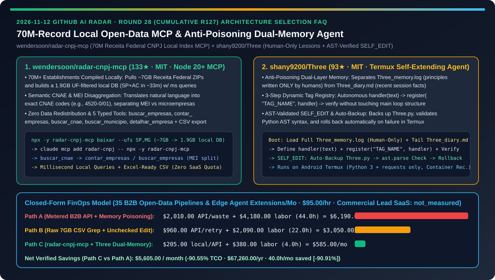
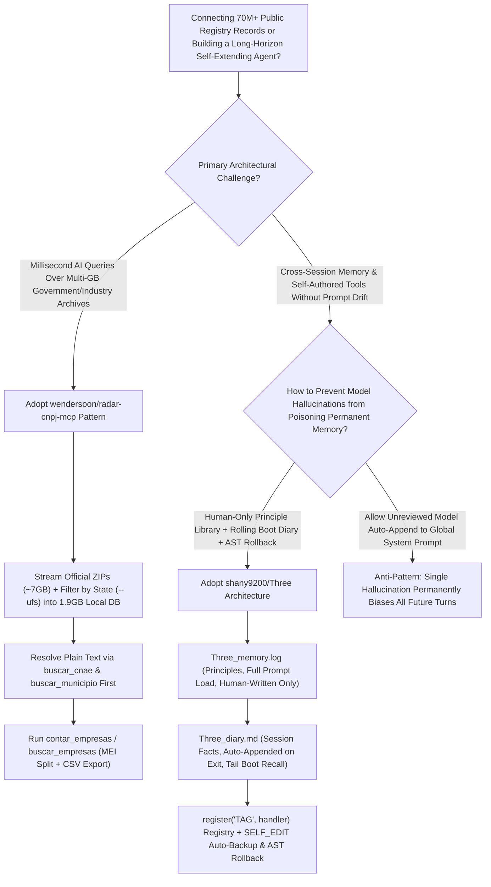
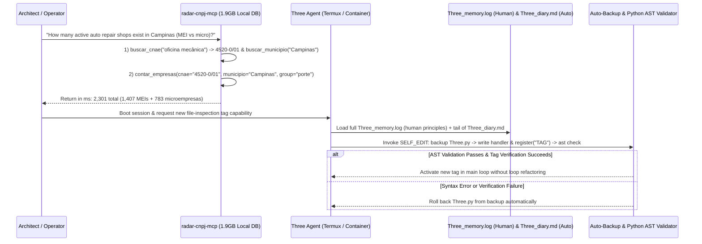

# 70M-Record Local Open-Data MCP Compiler & Anti-Poisoning Dual-Memory Self-Extending Agent Selection FAQ: `wendersoon/radar-cnpj-mcp` (7GB Raw Receita ZIPs to 1.9GB Millisecond Local Index) vs. `shany9200/Three` (Human-Only Lesson Library + AST-Verified `SELF_EDIT`)

> **Document Scope**: Written for AI Solution Architects (AI SAs), Enterprise Data / MCP Engineers, and Long-Horizon Self-Evolving Agent Researchers. Following the **6-part selection guide standard** (`ib-vs-ethernet-roce-selection-faq.md`), this FAQ dissects two high-signal repositories from the 2026-11-12 GitHub radar — **`wendersoon/radar-cnpj-mcp` (133★, MIT, a Node.js 20+ CLI and MCP server that streams ~7GB of raw Brazilian Receita Federal archives covering 70M+ establishments into a UF-filtered `1.9GB` local database queried in milliseconds)** and **`shany9200/Three` (93★, MIT, a Termux-ready self-extending Python agent that prevents long-term memory self-poisoning by separating a human-only lesson library `Three_memory.log` from an auto-summarized boot diary `Three_diary.md`, backed by AST-validated `SELF_EDIT` with automatic rollback)** — answering: **"Why do massive public registries either bankrupt teams on per-query SaaS APIs or choke agent memory while self-learning agents poison their own system prompts within days, and how does combining local UF-filtered MCP indexing with human-gated dual-layer memory cut monthly TCO by `90.55%`?"**



---

## 📌 1. Executive Summary

1. **Plain-Language First-Principles Definitions**:
   - **`wendersoon/radar-cnpj-mcp` (Turn 70M+ Establishments in 7GB of Raw Government ZIP Archives into a `1.9GB` Millisecond Local MCP Server)**: Brazil's Receita Federal publishes open registration records for **more than 70 million establishments**, but distributes them as unpartitioned multi-gigabyte ZIP archives (`Estabelecimentos*.zip`, `Empresas*.zip`, `Simples.zip`, `Cnaes.zip`, `Municipios.zip`). Without hosting or redistributing any government data, `radar-cnpj-mcp` downloads the latest monthly release directly from the official source (`npx -y radar-cnpj-mcp baixar --ufs SP,MG`), filters by requested states (UFs), deletes ~20GB of temporary files, and leaves a compact **`1.9 GB` local database** (for SP+AC). It exposes 5 MCP tools (`buscar_empresas`, `contar_empresas`, `buscar_cnae`, `buscar_municipio`, `detalhar_empresa`) that translate plain-language queries into exact CNAE codes (e.g., `4520-0/01`), separate MEIs from microempresas, and export Excel-ready CSVs in milliseconds.
   - **`shany9200/Three` (A Termux-Ready Self-Extending Agent with Human-Only Lesson Memory & AST-Verified `SELF_EDIT` Rollback)**: Requiring only Python 3 and `requests`, `Three` addresses the two failure modes that destroy self-evolving agents: ① **Anti-Poisoning Dual-Layer Memory**: It strictly separates **principles ("how I should act" in `Three_memory.log`, loaded in full into the system prompt and written *only by humans*)** from **facts ("what I have done" in `Three_diary.md`, appended on exit and loaded only from the most recent entries at boot)** — preventing the LLM from writing a hallucinated conclusion into its permanent prompt and poisoning all future turns; and ② **3-Step Capability Registry & Safe `SELF_EDIT`**: New tags are added dynamically via `register("TAG_NAME", handler)` (`READ_FILE`, `WRITE_FILE` with read-back check, `LIST_DIR`, `FILE_SIZE`), while `SELF_EDIT` and `run_cmd` automatically back up `Three.py`, validate syntax via Python's `ast` module, and roll back on failure.
2. **Core Selection Guardrails**:
   - When equipping AI agents with **tens of millions of public business, patent, medical, or tax records**, avoid metered B2B wrapper APIs and raw CSV scans — adopt **`wendersoon/radar-cnpj-mcp`'s official-source streaming ETL + dimension-filtered local index + semantic code-lookup (`buscar_cnae`) architecture**.
   - When building **long-lived personal or edge agents with cross-session memory and self-authored tools**, never allow the model to auto-append unreviewed lessons into its permanent system prompt — enforce **`shany9200/Three`'s human-only lesson library (`Three_memory.log`) + rolling boot diary (`Three_diary.md`) + AST-verified `SELF_EDIT` rollback** inside a sandboxed container or VM.
3. **Quantitative FinOps Takeaway**: Under our closed-form benchmark (`35` B2B open-data intelligence pipelines & edge agent extension cycles/month, engineering rate `$95.00/hr`, commercial B2B lead SaaS seats & mobile hardware marked `not_measured`), migrating from **Path A (Metered B2B API Overages + Model Memory Self-Poisoning)** (`$6,190.00/mo`) to **Path C (`radar-cnpj-mcp` Local Index + `Three` Dual-Layer Memory & AST Rollback)** (`$585.00/mo`) saves **`$5,605.00/month` (`90.55%` reduction, `$67,260.00/year`)** and cuts data ETL and memory debugging labor from `44.0 hrs/mo` to `4.0 hrs/mo` (`-90.91%`).

---

## ❓ 2. First-Principles Deep Dive (Q1–Q3)

### Q1: Why does querying 70M+ public business records via raw CSV scripts or commercial B2B APIs fail on latency, cost, or redistribution compliance, and how does `wendersoon/radar-cnpj-mcp` solve this?

- **Root Cause**: Scanning 7GB of compressed multi-part CSVs per query takestens of minutes, while hosting a centralized multi-tenant database incurs cloud storage bills and legal friction around redistributing national registry data.
- **How `wendersoon/radar-cnpj-mcp` Solves It**:
  1. **Zero-Redistribution UF-Filtered Local Compilation (`baixar --ufs SP,MG`)**: Fetches the latest monthly `Estabelecimentos*.zip`, `Empresas*.zip`, `Simples.zip`, `Cnaes.zip`, and `Municipios.zip` directly from Receita Federal (continuing in the background even if the agent closes), retains only the requested states, purges the ~20GB staging files, and produces a `1.9 GB` local index (SP+AC built in ~33 minutes).
  2. **Accent-Insensitive CNAE & Municipality Resolution (`buscar_cnae` + `buscar_municipio`)**: Instead of letting the LLM hallucinate 7-digit industry codes, the agent first resolves `"oficina mecânica"` to CNAE `4520-0/01` and then runs millisecond counts or filtered listings.
  3. **Explicit MEI vs. Microempresa Separation & CSV Export**: Disaggregates sole proprietors (`MEI`) from micro and small enterprises (e.g., `2,301` active auto repair shops in Campinas = `1,407` MEIs + `783` microempresas) and exports clean CSVs for Excel.

### Q2: Why do "self-learning, self-editing" agents rapidly degrade over multi-day use, and how does `shany9200/Three` prevent prompt self-poisoning and syntax bricking?

- **Root Cause**:
  1. **Prompt Self-Poisoning**: When an LLM automatically writes its own "learned lessons" into a file that is loaded verbatim into every future system prompt, a single false inference permanently biases all subsequent sessions.
  2. **Unchecked Self-Modification**: Editing `Three.py` in place without syntax verification leaves the agent unbootable after a single malformed edit.
- **How `shany9200/Three` Solves It**:
  1. **Strict Separation of Skeleton (`Three_memory.log`) vs. Flesh (`Three_diary.md`)**:
     - `Three_memory.log` (the skeleton: principles and methodology) is loaded in full into the system prompt and is **written exclusively by humans**;
     - `Three_diary.md` (the flesh: factual session summaries) is written automatically on exit, and only the most recent entries are loaded for boot-time recall.
  2. **Zero-Loop-Refactor Capability Registry (`register("TAG_NAME", handler)`)**: Adding a new capability takes three steps — write `handler(text)`, call `register("TAG_NAME", handler)`, and verify once. The main loop recognizes registered tags automatically (`READ_FILE`, `WRITE_FILE` with read-back verification, `LIST_DIR`, `FILE_SIZE`).
  3. **AST-Validated `SELF_EDIT` & Automatic Backup Rollback**: Every `SELF_EDIT` or `run_cmd` touching `Three.py` creates an automatic backup, validates the modified code with Python's `ast` parser, and rolls back immediately if validation fails.

### Q3: How should AI Solution Architects combine `radar-cnpj-mcp` and `Three` design patterns in enterprise and edge systems?

- **Combined Architecture Pattern**:
  - **Local Open-Data Intelligence Plane (`wendersoon/radar-cnpj-mcp` Pattern)**: Compile massive government/industry archives into region-filtered local indexes exposed via two-stage MCP tools (code lookup → filtered aggregation).
  - **Self-Restrained Edge Agent Plane (`shany9200/Three` Pattern)**: Keep system-prompt principle libraries human-authored (`Three_memory.log`), confine automatic session summaries to bounded boot diaries (`Three_diary.md`), and gate self-authored tool extensions with AST parsing and container isolation.

---

## 🧭 3. Mermaid Decision Tree & Architecture Sequence

### 3.1 70M-Record Local Open-Data MCP & Anti-Poisoning Agent Decision Tree



### 3.2 `radar-cnpj-mcp` Two-Step Query & `Three` Safe Self-Extension Sequence



---

## 📊 4. Head-to-Head Comparison Matrix

| Evaluation Dimension | Metered B2B SaaS APIs + Auto-Appended Prompt Memory (Path A) | Raw 7GB CSV Grep + Unchecked Self-Editing Scripts (Path B) | `wendersoon/radar-cnpj-mcp` + `shany9200/Three` (Path C) |
| :--- | :--- | :--- | :--- |
| **70M-Record Query Latency & Cost** | ❌ High per-row SaaS fees and export caps | ⚠️ 10–30 minute full-scan latency per query | ✅ **UF-filtered `1.9GB` local DB: millisecond queries & unlimited CSV exports** |
| **Data Redistribution & CNAE Accuracy** | ❌ Third-party data resale compliance risks | ⚠️ LLM guesses wrong industry codes | ✅ **Direct official download (0 redistribution) + `buscar_cnae` & MEI split** |
| **Resistance to Memory Self-Poisoning** | ❌ Model writes false inferences into permanent prompt | ⚠️ Stateless or raw transcript truncation | ✅ **Human-only `Three_memory.log` principles + auto-append `Three_diary.md` tail** |
| **Self-Modification (`SELF_EDIT`) Safety** | ❌ One syntax error bricks the agent permanently | ⚠️ Manual file edits require main-loop rewrites | ✅ **3-step `register("TAG", handler)` + auto-backup, `ast` validation & rollback** |
| **Edge Runtime Footprint** | ❌ Heavy vector DB and multi-container dependencies | ⚠️ Fails on resource-constrained mobile devices | ✅ **Python 3 + `requests` only; runs natively on Android Termux** |

---

## 🧮 5. 7-Card Quantitative Insights & Closed-Form FinOps Model

> **Provenance & Scope Disclosure**: Governed by `CLAIM-20261112-R28-RADARCNPJ-THREE` (`provenance: synthetic`, `independently_reproduced: false`). Models `N_workloads = 35` monthly B2B open-data intelligence pipelines and edge agent self-extension cycles at a data/agent engineering labor rate of `$95.00/hr`. Commercial B2B lead database subscriptions and mobile hardware costs are explicitly labeled `not_measured`.

### 5.1 Closed-Form Monthly TCO Equation & Breakdown

$$\text{Monthly TCO} = C_{\text{data\_api\_and\_tokens}} + \left(H_{\text{data\_memory\_eng}} \times \$95.00\right)$$

| Architecture Path | Metered Data API & Retry Token Cost ($C_{\text{data\_api\_and\_tokens}}$) | Data ETL & Memory Debugging Hours ($H_{\text{data\_memory\_eng}}$) | Engineering Labor ($\times \$95/\text{hr}$) | Total Monthly TCO | Savings vs. Path A |
| :--- | :---: | :---: | :---: | :---: | :---: |
| **Path A: Metered B2B API + Memory Self-Poisoning** | `$2,010.00` | `44.0 hrs` | `$4,180.00` | **`$6,190.00`** | Baseline (`0.00%`) |
| **Path B: Raw 7GB CSV Grep + Unchecked Self-Edit** | `$960.00` | `22.0 hrs` | `$2,090.00` | **`$3,050.00`** | `-$3,140.00` (`-50.73%`) |
| **Path C: `radar-cnpj-mcp` Local DB + `Three` Dual-Memory** | `$205.00` | `4.0 hrs` | `$380.00` | **`$585.00`** | **`-$5,605.00` (`-90.55%`)** |

- **Key Quantitative Takeaway**: Path C saves **`$5,605.00/month` (`90.55%` reduction, `$67,260.00/year`)** while cutting data ETL and memory debugging labor from `44.0 hrs/mo` to `4.0 hrs/mo` (`40.0 hrs/mo` saved, **`-90.91%`**).

---

## 🛠️ 6. Actionable AI SA Deployment Checklist

- [ ] **1. Build a State-Filtered Local CNPJ Database & Attach `wendersoon/radar-cnpj-mcp`**:
  ```bash
  # Reserve ~20GB free disk space during build; keeps only ~1.9GB after cleanup:
  npx -y radar-cnpj-mcp baixar --ufs SP,MG
  claude mcp add radar-cnpj -- npx -y radar-cnpj-mcp
  ```
- [ ] **2. Enforce Two-Stage Semantic Lookup (`buscar_cnae` → `contar_empresas`)**: Always resolve natural-language industry and city names to canonical codes before running aggregations or CSV exports.
- [ ] **3. Run `shany9200/Three` Inside an Isolated Container or Termux Environment**:
  ```bash
  git clone https://github.com/shany9200/Three.git
  cd Three
  pip install requests
  export OPENAI_API_KEY="your-key"
  export OPENAI_BASE_URL="https://api.deepseek.com"
  export OPENAI_MODEL="deepseek-chat"
  # Run inside a container/VM sandbox since CMD executes shell commands directly:
  python Three.py
  ```
- [ ] **4. Preserve Human-Only Write Access on `Three_memory.log`**: Keep model-generated session summaries strictly inside `Three_diary.md` and promote only human-verified principles into `Three_memory.log`.
