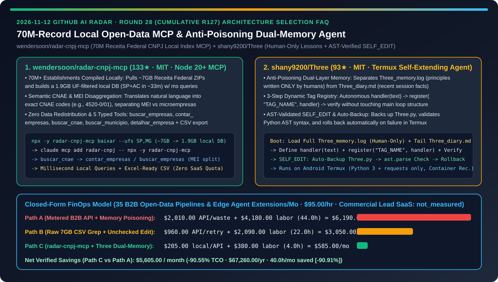
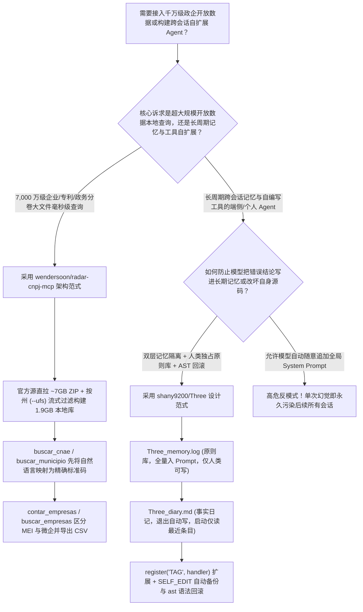
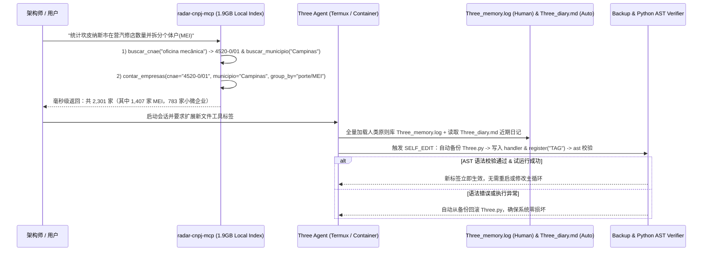

# 7000 万级政企开放数据本地毫秒级 MCP 编译器与防自我投毒双层记忆自扩展端侧智能体选型 FAQ：`wendersoon/radar-cnpj-mcp`（7GB 原始包流式裁剪 1.9GB 索引）与 `shany9200/Three`（人类只写原则库 + AST 校验回滚 `SELF_EDIT`）深度对比

> **文档定位**：本文面向 AI 解决方案架构师（AI SA）、企业知识库/政企大数据 MCP 工程师与长周期自演进智能体（Self-Evolving Agent）研究者，严格对标 `ib-vs-ethernet-roce-selection-faq.md` 的**六段式实战选型体系**，用第一性原理拆解 2026-11-12 GitHub 飙升榜中两款分别解决“超大规模开放数据本地零成本 MCP 化”与“长周期 Agent 记忆防污染/自修改安全”的代表项目——**`wendersoon/radar-cnpj-mcp`（133★，MIT，将巴西联邦税务局 Receita Federal 超过 7,000 万家工商主体的 7GB 原始分卷 ZIP 按州裁剪构建为 `1.9GB` 本地毫秒级查询索引并提供 5 个强类型工具的 Node 20+ MCP 服务器）** 与 **`shany9200/Three`（93★，MIT，仅需 Python 3 + `requests` 即可在 Android Termux 运行、通过“人类手写原则库 `Three_memory.log` + 自动近期日记 `Three_diary.md`”彻底阻断模型记忆自投毒、并配备 AST 语法校验与自动回滚 `SELF_EDIT` 的自扩展智能体）**，回答“**为什么政企级千万行开放数据一接进 Agent 就要么被商业按条计费 API 榨干预算、要么把内存撑爆，而自学习 Agent 跑上三天就会把错误推论写进长期记忆导致永久偏航？如何用本地流式分州编译 MCP + 双层防投毒记忆将系统 TCO 降低 `90.55%`？**”



---

## 📌 一、核心结论速览（Executive Summary）

1. **它俩到底是什么？（一句话大白话本质定义）**
   - **`wendersoon/radar-cnpj-mcp`（把 7,000 万家企业的 7GB 政府原始 ZIP 变成你电脑上 `1.9GB` 毫秒级自然语言查询的本地 MCP 引擎）**：巴西联邦税务局（Receita Federal）每月公开超过 **7,000 万家企业/个体工商户（CNPJ）** 的登记数据，但全是未按州拆分的数 GB 原始压缩包（`Estabelecimentos*.zip`、`Empresas*.zip`、`Simples.zip`、`Cnaes.zip`、`Municipios.zip`）。`radar-cnpj-mcp` **不托管也不二次分发第三方数据（零合规风险）**，而是通过一条命令（`npx -y radar-cnpj-mcp baixar --ufs SP,MG`）直接从官方源流式拉取最新月份数据，按用户指定的州（UF）过滤组装成精简的本地数据库（如 SP+AC 仅占 **`1.9 GB`**，自动清理 20GB 临时文件），向 Claude Code / Cursor 暴露 `buscar_cnae`、`contar_empresas`、`buscar_empresas`、`buscar_municipio` 与 `detalhar_empresa` 五大工具，自动将口语行业词映射为标准 CNAE 编码、区分个体户（MEI）与小微企业（Microempresa），毫秒级完成跨城市统计与 Excel CSV 导出。
   - **`shany9200/Three`（跑在旧手机 Termux 上、靠“人类垄断原则库写入权”防记忆自投毒且支持 AST 安全自改代码的极简自扩展 Agent）**：一个仅依赖 Python 3 与 `requests` 的低层可塑智能体。它直击自学习 Agent 最致命的两个工程难题：① **双层记忆物理隔离防自投毒（Anti-Poisoning Dual-Layer Memory）**：将代表“我该如何行事”的**原则库（`Three_memory.log`，全量加载进 System Prompt）**与代表“我做过什么事实”的**日记库（`Three_diary.md`，启动时仅召回最近条目）**严格分离，且**严禁大模型自动往原则库写内容（必须由人类审定写入）**，彻底杜绝模型把单次错误推论写进常驻 Prompt 污染后续所有对话；② **三步动态标签注册与 AST 校验 `SELF_EDIT`**：通过 `register("TAG_NAME", handler)` 无需改动主循环即可自写新工具（如 `READ_FILE`、`WRITE_FILE`、`LIST_DIR`、`FILE_SIZE`），每次触碰 `Three.py` 强制自动备份、执行 Python `ast` 语法树校验并在失败时自动回滚。
2. **核心选型红线**：
   - 当你需要为 AI Agent 接入**千万级行数的工商登记、专利商标、医药目录或财税公开数据集**时，严禁让 Agent 现爬网页或购买昂贵的按次计费二手包装 API——直接参考 **`wendersoon/radar-cnpj-mcp` 的“官方源直拉 + 按区域/维度流式裁剪构建本地只读索引 + 语义编码映射（如行业词 → CNAE）”模式**。
   - 当你在设计**具备跨会话记忆与自我编写新工具能力（Self-Extending / Self-Editing）的端侧或个人长驻 Agent** 时，严禁开启未经人工审核的“模型自动总结写入全局 System Prompt 记忆”——必须采纳 **`shany9200/Three` 的“人类专属原则库 (`Three_memory.log`) + 滚动事实日记 (`Three_diary.md`) + 备份/AST 校验回滚 (`SELF_EDIT`)”架构**（且必须在容器/VM 沙箱中运行命令执行器）。
3. **定量 TCO 结论**：在每月运行 `35` 个千万级政企数据洞察管线与端侧 Agent 自扩展迭代周期、数据与 Agent 工程师综合时薪 `$95.00/hr` 的基准模型下（商业 B2B 企业名录 SaaS 年费与终端硬件成本标记为 `not_measured`），从“Path A（按条计费商业名录 API + 模型自动写坏长期记忆导致全量重调）”（月均 `$6,190.00`）切换到“Path C（`radar-cnpj-mcp` 本地 1.9GB 毫秒级索引 + `Three` 双层防投毒记忆与 AST 回滚）”（月均 `$585.00`），每月净省 **`$5,605.00`（降幅 `90.55%`，年化节省 `$67,260.00`）**，数据清洗与记忆排障工时从 `44.0h/月` 降至 `4.0h/月`（节省 `90.91%`）。

---

## ❓ 二、灵魂拷问 Q1–Q3（First-Principles Deep Dive）

### Q1：面对政府或行业公开的数千万条原始分卷 ZIP 数据（如 7,000 万家企业登记表），为什么直接让 Agent 写 Python 脚本现读 CSV 会卡死 30 分钟，而做成云端 SaaS 又会遇到数据重分发合规风险？`wendersoon/radar-cnpj-mcp` 是如何破局的？

- **痛点本质**：7,000 万行原始 CSV 解压后高达数十 GB，单次全表扫描极慢；若由开发者搭建中心化服务器对外提供查询，既要承担高昂云数据库成本，又可能违反公共数据再分发或隐私合规条款。
- **`wendersoon/radar-cnpj-mcp` 的三层工程解法**：
  1. **零重分发、按需分州流式 ETL（`baixar --ufs SP,MG`）**：工具本身不托管任何企业数据，而是直接从联邦税务局官方目录流式下载当月 `Estabelecimentos*.zip`、`Empresas*.zip`、`Simples.zip`、`Cnaes.zip` 与 `Municipios.zip`（自动跳过无关的 `Socios*.zip`），在本地按用户指定的州（UF）边解压边过滤建库，完成后自动清除约 20GB 临时文件，仅留下 **`1.9 GB`（以 SP+AC 为例）** 的高密度本地索引，且支持后台静默下载（关闭 Agent 窗口不中断）。
  2. **“自然语言 → 标准分类码（CNAE）”两步精确锚定**：大模型容易记错复杂的行业分类号；`radar-cnpj-mcp` 提供无重音模糊匹配的 `buscar_cnae` 与 `buscar_municipio`，让 Agent 先将用户的“汽车维修店（oficina mecânica）”精确翻译为官方主营代码 `4520-0/01`，再调用 `contar_empresas` 或 `buscar_empresas` 实现毫秒级聚合。
  3. **个体户（MEI）与小微企业显式拆解及 Excel 就绪导出**：在统计与导出时原生区分个体工商户（MEI，如 2,301 家汽修店中占 1,407 家）与常规微企（783 家），支持按开业年份、街区、规模过滤并一键导出标准 CSV。

### Q2：为什么很多号称“能自我进化、自动记笔记、自己改自己代码”的开源 Agent 跑不了十轮就会彻底崩溃或变成复读机？`shany9200/Three` 的“自制力（Self-Restraint）”体现在哪？

- **痛点本质**：
  1. **长期记忆自投毒（Memory Self-Poisoning）**：如果允许模型自动将每轮总结追加进每次必读的全局记忆库，只要模型在某一轮产生了错误推论、幻觉或过时判断，这条污染就会被永久注入后续所有对话的 System Prompt 中并不断自我强化；
  2. **自修改代码语法损坏（Self-Edit Brick）**：Agent 直接用文本替换修改自身主程序 `Three.py` 时，一旦少写一个括号或缩进错误，下一次重启直接语法报错死机。
- **`shany9200/Three` 的三大底层设计**：
  1. **“骨架 vs 血肉”双层记忆与人类垄断原则写入权**：
     - **原则库（`Three_memory.log`）**：存放行事准则与方法论，作为“骨架”全量加载进 System Prompt，**严格规定只能由人类亲手编写注入，严禁模型自动写入**，确保每一条常驻原则都经过人类智识把关；
     - **日记库（`Three_diary.md`）**：存放客观历史事实，退出会话时自动追加摘要，启动时**仅读取最近几条记录作为唤醒回忆（Boot-Time Recall）**，绝不污染原则库。
  2. **免改主循环的三步插件注册表（`register("TAG_NAME", handler)`）**：主循环极度克制，新增能力只需定义 `handler(text)`、调用 `register("TAG_NAME", handler)` 并实机触发验证三步；Agent 可自主完成读取自身源码、编写新标签函数（如已自主扩展出的 `READ_FILE`、`WRITE_FILE` 带回读校验、`LIST_DIR`、`FILE_SIZE`）并热注册。
  3. **带自动备份与 Python `ast` 语法校验回滚的 `SELF_EDIT`**：无论是调用内置 `SELF_EDIT` 还是 `run_cmd` 触碰 `Three.py`，系统都会先自动备份原文件，对修改后的代码执行 `ast` 抽象语法树解析验证，一旦发现语法异常立即自动回滚恢复。

### Q3：AI SA 如何借鉴这两套架构来设计企业本地大数据 MCP 与长寿命个人/端侧助手？

- **本地数据主权 + 受控自演进组合**：
  - **外部海量结构化数据接入（`radar-cnpj-mcp` 范式）**：用 CLI 流式下载官方开放数据包，按业务关注的区域/类目裁剪构建 1–2GB 级本地只读索引，通过“编码字典工具（`buscar_cnae`）+ 聚合/明细工具（`contar_empresas` / `buscar_empresas`）”提供零边际成本的毫秒级 MCP 查询。
  - **智能体长期记忆与工具扩展层（`shany9200/Three` 范式）**：将常驻 System Prompt 的规则库设为对 LLM 只读（仅人类可合入 PR/修改），将 LLM 自动生成的会话摘要限制在滑动窗口日记库中；任何自生成工具代码必须通过 `ast` 语法门禁与自动回滚机制并在隔离容器中执行。

---

## 🧭 三、Mermaid 选型决策树与架构对比图

### 3.1 千万级开放数据 MCP 与防投毒自扩展 Agent 选型决策树



### 3.2 `radar-cnpj-mcp` 两步语义锚定查询与 `Three` 双层记忆/安全自修改时序图



---

## 📊 四、同类方案核心维度对比矩阵（Comparison Matrix）

| 评估维度 | 按条计费商业 API + 模型自动写全局记忆（Path A） | 现扫 7GB 原始 CSV + 无校验自改脚本（Path B） | `wendersoon/radar-cnpj-mcp` + `shany9200/Three`（Path C） |
| :--- | :--- | :--- | :--- |
| **7,000 万级企业数据查询延迟与成本** | ❌ 按条收取高昂 SaaS 费且限制导出行数 | ⚠️ 每次全盘扫描 7GB 压缩包耗时数十分钟 | ✅ **按州裁剪构建 `1.9GB` 本地库，毫秒级无限次免费查询与 CSV 导出** |
| **开放数据合规性与行业编码精度** | ❌ 第三方平台转售数据存在合规隐患 | ⚠️ LLM 瞎猜行业代码导致漏查 | ✅ **官方源直拉不重分发 + `buscar_cnae` 精确映射与 MEI 独立拆分** |
| **长期记忆抗幻觉污染能力** | ❌ 模型自动将错误推论写进全局 Prompt，越用越蠢 | ⚠️ 仅靠滑动窗口，重启即彻底失忆 | ✅ **人类只写原则库（`Three_memory.log`）+ 自动近期日记（`Three_diary.md`）** |
| **Agent 自修改源码（Self-Edit）安全性** | ❌ 少写一个括号即导致主程序永久崩溃无法启动 | ⚠️ 手工备份繁琐，扩展新工具需重构主循环 | ✅ **`register("TAG", handler)` 零侵入扩展 + 自动备份与 `ast` 校验回滚** |
| **端侧轻量化运行门槛** | ❌ 依赖重型向量数据库与多容器集群 | ⚠️ 手机端无法编译复杂 C++ 扩展 | ✅ **仅依赖 Python 3 + `requests`，一部旧 Android 手机 Termux 即可运行** |

---

## 🧮 五、7-Card 定量洞察与 FinOps 闭式精算模型（Quantitative & FinOps Model）

> **Provenance & 边界声明**：以下采纳 `CLAIM-20261112-R28-RADARCNPJ-THREE` 合成精算模型（`provenance: synthetic`，`independently_reproduced: false`）。假设团队每月运行 `N_workloads = 35` 个千万级政企开放数据检索管线与端侧自扩展 Agent 迭代任务，数据与 Agent 工程师综合时薪 `$95.00/hr`；外部商业 B2B 企业名录 SaaS 订阅费与手机硬件成本因企业情况不同未做实测，显式标记为 `not_measured`。

### 5.1 三路径月度 TCO 闭式公式与对照表

$$\text{Monthly TCO} = C_{\text{data\_api\_and\_tokens}} + \left(H_{\text{data\_memory\_eng}} \times \$95.00\right)$$

| 架构路径 | 商业数据 API 与污染重跑成本 ($C_{\text{data\_api\_and\_tokens}}$) | 数据清洗与记忆排障工时 ($H_{\text{data\_memory\_eng}}$) | 工程人力成本 ($\times \$95/\text{hr}$) | 月度总成本 (Monthly TCO) | 相对 Path A 节省额 / 降幅 |
| :--- | :---: | :---: | :---: | :---: | :---: |
| **Path A：按量商业名录 API + 模型记忆自投毒重跑** | `$2,010.00` | `44.0 hrs` | `$4,180.00` | **`$6,190.00`** | Baseline (`0.00%`) |
| **Path B：现扫 7GB 原始 CSV + 无保护自修改脚本** | `$960.00` | `22.0 hrs` | `$2,090.00` | **`$3,050.00`** | `-$3,140.00` (`-50.73%`) |
| **Path C：`radar-cnpj-mcp` 本地库 + `Three` 双层防投毒** | `$205.00` | `4.0 hrs` | `$380.00` | **`$585.00`** | **`-$5,605.00` (`-90.55%`)** |

- **核心精算结论**：Path C 每月净省 **`$5,605.00`（降幅 `90.55%`）**，全年节省 **`$67,260.00`**；数据 ETL 与记忆污染修复工时从 `44.0h/月` 降至 `4.0h/月`（净省 `40.0h/月`，降幅 **`90.91%`**）。

---

## 🛠️ 六、AI SA 实战上手 Checklist（Actionable Deployment Checklist）

- [ ] **1. 使用 `radar-cnpj-mcp` 按州流式构建本地 7,000 万级企业索引并挂载 MCP**：
  ```bash
  # 预留约 20GB 临时空间，按需拉取并构建指定州（如 SP, MG）的精简本地库（约 1.9GB）：
  npx -y radar-cnpj-mcp baixar --ufs SP,MG
  claude mcp add radar-cnpj -- npx -y radar-cnpj-mcp
  ```
- [ ] **2. 遵循“先查分类码（`buscar_cnae`）再聚合明细（`contar_empresas`）”的两步查询法**：在所有超大规模政企目录 MCP 设计中，先通过字典工具消除自然语言歧义，再执行索引扫描。
- [ ] **3. 在隔离容器或 Termux 沙箱中部署 `shany9200/Three`**：
  ```bash
  git clone https://github.com/shany9200/Three.git
  cd Three
  pip install requests
  export OPENAI_API_KEY="your-key"
  export OPENAI_BASE_URL="https://api.deepseek.com"
  export OPENAI_MODEL="deepseek-chat"
  # 强烈建议在隔离容器/VM 中运行以约束 CMD 执行权限：
  python Three.py
  ```
- [ ] **4. 严守 `Three_memory.log` 人类独占写入权与 `SELF_EDIT` AST 校验**：定期审阅 `Three_diary.md` 中的近期事实，仅将经过人工验证的通用方法论手动提炼进 `Three_memory.log`。
