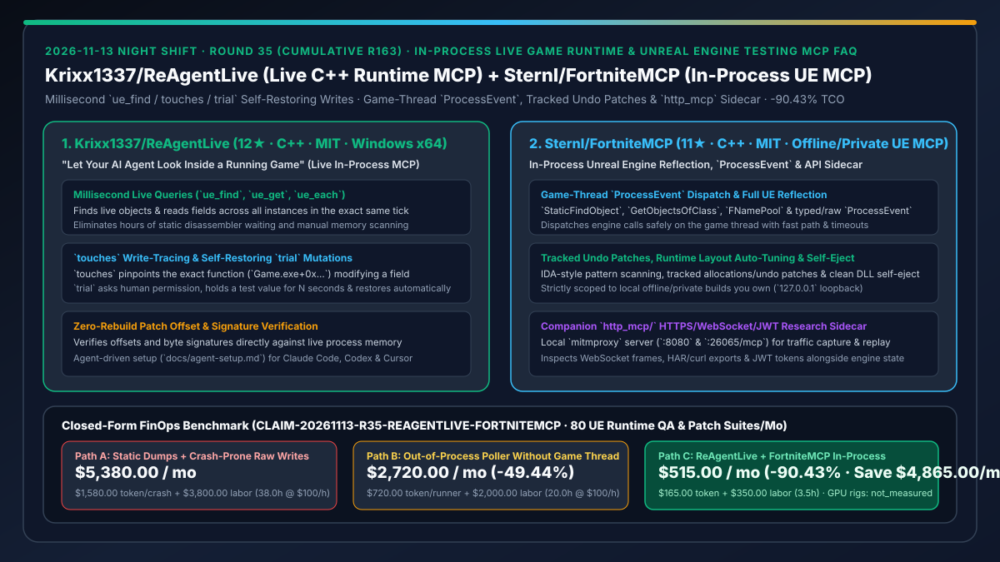
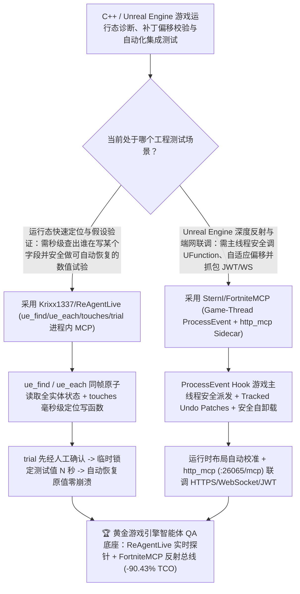

# 进程内毫秒级游戏运行态探针与自动回滚试验 MCP（`Krixx1337/ReAgentLive`）与 Unreal Engine 离线构建反射/线程安全测试 MCP（`SternI/FortniteMCP`）深度选型 FAQ

> **文档定位**：本专题是 **2026-11-13 夜班第 35 轮（累计第 163 篇）独立六段式选型指南**，严格对标 `ib-vs-ethernet-roce-selection-faq.md` 的通俗第一性原理与闭式 FinOps 核算规范，面向游戏引擎自动化 QA 架构师、C++ 运行时调试工具负责人与 AI Solution Architect，深度拆解今日新仓榜上解决“Coding Agent 调 C++/虚幻引擎游戏 Bug 时只能干等几小时静态反汇编或盲写内存把游戏搞崩”的两大进程内（In-Process）运行态 MCP 框架：
> 1. **`Krixx1337/ReAgentLive`（2 天新建获 `12★`，C++，MIT，Windows x64 进程内 MCP + 配套技能）**：“让 AI 智能体从正在运行的游戏内部实时观察与安全试验”的毫秒级探针——提供 `ue_find`（定位运行态对象）、`ue_get`（读取字段值）、`ue_each`（在同一游戏 Tick 内批量读取所有同类实体字段）、`touches`（毫秒级抓出正在改写该内存字段的函数地址如 `Game.exe+0x9A3F10`）与 **`trial`（征得人类确认后临时修改数值 N 秒并自动恢复原值，零残留、零崩溃重启）**！
> 2. **`SternI/FortniteMCP`（2 天新建获 `11★`，C++，MIT，严格限定用于自有离线/私有构建测试）**：面向 Unreal Engine（UE / UE6）研究与自动化测试的进程内 `FortniteMCP.dll` 与 `http_mcp/` 网络旁路双 MCP 服务——支持完整 UE 反射（`StaticFindObject`、`GetObjectsOfClass`、`FNamePool` 解析）、**通过 `ProcessEvent` Hook 将引擎调用安全派发至游戏主线程（Game-Thread Dispatch，带快速路径与超时保护）**、可追踪一键撤销内存补丁（Tracked Undo Patches）、运行时内存布局自适应校准、响应安全自卸载（Self-Eject），以及基于 `mitmproxy` 的本地 HTTP/WebSocket/JWT 抓包重放 Sidecar（`:26065/mcp`）！
>
> **English Version**: [reagentlive-fortnitemcp-inprocess-game-runtime-inspection-ue-testing-mcp-selection-faq.en.md](reagentlive-fortnitemcp-inprocess-game-runtime-inspection-ue-testing-mcp-selection-faq.en.md) · **关联日报**: [`daily/2026-11-13.md`](../daily/2026-11-13.md) · **专题架构图**: [`assets/github-ai-radar-2026-11-13-r35-reagentlive-fortnitemcp.svg`](../../../assets/github-ai-radar-2026-11-13-r35-reagentlive-fortnitemcp.svg)

---

## 📌 一、核心结论速览（Executive Summary）

1. **一句话大白话讲透这两个项目到底解决了什么痛点？**
   - **终结“让 Coding Agent 排查大型 C++/UE 游戏运行时状态异常时，要么对着静态代码/转储文件（Dump）瞎猜，要么花几个小时等反汇编器跑完交叉引用，或者贸然往内存里写个测试值直接把游戏干崩重启”的痛点（`Krixx1337/ReAgentLive`）**：把 `ReAgentLive` 注入正在跑的本地测试进程后，Agent 拥有了毫秒级“透视眼”：用 `ue_find` / `ue_each` 在**同一个游戏帧（Tick）**内读出全图 12 个单位的血量，用 `touches` 几毫秒抓出到底是哪个伤害函数在改写 `HealthComp+0x1A8`，再用 **`trial` 先问你同不同意、同意后把数值锁定 30 秒做完实验自动归位**，全程不用重新编译、不用重启游戏！
   - **终结“在外部进程用脚本读写虚幻引擎（Unreal Engine）对象或直接调 `UFunction` 时，因为跨线程竞态直接引发引擎崩溃，或者游戏发了个小补丁偏移量一变整套自动化测试全废”的痛点（`SternI/FortniteMCP`）**：专门针对自有离线/私有构建测试设计，把所有引擎函数调用通过 `ProcessEvent` Hook **安全调度到游戏主线程（Game Thread）执行**（带超时防卡死），支持运行时布局自动校准（Runtime Layout Auto-Tuning）、可追踪撤销补丁与免重启安全自卸载（Self-Eject），还附带一个 `http_mcp/` 本地 `mitmproxy` 旁路服务同时审查客户端 HTTPS/WebSocket/JWT 报文！
2. **闭式 FinOps 投资回报结论（`CLAIM-20261113-R35-REAGENTLIVE-FORTNITEMCP`）**：
   - 以 **游戏引擎自动化 QA 与客户端安全团队每月执行 `80 轮 Unreal Engine 运行态回归测试与补丁偏移校验`** 为基准（C++ 引擎与自动化测试工程师全包时薪 `$100.00/hr`；测试机房 GPU 主机硬件与商业反编译器年费：`not_measured`）：
   - 从 **Path A（静态转储苦等数小时 + 盲写内存频繁崩溃重启，月均 `$5,380.00`）** 升级至 **Path C（`ReAgentLive` 毫秒级 `touches`/`trial` 自恢复探针 + `FortniteMCP` 游戏主线程 `ProcessEvent` 与可撤销补丁，月均 `$515.00`）**，每月净省 **`$4,865.00/mo`（降幅 `-90.43%`，年省 `$58,380.00/yr`）**，并将静态分析等待、手动扫内存与崩溃重启工时从 `38.0 hrs/mo` 压缩至 `3.5 hrs/mo`（节省 **`-90.79%`**）。

---

## 🎯 二、三大灵魂拷问（Q1 / Q2 / Q3 深度原理解析）

### Q1：为什么传统的“静态源码/Dump 分析 + 进程外内存轮询”在大型 C++ / Unreal Engine 自动化测试中效率极低？
- **第一性原理拆解**：
  1. **静态偏移与运行态多态实例脱节**：数十 GB 的游戏二进制在静态反汇编器中分析字符串与交叉引用动辄数小时，且看不见当前局内动态生成的 `UObject` 实例树。
  2. **非游戏主线程调用与裸写内存必崩**：在外部线程直接调用虚幻引擎 `UFunction` 或未经保护地改写标志位，极易破坏引擎 GC 或触发访问违例（Access Violation），每次崩溃重启都要浪费数分钟加载地图。

### Q2：`Krixx1337/ReAgentLive` 是如何用 `ue_each`、`touches` 与 `trial` 构建安全闭环实验的？
- **第一性原理拆解**：
  1. **同帧原子读取（Same-Tick `ue_each`）与毫秒级写追踪（`touches`）**：
     - 在同一游戏 Tick 内遍历读取所有实体属性，消除跨帧竞态；通过 `touches` 立即定位正在写入目标字段的指令地址（如 `Game.exe+0x9A3F10`）。
  2. **人工授权 + 自动复原的 `trial` 机制**：
     - 任何试验性写入（如临时修改状态标志或属性）先向开发者请求确认，维持指定秒数验证行为后自动还原原始字节，确保进程零污染。

### Q3：`SternI/FortniteMCP` 是如何保障离线虚幻引擎测试的“线程安全、版本自适应与网络全栈可观测”的？
- **第一性原理拆解**：
  1. **游戏主线程 `ProcessEvent` 派发与可撤销内存账本**：
     - 所有 `UFunction` 调用均经由 `ProcessEvent` Hook 排队至游戏主线程安全执行（含超时熔断）；所有内存补丁与分配均被追踪（Tracked Undo Patches），测试完毕支持一键还原并安全卸载 DLL（Response-Safe Self-Eject）。
  2. **`http_mcp/` 本地网关协议联调与严格合规边界**：
     - 配套 `127.0.0.1:26065/mcp` 的 `mitmproxy` 服务同步捕获并重放客户端 HTTPS / WebSocket / JWT 流量；且加载器在代码层面严格限制仅连接本机自启的离线/私有测试进程（零反作弊绕过、零公网注入）。

---

## 🧭 三、Mermaid 选型决策树与「ReAgentLive 毫秒探针 + FortniteMCP 虚幻测试底座」架构图

---

## 📊 四、同类方案核心能力对比矩阵（Selection Matrix）

| 评估维度 | Path A：静态 Dump 分析 + 裸写内存崩溃重启 | Path B：进程外轮询脚本 + 手工维护偏移表 | **Path C（推荐）：`ReAgentLive` + `FortniteMCP`（离线测试）** |
| :--- | :--- | :--- | :--- |
| **运行态对象定位与写函数追踪耗时** | 静态反汇编分析需数小时，手工扫内存慢 | 仅能读已知固定地址，无法反查写指令 | **毫秒级 `ue_find` / 同帧 `ue_each` + `touches` 即时定位写函数** |
| **试验性修改安全性与状态恢复** | 裸写极易崩溃重启，或脏状态污染后续测试 | 需手工记录原值并手动写回 | **`trial` 自动定时复原 + `Tracked Undo Patches` + 免重启 DLL 安全自卸载** |
| **Unreal Engine `UFunction` 调用安全性** | 无法调用或跨线程强调直接引发引擎崩溃 | 缺乏游戏主线程同步机制 | **经 `ProcessEvent` Hook 在游戏主线程安全派发（含快速路径与超时保护）** |
| **版本补丁偏移适配与客户端网络联调** | 每次更新需重新编译注入 | 手工修偏移配置 | **运行时布局自动校准（Auto-Tuning）+ `http_mcp/` 本地 HTTPS/WS/JWT 联调** |
| **月度总拥有成本（80 轮引擎回归测试）** | **`$5,380.00 / mo`**（`$1,580` Token + `$3,800` 工时） | **`$2,720.00 / mo`**（`$720` Token + `$2,000` 工时） | **`$515.00 / mo`（净省 `$4,865.00/mo` · `-90.43%`）** |

---

## 🧪 五、定量 FinOps 算例与 7-Card 洞察（`CLAIM-20261113-R35-REAGENTLIVE-FORTNITEMCP`）

### 5.1 测算基准与显式边界（Scope & Boundaries）
- **场景设定**：游戏引擎研发与自动化 QA 团队每月在自有离线/私有测试包上执行 **80 轮运行态状态核验、伤害/物理逻辑回归与版本补丁偏移校准**。
- **费率假设**：C++ 游戏引擎与 QA 自动化工程师全包时薪 **`$100.00 / hr`**。
- **显式边界声明（Explicit Not-Measured Boundary）**：Windows GPU 测试机硬件折旧与商业反编译器许可证年费标记为 **`not_measured`**，本表严格核算 Agent 调试会话 Token 支出，以及工程师等待静态反汇编、手工扫描内存与重启崩溃测试客户端的工时。

### 5.2 三路径月度成本闭式对照表

| 成本分项 | Path A：静态 Dump + 裸写内存崩溃重启 | Path B：进程外轮询 + 手工修偏移 | **Path C：`ReAgentLive` + `FortniteMCP`（推荐）** |
| :--- | :--- | :--- | :--- |
| **月度运行态诊断与回归测试 LLM Token 支出** | **`$1,580.00`**（盲猜 Dump 重试 + 崩溃重跑上下文） | **`$720.00`**（偏移失效重试开销） | **`$165.00`**（毫秒级精确反射与 `touches` 一步到位） |
| **静态分析等待、扫内存与崩溃重启工时（`$100/hr`）** | `38.0 hrs × $100.00` = **`$3,800.00`** | `20.0 hrs × $100.00` = **`$2,000.00`** | `3.5 hrs × $100.00` = **`$350.00`** |
| **月度总成本（Monthly TCO）** | **`$5,380.00 / mo`** | **`$2,720.00 / mo`**（`-49.44%`） | **`$515.00 / mo`** |
| **相对 Path A 净节省** | 基准线（Baseline） | 净省 `$2,660.00 / mo` | **净省 `$4,865.00 / mo`（`-90.43%` · 年省 `$58,380.00/yr`）** |
| **GPU 测试机硬件与商业反编译器授权** | `not_measured` | `not_measured` | `not_measured` |

---

## 🛠️ 六、生产级落地核验 Checklist

- [ ] **1. 授权边界确认（仅限自有离线/私有测试包）**：严格确保 `ReAgentLive` 与 `FortniteMCP` 仅在团队自有、关闭反作弊的本地离线测试构建（`127.0.0.1`）上运行。
- [ ] **2. `Krixx1337/ReAgentLive` 编译与 `trial` 自动恢复验证**：按 `docs/agent-setup.md` 编译并注册 MCP 工具，测试 `ue_find`、`ue_each`、`touches` 及带自动复原的 `trial` 写入。
- [ ] **3. `SternI/FortniteMCP` 主线程 `ProcessEvent` 与自卸载测试**：验证 `StaticFindObject` 与 `ProcessEvent` 在游戏主线程无崩溃执行，并测试 Tracked Undo Patches 一键回滚与 DLL 安全自卸载（Self-Eject）。
- [ ] **4. `http_mcp/` 客户端 API 联调验证**：启动 `http_mcp\start.cmd`（`:8080` 代理 + `:26065/mcp`），核验客户端网络请求、WebSocket 帧与引擎内部状态同步可查。
