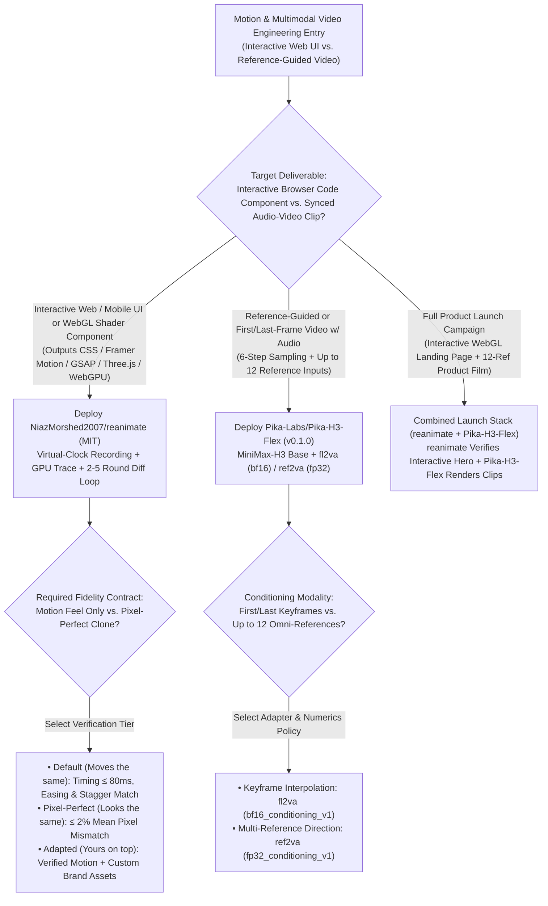

# Virtual-Clock UI Motion Reverse-Engineering & 6-Step Multi-Reference Audio-Video Inference Selection FAQ: `NiazMorshed2007/reanimate` + `Pika-Labs/Pika-H3-Flex` (`v0.1.0`) vs. Blind Screenshot Coding & 50-Step Silent Video Diffusion

> **Document Scope**: A first-principles architecture and FinOps selection guide for AI Solution Architects, Design Engineering Leads, and Multimodal Audio-Video Inference Architects. Focusing on two standout motion and video inference repositories from the `2026-11-09` GitHub AI Radar — **`NiazMorshed2007/reanimate`** (MIT, **1,482 Stars** / **1,483 Stars** live API in 11 days, **`135 Stars/day`** lifecycle velocity, `stars_today = not_measured`) and **`Pika-Labs/Pika-H3-Flex`** (`v0.1.0` `pika-h3-pro`, Code License: Apache-2.0, **1,742 Stars** / **1,758 Stars** live API in 11 days, **`158 Stars/day`** lifecycle velocity, `stars_today = not_measured`) — this guide dissects how a **5-Stage Virtual-Clock WebGL/CSS Verification Loop (`<= 80 ms` timing / `<= 2%` pixel mismatch)** and **6-Step Synchronized Audio-Video Generation with 12-Reference `fp32` Conditioning (`fl2va` / `ref2va`)** eliminate single-pass UI animation misses and 50-step silent diffusion rework.
>
> **Navigation**: [中文版 (`reanimate-pika-h3-flex-motion-video-selection-faq.md`)](./reanimate-pika-h3-flex-motion-video-selection-faq.md) · [2026-11-09 Daily Radar](../daily/2026-11-09.en.md) · [Back to Radar Index](../README.en.md)

---

## 📌 1. Executive Summary

1. **First-Principles Definition**:
   - **`NiazMorshed2007/reanimate` (Bun 1.1+ + Playwright Chromium + FFmpeg, MIT)** is a Claude Code skill (`/reanimate`) that reverse-engineers interactive animations from live URLs (`stripe.com`, `vercel.com`, `clerk.com`), screen recordings, `.mp4`, `.gif`, or Lottie files and proves the rebuilt component moves the same. Instead of guessing from a static screenshot, it runs a **5-stage closed loop (`Record → Spec → Build → Verify → Repeat 2–5 rounds`)** on a **deterministic Virtual Clock** that captures CSS/Web Animations API transitions, per-frame element positions, and **Canvas/WebGL/WebGPU calls (shaders, uniforms, draw calls, Three.js scenes)** — iterating until timing matches within **`<= 80 ms`** (`Moves the same` default) or **`<= 2%` mean pixel mismatch** (`Looks the same`).
   - **`Pika-Labs/Pika-H3-Flex` (`v0.1.0` `pika-h3-pro`, Python 3.12 + PyTorch 2.13+cu129 + PEFT 0.20, Code License: Apache-2.0)** is Pika Labs' post-trained `MiniMaxAI/MiniMax-H3` inference pipeline that generates **native `480p / 768p` video with synchronized stereo audio in just `6 sampling steps`** locally (extendable to 4K and isolated audio stems via Pika API). It ships with two SHA-256-pinned LoRA adapters in `release.json`: **`fl2va` (`bf16_conditioning_v1`)** for first/last-frame interpolation and **`ref2va` (`fp32_conditioning_v1`)** supporting **up to 12 omni-reference inputs**.
2. **Core Architectural Insight (Why Single-Pass Screenshot Prompts & 50-Step Silent Diffusion Fail in Production)**:
   - **Failure Mode #1 (Static Screenshots Cannot Capture Easing Curves, Stagger Delays, or WebGL Uniforms)**: Asking a coding agent to rebuild a Stripe 3D card tilt or Vercel's 262,144-dot WebGPU fluid ocean from a URL or screenshot yields a broken one-pass guess. `reanimate` hooks the browser's virtual clock and GPU pipeline, builds a per-property `Spec` table, films the rebuilt code along the exact same pointer path, and iterates 2–5 rounds until verified (`417/417` identical frames on Vercel Toolbar; `0.4 px` tilt delta on Stripe card; `anonymized_reported (independently_reproduced=false)`).
   - **Failure Mode #2 (50-Step Video-Only Diffusion Burns 8.3x Compute, Lacks Sound, and Collapses Multi-Reference Precision in `bf16`)**: `Pika-H3-Flex` slashes diffusion sampling from 50 steps to **6 steps** while synthesizing synchronized stereo audio in the same pass, and enforces **`fp32_conditioning_v1`** on its 12-reference `ref2va` adapter so multi-reference cross-attention embeddings never suffer `bf16` mantissa underflow.
3. **30-Second Selection Rule**:
   - Choose **`NiazMorshed2007/reanimate`** when you need to **reverse-engineer and adapt interactive web animations into production CSS, Framer Motion, GSAP, Three.js, WebGL2, or WebGPU code with frame-verified fidelity**.
   - Choose **`Pika-Labs/Pika-H3-Flex` (`v0.1.0`)** when you need **6-step reference-guided (`1–12` references) or first/last-frame video generation with synchronized stereo audio**.

---

## 🎯 2. Architect's First-Principles Deep Dive (Q1 / Q2 / Q3)

### Q1: How does `NiazMorshed2007/reanimate` use a deterministic Virtual Clock and GPU call tracing to prove a rebuilt UI/WebGL animation matches the original?

Inspecting `README.md`, `skills/`, and `site/` in `NiazMorshed2007/reanimate` reveals a 5-stage closed-loop verification architecture:

1. **Stage 1: Deterministic Virtual-Clock Recording & GPU Tracing (`Record`)**:
   - Standard screen recordings suffer from non-deterministic frame drops. `reanimate` drives headless Playwright Chromium on a **Virtual Clock** at a locked viewport, frame rate, and synthetic pointer trajectory.
   - It records numbered frames, enumerates every CSS and Web Animations API animation, tracks per-frame bounding boxes of target elements, and **traces Canvas/WebGL2/WebGPU calls (vertex/fragment shaders, uniform trajectories, draw calls, and Three.js scene graphs)**.
2. **Stages 2 & 3: Property-Level `Spec` Table & Native-Stack `Build`**:
   - Compiles a structured `Spec` table with one row per element per animated property (`start`, `duration`, `from → to`, `easing`, `stagger`, marking uninspected frames with `"?"`), then authors the component in the target repo's existing stack (CSS, Framer Motion, GSAP, Three.js, WebGL2, or WebGPU + Web Workers).
3. **Stages 4 & 5: Side-by-Side Virtual-Clock Verification (`Verify & Repeat`)**:
   - Films the rebuilt component on the identical virtual clock and pointer path, computes timing, easing, and pixel diffs across side-by-side contact sheets, and iterates **2 to 5 rounds** against three explicit fidelity contracts:
     - **`Moves the same` (default)**: Matches trigger, order, stagger, easing family, and timing within **`<= 80 ms`**;
     - **`Looks the same` (`pixel-perfect`)**: Matches fonts, colors, spacing, and assets within **`<= 2%` mean pixel mismatch**;
     - **`Yours on top`**: Locks cloned motion while isolating custom brand modifications.

### Q2: Why does `Pika-Labs/Pika-H3-Flex` (`v0.1.0`) enforce distinct numerics policies (`bf16_conditioning_v1` vs. `fp32_conditioning_v1`) across its `fl2va` and `ref2va` adapters in `release.json`?

Inspecting `pyproject.toml` (`pika-h3-pro v0.1.0`) and `release.json` in `Pika-Labs/Pika-H3-Flex` highlights three production inference patterns:

1. **Commit-Pinned Base & SHA-256 Adapter Integrity**:
   - Pins the base model `MiniMaxAI/MiniMax-H3` (`revision: 42ed227ee7df40d41602854ae760620d6eb651fe`), `diffusers` commit (`3a2f35d4...`), and exact SHA-256 hashes for both PEFT (`peft==0.20.0`) safetensor adapters.
2. **Precision-Matched Conditioning (`bf16` for 2-Frame vs. `fp32` for 12-Reference)**:
   - **`fl2va` (`pika-flex-fl2va-v1`, `sha256: 8ed6115d...`)**: Interpolates between a first and last frame using **`numerics_policy: "bf16_conditioning_v1"`**.
   - **`ref2va` (`pika-flex-ref2va-v1`, `sha256: eef684ba...`)**: Accepts **up to 12 simultaneous omni-reference inputs** (character identity, wardrobe, props, environment, camera layout). Combining 12 reference conditioning tensors in `bf16` risks precision loss across secondary references; therefore `ref2va` enforces **`numerics_policy: "fp32_conditioning_v1"`**.
3. **6-Step Local Iteration with Synchronized Stereo Audio**:
   - Synthesizes `480p / 768p` video + mixed stereo audio in **6 sampling steps** locally (`torch==2.13.0+cu129`), with optional hosted API extensions for `1080p / 2K / 4K` upscaling and isolated audio stems.

### Q3: How should a product and creative engineering team combine `reanimate` and `Pika-H3-Flex`?

- **Interactive DOM / WebGL / WebGPU Components (`NiazMorshed2007/reanimate`)**: Use `/reanimate` to build interactive 60fps hero sections, hover cards, and shader backgrounds that run natively in the user's browser.
- **Multi-Reference Narrative & Product Video Clips (`Pika-Labs/Pika-H3-Flex`)**: Use `pika-h3-pro` (`ref2va` / `fl2va`) to generate 6-step reference-locked video showcases with synchronized stereo audio.

---

## 🧭 3. Mermaid Decision Tree & Execution Sequence

### 3.1 Interactive Motion & Audio-Video Inference Decision Tree

### 3.2 End-to-End Execution Sequence (`reanimate` Virtual Clock + `Pika-H3-Flex` 6-Step Inference)

```mermaid
sequenceDiagram
    autonumber
    participant User as Design Engineer / Creative Lead
    participant RA as NiazMorshed2007/reanimate<br/>(Bun + Playwright Virtual Clock)
    participant Pika as Pika-Labs/Pika-H3-Flex<br/>(pika-h3-pro v0.1.0)
    participant GPU as Local CUDA 12.9 GPU<br/>(PyTorch 2.13 + PEFT 0.20)

    rect rgb(40, 16, 42)
    Note over User,RA: Track 1: Interactive Web / WebGL Motion Verification (reanimate)
    User->>RA: 1. /reanimate the hero entrance on https://example.com into Hero.tsx
    RA->>RA: 2. Record: Capture frames on Virtual Clock + extract CSS/WAAPI + trace WebGL shaders
    RA->>RA: 3. Spec & Build: Populate start/duration/easing/stagger table & write component code
    loop 2 to 5 Automated Verification Rounds
        RA->>RA: 4. Verify: Replay identical virtual clock & pointer path → check ≤80ms / ≤2% pixel diff
    end
    RA-->>User: 5. Deliver verified component code & side-by-side comparison sheet
    end

    rect rgb(31, 18, 56)
    Note over User,GPU: Track 2: 6-Step Multi-Reference Audio-Video Inference (Pika-H3-Flex)
    User->>Pika: 6. Submit shot prompt + up to 12 character/product/camera references
    Pika->>GPU: 7. Verify SHA256 (eef684ba...) & load ref2va under fp32_conditioning_v1
    GPU-->>User: 8. Generate 480p/768p video + synchronized stereo audio in 6 sampling steps
    end
```

---

## 📊 4. Comparison Matrix Across Motion & Video Tooling

| Dimension | `NiazMorshed2007/reanimate` (`MIT`) | `Pika-Labs/Pika-H3-Flex` (`v0.1.0`) | Single-Pass Screenshot UI Prompting | Legacy 50-Step Video-Only Diffusion |
| :--- | :--- | :--- | :--- | :--- |
| **Core Mechanism** | **Virtual-Clock Recording + WebGL/CSS Trace + 2–5 Round Diff Loop** | **6-Step Video + Synced Stereo Audio + Dual `fl2va`/`ref2va` LoRAs** | LLM guesses CSS/JS from a static image or URL | 30–50 step silent video diffusion |
| **Spatial & Temporal Accuracy** | **`<= 80 ms` timing, `0.4 px` pointer tilt, `<= 2%` pixel mismatch** | **Up to 12 omni-references (`fp32`)** + first/last frame (`bf16`) | **Poor**: Misses stagger delays, spring physics & easing curves | Single-image conditioning; high character drift |
| **GPU Shader & Audio Support** | **Traces WebGL2 / WebGPU shaders, uniforms & Three.js scenes** | **Generates synchronized stereo audio natively** | Blind to internal Canvas/WebGL shader uniforms | Silent output requiring manual post-production Foley |
| **Iteration Speed** | Automated 2–5 round loop (30–90 min for complex WebGL clones) | **6 sampling steps** (**`8.3x` fewer steps** than 50-step models) | 4–5 hours of manual frontend keyframe tweaking | Slow 50-step sampling per retry |
| **Reproducibility** | Deterministic Virtual Clock + auto-cached Chromium/FFmpeg (~250 MB) | Pin-locked `MiniMax-H3` rev + SHA-256 adapters in `release.json` | Non-deterministic single-turn guesses | Unpinned precision policies across multi-ref inputs |

---

## 🧪 5. Closed-Form FinOps Worked Example & 7-Card Insights

### 5.1 Monthly Interactive UI Motion & Multi-Reference Video Studio Cost Model (`synthetic (independently_reproduced=false)`)

> **Provenance Notice**: This closed-form calculation is a synthetic architectural model (`synthetic (independently_reproduced=false)`) comparing **Path A (Single-Pass Screenshot UI Prompting + Manual Frontend Keyframe Tuning + 50-Step Silent Video Diffusion + Manual Foley Sync)** against **Path B (`NiazMorshed2007/reanimate` 5-Stage Virtual-Clock Loop + `Pika-Labs/Pika-H3-Flex` 6-Step Local Inference)**. Reported clone benchmarks (`417/417` frames, `0.4 px` tilt, `262,144` WebGPU dots) are labeled `anonymized_reported (independently_reproduced=false)`; hosted Pika 4K API upscaling credits and local GPU hardware amortization are explicitly marked `not_measured`.

**Workload Parameters**:
- **Interactive Web / WebGL Animations**: **`20` flagship interactive animations/month** cloned and adapted into production components.
- **Reference-Guided Audio-Video Clips**: **`150` 768p reference-locked product/story clips/month**; frontend and video engineering labor valued at **`$65.00 / hour`**.

| Cost Component | Path A: Blind Screenshot UI + 50-Step Silent Diffusion | Path B: `reanimate` Loop + `Pika-H3-Flex` 6-Step | Governing Engineering Mechanism |
| :--- | :--- | :--- | :--- |
| **1. 20 Interactive Web/WebGL Animations (Tokens + Labor)** | **$5,870.00 / mo** (`$20` tokens + `4.5 hr/anim × 20` = **`90.0 hours/mo`** × `$65/hr`) | **$720.00 / mo** (`$70` loop tokens + `0.5 hr/anim × 20` = **`10.0 hours/mo`** × `$65/hr`) | `reanimate` Virtual-Clock diff loop converges to `<=80ms` / `<=2%` automatically, saving **`80.0 hours/mo`** |
| **2. 150 Multi-Reference Video Clips GPU Compute** | **$630.00 / mo** (50-step sampling × `3.5 retries/clip` × `$1.20` × `150`) | **$45.00 / mo** (6-step sampling + 12-ref `fp32` control = `$0.30/clip` × `150`) | `Pika-H3-Flex` 6-step sampling & `ref2va` 12-reference locking cut compute by **92.9%** |
| **3. 150 Clips Foley Audio Design & Sync Labor (`@$65/hr`)** | **$1,625.00 / mo** (`10 min/clip` manual Foley & sync × `150` = **`25.0 hours/mo`**) | **$130.00 / mo** (Native synchronized stereo audio generation = **`2.0 hours/mo`** QA) | Joint audio-video 6-step generation saves **`23.0 hours/mo` (-92.0% labor)** |
| **4. Hosted 4K Upscaling API Credits & Local GPU Hardware** | `not_measured` | `not_measured` | Optional cloud 4K upscaling and hardware amortization are decoupled and never fabricated |
| **Total Modeled Monthly Cost** | **$8,125.00 / mo** | **$895.00 / mo** | **Net Savings: `$7,230.00 / mo` (`-88.98%` cost reduction, `9.08x` efficiency, `103.0 hours` saved)** |

### 5.2 Key Engineering & Numerics Invariants

- **Virtual-Clock & Pointer-Path Identity Invariant**: `NiazMorshed2007/reanimate` executes both `Record` (original) and `Verify` (rebuilt copy) on an identical virtual clock and synthetic pointer trajectory, eliminating OS frame-rate jitter during pixel/timing comparison.
- **12-Reference `fp32_conditioning_v1` Precision Invariant**: In `Pika-Labs/Pika-H3-Flex` (`release.json`), the 12-reference `ref2va` adapter (`sha256: eef684ba...`) must execute under `fp32_conditioning_v1` rather than `bf16` to preserve multi-reference conditioning fidelity.

---

## 🛠️ 6. Actionable Production Checklist

- [ ] **1. Install `reanimate` via `npx skills add NiazMorshed2007/reanimate -g -a claude-code`**: Run on macOS or Linux with Bun `>= 1.1`, allowing first-run caching of static FFmpeg and Playwright Chromium (`~250 MB`).
- [ ] **2. Specify Explicit Fidelity Tiers in `/reanimate` Prompts**: Use default `"clone this animation"` (`<= 80 ms` timing) for structural motion adaptation, `"match it exactly"` (`<= 2%` mean pixel mismatch) for 1:1 visual clones, or `"clone X and add Y"` for brand customization.
- [ ] **3. Provision Python `3.12` + `torch==2.13.0+cu129` for `Pika-H3-Flex`**: Match `pyproject.toml` (`requires-python = ">=3.12,<3.13"`) and verify the SHA-256 digests in `release.json` for `MiniMax-H3`, `fl2va`, and `ref2va`.
- [ ] **4. Route Keyframe Shots to `fl2va` (`bf16`) and Multi-Ref Shots to `ref2va` (`fp32`)**: Preserve `numerics_policy: "fp32_conditioning_v1"` whenever conditioning on multiple character/environment reference images (up to 12).
- [ ] **5. Iterate Locally at 6-Step `480p/768p` Before Calling 4K APIs**: Lock camera choreography, reference combinations, and stereo audio locally in 6 steps before sending final approved takes to 4K upscaling or stem separation.
