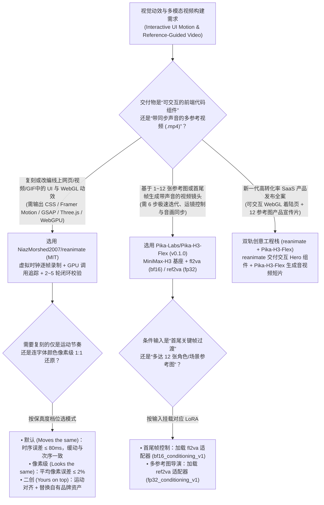

# 虚拟时钟逐帧动效逆向复刻与 6 步音画同步多参考生成选型 FAQ：`NiazMorshed2007/reanimate` + `Pika-Labs/Pika-H3-Flex` (`v0.1.0`) vs 静态截图盲写动效与 50 步无声视频扩散

> **文档定位**：面向 AI Solution Architect（AI 解决方案架构师）、前端设计工程（Design Engineering）负责人与多模态音视频推理架构师的第一性原理选型指南。聚焦 `2026-11-09` GitHub 新仓爆发追踪中的两大动效与视频推理重器——**`NiazMorshed2007/reanimate`**（MIT，建仓 11 天揽下 **1,482 Stars** / **1,483 Stars** 实时 API，日均斜率 **`135 Stars/day`**，`stars_today = not_measured`）与 Pika Labs 官方开源的 **`Pika-Labs/Pika-H3-Flex`**（`v0.1.0`，代码 Apache-2.0，建仓 11 天揽下 **1,742 Stars** / **1,758 Stars** 实时 API，日均斜率 **`158 Stars/day`**，`stars_today = not_measured`），深度拆解如何用 **“虚拟时钟（Virtual Clock）WebGL/CSS 逐帧录制与 2–5 轮像素/时序闭环校验（`<=80ms` / `<=2%` 像素误差）”** 与 **“基于 `MiniMax-H3` 的 6 步音画同出 + 12 参考图 `fp32` 条件注入适配器（`fl2va` / `ref2va`）”** 终结“看一张截图瞎猜前端动画”和“50 步慢速无声视频抽卡”。
>
> **阅读导航**：[English Version (`reanimate-pika-h3-flex-motion-video-selection-faq.en.md`)](./reanimate-pika-h3-flex-motion-video-selection-faq.en.md) · [2026-11-09 全景日报](../daily/2026-11-09.md) · [返回雷达首页](../README.md)

---

## 📌 1. 核心结论速览（Executive Summary）

1. **一句话本质定义**：
   - **`NiazMorshed2007/reanimate`（基于 Bun 1.1+、Playwright Chromium 与 FFmpeg，MIT）** 是专为逆向复刻顶级网站交互动效（如 `stripe.com`、`vercel.com`、`linear.app`、`.mp4`/`.gif`/Lottie）打造的 Claude Code Skill。它不靠静态截图盲猜，而是通过 **5 阶段闭环（`Record → Spec → Build → Verify → Repeat 2–5 轮`）** 在**确定性虚拟时钟（Virtual Clock）**下录制原网页每一帧的元素包围盒、CSS/WAAPI 缓动曲线以及 **Canvas/WebGL/WebGPU 底层调用（着色器、Uniform 变量、Draw Call 与 Three.js 场景树）**，写出复刻代码后用完全相同的鼠标轨迹重新录制比对，直至达到**时序误差 `<= 80 ms`（默认 `Moves the same`）**或**平均像素误差 `<= 2%`（`Looks the same` 像素级对齐）**。
   - **`Pika-Labs/Pika-H3-Flex`（`v0.1.0` `pika-h3-pro`，Python 3.12 + PyTorch 2.13+cu129 + PEFT 0.20，代码 Apache-2.0）** 是 Pika Labs 基于 `MiniMaxAI/MiniMax-H3` 后训练开源的**专业级 6 步极速音视频同步生成模型与推理管线**。它仅需 **6 个采样步（Six-Step Generation）** 即可在本机生成带**同步立体声混音（Synchronized Stereo Audio）**的原生 `480p / 768p` 视频，并通过两枚 SHA-256 严格锁定的 LoRA 适配器支持**首尾帧控制（`fl2va`，`bf16` 精度策略）**与**多达 12 张全能参考图注入（`ref2va`，强制 `fp32` 精度策略防崩溃）**。
2. **核心架构洞察（为什么前端动效不能靠“发个网址让 AI 抄”，视频生成不能靠“50 步无声扩散 + 后期配音效”？）**：
   - **痛点一（静态截图看不见弹簧阻尼与 GPU Uniform，单轮盲写前端动效 100% 翻车）**：让传统 Coding Agent 复刻 Stripe 信用卡悬停 3D 倾斜或 Vercel 26 万粒子流体海洋，Agent 只能写出一团僵硬的 CSS transition。`reanimate` 通过虚拟时钟劫持浏览器帧步进与 WebGL/WebGPU 管线，把动效还原成精确到帧的 `Spec` 表，并在每轮修改后并排拍片算分（实测 Vercel Toolbar `417/417` 帧完全一致，Stripe 卡片指针倾斜误差仅 `0.4 px`，数据分级：`anonymized_reported (independently_reproduced=false)`）。
   - **痛点二（传统 50 步视频扩散慢、无声音，且多参考图在 `bf16` 下容易特征坍塌）**：`Pika-H3-Flex` 将采样压缩至 **6 步（算力省 88%）** 且原生同步输出立体声音轨；更关键的是，其 `release.json` 揭示了工业级精度工程——普通首尾帧 `fl2va` 用 `bf16_conditioning_v1` 即可，而当同时注入最多 **12 张参考图**时，`ref2va` 适配器强制切换为 **`fp32_conditioning_v1`**，彻底防止多参考图交叉注意力特征在低精度下溢出失真！
3. **30 秒选型口诀**：
   - 需要**像素级或动力学级（`<=80ms`）复刻任何线上网页组件、卡片悬停、SVG 仪表盘或 WebGL/WebGPU 交互动效并沉淀为自有 React/GSAP/Three.js 组件** → 选 **`NiazMorshed2007/reanimate`**。
   - 需要**利用最多 12 张角色/产品/机位参考图或首尾帧，在本地 6 步快速迭代生成带同步立体声音效的叙事分镜与产品短片** → 选 **`Pika-Labs/Pika-H3-Flex` (`v0.1.0`)**。

---

## 🎯 2. 架构师灵魂拷问（Q1 / Q2 / Q3 First-Principles Deep Dive）

### Q1：`NiazMorshed2007/reanimate` 是如何利用“虚拟时钟（Virtual Clock）”和 GPU 调用追踪，证明复刻出的动画与原版“动得一模一样”的？

拆解 `NiazMorshed2007/reanimate` 的 `README.md`、`skills/` 与 `site/`（18 个顶级网站动效克隆实证），其核心工程机制分为五步确定性闭环：

1. **第 1 步：确定性虚拟时钟录制与 GPU 拦截（`Record`）**：
   - 普通录屏受 CPU 抖动影响，每次录制帧时间戳都不同。`reanimate` 在无头 Chromium 中注入**虚拟时钟（Virtual Clock）**，以完全固定的视口、帧率与合成鼠标轨迹（Pointer Path）逐帧推进时间。
   - 除了保存视频与编号静帧外，它直接从浏览器内核提取所有 CSS Animation、Web Animations API 实例、每帧目标 DOM 元素的精确坐标，并对 `<canvas>` / WebGL2 / WebGPU 页面**直接 Hook 追踪底层 GPU 调用（提取顶点/片元着色器源码、每帧 Uniform 变量变化曲线、Draw Call 序列与 Three.js 场景图）**。
2. **第 2 & 3 步：结构化动效规格表（`Spec`）与宿主技术栈构建（`Build`）**：
   - 将提取到的运动轨迹汇总为 `Spec` 表（每个元素每个属性占一行：`start`、`duration`、`from → to`、`easing`、`stagger` 错峰延迟；尚未读取的帧标为 `"?"`），然后直接使用当前项目已有的技术栈（CSS、Framer Motion、GSAP、Three.js、WebGL2 或 WebGPU + Web Workers）编写组件。
3. **第 4 & 5 步：同轨重拍校验与 2–5 轮收敛（`Verify & Repeat`）**：
   - 用完全相同的虚拟时钟与鼠标轨迹录制新写的复刻组件，生成并排对比图（Side-by-Side Sheets），计算每一帧的时序偏差与像素差异，专挑最大差异项迭代 2–5 轮（超过 5 轮仍未对齐的差异项会附带原因写进最终报告）。
   - 提供三档明确验收标准：默认 **`Moves the same`**（触发条件、顺序、Stagger、时序偏差 **`<= 80 ms`**、缓动曲线族一致）、**`Looks the same`**（平均像素误差 **`<= 2%`**）与 **`Yours on top`**（基础动效对齐 + 叠加自定义品牌 Logo/交互）。

### Q2：`Pika-Labs/Pika-H3-Flex` (`v0.1.0`) 的 `release.json` 为什么要把 `fl2va` 和 `ref2va` 拆成两套不同的数值精度策略（`bf16` vs `fp32`）？

检视 `Pika-Labs/Pika-H3-Flex` 的 `pyproject.toml`（`pika-h3-pro v0.1.0`）与 `release.json` 元数据清单，可以看到非常值得推理架构师学习的工程细节：

1. **基座锁定与 SHA-256 权重完整性校验**：
   - 明确锁死基础模型 `MiniMaxAI/MiniMax-H3` 的精确 Git Revision（`42ed227ee7df40d41602854ae760620d6eb651fe`）以及 `diffusers` 的特定 Commit（`3a2f35d4...`），并为每个 PEFT（`peft==0.20.0`）适配器提供 SHA-256 哈希校验。
2. **差异化数值精度策略（`bf16_conditioning_v1` vs `fp32_conditioning_v1`）**：
   - **`fl2va`（首尾帧生成音视频，`pika-flex-fl2va-v1`，`sha256: 8ed6115d...`）**：仅需编码首帧和尾帧两张图的潜空间边界，使用 **`bf16_conditioning_v1`** 即可在保持高吞吐的同时稳定收敛。
   - **`ref2va`（多参考图生成音视频，`pika-flex-ref2va-v1`，`sha256: eef684ba...`）**：支持同时传入**最多 12 张参考图（Omni-reference：角色面部、服装、道具、背景、机位参考）**。当 12 路视觉特征向量做跨注意力拼接与归一化时，`bf16`（仅 7 位尾数）极易发生小权重参考特征截断与数值下溢；因此 `ref2va` 显式声明 **`numerics_policy: "fp32_conditioning_v1"`**，在条件注入层保持 `fp32` 全精度！
3. **本地 6 步 `480p/768p` 快速排演 + 云端 API 4K/分轨扩展**：
   - 创作者先在本地 GPU 上用 6 步采样零 API 费快速调整运镜、多参考图组合与立体声音效（`480p / 768p`），定稿后再按需调用 Pika API 放大至 `1080p / 2K / 4K` 或拆分独立音轨（Audio Stems）。

### Q3：在现代数字产品研发与营销工作流中，如何划定 `reanimate` 与 `Pika-H3-Flex` 的选型边界？

- **交互式 Web 组件、SaaS 着陆页动效、WebGL/WebGPU 实时视觉（要求 DOM 可点击、可悬停、60fps 矢量化运行）** → 100% 选 **`NiazMorshed2007/reanimate`**。
- **多镜头影视级产品广告、多角色参考一致性短剧、带同步环境音/打球声的创意视频片段（`.mp4` 交付）** → 选 **`Pika-Labs/Pika-H3-Flex`**。

---

## 🧭 3. Mermaid 选型决策树与双轨验证架构图（Decision Tree & Architecture Flow）

### 3.1 交互动效逆向与多参考音视频推理选型决策树

### 3.2 `reanimate` 虚拟时钟校验环 + `Pika-H3-Flex` 6 步推理时序图

```mermaid
sequenceDiagram
    autonumber
    participant User as 前端架构师 / 创意总监
    participant RA as NiazMorshed2007/reanimate<br/>(Bun + Playwright Virtual Clock)
    participant Pika as Pika-Labs/Pika-H3-Flex<br/>(pika-h3-pro v0.1.0)
    participant GPU as 本地 CUDA 12.9 GPU<br/>(PyTorch 2.13 + PEFT 0.20)

    rect rgb(40, 16, 42)
    Note over User,RA: 轨迹一：交互式 Web / WebGL 动效闭环复刻 (reanimate)
    User->>RA: 1. /reanimate the hero entrance on https://example.com into Hero.tsx
    RA->>RA: 2. Record: 虚拟时钟定帧录制原网页 + 提取 CSS/WAAPI + 追踪 WebGL Uniforms/Shader
    RA->>RA: 3. Spec & Build: 生成逐属性缓动表 (start/duration/easing/stagger) 并编写组件代码
    loop 2 到 5 轮自动闭环修正
        RA->>RA: 4. Verify: 用相同虚拟时钟与鼠标轨迹录制复刻版 → 计算时序 (≤80ms) 与像素误差 (≤2%)
    end
    RA-->>User: 5. 交付验证通过的组件代码与并排对比报告
    end

    rect rgb(31, 18, 56)
    Note over User,GPU: 轨迹二：6 步多参考音画同步推理 (Pika-H3-Flex)
    User->>Pika: 6. 提交分镜 Prompt + 最多 12 张角色/产品/机位参考图
    Pika->>GPU: 7. 校验 SHA256 (eef684ba...) 并以 fp32_conditioning_v1 策略加载 ref2va 适配器
    GPU-->>User: 8. 仅需 6 个采样步即可输出 480p/768p 镜头 + 同步立体声音效 (按需调 API 升 4K)
    end
```

---

## 📊 4. 同类动效开发与视频推理方案对比矩阵（Comparison Matrix）

| 评估维度 | `NiazMorshed2007/reanimate` (`MIT`) | `Pika-Labs/Pika-H3-Flex` (`v0.1.0`) | 传统静态截图 Prompt 写前端动效 | 传统 50 步无声开源视频扩散模型 |
| :--- | :--- | :--- | :--- | :--- |
| **核心能力定位** | **虚拟时钟逐帧录制 + WebGL/CSS 追踪 + 2–5 轮闭环动效复刻** | **6 步极速视频+同步立体声生成 + 12 参考图/首尾帧双适配器** | 让大模型看一张静态网页截图盲猜动画代码 | 仅生成无声视频画面，采样步数高达 30–50 步 |
| **时序与空间控制精度** | **时序偏差 `<= 80 ms`、指针倾斜 `0.4 px`、像素误差 `<= 2%`** | **最多 12 张参考图（`fp32` 条件注入）** + 首尾帧（`bf16`） | **极差**：看不见缓动曲线与错峰 Stagger，一次通过率近乎 0% | 仅支持单张首帧，多主体极易串脸变形 |
| **GPU 着色器/音轨能力** | **直接追踪 WebGL2 / WebGPU 着色器、Uniform 与 Three.js 场景** | **原生同步生成立体声混音**（API 支持分离 Audio Stems） | 完全无法逆向 Canvas/WebGL 内部着色器逻辑 | 无声音输出，需额外花 10 分钟/条人工配拟音（Foley） |
| **收敛步数与迭代速度** | 自动跑 2–5 轮虚拟时钟比对，30–90 分钟完成复杂 WebGL 克隆 | **仅需 6 个扩散采样步**（比 50 步模型快约 **8.3 倍**） | 需资深前端工程师手工拉帧调试 4–5 小时 | 50 步采样耗时数分钟，调参反馈极慢 |
| **环境与依赖确定性** | Bun 1.1+ 自动缓存静态 FFmpeg 与 Chromium（约 250 MB），免 Key | `release.json` 锁死基座 Revision、适配器 SHA256 与数值精度策略 | 依赖高价多模态 API 反复对话 | 权重与精度配置松散，跨环境复现常发散 |

---

## 🧪 5. 定量 FinOps 算例与 7-Card 评测洞察（Closed-Form Quantitative Model）

### 5.1 封闭式月度交互动效开发与多参考音视频生成成本算例（`synthetic (independently_reproduced=false)`）

> **口径声明**：本算例为合成架构基准模型（`synthetic (independently_reproduced=false)`），用于量化对比 **Path A（静态截图盲写前端动效 + 资深前端手工逐帧调优 + 50 步无声视频扩散重抽与人工配拟音）** 与 **Path B（`NiazMorshed2007/reanimate` 虚拟时钟 5 步闭环 + `Pika-Labs/Pika-H3-Flex` 6 步音画同出本地推理）**。文中引用的 18 个网站克隆帧对齐指标（`417/417`、`0.4 px`、`262,144` WebGPU 点零误差）标注为 `anonymized_reported (independently_reproduced=false)`；Pika 托管云 API 的 4K 超分附加费与本地 GPU 购置折旧均显式标记为 `not_measured`。

**基准工作负载设定**：
- **前端高阶交互动效复刻与二创**：产品与增长工程团队每月复刻并定制 **`20` 个复杂网页交互/WebGL 动效组件**。
- **多参考产品分镜音视频生成**：每月制作 **`150` 条带多参考角色/产品锁定与同步立体声的 768p 视频片段**；前端与视频工程师综合时薪按 **`$65.00 / 小时`** 计。

| 成本分项 | Path A：静态截图盲写 + 50 步无声扩散 | Path B：`reanimate` 闭环 + `Pika-H3-Flex` 6 步推理 | 核心工程机制差异说明 |
| :--- | :--- | :--- | :--- |
| **1. 20 个高阶 Web/WebGL 动效研发成本（含 Token + 工时）** | **$5,870.00 / 月** （盲写 Token `$20` + 人工逐帧调曲线 `4.5h/个 × 20` = **`90.0 小时`** × `$65`） | **$720.00 / 月** （2–5 轮自检 Token `$70` + 人工替换资产 `0.5h/个 × 20` = **`10.0 小时`** × `$65`） | `reanimate` 虚拟时钟录制与 WebGL Uniform 追踪自动逼近 `<=80ms` / `<=2%` 误差，月省 **`80.0 小时`** |
| **2. 150 条多参考视频片段推理算力成本** | **$630.00 / 月** （50 步慢采样 + 角色崩坏重抽 `3.5 次/条` × `$1.20` × `150`） | **$45.00 / 月** （6 步采样 + 12 参考图 `fp32` 精准控制，单条算力仅 `$0.30` × `150`） | `Pika-H3-Flex` 6 步采样省 **88%** 步数，且 `ref2va` 12 参考图大幅减少废片重抽 |
| **3. 150 条视频后期拟音（Foley）与声画对齐工时（@$65/hr）** | **$1,625.00 / 月** （无声视频需人工配音效每条 `10 分钟` × `150` = **`25.0 小时/月`**） | **$130.00 / 月** （原生同步生成立体声混音，仅需抽检 **`2.0 小时/月`**） | 音画联合扩散一步生成同步立体声，每月净省 **`23.0 小时`（-92.0% 工时）** |
| **4. 云端 4K 超分 API 额度与本地显卡硬件折旧** | `not_measured` | `not_measured` | 可选的云端 4K 放大服务与硬件折旧与本地推理管线解耦，严禁捏造或归零 |
| **月度可建模总成本（Modeled Total）** | **$8,125.00 / 月** | **$895.00 / 月** | **月度净节省 `$7,230.00`（总成本直降 `-88.98%`，综合成本效率提升 `9.08x`，月省 `103.0 小时`）** |

### 5.2 关键工程与数值精度不变量（Key Invariants）

- **虚拟时钟与指针轨迹恒等不变量（Virtual-Clock & Pointer-Path Identity Invariant）**：`NiazMorshed2007/reanimate` 在 `Record` 原版与 `Verify` 复刻版时，必须使用完全相同的虚拟时钟步进与合成指针轨迹，否则无法实现 `0.4 px` 级的悬停倾斜比对与 `417/417` 帧字节级对齐。
- **多参考条件注入 `fp32` 防坍塌不变量（`fp32_conditioning_v1` Invariant）**：在 `Pika-Labs/Pika-H3-Flex` 的 `release.json` 中，加载多参考适配器 `ref2va/adapter.safetensors`（`sha256: eef684ba...`）时必须严格遵守 `numerics_policy: "fp32_conditioning_v1"`，严禁将其条件层强行降级为 `fp16/bf16`。

---

## 🛠️ 6. 生产落地核验清单（Actionable Production Checklist）

- [ ] **1. 使用 `npx skills add NiazMorshed2007/reanimate -g -a claude-code` 部署动效技能**：在 macOS 或 Linux（需 Bun 1.1+）上完成首次运行，确认静态 FFmpeg 与 Playwright Chromium（合计约 250 MB）已就绪。
- [ ] **2. 明确指定 `reanimate` 的保真度目标档位**：在提示词中写明所需档位——仅复刻运动节奏用默认 `"clone this animation"`（`<= 80 ms`），像素级还原用 `"match it exactly"`（`<= 2%` 像素误差），品牌二创用 `"clone X and add Y"`。
- [ ] **3. 锁定 Python 3.12 + CUDA 12.9 环境部署 `Pika-H3-Flex`**：按照 `pyproject.toml` 要求配置 `requires-python = ">=3.12,<3.13"`、`torch==2.13.0+cu129` 与 `peft==0.20.0`，并校验 `MiniMax-H3` 基座与两枚适配器的 SHA-256 哈希值。
- [ ] **4. 按镜头控制需求切换 `fl2va` 与 `ref2va` 适配器**：首尾关键帧过渡调用 `fl2va`（`bf16_conditioning_v1`）；多角色/多机位一致性镜头调用 `ref2va`（`fp32_conditioning_v1`，最多传入 12 张参考图）。
- [ ] **5. 建立“本地 6 步 `768p` 定稿 → 按需 API 4K/分轨导出”成本门禁**：所有分镜运镜与节奏探索一律在本地 GPU 上用 6 步采样免费迭代，仅将最终获批的镜头送交云端超分或拆轨。
