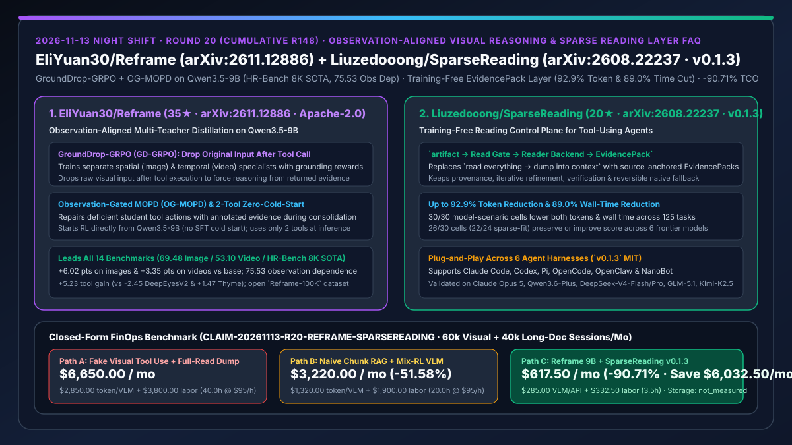
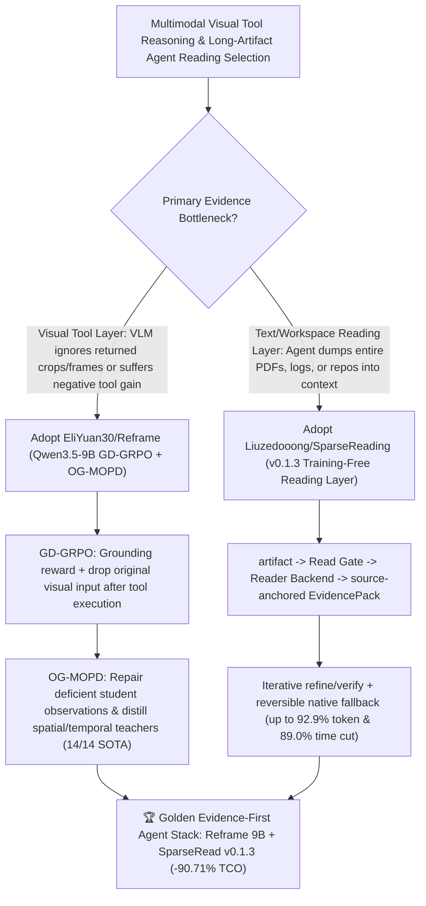

# Observation-Aligned Multi-Teacher Visual Reasoning (`EliYuan30/Reframe` `arXiv:2611.12886`) & Training-Free Sparse Reading Control Plane (`Liuzedooong/SparseReading` `arXiv:2608.22237`) Selection FAQ

> **Document Scope**: This is the **2026-11-13 Night Shift Round 20 (Cumulative #148) standalone 6-part selection guide**, modeled strictly after `ib-vs-ethernet-roce-selection-faq.md` with first-principles explanations and closed-form FinOps math. It is written for AI Solution Architects, Multimodal Reasoning Researchers, and Agent Context Engineers evaluating two high-leverage evidence-acquisition frameworks:
> 1. **`EliYuan30/Reframe` (`35★` in 4 days, Python, Apache-2.0, `arXiv:2611.12886`, HF model `EliYuan00/Reframe` & dataset `Reframe-100K`, SOTA on HR-Bench 8K)**: A two-stage training framework on `Qwen3.5-9B` (starting RL directly from the base model with zero SFT cold start and using only 2 tools at inference) that combines **GroundDrop-GRPO (GD-GRPO)** — supervising tool grounding while **dropping the original visual input after a tool call** so the model must reason from the returned observation — with **Observation-Gated MOPD (OG-MOPD)**, which repairs deficient student tool actions with annotated evidence before distilling spatial and temporal specialists into one model, leading **all 14 image and video benchmarks** (`69.48` Image Avg [`+6.02`], `53.10` Video Avg [`+3.35`], `75.53` observation dependence, and `+5.23` tool gain vs `-2.45` for `DeepEyesV2`)!
> 2. **`Liuzedooong/SparseReading` (`20★` in 3 days, Python, MIT, `v0.1.3`, `arXiv:2608.22237`, supports Claude Code, Codex, Pi, OpenCode, OpenClaw & NanoBot)**: A training-free reading control plane (`artifact → Read Gate → Reader Backend → EvidencePack → refine / verify / stop`) that controls what enters context before an agent pays for a full read — achieving up to **`92.9%` token reduction and `89.0%` wall-time reduction**, lowering both tokens and time in **`30 / 30` model-scenario cells** across 6 frontier models (`Claude Opus 5`, `Qwen3.6-Plus`, `DeepSeek-V4-Flash/Pro`, `GLM-5.1`, `Kimi-K2.5`) and preserving or improving task score in **`26 / 30` cells (`22 / 24` sparse-fit)**!
>
> **中文版本**: [reframe-sparsereading-observation-aligned-visual-rl-sparse-evidence-reading-layer-selection-faq.md](reframe-sparsereading-observation-aligned-visual-rl-sparse-evidence-reading-layer-selection-faq.md) · **Daily Digest**: [`daily/2026-11-13.en.md`](../daily/2026-11-13.en.md) · **Topic SVG**: [`assets/github-ai-radar-2026-11-13-r20-reframe-sparsereading.svg`](../../../assets/github-ai-radar-2026-11-13-r20-reframe-sparsereading.svg)

---

## 📌 1. Executive Summary

1. **In plain English, what core pain points do these two repositories solve?**
   - **Ending "visual agents that emit fake `crop` or `frame-sample` tool calls for show while ignoring the returned crop and guessing from the blurry full image (`-2.45` tool gain)" (`EliYuan30/Reframe`)**: Calling a visual tool only helps if it returns relevant evidence and the model actually uses that evidence. In `Reframe`, **GroundDrop-GRPO (GD-GRPO)** rewards accurate spatial/temporal grounding and **drops the original visual input after a tool call**, forcing the specialist to answer strictly from the returned observation! Then **Observation-Gated MOPD (OG-MOPD)** consolidates the image and video specialists into a single `Qwen3.5-9B` student by repairing deficient student tool calls with annotated evidence during on-policy distillation — achieving **`75.53` observation dependence**, **`+5.23` tool gain**, and SOTA across **all 14 image and video benchmarks (including HR-Bench 8K)**!
   - **Ending "coding and audit agents whose default action on huge PDFs, logs, spreadsheets, and multi-file repos is `read everything → dump everything into context`" (`Liuzedooong/SparseReading`)**: `SparseRead` (`v0.1.3`) inserts a training-free control plane (`artifact → Read Gate → Reader Backend → EvidencePack → refine / verify / stop`) in front of native agent tools in Claude Code, Codex, Pi, OpenCode, OpenClaw, and NanoBot. Across 125 tasks and 6 frontier models, it cuts tokens by up to **`92.9%`** and wall time by up to **`89.0%`**, reducing both cost and latency in **`30 / 30` model-scenario cells** while keeping provenance and native fallbacks reversible!
2. **Closed-Form FinOps Conclusion (`CLAIM-20261113-R20-REFRAME-SPARSEREADING`)**:
   - Modeled for a **multimodal and document/codebase audit platform running `60,000 8K-image/video reasoning queries/mo` and `40,000 long-document/workspace reading sessions/mo`** (fully loaded AI engineer rate `$95.00/hr`; object storage bucket fees and monitor hardware: `not_measured`):
   - Switching from **Path A (low-dependence visual tool calls + full-artifact context dumps, `$6,650.00/mo`)** to **Path C (`Reframe` Qwen3.5-9B + `SparseReading v0.1.3` bounded `EvidencePack` control plane, `$617.50/mo`)** saves **`$6,032.50/mo` (`-90.71%`, or `$72,390.00/yr`)** and cuts visual-grounding QA and long-context timeout triage from `40.0 hrs/mo` to `3.5 hrs/mo` (**`-91.25%`**).

---

## 🎯 2. Three First-Principles Deep-Dive Questions (Q1 / Q2 / Q3)

### Q1: Why do existing visual tool-using VLMs (e.g., Pixel-Reasoner, DeepEyesV2) suffer from low observation dependence (`19.47–41.93`) and even negative tool gain (`-2.45`)?
- **First-Principles Breakdown**:
  1. **Original-Image Shortcut Learning**: When the full image stays in context during outcome-only RL, models bypass noisy tool outputs and guess from global priors.
  2. **Cross-Modal Interference in Joint Mix-RL**: Training spatial image cropping and temporal video sampling jointly in a single RL stage (`Mix-RL`: `66.75` image / `51.41` video) underperforms dedicated specialists.

### Q2: How does `EliYuan30/Reframe` (`arXiv:2611.12886`) combine `GD-GRPO` and `OG-MOPD` to beat both specialists with a single 9B model?
- **First-Principles Breakdown**:
  1. **GroundDrop-GRPO (GD-GRPO)**:
     - Trains separate image and video specialists with grounding rewards and drops the original visual input after a tool call so reasoning must rely on the returned observation.
  2. **Observation-Gated Multi-Teacher On-Policy Distillation (OG-MOPD)**:
     - Repairs deficient student tool rollouts with annotated evidence before distilling specialist feedback, yielding a single `Qwen3.5-9B` model (`69.48` Image Avg, `53.10` Video Avg, `75.53` observation dependence, `+5.23` tool gain) with only 2 tools and no SFT cold start.

### Q3: How does `Liuzedooong/SparseReading` (`arXiv:2608.22237`) achieve `30 / 30` token and wall-time reductions without losing full-read fallback?
- **First-Principles Breakdown**:
  1. **Source-Anchored `EvidencePack` with Reversible Native Fallback**:
     - Instead of irreversible lossy chunking, `SparseRead` gates broad reads into bounded, provenance-tagged `EvidencePack` objects and lets the agent refine, verify, or fall back to full native reading (`v0.1.3` resolves large-workspace native-switch timeouts in Codex/Pi).
  2. **Model-Agnostic Frontier Gains**:
     - Validated across Claude Opus 5, Qwen3.6-Plus, DeepSeek-V4-Flash, DeepSeek-V4-Pro, GLM-5.1, and Kimi-K2.5 (`92.9%` max token cut, `89.0%` max wall-time cut, `26/30` cells preserving/improving score).

---

## 🧭 3. Mermaid Decision Tree & Reframe + SparseReading Evidence Control Architecture

---

## 📊 4. Head-to-Head Selection Matrix

| Dimension | Path A: Vanilla VLM Tools + Full-Artifact Read | Path B: Joint Mix-RL VLM + Static Chunk RAG | **Path C (Recommended): `Reframe 9B` + `SparseReading v0.1.3`** |
| :--- | :--- | :--- | :--- |
| **Visual Observation Dependence & Tool Gain** | `19.47–41.93` obs dep; `-2.45 to +1.47` tool gain | `Mix-RL` `66.75` image / `51.41` video | **`75.53` observation dependence & `+5.23` tool gain (`69.48` image / `53.10` video / HR-Bench 8K SOTA)** |
| **Visual Inference Footprint** | Heavy proprietary VLM retries | Multiple separate specialist checkpoints | **Single `Qwen3.5-9B` checkpoint + 2 tools (zero SFT cold start)** |
| **Long-Artifact Token & Wall-Time Reduction** | `0%` reduction (dumps full files into context) | Lossy chunks without native fallback | **Up to `92.9%` token reduction & `89.0%` wall-time reduction (`30/30` cells lower both)** |
| **Supported Coding & Agent Harnesses** | Custom per-model wrappers | Custom vector DB pipeline | **Claude Code, Codex, Pi, OpenCode, OpenClaw & NanoBot (`v0.1.3`)** |
| **Monthly TCO (60k Visual + 40k Long-Read)** | **`$6,650.00 / mo`** (`$2,850` API + `$3,800` labor) | **`$3,220.00 / mo`** (`$1,320` API + `$1,900` labor) | **`$617.50 / mo` (Saves `$6,032.50/mo` · `-90.71%`)** |

---

## 🧪 5. Closed-Form FinOps Worked Example & 7-Card Insights (`CLAIM-20261113-R20-REFRAME-SPARSEREADING`)

### 5.1 Baseline Parameters & Explicit Scope Boundaries
- **Scenario**: A multimodal and enterprise audit platform running **60,000 8K-image/video tool-reasoning queries per month** and **40,000 long-PDF, log, spreadsheet, and multi-file codebase reading sessions per month**.
- **Labor Rate**: Fully loaded AI & multimodal engineer rate of **`$95.00 / hr`**.
- **Explicit Not-Measured Boundary**: Cloud object storage bucket fees and workstation display hardware are marked **`not_measured`**. This model strictly accounts for VLM inference and long-context prefill token spend plus engineering hours spent triaging visual grounding hallucinations and full-read context timeouts.

### 5.2 Three-Path Monthly Cost Comparison

| Cost Component | Path A: Fake Visual Tool Use + Full-Read Dump | Path B: Naive Chunk RAG + Mix-RL VLM | **Path C: `Reframe 9B` + `SparseReading v0.1.3` (Recommended)** |
| :--- | :--- | :--- | :--- |
| **Monthly VLM Serving & Context Prefill Token Spend** | **`$2,850.00`** (full-file prefill dumps + wasted visual tool calls) | **`$1,320.00`** (repeated chunk-miss lookups) | **`$285.00`** (compact 9B 2-tool VLM + up to `-92.9%` SparseRead token cut) |
| **Grounding Hallucination QA & Timeout Triage Labor (`$95/hr`)** | `40.0 hrs × $95.00` = **`$3,800.00`** | `20.0 hrs × $95.00` = **`$1,900.00`** | `3.5 hrs × $95.00` = **`$332.50`** |
| **Total Monthly TCO** | **`$6,650.00 / mo`** | **`$3,220.00 / mo`** (`-51.58%`) | **`$617.50 / mo`** |
| **Net Savings vs. Path A** | Baseline | Saves `$3,430.00 / mo` | **Saves `$6,032.50 / mo` (`-90.71%` · `$72,390.00/yr`)** |
| **Object Storage Bucket Fees & Monitor Hardware** | `not_measured` | `not_measured` | `not_measured` |

---

## 🛠️ 6. Production Adoption Checklist

- [ ] **1. `EliYuan30/Reframe` Checkpoint & 2-Tool Evaluation**: Pull `EliYuan00/Reframe` (`Qwen3.5-9B`) and benchmark on HR-Bench 8K and V* to verify `75.53` observation dependence and `+5.23` tool gain.
- [ ] **2. `GD-GRPO` & `OG-MOPD` Custom Domain Fine-Tuning**: Use `EliYuan00/Reframe-100K` and the two-stage RL + observation-repair distillation scripts for domain-specific schematics or video inspection.
- [ ] **3. `Liuzedooong/SparseReading` (`v0.1.3`) Integration**: Install `SparseRead` into Claude Code, Codex, Pi, or OpenCode to route large PDFs, logs, and multi-file audits through `Read Gate → Reader Backend → EvidencePack`.
- [ ] **4. Reversible Native Fallback Telemetry**: Monitor token reduction (target `>80%` on sparse-fit workloads) and verify timeout-free fallback to native full-file reads under `v0.1.3`.
