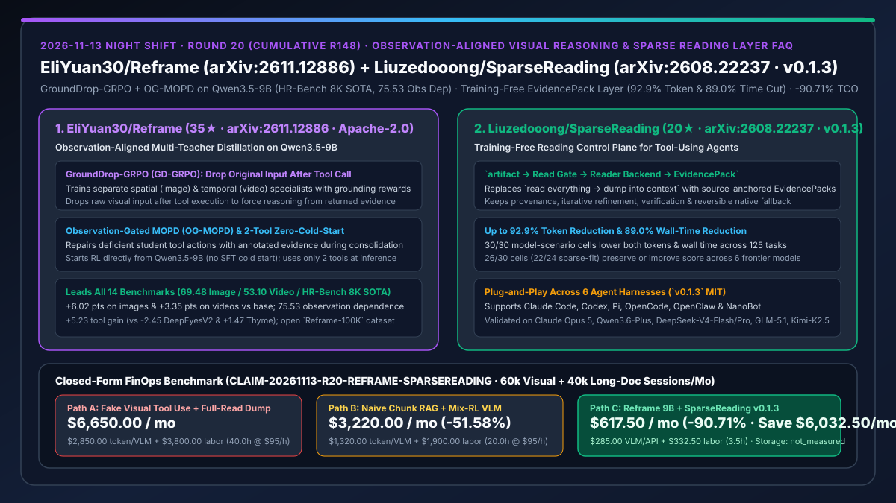
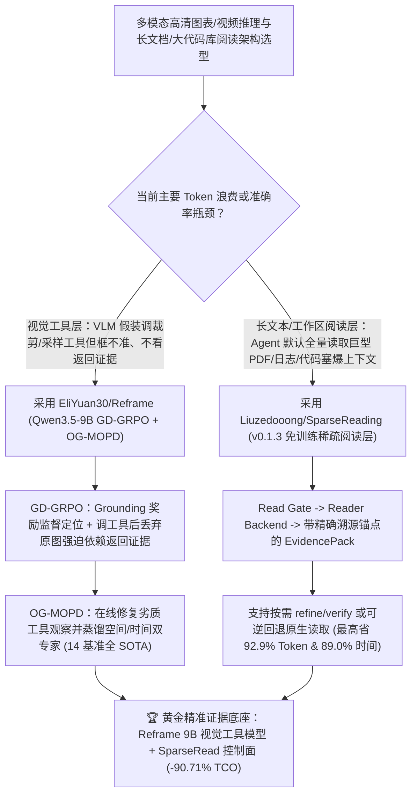

# 观察对齐多师同策略蒸馏视觉推理模型（`EliYuan30/Reframe` `arXiv:2611.12886`）与免训练稀疏证据控制面（`Liuzedooong/SparseReading` `arXiv:2608.22237`）深度选型 FAQ

> **文档定位**：本专题是 **2026-11-13 夜班第 20 轮（累计第 148 篇）独立六段式选型指南**，严格对标 `ib-vs-ethernet-roce-selection-faq.md` 的通俗第一性原理与闭式 FinOps 核算规范，面向多模态算法负责人、企业文档/代码审计架构师与 AI Solution Architect，深度拆解今日新仓榜上解决“视觉 Agent 假装调工具其实不看返回图”与“文本 Agent 无脑把整份大文件全塞进上下文烧光 Token”的两大前沿项目：
> 1. **`EliYuan30/Reframe`（4 天新建获 `35★`，Python，Apache-2.0，论文 `arXiv:2611.12886`，开源 `EliYuan00/Reframe` 权重与 `Reframe-100K` 数据集，登顶 HR-Bench 8K SOTA）**：基于 `Qwen3.5-9B` 的两阶段多模态视觉工具推理训练框架（零 SFT 冷启动直接 RL，推理仅需 2 个工具）——通过 **GroundDrop-GRPO (GD-GRPO)**（工具调用后**主动丢弃原始图像/视频输入**，强迫模型必须依赖裁剪/采样回来的局部观察证据作答）与 **Observation-Gated MOPD (OG-MOPD)**（在同策略多师蒸馏中用标注证据在线修复错误工具动作并合并空间/时间双专家），在 **14 项图像与视频推理基准上全面夺冠**（图像均分 **`69.48` [`+6.02`]**、视频均分 **`53.10` [`+3.35`]**、观察依赖度高达 **`75.53`**、工具净增益 **`+5.23`**，远超 `DeepEyesV2` 的 `-2.45` 与 `Thyme` 的 `+1.47`）！
> 2. **`Liuzedooong/SparseReading`（3 天新建获 `20★`，Python，MIT，`v0.1.3`，论文 `arXiv:2608.22237`，支持 Claude Code / Codex / Pi / OpenCode / OpenClaw / NanoBot）**：面向工具型 Agent 的**免训练稀疏阅读控制层（`artifact → Read Gate → Reader Backend → EvidencePack → refine / verify / stop`）**——在 Claude Opus 5、Qwen3.6-Plus、DeepSeek-V4-Flash/Pro、GLM-5.1 与 Kimi-K2.5 六大前沿模型 × 5 类场景（共 125 个任务、30 个评测格）上，**`30/30`（100%）单元格同时降低 Token 与耗时**，最高实现 **`92.9%` Token 削减与 `89.0%` 端到端耗时削减**，且 `26/30`（稀疏适配场景 `22/24`）保持或提升任务得分！
>
> **English Version**: [reframe-sparsereading-observation-aligned-visual-rl-sparse-evidence-reading-layer-selection-faq.en.md](reframe-sparsereading-observation-aligned-visual-rl-sparse-evidence-reading-layer-selection-faq.en.md) · **关联日报**: [`daily/2026-11-13.md`](../daily/2026-11-13.md) · **专题架构图**: [`assets/github-ai-radar-2026-11-13-r20-reframe-sparsereading.svg`](../../../assets/github-ai-radar-2026-11-13-r20-reframe-sparsereading.svg)

---

## 📌 一、核心结论速览（Executive Summary）

1. **一句话大白话讲透这两个项目到底解决了什么痛点？**
   - **终结“多模态视觉 Agent 嘴上发起了 `crop_image` 或 `sample_frames` 工具调用，但实际上根本不看工具返回的高清局部图，还是靠第一眼模糊全图的先验乱猜（甚至调了工具分数反而倒退 `-2.45`）”的痛点（`EliYuan30/Reframe`）**：为什么很多视觉 Agent 的“工具调用”是装样子？因为原始全局大图一直留在上下文里，模型偷懒直接看原图猜答案！`Reframe` 提出了极其巧妙的 **GroundDrop-GRPO（GD-GRPO）**：**一旦模型调用了视觉工具，立即把原始全局图从上下文中扔掉（Drop）**！如果它裁歪了或者不看工具返回的观察图（Observation），就根本答不出题；随后再用 **Observation-Gated MOPD（OG-MOPD）** 把图像空间专家和视频时间专家蒸馏进同一个 `Qwen3.5-9B` 学生模型（训练中遇到烂工具调用先用正确观察修复再继续蒸馏），让观察依赖度飙升至 **`75.53`**（对比 `DeepEyes` 的 `19.47`），横扫 HR-Bench 8K 等全部 14 个基准！
   - **终结“Coding / 审计 Agent 遇到几百页 PDF、长日志或巨型代码仓时，默认动作永远是 `read everything → 全塞进上下文`，不仅烧掉 10 倍 Token 还经常超时卡死”的痛点（`Liuzedooong/SparseReading`）**：`SparseRead`（`v0.1.3`）无需重训模型，直接在原生阅读工具前加了一道轻量控制闸门（`Read Gate → Reader Backend → EvidencePack`），只把带精确源码/页码锚点的精炼证据包（`EvidencePack`）送入上下文，并支持按需深入（`refine`）或一键无缝回退到原生全量读取，在 **6 大主流模型 × 5 大场景（`30/30` 单元格）100% 实现降本提速**，最高省下 **`92.9%` Token 与 `89.0%` 时间**！
2. **闭式 FinOps 投资回报结论（`CLAIM-20261113-R20-REFRAME-SPARSEREADING`）**：
   - 以 **多模态与文档/代码智能团队每月处理 `60,000 次 8K 高清图表/长视频工具推理` 与 `40,000 次长 PDF/日志/代码仓阅读审计会话`** 为基准（多模态与 AI 工程师全包时薪 `$95.00/hr`；底层对象存储桶租约与办公显示器硬件：`not_measured`）：
   - 从 **Path A（虚假工具调用 VLM + 原生全量读取塞爆上下文，月均 `$6,650.00`）** 升级至 **Path C（`Reframe` 9B 观察对齐视觉推理 + `SparseReading v0.1.3` 免训练证据包控制面，月均 `$617.50`）**，每月净省 **`$6,032.50/mo`（降幅 `-90.71%`，年省 `$72,390.00/yr`）**，并将人工复核幻觉、长上下文超时排障工时从 `40.0 hrs/mo` 压缩至 `3.5 hrs/mo`（节省 **`-91.25%`**）。

---

## 🎯 二、三大灵魂拷问（Q1 / Q2 / Q3 深度原理解析）

### Q1：为什么现有的视觉工具推理模型（如 Pixel-Reasoner、DeepEyesV2）会出现“调用了视觉工具，准确率反而原地踏步甚至倒退（`-2.45`）”的怪象？
- **第一性原理拆解**：
  1. **捷径学习（Shortcut Learning）忽略工具返回结果**：如果仅靠最终答案对错给奖励（Outcome-based RL）且保留原始输入，模型会用原图低分辨率全局特征猜答案，把工具调用退化为无意义的装饰动作（`DeepEyes` 观察依赖度仅 `19.47`）。
  2. **图像空间裁剪与视频时间采样互相干扰**：把图像与视频简单混合做强化学习（`Mix-RL`）会导致空间定位与时序定位相互拖拽，表现均不如单模态专家。

### Q2：`EliYuan30/Reframe` (`arXiv:2611.12886`) 是如何用 `GD-GRPO` + `OG-MOPD` 在 9B 参数量下横扫 14 个基准的？
- **第一性原理拆解**：
  1. **第一阶段 `GroundDrop-GRPO`（强迫既找对证据、又用对证据）**：
     - 分别训练图像专家与视频专家：引入 Grounding 定位奖励监督工具框选精度，并在**工具执行后丢弃原始视觉输入**，逼迫模型只能依据工具返回的局部高清证据推理。
  2. **第二阶段 `Observation-Gated MOPD`（观察门控多师同策略蒸馏）**：
     - 当学生模型在 Rollout 中产生劣质工具调用时，训练框架先利用标注证据将其**修复（Observation Repair）**再继续由专家教师指导蒸馏，同时教会学生自己产出修复后的精准调用；推理时仅需 `Qwen3.5-9B` 单模型与 2 个基础工具，图像均分达 `69.48`、视频均分达 `53.10`、工具净增益达 `+5.23`。

### Q3：`Liuzedooong/SparseReading` (`arXiv:2608.22237`) 与传统“先切块再 Top-K 向量检索（Chunked RAG）”有何本质区别？
- **第一性原理拆解**：
  1. **保留文档结构溯源与可逆回退（Bounded, Source-Anchored & Reversible）**：
     - 传统向量 RAG 把长文档切碎后丢失上下文边界且无法回退；`SparseRead` 位于原生工具前端（`artifact → Read Gate → Reader Backend → EvidencePack → refine / verify / stop`），让 Agent 自主决定继续精炼、核验还是直接回退到原生全量读取（`v0.1.3` 已修复 Codex/Pi 大工作区切换原生读取的超时问题）。
  2. **跨 6 大模型 `30/30` 全胜实证**：
     - 在 Claude Opus 5、Qwen3.6-Plus、DeepSeek-V4-Flash/Pro、GLM-5.1、Kimi-K2.5 上最高省 `92.9%` Token 与 `89.0%` 时间。

---

## 🧭 三、Mermaid 选型决策树与「Reframe 视觉证据推理 + SparseReading 稀疏阅读控制面」架构图

---

## 📊 四、同类方案核心能力对比矩阵（Selection Matrix）

| 评估维度 | Path A：常规 VLM 工具调用 + 原生全量读取 | Path B：混合 RL 视觉模型 + 传统静态切片 RAG | **Path C（推荐）：`Reframe 9B` + `SparseReading v0.1.3`** |
| :--- | :--- | :--- | :--- |
| **视觉工具观察依赖度与工具增益** | 观察依赖度 `19.47–41.93`，工具增益 `-2.45 ~ +1.47` | `Mix-RL` 图像 `66.75` / 视频 `51.41`，模态互相妥协 | **观察依赖度 `75.53`、工具净增益 `+5.23`（图像 `69.48` / 视频 `53.10` / HR-Bench 8K SOTA）** |
| **视觉推理部署复杂度** | 依赖闭源超大参数模型多次重采样 | 需维护多套独立微调模型 | **零 SFT 冷启动，推理仅需单个 `Qwen3.5-9B` 模型 + 2 个轻量工具** |
| **长文档/大代码仓阅读 Token 与耗时** | 全量塞入上下文，100% 原始 Token 消耗且易超时 | 切片丢失全局结构，无法无缝回退原生工具 | **最高削减 `92.9%` Token 与 `89.0%` 端到端耗时（`30/30` 模型-场景全降本提速）** |
| **兼容 Coding Agent 生态** | 仅限各家私有工具 | 需侵入式改写 Agent 主循环 | **免训练即插即用支持 Claude Code、Codex、Pi、OpenCode、OpenClaw、NanoBot** |
| **月度总拥有成本（6 万视觉 + 4 万长读/月）** | **`$6,650.00 / mo`**（`$2,850` 算力 + `$3,800` 工时） | **`$3,220.00 / mo`**（`$1,320` 算力 + `$1,900` 工时） | **`$617.50 / mo`（净省 `$6,032.50/mo` · `-90.71%`）** |

---

## 🧪 五、定量 FinOps 算例与 7-Card 洞察（`CLAIM-20261113-R20-REFRAME-SPARSEREADING`）

### 5.1 测算基准与显式边界（Scope & Boundaries）
- **场景设定**：多模态与企业知识审计平台每月执行 **60,000 次 8K 高清图表/工程图纸与长视频工具推理**，以及 **40,000 次跨长 PDF、日志与多文件代码仓的 Agent 阅读任务**。
- **费率假设**：多模态与 AI 平台工程师全包时薪 **`$95.00 / hr`**。
- **显式边界声明（Explicit Not-Measured Boundary）**：底层云对象存储桶租约与工程师办公显示器硬件折旧标记为 **`not_measured`**，本表严格核算 VLM 推理与长上下文阅读 Token 支出，以及工程师用于排查视觉错框幻觉与长文件读取超时的工时。

### 5.2 三路径月度成本闭式对照表

| 成本分项 | Path A：虚假视觉工具 + 全量读取塞上下文 | Path B：混合 RL 视觉 + 传统静态切片 RAG | **Path C：`Reframe 9B` + `SparseReading v0.1.3`（推荐）** |
| :--- | :--- | :--- | :--- |
| **月度 VLM 推理与长文档阅读 API/算力支出** | **`$2,850.00`**（全量长上下文 Prefill + 无效工具重试） | **`$1,320.00`**（切片漏召回导致的反复检索） | **`$285.00`**（9B 紧凑双工具推理 + 最高 `-92.9%` 稀疏阅读 Token） |
| **视觉幻觉人工复核与长上下文超时排障工时（`$95/hr`）** | `40.0 hrs × $95.00` = **`$3,800.00`** | `20.0 hrs × $95.00` = **`$1,900.00`** | `3.5 hrs × $95.00` = **`$332.50`** |
| **月度总成本（Monthly TCO）** | **`$6,650.00 / mo`** | **`$3,220.00 / mo`**（`-51.58%`） | **`$617.50 / mo`** |
| **相对 Path A 净节省** | 基准线（Baseline） | 净省 `$3,430.00 / mo` | **净省 `$6,032.50 / mo`（`-90.71%` · 年省 `$72,390.00/yr`）** |
| **云对象存储桶租约与显示器硬件折旧** | `not_measured` | `not_measured` | `not_measured` |

---

## 🛠️ 六、生产级落地核验 Checklist

- [ ] **1. `EliYuan30/Reframe` 权重与 `Reframe-100K` 验证**：从 HuggingFace 拉取 `EliYuan00/Reframe`（基于 `Qwen3.5-9B`），在 HR-Bench 8K 或 V* 基准上验证其仅用 2 个视觉工具即可实现 `75.53` 观察依赖度与 `+5.23` 工具净增益。
- [ ] **2. `GD-GRPO` 丢弃原图消融复核**：在自定义工业图纸/监控视频任务上对比保留原图 vs 工具调用后丢弃原图的裁剪框准确率。
- [ ] **3. `Liuzedooong/SparseReading` (`v0.1.3`) 插件挂载**：在 Claude Code、Codex、Pi 或 OpenCode 中启用 `SparseRead`，验证 `Read Gate → Reader Backend → EvidencePack` 链路对大 PDF、长日志与多文件审计的拦截效果。
- [ ] **4. 原生回退与 Token 节省率监控**：在大型工作区测试从 `EvidencePack` 按需 `refine` 以及无缝切换回全保真原生读取（确认 `v0.1.3` 无超时），统计单任务 Token 与端到端耗时降幅。
