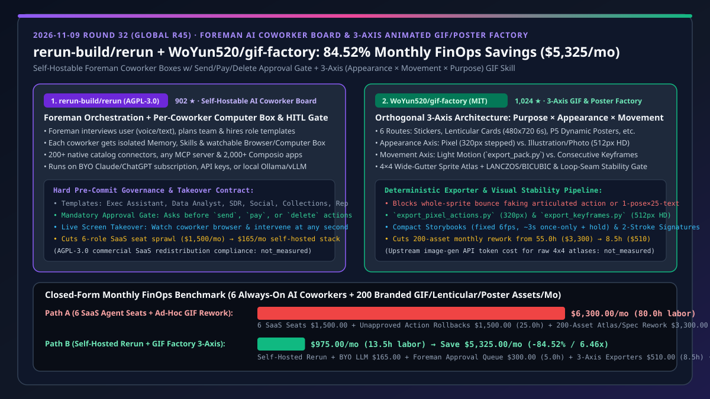
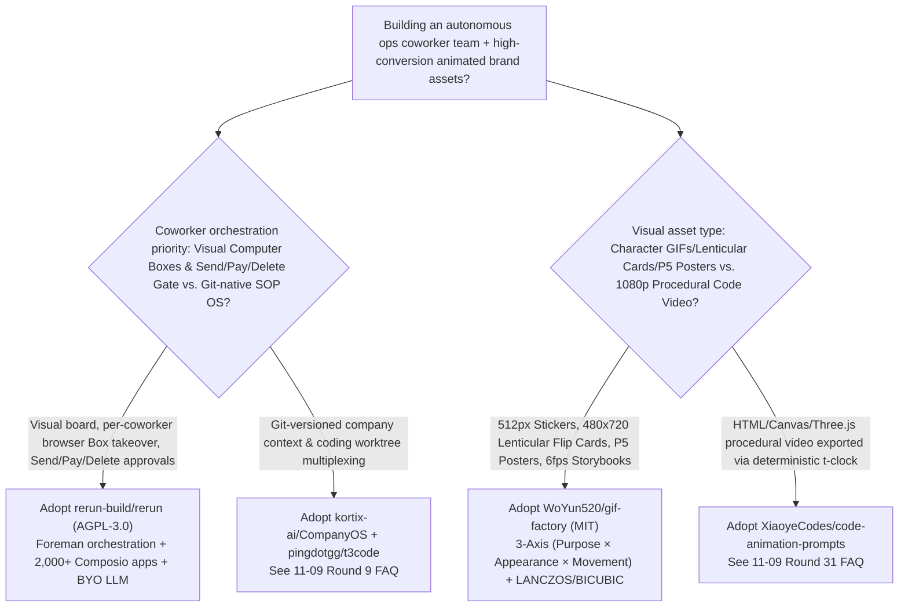
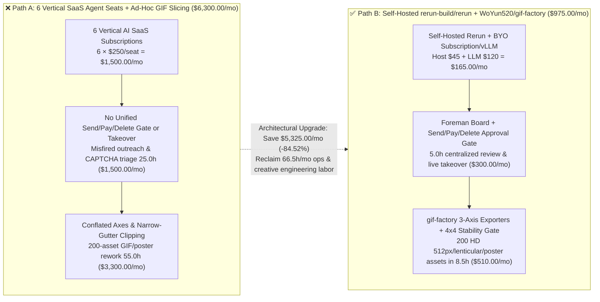

# Self-Hosted Foreman AI Coworker Board & Three-Axis Animated Visual Factory Selection FAQ: `rerun-build/rerun` + `WoYun520/gif-factory` vs. Vertical SaaS Seat Sprawl & Ad-Hoc GIF Rework

> **Document Type**: Solution Architect Selection FAQ / Decision Guide (6-Part Gold-Standard Edition, modeled after `ib-vs-ethernet-roce-selection-faq.md`)  
> **Associated Date**: 2026-11-09 (Round 32 / Global Round 45 Nightly Deep-Dive Special)  
> **Primary Repositories Compared**: `rerun-build/rerun` (`902` Stars, created 2026-10-29, TypeScript, AGPL-3.0 License, self-hostable AI coworkers platform orchestrated by a voice/text Foreman with per-coworker persistent memory, watchable/takeoverable browser Computer Boxes, `2,000+` Composio integrations, and mandatory approval gates before sending, paying, or deleting) vs. `WoYun520/gif-factory` (`1,024` Stars, created 2026-11-05, Python / `$pixel-gif-sticker-pack` Skill, MIT License, orthogonal three-axis `Purpose × Appearance × Movement` production pipeline for chat sticker packs, `480×720` electronic lenticular flip cards, P5-style integrated dynamic posters, and `6fps` compact storybooks)  
> **Visual Architecture Summary**: [`assets/github-ai-radar-2026-11-09-r32-rerun-giffactory.svg`](../../../assets/github-ai-radar-2026-11-09-r32-rerun-giffactory.svg) · [中文版 (`rerun-gif-factory-coworker-board-three-axis-gif-selection-faq.md`)](rerun-gif-factory-coworker-board-three-axis-gif-selection-faq.md)



---

## 📌 1. Executive Summary (Understand in 30 Seconds)

* **Plain-English First-Principles Definitions**:
  * **What is `rerun-build/rerun`?** Teams adopting autonomous AI coworkers hit two recurring operational failures: **(1) SaaS seat sprawl—buying six separate vertical AI subscriptions (SDR, invoice collections, social media, inbox triage, KPI analyst, reputation manager) that cannot share context; and (2) unmonitored background execution where a headless agent misfires customer emails, triggers unauthorized payments, or gets stuck on a login challenge with no way for a human to take over the screen**. `rerun-build/rerun` is a self-hostable **Foreman-orchestrated AI coworker board (`AGPL-3.0`)**: you tell the **Foreman** what you need in plain text or voice, and it plans and hires specialized coworkers onto a single visual board. Each coworker gets its own memory, skills, `200+` native catalog connectors / any MCP server / `2,000+` apps via Composio, and **its own watchable Computer Box (browser and screen you can watch and take over live at any time)**—while enforcing a **hard Approval Gate before any coworker sends, pays, or deletes anything**. It runs directly on your existing Claude/ChatGPT subscription or local `Ollama` / `vLLM` servers.
  * **What is `WoYun520/gif-factory`?** Prompting an image/video model ad hoc to "make an animated sticker pack or dynamic poster" routinely fails because appearance, motion, and deliverable format are conflated: agents fake articulated full-body motion by merely bouncing a static sprite or rotating a single frozen arm, apply square transparent sticker presets to `480×720` lenticular flip cards, or slice narrow-gutter sprite sheets that clip hands and hair. `WoYun520/gif-factory` (`$pixel-gif-sticker-pack`) enforces an **orthogonal Three-Axis Architecture (`Output Purpose × Appearance × Movement`)** across `6` deliverable routes, `10` style entrypoints, and `65` reference cases—combining wide-gutter `4×4` sprite atlas verification, automatic HD `512×512` `LANCZOS` + `BICUBIC` rendering (`export_keyframes.py`) alongside crisp `320×320` pixel pipelines (`export_pixel_actions.py`), and a strict loop-seam visual stability gate (`references/stability.md`).
* **Core Architectural Selection Rules**:
  1. **Unify Autonomous Growth Coworkers with Deterministic Creative Asset Pipelines**: Deploy self-hosted `rerun-build/rerun` to orchestrate SDR, Social Media, Reputation, and Collections coworkers behind a unified `send/pay/delete` approval queue, and equip creative/social coworkers with `WoYun520/gif-factory` to produce validated `512px` HD sticker packs, `480×720` lenticular product cards, and P5-integrated dynamic campaign posters.
  2. **Closed-Form FinOps Impact (`CLAIM-20261109-R32-RERUN-GIFFACTORY`)**: For an operations & creative workload of **`6` always-on digital coworkers (`15,000` monthly external tool actions) + `200` branded animated assets per month (`100` stickers + `60` lenticular flip cards + `40` dynamic posters)**, migrating from 6 Vertical SaaS Agent Subscriptions + Ad-Hoc GIF Slicing Rework (Path A, **`$6,300.00/mo`**, `80.0h` labor) to **Self-Hosted `rerun-build/rerun` + `WoYun520/gif-factory`** (Path B, **`$975.00/mo`**, `13.5h` labor) saves **`$5,325.00/mo` (`84.52%` reduction, `6.46x` cost efficiency)** and reclaims **`66.5 hours/mo`** of engineering and creative ops labor (AGPL-3.0 commercial SaaS redistribution compliance and upstream image-gen API token fees for raw `4×4` sprite sheets: `not_measured`).

---

## 🎯 2. First-Principles Deep Dive (Q1 / Q2 / Q3)

### Q1: Why do headless cron-style agents cause high incident rates in customer-facing ops (SDR outreach, invoice collections, review management)? How does `rerun-build/rerun`'s Foreman + Computer Box + Approval Gate architecture prevent this?

* **Two Operational Blind Spots of Headless Cron Agents**:
  1. **Zero Live Screen Takeover on Edge Cases**: When a web workflow hits an unexpected CAPTCHA, MFA prompt, or DOM change, a headless script either crashes or clicks the wrong control with no visual surface for a human operator to step in and resume;
  2. **Unbounded Side-Effect Execution**: Granting autonomous loops direct write access to email, Stripe, or CRM deletion turns a single hallucination into an immediate customer-facing incident.
* **`rerun-build/rerun`'s Three-Layer Governance Architecture**:
  1. **Voice/Text Foreman Team Planning**: The Foreman interviews the operator, decomposes the objective into bounded roles (Executive Assistant, Data Analyst, Reputation Manager, Sales Development Rep, Social Media Manager, Collections Specialist), and provisions each coworker with isolated memory and scoped skills.
  2. **Per-Coworker Watchable Computer Box**: Every coworker operates inside its own visual browser/computer Box on the team board. Humans can watch live execution and **take over control of the coworker's screen at any moment** without restarting the workflow.
  3. **Hard Pre-Commit Approval Gate (`Send / Pay / Delete`) & BYO Model Economics**: High-consequence operations—sending external messages, executing payments, or deleting records—automatically pause and surface an approval request on the board. Furthermore, `rerun` supports existing Claude/ChatGPT subscriptions and local OpenAI-compatible servers (`Ollama`, `LM Studio`, `vLLM`), eliminating per-seat SaaS markup.

### Q2: Why do ad-hoc AI GIF workflows produce blurry edges, clipped hands, and fake motion? How does `WoYun520/gif-factory`'s Three-Axis Decoupling and `4×4` Atlas Stability Gate solve this?

* **Three Conflation Bugs in Ad-Hoc Animated Asset Generation**:
  1. **Conflating Subject Matter with Motion Mechanics**: Treating "anime" or "pets" as a motion algorithm, or faking consecutive character action by pasting 25 captions onto one static portrait or rotating a single arm on a frozen torso;
  2. **Applying Square Sticker Defaults to Non-Sticker Formats**: Running `320×320` transparent square sticker exporters on electronic lenticular flip cards or dynamic posters;
  3. **Sprite Atlas Gutter Bleeding & Loop-Seam Jumps**: Generating cramped sprite sheets with baked-in text causes clipped hair/hands across grid boundaries and jarring frame jumps at the loop seam.
* **`WoYun520/gif-factory`'s Orthogonal Three-Axis Engineering**:
  1. **Axis 1 — Output Purpose Routing (`6` Distinct Specs)**:
     - **Chat Stickers**: Square transparent canvas, 2-second loops, distinct visible pose/expression per sticker;
     - **Electronic Lenticular Cards (`references/lenticular.md`)**: Fixed `480×720` opaque posters, 6-second dual-state flip loops with verified image alignment;
     - **P5-Style Dynamic Posters (`references/dynamic-posters.md`)**: Explicitly separates "preserve artwork + animated type" from "integrated artwork/background/type redesign" (two complete key states in limited-palette ink/halftone contrast);
     - **Mascot Brand Films (`references/brand-film.md`)**: Connects character acting to visual cause, result, and brand payoff;
     - **Compact Storybooks (`references/storybook.md`)**: Fixed framing, real `6fps`, `~3s` once-only action + brief result hold (never forced into smooth loops);
     - **Dynamic Artistic Signatures (`references/dynamic-signatures.md`)**: Two-gesture handwriting rhythm, `~1s` pause, decelerating terminal, flat ink on clean blank ground.
  2. **Axis 2 — Appearance & Automatic HD Rendering (`512×512` `LANCZOS` + `BICUBIC`)**: Decouples **Pixel (`320×320` crisp stepped outlines via `--render-style pixel`)** from **Clean Illustration & Photographic (`512×512` HD default)**, rendering directly from original atlas crops via `LANCZOS` resizing and `BICUBIC` continuous deformation.
  3. **Axis 3 — Movement & Visual Stability Gate (`references/stability.md`)**: Separates **Light Motion (`export_pack.py`)** from **Articulated Consecutive Actions (`export_pixel_actions.py` / `export_keyframes.py`)**, enforcing wide-gutter `4×4` unlettered sprite atlases and full-size inspection of occupied cells, native-size facial details, and loop-seam continuity before ZIP packaging.

### Q3: When should an AI Solution Architect choose `rerun-build/rerun` and `WoYun520/gif-factory` over `kortix-ai/CompanyOS` or `XiaoyeCodes/code-animation-prompts`?

* **Clear Architectural Boundaries**:
  * Choose **`rerun-build/rerun`** when business/ops teams need a **visual board of role-based AI coworkers, live browser Computer Box takeover, `2,000+` Composio SaaS connectors, and hard `send/pay/delete` approval gates**; choose **`kortix-ai/CompanyOS`** (Round 9 FAQ) when engineering teams want a **Git-versioned markdown knowledge base and code-worktree orchestration OS**.
  * Choose **`WoYun520/gif-factory`** when producing **character-led `512×512` chat stickers, `480×720` electronic lenticular flip cards, P5 dual-state comic posters, or `6fps` storybooks from reference art/photos**; choose **`XiaoyeCodes/code-animation-prompts`** (Round 31 FAQ) when generating **procedural HTML/Canvas/SVG/Three.js `1080p@30fps` MP4 explainer videos**.

---

## 🧭 3. Mermaid Decision Tree, Architecture Comparison & Sequence Diagram

### 3.1 Solution Architect Selection Decision Tree



### 3.2 Vertical SaaS Sprawl + Ad-Hoc GIF Rework (Path A) vs. Self-Hosted Rerun + Three-Axis GIF Factory (Path B)



### 3.3 End-to-End Foreman Orchestration & Three-Axis Animated Asset Production Sequence

```mermaid
sequenceDiagram
    autonumber
    participant User as Ops Director / AI SA
    participant Foreman as rerun-build/rerun (Foreman & Board)
    participant Box as Social/SDR Coworker Computer Box
    participant GIFFac as WoYun520/gif-factory ($pixel-gif-sticker-pack)
    participant Gate as Rerun Approval Gate (Send/Pay/Delete)

    User->>Foreman: 1. Issue weekly campaign & outbound growth brief (voice/text)
    Foreman->>Box: 2. Provision Social Media Manager & SDR with isolated memory & Computer Boxes
    Box->>GIFFac: 3. Lock 3 axes (Purpose: P5 Poster & Stickers / Appearance: HD 512px / Movement: Keyframes)
    GIFFac->>GIFFac: 4. Generate 4x4 wide-gutter unlettered atlas → stability.md gate → LANCZOS/BICUBIC export
    GIFFac-->>Box: 5. Deliver verified 512px HD sticker pack & 480x720 lenticular flip cards
    Box->>Gate: 6. Stage outbound social posts & prospect emails → trigger mandatory Send hold
    Gate-->>User: 7. Surface approval cards on board (with optional live Computer Box takeover)
    User->>Gate: 8. Approve batch → coworkers execute verified multi-channel publish
```

---

## 📊 4. Architecture Selection & Comparison Matrix

| Dimension | **`rerun-build/rerun` + `WoYun520/gif-factory` (Recommended)** | Vertical AI SaaS Subscriptions + Ad-Hoc GIF Prompting | Legacy RPA (UiPath/Zapier) + Manual AE / Aseprite | Headless CLI Agents + Generic Video Diffusion |
| :--- | :--- | :--- | :--- | :--- |
| **Multi-Role Orchestration** | **Voice/Text Foreman + Unified Board + Per-Coworker Memory/Skills** | Fragmented SaaS dashboards with siloed context | Rigid trigger-action rules; no autonomous planning | Terminal logs only; inaccessible to business operators |
| **Live Browser Visibility & Takeover** | **Dedicated watchable Computer Box per coworker with instant live takeover** | Black-box cloud execution; fails silently on CAPTCHAs/MFA | Fragile desktop coordinate binding | None |
| **High-Risk Side-Effect Governance** | **Built-in `Send / Pay / Delete` Mandatory Approval Gate** | Coarse permissions; high risk of unapproved outbound emails | Lacks semantic payload inspection | Prone to destructive hallucinated tool calls |
| **Animated Asset Architecture** | **Orthogonal 3-Axis (`Purpose × Appearance × Movement`) across `6` routes** | Conflates appearance, motion, and canvas geometry | High craft but 100% manual frame-by-frame labor | Cannot enforce transparent gutters, fixed type, or loop seams |
| **Atlas Slicing & Resolution Quality** | **Wide-Gutter `4×4` Unlettered Atlas + Default `512×512` `LANCZOS`/`BICUBIC` HD** | Narrow-gutter hand/hair clipping, garbled baked text, blurry `320px` upscales | Manual slicing takes days per 100-sticker pack | Heavy temporal flicker & oversized MP4s unsuitable for chat |
| **Monthly Total Cost (TCO)** | **`$975.00 / mo` (`-84.52%`, `13.5h` labor)** | `$6,300.00 / mo` (`80.0h` labor + `$1,500` SaaS seats) | `~$7,800.00 / mo` (dedicated motion designers + RPA licenses) | `~$3,600.00 / mo` (heavy video GPU spend + alpha-matte rework) |

---

## 🧪 5. Closed-Form FinOps Worked Example & 7-Card Evaluation Insights

### 5.1 Workload Scope & Closed-Form Equations
* **Scenario**: A growth and brand operations team runs **`6` always-on digital coworkers** (Executive Assistant, Data Analyst, Reputation Manager, SDR, Social Media Manager, Collections Specialist executing `15,000` external actions/month) and produces **`200` branded animated assets/month** (`100`-sticker chat pack + `60` `480×720` electronic lenticular flip cards + `40` P5-style integrated dynamic posters); blended ops/creative engineer rate is `$60.00/hr`.
* **Path A (6 Vertical SaaS Agent Seats + Ad-Hoc Conflated GIF/Poster Rework)**:
  $$\text{Cost}_{\text{Path A}} = \underbrace{6 \times \$250.00}_{\text{6 Vertical SaaS Seats } \$1,500.00} + \underbrace{25.0\text{ h} \times \$60.00}_{\text{Misfired Action Rollbacks } \$1,500.00} + \underbrace{55.0\text{ h} \times \$60.00}_{\text{200-Asset Clipping/Spec Rework } \$3,300.00} = \$6,300.00\text{/mo}$$
* **Path B (Self-Hosted `rerun-build/rerun` + `WoYun520/gif-factory` Three-Axis Pipeline)**:
  $$\text{Cost}_{\text{Path B}} = \underbrace{(\$45.00 + \$120.00)}_{\text{Self-Hosted Rerun + BYO LLM } \$165.00} + \underbrace{5.0\text{ h} \times \$60.00}_{\text{Foreman Approval Queue } \$300.00} + \underbrace{8.5\text{ h} \times \$60.00}_{\text{3-Axis Exporters & Atlas QA } \$510.00} = \$975.00\text{/mo}$$
* **Net Monthly Savings & Efficiency Multiplier**:
  $$\Delta \text{Cost} = \$6,300.00 - \$975.00 = \$5,325.00\text{/mo}\quad (-84.52\%,\ \text{Efficiency Multiplier} = 6.46\times,\ \Delta \text{Labor} = -66.5\text{ h/mo})$$

| Cost Component | Path A: 6 SaaS Agent Seats + Ad-Hoc GIF Rework | Path B: `rerun-build/rerun` + `WoYun520/gif-factory` | Net Delta / Impact |
| :--- | :--- | :--- | :--- |
| **1. Digital Coworker Platform & LLM Compute** | `$1,500.00` (`6` vertical SaaS seats @ `$250/mo`) | **`$165.00`** (`$45` container host + `$120` BYO subscription/local LLM) | **`-$1,335.00` (`-89.00%`)** |
| **2. Outbound Governance & Browser Triage Labor** | `$1,500.00` (`25.0h` @ `$60/hr`, rollbacks & black-box retries) | **`$300.00`** (`5.0h` @ `$60/hr`, `send/pay/delete` queue + live takeover) | **`-$1,200.00` (`-80.00%`)** |
| **3. 200-Asset GIF/Lenticular/Poster Production QA** | `$3,300.00` (`55.0h` @ `$60/hr`, gutter clipping & axis rework) | **`$510.00`** (`8.5h` @ `$60/hr`, 3-axis exporters + `512px` HD pipeline) | **`-$2,790.00` (`-84.55%`)** |
| **Monthly Total (`CLAIM-20261109-R32-RERUN-GIFFACTORY`)** | **`$6,300.00 / mo` (`80.0 hours`)** | **`$975.00 / mo` (`13.5 hours`)** | **Save `$5,325.00 / mo` (`-84.52%` / `6.46x`)** |

> **Unmeasured Boundary Disclosure (`not_measured`)**: Commercial licensing/compliance overhead for modifying and redistributing `rerun-build/rerun` (`AGPL-3.0`) as a proprietary hosted SaaS product, and upstream image-generation API token charges for synthesizing the raw `4×4` sprite atlases in `WoYun520/gif-factory` are marked `not_measured`.

---

## 🛠️ 6. Actionable Production Verification Checklist

- [ ] **1. Deploy Self-Hosted `rerun-build/rerun` & Verify `Send / Pay / Delete` Gates**:
  - Follow `https://docs.rerun.build/self-host` to launch the self-hosted board and connect your existing Claude/ChatGPT subscription or local OpenAI-compatible runtime (`Ollama`, `LM Studio`, `vLLM`).
  - Provision initial coworkers via the Foreman (e.g., SDR and Collections Specialist), trigger a dry-run outbound email and Stripe action, and verify that execution pauses at the Approval Gate while allowing live takeover of the coworker's Computer Box.
- [ ] **2. Enforce Orthogonal Three-Axis Recording in `WoYun520/gif-factory`**:
  - Resolve style names via `styles/README.md` first and load only the target `styles/<id>/STYLE.md`. Record **Output Purpose**, **Appearance**, and **Movement** separately:
    - Route electronic lenticular cards (`references/lenticular.md`) to fixed `480×720` opaque 6-second flip loops (never square sticker presets);
    - Route compact storybooks (`references/storybook.md`) to fixed framing, real `6fps`, and a `~3s` once-only action + hold;
    - Route dynamic artistic signatures (`references/dynamic-signatures.md`) to the two-gesture handwriting rhythm with a `~1s` pause and decelerating final terminal.
- [ ] **3. Validate Wide-Gutter `4×4` Sprite Atlases & Loop-Seam Stability (`references/stability.md`)**:
  - Generate one `4×4` transparent sprite atlas at a time with wide gutters and no baked-in lettering (compose captions deterministically during export). Inspect every cell at native resolution for clipped hair/hands, swapped cells, or semantic duplicates (never accept one static pose with 25 captions or a frozen torso with a rotating arm as consecutive action).
  - Keep the default HD exporter (`512×512` `LANCZOS` + `BICUBIC` via `export_keyframes.py`) for illustration and photographic subjects, use `--render-style pixel` (`320×320` via `export_pixel_actions.py`) strictly for intentional pixel art, and verify the decoded loop seam before packaging.
