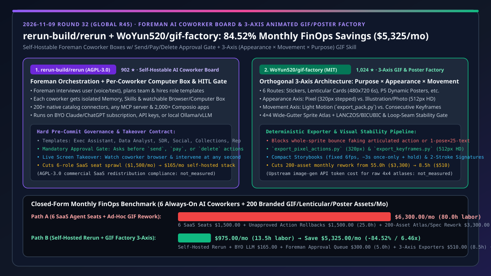
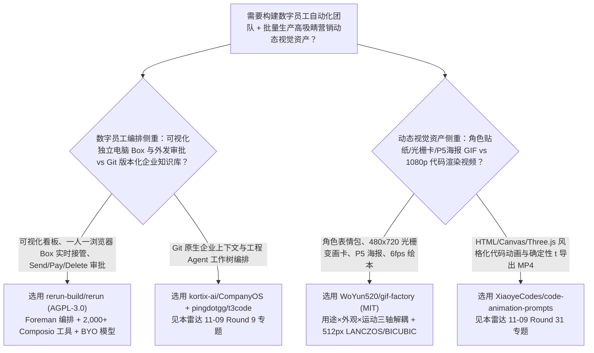
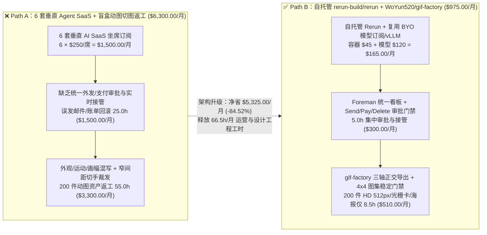

# 自托管工头制 AI 数字员工看板与三轴解耦动态视觉工厂选型 FAQ：`rerun-build/rerun` + `WoYun520/gif-factory` vs 垂直 SaaS 坐席堆叠与盲盒式动图返工

> **文档类型**：架构师选型 FAQ / 决策指南（6 段式标杆版，对标 `ib-vs-ethernet-roce-selection-faq.md`）  
> **关联日期**：2026-11-09（Round 32 / 全局 Round 45 整晚深潜收官独立专题）  
> **核心对标仓库**：`rerun-build/rerun`（`902` Stars，2026-10-29 创建，TypeScript，AGPL-3.0 协议，由 Foreman 工头统一面试编排、每位数字员工独占记忆/技能/可随时接管浏览器电脑 Box、且在发送/付款/删除前强制人工审批的自托管 AI 协作平台） vs `WoYun520/gif-factory`（`1,024` Stars，2026-11-05 创建，Python / `$pixel-gif-sticker-pack` Skill，MIT 协议，将“输出用途 × 视觉外观 × 运动模式”三轴彻底正交解耦的像素/插画/真人表情包、电子光栅卡、P5 风格动态海报与 6fps 动态绘本生产管线）  
> **关联可视化图表**：[`assets/github-ai-radar-2026-11-09-r32-rerun-giffactory.svg`](../../../assets/github-ai-radar-2026-11-09-r32-rerun-giffactory.svg) · [English Version (`rerun-gif-factory-coworker-board-three-axis-gif-selection-faq.en.md`)](rerun-gif-factory-coworker-board-three-axis-gif-selection-faq.en.md)



---

## 📌 1. 核心结论速览（Executive Summary — 30 秒看懂）

* **一句话大白话本质定义**：
  * **`rerun-build/rerun` 是什么？** 企业采购 AI Agent 时最怕两件事：**一是买了一堆按席位收费的垂直 SaaS Agent（SDR 销售、催款专员、社媒运营、高管助理各买一套），互相记忆不通且账单爆炸；二是后台无头 Agent 偷偷发错邮件、乱扣款或误删 CRM 数据**。`rerun-build/rerun` 提供了一个可自托管的 **“工头（Foreman）+ 独立电脑沙盒（Computer Box）+ 关键动作审批门禁”数字员工看板**：你用自然语言（或语音）告诉 Foreman 目标，Foreman 自动组建团队并分配角色模板；每位数字员工拥有独立的记忆、技能、可直连 `200+` 原生目录工具 / 任意 MCP Server / `2,000+` Composio 应用，以及一台**人类随时可实时监看并一键接管的专属浏览器电脑**；最关键的是，任何涉及**外发消息（Send）、资金支付（Pay）或数据删除（Delete）**的高危操作，都会强制挂起等待人类一键审批。支持直接复用已有的 Claude/ChatGPT 订阅或本地 `Ollama` / `vLLM`。
  * **`WoYun520/gif-factory` 是什么？** 当增长与内容团队用 AI 批量制作聊天表情包、双状态电子光栅变画卡（Lenticular Card）或 P5（女神异闻录 5）风格漫画动态海报时，传统做法是“一段笼统 Prompt 直接生图切图”，结果要么把“整体精灵上下弹跳（Light Motion）”冒充“全身关节连贯动作（Articulated Consecutive Action）”，要么把方形透明贴纸预设错误套用到 `480×720` 不透明光栅卡上，甚至因精灵图集（Sprite Atlas）间距过窄导致头发/手部被裁切。`gif-factory`（`$pixel-gif-sticker-pack`）建立了严格的**三轴正交解耦架构（输出用途 Purpose × 外观渲染 Appearance × 运动方式 Movement）**，提供 `export_pack.py`、`export_pixel_actions.py`（`320×320` 像素阶梯轮廓）与默认 HD `export_keyframes.py`（`512×512` `LANCZOS` 缩放 + `BICUBIC` 连续形变）以及 `references/stability.md` 循环接缝质检门禁。
* **核心选型纪律**：
  1. **前台数字员工协同 + 品牌动态视觉资产流水线**：用自托管 `rerun-build/rerun` 统一编排 SDR、社媒、催收与声誉管理数字员工（复用 BYO 模型订阅与统一审批流），同时将 `WoYun520/gif-factory` 挂载为社媒与品牌数字员工的视觉技能引擎，按需批量生产合规、零裁切瑕疵的品牌表情包、光栅收藏卡与 P5 动态海报。
  2. **闭式 FinOps 收益（`CLAIM-20261109-R32-RERUN-GIFFACTORY`）**：在“常驻运行 `6` 类业务数字员工（月处理 `15,000` 次外部工具动作）+ 每月交付 `200` 件品牌动态视觉资产（`100` 张表情包 + `60` 张电子光栅卡 + `40` 张动态海报）”基准负载下，相比“采购 6 套商业垂直 Agent SaaS 席位 + 混轴盲盒动图返工”（Path A，**`$6,300.00/月`**，耗费 `80.0h` 人工），采用 **自托管 `rerun` + `gif-factory` 三轴流水线**（Path B，**`$975.00/月`**，仅 `13.5h` 人工）每月净省 **`$5,325.00/月`（降本 `84.52%`，成本效率提升 `6.46x`）**，每月释放 **`66.5 小时`**运营与设计工程工时！（注：`rerun-build/rerun` 的 AGPL-3.0 协议在商业多租户改版分发下的合规成本，以及 `gif-factory` 生成原始 `4×4` 精灵图集的上游生图 API Token 费用标记为 `not_measured`）。

---

## 🎯 2. 灵魂拷问（Q1 / Q2 / Q3 — 第一性原理深挖）

### Q1：为什么传统的“后台 Cron 脚本型 Agent”在企业外联（SDR 拓客、逾期账单催收、负面评价回复）中事故率极高？`rerun-build/rerun` 的 Foreman + 独立电脑 Box + Send/Pay/Delete 审批门禁是如何解决的？

* **传统后台 Agent 的两大失控盲区**：
  1. **黑盒浏览器会话无法中途接管**：当目标网站弹出复杂验证码、二次认证或异常布局时，无界面脚本直接崩溃或点错按钮，人类既看不到现场画面，也无法平滑接管鼠标键盘；
  2. **缺乏语义级高危动作统一刹车**：把发邮件、改日历、发起退款的权限直接交给自治循环，一旦发生 Prompt 注入或幻觉，几分钟内就会制造批量外联事故。
* **`rerun-build/rerun` 的三层架构防线**：
  1. **工头面谈与角色边界隔离（The Foreman & Role Templates）**：Foreman 先通过语音或文字与人类对齐业务规则，按职责孵化独立数字员工（Executive Assistant、Data Analyst、Reputation Manager、SDR、Social Media Manager、Collections Specialist），每个员工拥有独立的记忆空间与专属工具集，杜绝跨角色上下文污染。
  2. **一人一机可视化沙盒（Their Own Computer Box）**：每位数字员工配备独立的隔离桌面/浏览器环境，统一呈现在看板的 Box 中；人类可随时点开实时观察其操作轨迹，并在遇到边缘情况时**零停机即时接管（Live Takeover）**。
  3. **不可绕过的 Send / Pay / Delete 审批门禁（Mandatory Approval Gate）**：在工具执行层对所有具备外部副作用的动作（发送外联邮件/社媒贴、执行 Stripe/账单支付、删除记录）实施硬性拦截，在看板生成待批卡片，人类确认前绝不落盘执行；同时支持绑定企业已付费的 Claude/ChatGPT 订阅或本地 `vLLM`/`Ollama`，消除二次 SaaS 溢价。

### Q2：为什么大多数 AI 表情包与动态海报生成工具做出来的成品“边缘糊、手脚被切、动作假”？`WoYun520/gif-factory` 的“三轴正交解耦”与 `4×4` 图集稳定门禁到底解决了什么工程问题？

* **传统动图生成的三大耦合乱象**：
  1. **把“题材”当成“运动模式”**：误以为二次元或宠物就该用同一种形变脚本，甚至拿“1 张静态肖像配 25 句不同文字”或“整张贴图旋转手臂”冒充全身连贯动作（Articulated Consecutive Action）；
  2. **把“贴纸画布规范”硬套到所有载体**：用 `320×320` 方形透明背景贴纸导出器去生成电子光栅卡或漫画海报，导致分辨率模糊、比例失调；
  3. **图集切分越界与循环接缝跳帧**：生图模型一次性生成的精灵图若间距（Gutter）过窄或直接带字，切帧时会出现发梢/手掌被截断、格子顺序错乱及首尾帧跳变。
* **`gif-factory` 的三轴正交工程规范**：
  1. **第一轴：输出用途路由（Output Purpose）**：严格区分 6 类交付物规范——① **聊天贴纸（Sticker Pack）**：方形透明画布、2 秒循环；② **电子光栅变画卡（Electronic Lenticular Cards）**：固定 `480×720` 不透明画幅、6 秒双状态对齐翻转；③ **P5 式漫画融合动态海报（Dynamic Posters）**：区分“保留原画+动效字”与“人物/背景/大字双关键状态整体重构（黑白网点打底+角色主色对比）”；④ **吉祥物品牌短片（Brand Films）**；⑤ **紧凑动态绘本（Compact Storybooks）**：独立 Skill，固定机位、真实 `6fps`、约 3 秒单次动作加结果停顿（严禁强行循环或平滑插值）；⑥ **动态艺术签名（Dynamic Signatures）**：两笔书写节奏、约 1 秒停顿与收笔减速，纯平手写墨迹。
  2. **第二轴：外观与超清采样（Appearance & Automatic HD Rendering）**：将 **像素风（Pixel，`320×320` 阶梯锐利轮廓，`--render-style pixel`）** 与 **清晰插画 / 真人宠物摄影（Clean Illustration / Photographic，默认 HD `512×512`）** 解耦；HD 模式直接从原始图集裁切并通过 `LANCZOS` 重采样与 `BICUBIC` 连续形变输出，无需用户手动修补清晰度。
  3. **第三轴：运动模式与视觉稳定门禁（Movement & Stability Gate）**：明确区分 **轻动效（Light Motion，`export_pack.py` 微弹跳/点头/挤压，但每张贴纸仍须具备独立表情姿态）** 与 **连贯关节动作（Consecutive Action，`export_pixel_actions.py` / `export_keyframes.py`）**；生成 `4×4` 宽间距无字透明精灵图集后，强制按 `references/stability.md` 原尺寸核验占用格数、发丝手部裁切与首尾循环接缝（Loop Seam）。

### Q3：架构师在落地 `rerun-build/rerun` 与 `WoYun520/gif-factory` 时，何时应该选它们，何时应该选 `kortix-ai/CompanyOS` 或 `XiaoyeCodes/code-animation-prompts`？

* **清晰选型边界**：
  * 当你需要**面向业务团队的可视化多员工看板、实时接管每个员工的独立浏览器 Box、连接 `2,000+` Composio 业务 SaaS 并复用现有 Claude/ChatGPT 订阅**时，选 **`rerun-build/rerun`**；若你需要的是**基于 Git 版本化管理企业 SOP/Context 的代码仓级操作系统**，选本雷达 Round 9 的 **`kortix-ai/CompanyOS`**。
  * 当你需要**以角色/吉祥物/人物肖像为核心，批量生产 `512×512` 聊天表情包、`480×720` 电子光栅变画卡、P5 双状态漫画海报或 `6fps` 翻页绘本**时，选 **`WoYun520/gif-factory`**；若你需要的是**基于 HTML/Canvas/SVG/Three.js 代码生成的 1080p 粒子/水墨/赛博/工程对比墙视频短片**，选本雷达 Round 31 的 **`XiaoyeCodes/code-animation-prompts`**。

---

## 🧭 3. Mermaid 选型决策树、架构路径对比与协同生产时序图

### 3.1 架构师选型决策树（Selection Decision Tree）



### 3.2 垂直 SaaS 堆叠 + 盲盒动图返工（Path A）vs 自托管 Rerun + GIF 工厂三轴管线（Path B）



### 3.3 Foreman 数字员工编排与三轴 GIF 视觉资产交付端到端时序图（Sequence Diagram）

```mermaid
sequenceDiagram
    autonumber
    participant User as 人类运营总监 / AI SA
    participant Foreman as rerun-build/rerun (Foreman & Board)
    participant Box as Social/SDR Coworker Computer Box
    participant GIFFac as WoYun520/gif-factory ($pixel-gif-sticker-pack)
    participant Gate as Rerun Approval Gate (Send/Pay/Delete)

    User->>Foreman: 1. 语音/文本下达周度增长与新品宣发任务
    Foreman->>Box: 2. 分配 Social Media Manager 与 SDR 独立记忆及浏览器 Box
    Box->>GIFFac: 3. 锁定三轴参数 (用途: P5海报 & 贴纸 / 外观: HD 512px / 运动: 连贯动作)
    GIFFac->>GIFFac: 4. 生成 4x4 宽间距无字图集 → stability.md 接缝质检 → LANCZOS/BICUBIC 导出
    GIFFac-->>Box: 5. 返回验收通过的 512px GIF 贴纸包与 480x720 光栅预告卡
    Box->>Gate: 6. 准备批量外发社媒贴与客户拓展邮件，触发 Send 审批拦截
    Gate-->>User: 7. 看板弹出待批卡片（可随时点进 Box 接管浏览器微调）
    User->>Gate: 8. 一键批准 (Approve)，数字员工安全完成全渠道发布
```

---

## 📊 4. 同类方案对比选型矩阵（Comparison Matrix）

| 评估维度 | **`rerun-build/rerun` + `WoYun520/gif-factory`（推荐组合）** | 垂直 AI Agent SaaS 采购 + 笼统 Prompt 生图切图（Legacy Stack） | 传统 RPA（UiPath/Zapier）+ 手工 After Effects / Aseprite | 无头 Agent 框架（AutoGPT 类）+ 通用视频扩散模型 |
| :--- | :--- | :--- | :--- | :--- |
| **多员工编排与界面** | **Foreman 自动组队 + 单看板集中管理 + 每人独立记忆/技能** | 多个割裂 SaaS 后台，记忆与上下文完全孤立 | 纯流程图连线，无自主规划与跨工具推理能力 | 仅命令行日志，非技术运营人员无法使用 |
| **浏览器可视化与人工接管** | **每位员工独占可实时观看并随时一键接管的 Computer Box** | 黑盒云端执行，遇到验证码或异常直接失败 | 需绑定本地固定桌面，接管易打断脚本状态 | 无图形化接管界面 |
| **高危动作安全门禁** | **内置 Send / Pay / Delete 硬性审批拦截（Approval Gate）** | 权限粒度粗糙，易发生未授权自动外发事故 | 缺乏语义级风控判断 | 极易因幻觉执行破坏性调用 |
| **动图设计架构（三轴解耦）** | **用途（6类）× 外观（320px像素 / 512px HD）× 运动（轻动效/连贯帧）正交解耦** | 外观、动作与画布混为一谈，频繁用单图弹跳冒充连贯动作 | 质量高但完全依赖设计师逐帧手绘 | 无法精确控制透明通道、固定字牌与无限循环接缝 |
| **图集裁切与清晰度保障** | **`4×4` 宽间距无字图集核验 + 默认 `512×512` `LANCZOS`/`BICUBIC` 超清采样** | 窄间距切手裁发、带字生图乱码、`320px` 模糊放大 | 手工切图耗时极长（每套数天） | 边缘伪影严重，文件体积过大不适合聊天窗口 |
| **月度总拥有成本（TCO）** | **`$975.00 / 月`（省 `84.52%`，`13.5h` 人工）** | `$6,300.00 / 月`（`80.0h` 人工 + `$1,500` SaaS 席位） | `~$7,800.00 / 月`（高昂全职设计师与 RPA 授权费） | `~$3,600.00 / 月`（高昂视频 GPU 算力 + 抠图返工） |

---

## 🧪 5. 定量 FinOps 闭式算例与 7-Card 评测洞察（Closed-Form Quantitative Evaluation）

### 5.1 基准工作负载设定（Scope & Assumptions）
* **业务场景**：某跨境品牌增长与互动营销团队，常驻运行 **`6` 名全天候 AI 数字员工**（高管助理、数据分析、声誉管理、SDR 拓客、社媒运营、逾期催收，每月执行 `15,000` 次跨平台动作），并每月生产 **`200` 件品牌动态视觉资产**（`100` 张聊天表情包 + `60` 张 `480×720` 电子光栅变画卡 + `40` 张 P5 风格漫画动态海报）；增长与视觉工程师综合时薪 `$60.00/hr`。
* **Path A（采购 6 套商业垂直 Agent SaaS + 混轴盲盒动图返工）**：
  $$\text{Cost}_{\text{Path A}} = \underbrace{6 \times \$250.00}_{\text{6 套垂直 Agent SaaS } \$1,500.00} + \underbrace{25.0\text{ h} \times \$60.00}_{\text{外发误操作回滚与黑盒排障 } \$1,500.00} + \underbrace{55.0\text{ h} \times \$60.00}_{\text{200 件动图切手/模糊/混轴返工 } \$3,300.00} = \$6,300.00\text{/月}$$
* **Path B（自托管 `rerun-build/rerun` + `WoYun520/gif-factory` 三轴解耦管线）**：
  $$\text{Cost}_{\text{Path B}} = \underbrace{(\$45.00 + \$120.00)}_{\text{自托管 Rerun 容器 + BYO 模型 } \$165.00} + \underbrace{5.0\text{ h} \times \$60.00}_{\text{Foreman 看板集中审批 } \$300.00} + \underbrace{8.5\text{ h} \times \$60.00}_{\text{三轴导出器与 4x4 图集质检 } \$510.00} = \$975.00\text{/月}$$
* **净节省与效率倍率**：
  $$\Delta \text{Cost} = \$6,300.00 - \$975.00 = \$5,325.00\text{/月}\quad (-84.52\%,\ \text{Efficiency Multiplier} = 6.46\times,\ \Delta \text{Labor} = -66.5\text{ h/月})$$

| 成本分项 | Path A：垂直 Agent SaaS + 盲盒动图返工 | Path B：`rerun-build/rerun` + `WoYun520/gif-factory` | 差额 / 收益 |
| :--- | :--- | :--- | :--- |
| **1. 数字员工平台与模型算力费** | `$1,500.00`（`6` 个垂直 SaaS 席位 @ `$250/月`） | **`$165.00`**（自托管主机 `$45` + 复用 BYO 订阅/本地模型 `$120`） | **`-$1,335.00` (`-89.00%`)** |
| **2. 外联风控审批与浏览器异常排障人工** | `$1,500.00`（`25.0h` @ `$60/hr`，事后回滚与黑盒重试） | **`$300.00`**（`5.0h` @ `$60/hr`，Send/Pay/Delete 预审 + 实时接管） | **`-$1,200.00` (`-80.00%`)** |
| **3. 200 件品牌 GIF/光栅卡/海报制作与质检人工** | `$3,300.00`（`55.0h` @ `$60/hr`，切图越界与动作重做） | **`$510.00`**（`8.5h` @ `$60/hr`，三轴正交导出 + `512px` HD 默认管线） | **`-$2,790.00` (`-84.55%`)** |
| **月度总计（`CLAIM-20261109-R32-RERUN-GIFFACTORY`）** | **`$6,300.00 / 月`（`80.0 小时`）** | **`$975.00 / 月`（`13.5 小时`）** | **净省 `$5,325.00 / 月` (`-84.52%` / `6.46x`)** |

> **未测量项透明披露（`not_measured`）**：将 `rerun-build/rerun`（`AGPL-3.0` 许可证）修改后作为商业闭源多租户 SaaS 对外售卖时的法务合规/商业授权买断成本，以及 `WoYun520/gif-factory` 在调用外部生图模型生成初始 `4×4` 透明精灵图集时的上游图像 API Token 账单标记为 `not_measured`。

---

## 🛠️ 6. 实战上手与生产核验 Checklist（Actionable Production Checklist）

- [ ] **1. 部署自托管 `rerun-build/rerun` 并验证 Send/Pay/Delete 审批拦截**：
  - 按照 `https://docs.rerun.build/self-host` 启动自托管实例，接入企业现有的 Claude/ChatGPT 订阅或内网 OpenAI 兼容端点（`vLLM` / `Ollama` / `LM Studio`）。
  - 通过 Foreman 创建首批角色（如 SDR 与 Collections Specialist），并在测试沙盒中触发一笔模拟发送邮件与 Stripe 扣款，验证看板是否强制挂起在 Approval Gate 且支持随时点击 Computer Box 实时接管浏览器画面。
- [ ] **2. 严格执行 `WoYun520/gif-factory` 三轴正交参数建档**：
  - 每次调用 `$pixel-gif-sticker-pack` 时，先查 `styles/README.md` 并只按需读取目标 `styles/<id>/STYLE.md`；在生产记录中分别锁定 **用途（Purpose）**、**外观（Appearance）** 与 **运动模式（Movement）**：
    - 电子光栅卡（`references/lenticular.md`）必须使用固定 `480×720` 不透明画幅与 6 秒循环，严禁套用方形透明贴纸预设；
    - 紧凑动态绘本（`references/storybook.md`）必须采用固定机位、真实 `6fps`、约 3 秒单次动作加结果停顿，严禁强制无限循环或插帧；
    - 动态艺术签名（`references/dynamic-signatures.md`）必须保持两笔书写节奏、约 1 秒停顿与收笔减速。
- [ ] **3. 执行 `4×4` 宽间距无字图集与 `references/stability.md` 视觉验收门禁**：
  - 生成角色动作图集时，强制要求 **单张 `4×4` 宽间距（Wide Gutters）、纯透明背景且不含文字**（文字留到合成阶段注入以便校验）；原尺寸检查全部 16 格是否被完整占用、有无发梢/手掌跨格裁切或语义重复（严禁“同一张静态图换 25 句文案”或“全身僵硬仅手臂旋转”冒充连贯动作）。
  - 插画与真人宠物默认启用 HD 模式（`512×512` `LANCZOS` 缩放 + `BICUBIC` 连续形变，`export_keyframes.py`）；仅在明确要求像素风时传入 `--render-style pixel`（`320×320`，`export_pixel_actions.py`），并在打包交付前逐帧检查首尾循环接缝（Loop Seam）。
