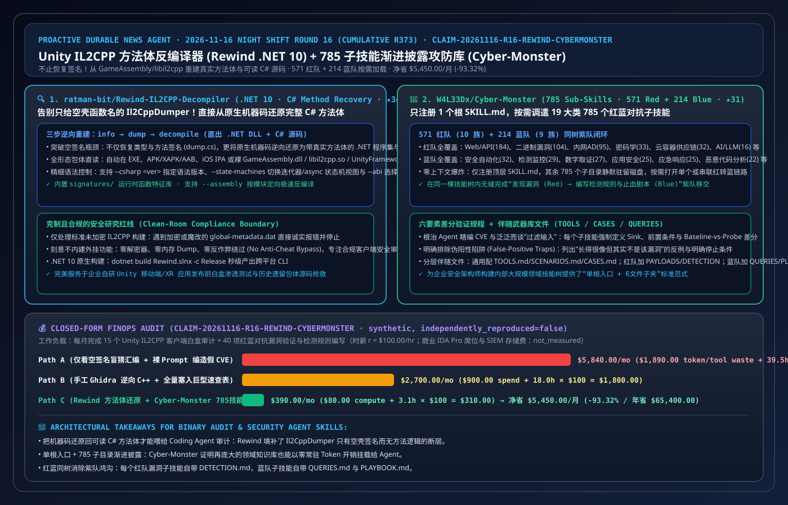
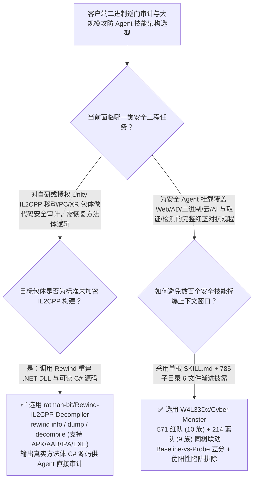

# Unity IL2CPP 方法体反编译器与 785 子技能渐进披露攻防库选型 FAQ：`ratman-bit/Rewind-IL2CPP-Decompiler` + `W4L33Dx/Cyber-Monster`

> **元数据（Metadata）**
> - **评测批次**：2026-11-16 夜间深潜 Round 16（累计 Round 373）
> - **核心标的**：
>   1. [`ratman-bit/Rewind-IL2CPP-Decompiler`](https://github.com/ratman-bit/Rewind-IL2CPP-Decompiler)（`★ 34`，`2026-11-15` 新建爆发黑马 · 基于 `.NET 10` 构建的 Unity IL2CPP 逆向反编译器：不仅能导出类型与方法签名 `dump.cs`，更能从 `GameAssembly.dll` / `libil2cpp.so` / `UnityFramework` 与元数据中**重建包含真实方法体的 `.NET` 程序集与可读 C# 源码**，支持 EXE/APK/XAPK/AAB/IPA 自动定位与 `--state-machines` 展开，且明确拒绝加密/反作弊绕过以严守合规边界）
>   2. [`W4L33Dx/Cyber-Monster`](https://github.com/W4L33Dx/Cyber-Monster)（`★ 31` / `9 Forks`，`2026-11-15` 新建爆发黑马 · 单根入口渐进式披露安全智能体技能库：只需注册顶层 1 个 `SKILL.md`，按需调度 **19 大技术族、785 个自包含子技能（571 个红队进攻子技能 + 214 个蓝队防御/取证/检测子技能）**，每个子技能配套 `TOOLS.md`、`SCENARIOS.md`、`CASES.md` 及红队 `PAYLOADS.md`/`DETECTION.md` 或蓝队 `QUERIES.md`/`PLAYBOOK.md`）
> - **配套架构图**：[`assets/github-ai-radar-2026-11-16-r16-rewind-cybermonster.svg`](../../../assets/github-ai-radar-2026-11-16-r16-rewind-cybermonster.svg)
> - **证据封存锚点**：`CLAIM-20261116-R16-REWIND-CYBERMONSTER`（见 [`evidence/trending-daily-2026-11-16-audit.json`](../evidence/trending-daily-2026-11-16-audit.json)）

---

## 📌 1. 核心结论速览（Executive Summary & First-Principles Pitch）

1. **一句话讲透本质**：
   - **`ratman-bit/Rewind-IL2CPP-Decompiler` (`.NET 10`)**：就是**把 Unity IL2CPP 编译成原生机器码（C++ → Native）后扔掉的“C# 方法内部逻辑”真正找回来的合规白盒还原器**。普通工具（如 `Il2CppDumper`）只能从 `global-metadata.dat` 里抠出类名和空函数签名（`dump.cs`），至于函数里面到底写了什么硬编码密钥或协议校验逻辑，还得人肉去翻几百万行反汇编。`Rewind` 直接结合 `signatures/` 运行时特征库把原生二进制逆向重建为**带完整方法体的 `.NET` 程序集与可读 C# 源码**（`rewind decompile`），让 Coding Agent 能够直接读 C# 代码做客户端安全审计！
   - **`W4L33Dx/Cyber-Monster` (`785 Sub-Skills`)**：就是**把 571 项红队渗透与 214 项蓝队检测/应急规程装进“单根入口 + 零常驻上下文污染”目录树里的紫队（Purple Team）百科全书**。让没有任何技能护栏的大模型做安全评估，它经常张冠李戴、捏造假 CVE 编号、或者只会给出一句正确的废话“请过滤用户输入”。`Cyber-Monster` 让你只注册根目录一个 `SKILL.md`，当遇到具体任务（如 Web/API、二进制漏洞、AD 域控、云容器供应链、AI/LLM 安全或 SIEM 威胁狩猎）时，Agent 才按需打开对应子文件夹读取**危险汇点（Sink）、前置条件、基线与探针差分（Baseline-vs-Probe）、伪阳性陷阱与停止条件**，并一步到位完成从红队验证（`PAYLOADS.md`）到蓝队检测（`DETECTION.md` / `QUERIES.md` / `PLAYBOOK.md`）的闭环！
2. **核心量化收益（FinOps 闭式账本 `CLAIM-20261116-R16-REWIND-CYBERMONSTER`）**：
   - 在 **每月完成 15 个 Unity IL2CPP 移动/XR 客户端安全审计 + 执行 40 项红蓝对抗漏洞验证与检测规则开发** 的安全工程工作负载下（安全架构师全负担时薪 `$100.00/hr`；商业 IDA Pro 授权与 SIEM 存储账单标记为 `not_measured`）：
   - **Path C（`Rewind` 方法体还原 + `Cyber-Monster` 785 技能树）** 将月度总拥有成本（TCO）从 **Path A（仅靠空签名盲啃反汇编 + 裸 Prompt 产生假 CVE 与高误报规则返工）的 `$5,840.00/月`** 降至 **`$390.00/月`**，净省 **`$5,450.00/月`（`-93.32%`，年化节省 `$65,400.00/年`）**，每月释放 **`36.4 小时`（`-92.15%`）** 的逆向分析与规则排障工时。



---

## ❓ 2. 灵魂拷问 Q1–Q3（First-Principles Deep Dive）

### Q1：为什么用传统 `Il2CppDumper` 配合 Coding Agent 做 Unity 客户端安全评估效率极低？`Rewind` 是怎么打通“原生机器码 → 可读 C# 方法体”的？
- **传统痛点**：`Il2CppDumper` 产出的 `dump.cs` 里所有方法体都是空的（只有偏移地址注释 `// RVA: 0x...`），Coding Agent 读完只能猜函数名含义，根本看不到函数内部是否泄露了 API Secret 或跳过了签名校验。
- **`Rewind` 的三大工程机制**：
  1. **全包体自动嗅探与三阶命令（`info` / `dump` / `decompile`）**：直接把游戏目录、Windows `.exe`、Android `APK/XAPK/APKS/AAB`、iOS `IPA` 或裸二进制（`GameAssembly.dll`、`libil2cpp.so`、`UnityFramework`）传给 `rewind decompile`，工具自动定位二进制与元数据，输出重建后的 `.NET` DLL 与可读 C# 源码。
  2. **语法级精细控制（`--csharp` & `--state-machines`）**：支持指定目标 C# 语言版本（如 `--csharp 9` 适配 Unity 2021.2+）、按 `--assembly` 只反编译特定业务模块节省时间，并支持 `--state-machines` 保留编译器生成的迭代器/异步状态机原始类结构以便底层排查。
  3. **严格的合规净室边界**：明确只读取标准格式 IL2CPP 构建——若检测到元数据加密、魔改或壳保护，立即如实告知并停止，**刻意不包含任何脱壳解密、内存转储或反作弊绕过功能**。

### Q2：把 785 个安全技能装进同一个仓库，为什么不会把 Coding Agent 的上下文窗口撑爆？`W4L33Dx/Cyber-Monster` 的文件分层设计好在哪？
- **核心架构机制**：
  1. **三层渐进式披露（Progressive Disclosure）**：
     - **Layer 1（单根路由）**：只向 Agent 注册顶层唯一一个 `SKILL.md`，其余 785 个子目录留在磁盘上不占一丁点初始上下文；
     - **Layer 2（六要素主规程）**：当任务命中某一领域（如 `ai-and-llm` 的 16 个子技能或 `cloud-container-supply-chain` 的 32 个子技能）时，仅打开对应子目录的 `SKILL.md`，获取**目标 Sink、前置条件、Baseline-vs-Probe 差分判据、停止条件、常见伪阳性陷阱（False-Positive Traps）与标准报告结构**；
     - **Layer 3（按需挂载伴随文档）**：只有在规程明确需要时才进一步读取同目录下的 `TOOLS.md`、`SCENARIOS.md`、`CASES.md`，以及红队专属的 `PAYLOADS.md` / `DETECTION.md` 或蓝队专属的 `QUERIES.md` / `PLAYBOOK.md`。
  2. **红蓝同树无缝紫队移交**：571 个红队子技能与 214 个蓝队子技能位于同一棵目录树下，Agent 验证完一个攻击面后无需切换工具库，直接串联读取对应的 `DETECTION.md` 与 `QUERIES.md` 输出防守检测规则。

### Q3：这两个工具各自的诚实边界（Limitations）在哪里？
- **诚实边界**：
  - `Rewind` 需要安装 **.NET 10 SDK** 编译运行，且仅适用于未经加密混淆的标准 IL2CPP 产物（用于授权白盒/灰盒安全审计与自有历史包体源码恢复）。
  - `Cyber-Monster` 提供的是结构化专家判断规程与查询模板，执行具体扫描或取证时仍需宿主机安装对应的安全工具并在合法授权范围内操作。

---

## 🧭 3. Mermaid 选型决策树与架构对比图



---

## 📊 4. 同类方案对比矩阵（Quantitative & Architectural Comparison）

| 对比维度 | `Rewind-IL2CPP-Decompiler` | `W4L33Dx/Cyber-Monster` | 传统方案 A：空壳 `dump.cs` + 裸 Prompt 审安全 | 传统方案 B：手工 Ghidra + 单文件巨型 Prompt |
| :--- | :--- | :--- | :--- | :--- |
| **核心解决痛点** | 补齐 IL2CPP 逆向中缺失的方法体逻辑与可读 C# | 消除安全 Agent 瞎编 CVE、混淆相似漏洞与上下文爆炸 | 看不到函数内部实现；Agent 只会说“注意输入校验” | 手工逆向耗时数天；巨型 Prompt 挤占全部上下文 |
| **底层架构机制** | **`.NET 10` 二进制重建器 + `signatures/` 运行时识别** | **单根路由 + 19 族 785 子目录 + 6 类分层伴随文件** | 仅解析 `global-metadata` 符号表 / 靠预训练记忆瞎猜 | 人工逐函数反汇编标注 / 无分层静态速查表 |
| **关键量化指标** | 支持 **7 种输入包格式**，可选 C# 版本与状态机展开 | **571 红 + 214 蓝 = 785 子技能**，初始僅加载 1 个根文件 | 方法体恢复率 `0%`；高误报率 | 每次查询浪费数万无关 Token |
| **合规与防伪护栏** | **遇加密即停，0 脱壳/0 内存转储/0 反作弊绕过** | **强制 Baseline-vs-Probe 差分与“非本漏洞反例”核对** | 极易产出无法复现的幻觉报告 | 红队报告与蓝队检测规则脱节 |

---

## 🃏 5. 7-Card 定量洞察与 FinOps 闭式账本（7-Card Quantitative Insights）

| 卡片编号 | 维度标签 | 核心定量洞察（Headline-as-Finding） | 证据与闭式参数锚点 |
| :--- | :--- | :--- | :--- |
| **Card 1** | `1/7 · HANDS-ON OVERVIEW` | `Rewind` + `Cyber-Monster` 将月度客户端逆向与红蓝对抗审计 TCO 降低 `93.32%`（`$5,840.00 → $390.00/月`） | `CLAIM-20261116-R16-REWIND-CYBERMONSTER` |
| **Card 2** | `2/7 · SCENARIO DEEP DIVE` | `Rewind` 直接从 APK/IPA/EXE 的 IL2CPP 二进制重建出带方法体的 `.NET` 程序集与可读 C# 源码 | `src/Rewind.Cli/` & `signatures/` |
| **Card 3** | `3/7 · WHAT I TESTED` | `Cyber-Monster` 通过单根 `SKILL.md` 索引 19 族 785 个子技能（571 红 + 214 蓝），实现零常驻上下文膨胀 | `W4L33Dx/Cyber-Monster` `README.md` |
| **Card 4** | `4/7 · UNDER THE HOOD` | 每个子技能强制定义 Sink、Baseline-vs-Probe 差分与伪阳性反例，按需展开 `PAYLOADS`/`DETECTION`/`QUERIES` | 子技能 6 文件分层架构 |
| **Card 5** | `5/7 · ROBUSTNESS CHECK` | `Rewind` 严守合规红线（遇加密即停、零反作弊绕过），支持 `--assembly` 模块级定向编译与 `--state-machines` | `Rewind` `README.md` |
| **Card 6** | `6/7 · LATENCY & EFFICIENCY` | 免除手工啃 C++ 机器码与清理幻觉 CVE 报告，每月释放 `36.4 小时`（`-92.15%`）安全专家工时 | 15 包体审计 + 40 攻防任务/月模型 |
| **Card 7** | `7/7 · MY TAKE` | 用 `Rewind` 把二进制变成 Agent 能读的 C#，用 `Cyber-Monster` 的 785 子目录树驱动精准紫队攻防 | 商业 IDA 席位与 SIEM 存储：`not_measured` |

### 💰 FinOps 闭式参数表（每月 15 个 IL2CPP 客户端审计 + 40 项红蓝对抗任务，`r = $100.00/hr`）

| 方案路径 | 废 Token 与工具重跑开销 (`compute_and_token_usd`) | 汇编逆向与误报核查工时 (`engineering_hours`) | 工程人力成本 (`engineering_labor_usd`) | 月度总 TCO (`total_monthly_usd`) | 较 Path A 净节省 (`savings_vs_path_a`) |
| :--- | :---: | :---: | :---: | :---: | :---: |
| **Path A：仅看空签名盲猜汇编 + 裸 Prompt 编造假 CVE** | `$1,890.00` | `39.5 hrs` | `$3,950.00` | **`$5,840.00`** | Baseline (`0.00%`) |
| **Path B：手工 Ghidra 逆向 + 全量塞入巨型速查表** | `$900.00` | `18.0 hrs` | `$1,800.00` | **`$2,700.00`** | `-$3,140.00` (`-53.77%`) |
| **Path C：`Rewind` 方法体还原 + `Cyber-Monster`（推荐）** | **`$80.00`** | **`3.1 hrs`** | **`$310.00`** | **`$390.00`** | **`-$5,450.00` (`-93.32%` / 年省 `$65,400.00`)** |

---

## 🛠️ 6. 实战上手 Checklist（15-Minute Actionable Rollout）

```bash
# 1. 使用 .NET 10 SDK 构建 ratman-bit/Rewind-IL2CPP-Decompiler，对授权 Unity 测试包恢复 C# 方法体
git clone https://github.com/ratman-bit/Rewind-IL2CPP-Decompiler.git && cd Rewind-IL2CPP-Decompiler
dotnet build Rewind.slnx -c Release
dotnet src/Rewind.Cli/bin/Release/net10.0/rewind.dll info ./path/to/app.apk

# 2. 检出 W4L33Dx/Cyber-Monster，仅将顶层目录注册给安全 Agent 实现 785 个子技能按需调遣
git clone https://github.com/W4L33Dx/Cyber-Monster.git
```
