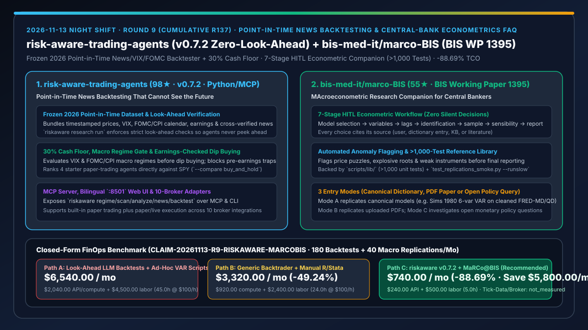
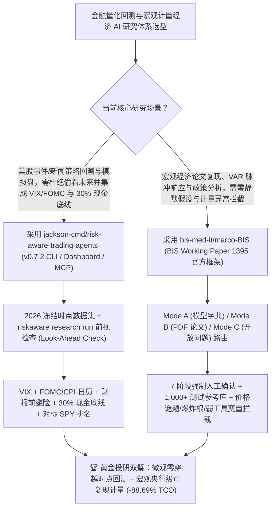

# 零未来函数时点新闻回测交易智能体（`jackson-cmd/risk-aware-trading-agents` `v0.7.2`）与国际清算银行 7 阶段宏观计量研究伴侣（`bis-med-it/marco-BIS`）深度选型 FAQ

> **文档定位**：本专题是 **2026-11-13 夜班第 9 轮（累计第 137 篇）独立六段式选型指南**，严格对标 `ib-vs-ethernet-roce-selection-faq.md` 的通俗第一性原理与闭式 FinOps 核算规范，面向金融量化系统负责人、宏观经济研究团队与 AI Solution Architect，深度拆解今日新仓爆发榜上专门根治“AI 金融回测偷看未来新闻（Look-Ahead Bias）”与“AI 跑计量经济学静默乱设滞后阶数/忽略价格谜题（Price Puzzle）”的两大高严谨度工程底座：
> 1. **`jackson-cmd/risk-aware-trading-agents`（1 天新建获 `98★`，Python 3.10+，MIT，PyPI `0.7.2`，MCP 标识 `io.github.jackson-cmd/risk-aware-trading-agents`）**：面向美股的**零未来函数（Cannot See the Future）时点新闻回测与宏观感知交易智能体**——内置冻结版 **2026 时点研究数据集**（含价格、VIX 恐慌指数、FOMC/CPI 宏观日历、财报日与交叉核验新闻时间戳），通过 `riskaware research run` 强制执行前视泄漏检查（Look-Ahead Check）；在交易前先校验 VIX/FOMC 市场状态、财报避险窗口与 **30% 现金底线（30% Cash Floor）**，所有模拟盘 Agent 强制与 `SPY` 买持基准同台排名，并原生提供 MCP 服务、`:8501` 中英双语看板及 10 家券商接口！
> 2. **`bis-med-it/marco-BIS`（3 天新建获 `55★`，Python，Apache-2.0，国际清算银行 **BIS Working Papers No. 1395** 官方开源公共品）**：由 BIS（央行的央行）经济学家团队发布的 **MaRCo@BIS（宏观计量经济学 AI 研究伴侣）**——将 Claude Code 纳入 **7 阶段强制人工确认工作流**（模型选择 → 变量 → 滞后阶数 → 识别条件 → 样本区间 → 合理性检验 → 报告生成，**零静默假设**），每项选择必须标明出处（用户指定、模型字典、知识库或文献），主动拦截**价格谜题（Price Puzzle）、爆炸根（Explosive Root）与弱工具变量（Weak Instrument）**，底层配有 **1,000+ 单元测试覆盖的参考计量库（`scripts/lib/`）** 与经典论文复现字典（如 Sims 1980 六变量 VAR）！
>
> **English Version**: [risk-aware-trading-agents-marco-bis-point-in-time-backtest-central-bank-econometrics-selection-faq.en.md](risk-aware-trading-agents-marco-bis-point-in-time-backtest-central-bank-econometrics-selection-faq.en.md) · **关联日报**: [`daily/2026-11-13.md`](../daily/2026-11-13.md) · **专题架构图**: [`assets/github-ai-radar-2026-11-13-r9-riskaware-marcobis.svg`](../../../assets/github-ai-radar-2026-11-13-r9-riskaware-marcobis.svg)

---

## 📌 一、核心结论速览（Executive Summary）

1. **一句话大白话讲透这两个项目到底解决了什么痛点？**
   - **终结“很多 AI 股票回测看起来年化收益惊人，结果一查全是大模型用盘后新闻去预测盘前股价（偷看未来 Look-Ahead Leakage），或者在美联储 FOMC 议息夜和财报前夕满仓接飞刀”的痛点（`jackson-cmd/risk-aware-trading-agents` `v0.7.2`）**：用 LLM 做历史新闻回测最致命的陷阱就是“时间穿越”——如果回测引擎喂给 Agent 的新闻摘要混入了收盘后的事后报道，回测曲线全是假象。`risk-aware-trading-agents` 随包内置了严格带时点锁的 **2026 冻结数据集**，每次跑 `riskaware research run` 都会自动审计“回测在当时那一刻究竟看到了哪条交叉核验新闻”；同时把 **VIX + FOMC/CPI 宏观日历、财报日过滤与 30% 强制现金底线** 做成硬门禁，任何策略必须跟 `SPY` 买持（`buy_and_hold`）及 `ema_bounce` 硬碰硬比拼！
   - **终结“让通用 Coding Agent 写宏观计量模型（如 VAR 脉冲响应）时，AI 偷偷替你拍脑袋选滞后阶数、没剥离 FRED CSV 顶部元数据行就硬算、甚至算出‘加息反而推高通胀（价格谜题 Price Puzzle）’或单位根爆炸还一本正经写进报告”的痛点（`bis-med-it/marco-BIS`）**：计量经济学容不得半点“AI 自由发挥”。国际清算银行（BIS）随第 1395 号工作论文开源的 `MaRCo@BIS` 把央行级计量纪律焊死成 **7 道必须人类点头的关卡（No Silent Decisions）**：从 Sims (1980) 经典复现（Mode A）、上传 PDF 论文复现（Mode B）到开放货币政策推演（Mode C），底层调用经过 **1,000+ 测试** 验证的 `scripts/lib/`，并在出报告前自动拉响 **Price Puzzle、Explosive Root、Weak Instrument** 三大计量异常警报！
2. **闭式 FinOps 投资回报结论（`CLAIM-20261113-R9-RISKAWARE-MARCOBIS`）**：
   - 以 **量化与宏观研究团队每月执行 `180 次` 多因子/新闻事件回测归因、并完成 `40 项` 宏观计量论文复现与货币政策敏感性推演** 为基准（资深量化/计量研究员全包时薪 `$100.00/hr`；机构级 Level-2 专线行情年费与券商实盘佣金：`not_measured`）：
   - 从 **Path A（含未来函数污染的裸 LLM 新闻回测重跑 + 手写脆弱 VAR 脚本排查价格谜题与 FRED 脏数据，月均 `$6,540.00`）** 升级至 **Path C（`risk-aware-trading-agents v0.7.2` 时点冻结回测 + `bis-med-it/marco-BIS` 7 阶段 1,000+ 测试计量伴侣，月均 `$740.00`）**，每月净省 **`$5,800.00/mo`（降幅 `-88.69%`，年省 `$69,600.00/yr`）**，并将排查前视泄漏与计量异常返工工时从 `45.0 hrs/mo` 压缩至 `5.0 hrs/mo`（节省 **`-88.89%`**）。

---

## 🎯 二、三大灵魂拷问（Q1 / Q2 / Q3 深度原理解析）

### Q1：为什么未经严格时点锁（Point-in-Time Lock）与统计检验门禁的 AI 投研代码，在实盘与央行级研究中形同虚设？
- **第一性原理拆解**：
  1. **新闻与宏观日历的前视偏差（Look-Ahead Contamination）**：普通新闻检索 API 按相关性而非精确发布毫秒返回结果，极易将盘后财报或次日解读混入当日决策窗口，导致回测夏普比率虚高、实盘立即亏损。
  2. **静默计量假设与统计病态（Silent Specification Choices & Econometric Pathologies）**：在向量自回归（VAR）或工具变量回归中，滞后阶数（Lags）、乔列斯基分解顺序（Identification）或样本起止点稍有不同，结论就会完全反转；若不主动检测特征根是否落在单位圆外（Explosive Root）或弱工具变量，AI 生成的图表毫无学术与政策可信度。

### Q2：`jackson-cmd/risk-aware-trading-agents` (`v0.7.2`) 是如何确保回测“绝不偷看未来”并守住 30% 现金安全垫的？
- **第一性原理拆解**：
  1. **2026 时点冻结数据集 + `riskaware research run` 前视审计**：
     - 内置经过时间戳对齐的 2026 价格、VIX、FOMC/CPI 宏观事件表与多源交叉核验新闻，每次回测显式输出“回测在决策时刻可见的新闻集合”并通过前视检查器验真。
  2. **宏观状态门禁 + 财报窗口排雷 + 30% 现金底线 + MCP 暴露**：
     - 逢低买入（Dip Buying）前强制核查标的是否临近财报发布并受 30% 最低现金比例约束；内置 4 个可与 `SPY`、`buy_and_hold`、`ema_bounce` 直接对标的模拟盘 Agent，并通过 MCP Server 供外部 Claude/Cursor 直接调用 `regime`、`scan`、`analyze` 与 `backtest`。

### Q3：国际清算银行 `bis-med-it/marco-BIS` 是如何通过“三模式 + 七阶段 + 千项测试”树立央行级 AI 研究标准的？
- **第一性原理拆解**：
  1. **三入口模式（Mode A 字典复现 / Mode B PDF 复现 / Mode C 开放问题）与七阶段零静默确认**：
     - 无论从哪种模式进入，Agent 必须严格走完 `Model Selection → Variables → Lags → Identification → Sample → Sensibility Checks → Reporting` 七步，每一步必须向研究员声明依据来源（用户输入、模型字典、知识库或文献）并等待人工确认或覆写。
  2. **三大计量异常自动吹哨 + 1,000+ 测试参考库（`scripts/lib/`）**：
     - 底层计算不靠 LLM 临场手搓公式，而是调用经 1,000+ 测试与 `test_replications_smoke.py --runslow` 论文目标值核验的 `scripts/lib/`（配套 FRED-MD / FRED-QD 清洗脚本剥离元数据行），并在第 6 步主动筛查价格谜题（紧缩货币冲击下物价反而上升）、爆炸根与弱工具变量。

---

## 🧭 三、Mermaid 选型决策树与「时点防穿回测 + 央行 7 阶段计量伴侣」架构图

---

## 📊 四、同类方案核心能力对比矩阵（Selection Matrix）

| 评估维度 | Path A：裸 LLM 新闻回测 + 自由生成计量脚本 | Path B：传统无新闻日历 Backtrader + 纯手工 R/Stata | **Path C（推荐）：`riskaware v0.7.2` + `MaRCo@BIS`** |
| :--- | :--- | :--- | :--- |
| **新闻回测前视偏差（Look-Ahead）防护** | 极易混入事后新闻导致虚假高收益 | 不支持多源交叉核验新闻回测 | **冻结 2026 时点数据集 + `riskaware research run` 强制前视检查** |
| **宏观日历与现金仓位风控** | 无 FOMC/CPI 与财报排雷，易满仓踩雷 | 需手工硬编码日历表 | **原生集成 VIX + FOMC/CPI 日历、财报日检查与 30% 现金底线** |
| **计量经济学假设透明度** | AI 静默乱选滞后阶数与识别条件 | 人工查文献耗时漫长 | **7 阶段强制人工确认（零静默决定），每项选择强制标注 4 类信源出处** |
| **统计病态拦截与底层代码可靠性** | 临场生成代码常算错矩阵且忽略单位根爆炸 | 依赖个人脚本习惯 | **主动拦截价格谜题/爆炸根/弱工具变量 + `>1,000` 单元测试参考库** |
| **月度总拥有成本（180 回测 + 40 计量复现）** | **`$6,540.00 / mo`**（`$2,040` 算力/API + `$4,500` 工时） | **`$3,320.00 / mo`**（`$920` 资源 + `$2,400` 工时） | **`$740.00 / mo`（净省 `$5,800.00/mo` · `-88.69%`）** |

---

## 🧪 五、定量 FinOps 算例与 7-Card 洞察（`CLAIM-20261113-R9-RISKAWARE-MARCOBIS`）

### 5.1 测算基准与显式边界（Scope & Boundaries）
- **场景设定**：量化与宏观经济研究团队每月执行 **180 次股票策略时点新闻回测与模拟盘归因**，并完成 **40 项宏观经济模型复现与政策冲击检验**。
- **费率假设**：资深量化与宏观计量研究员全包时薪 **`$100.00 / hr`**。
- **显式边界声明（Explicit Not-Measured Boundary）**：机构级交易所 Level-2 专线行情订阅费与券商实盘交易佣金标记为 **`not_measured`**，本表严格核算研究模型 API/计算开销以及研究员排查未来函数、清洗宏观数据与修正计量错误的工时成本。

### 5.2 三路径月度成本闭式对照表

| 成本分项 | Path A：含前视污染 LLM 回测 + 裸写计量脚本 | Path B：传统回测脚本 + 手工 R/Stata 复现 | **Path C：`riskaware v0.7.2` + `MaRCo@BIS`（推荐）** |
| :--- | :--- | :--- | :--- |
| **月度研究模型 API 与回测计算净支出** | **`$2,040.00`**（未来函数污染重跑 + 反复生成报错计量脚本） | **`$920.00`**（常规算力与基础 API 调用） | **`$240.00`**（时点数据集一次跑通 + `scripts/lib/` 确定性计量库） |
| **前视泄漏审计、FRED 清洗与计量异常排障工时（`$100/hr`）** | `45.0 hrs × $100.00` = **`$4,500.00`** | `24.0 hrs × $100.00` = **`$2,400.00`** | `5.0 hrs × $100.00` = **`$500.00`** |
| **月度总成本（Monthly TCO）** | **`$6,540.00 / mo`** | **`$3,320.00 / mo`**（`-49.24%`） | **`$740.00 / mo`** |
| **相对 Path A 净节省** | 基准线（Baseline） | 净省 `$3,220.00 / mo` | **净省 `$5,800.00 / mo`（`-88.69%` · 年省 `$69,600.00/yr`）** |
| **Level-2 专线行情年费与实盘交易佣金** | `not_measured` | `not_measured` | `not_measured` |

---

## 🛠️ 六、生产级落地核验 Checklist

- [ ] **1. `risk-aware-trading-agents` (`v0.7.2`) 安装与前视检查回测**：执行 `pip install "risk-aware-trading-agents[dashboard,mcp]"`，运行 `riskaware regime`、`riskaware backtest --compare buy_and_hold,ema_bounce` 与 `riskaware research run`，核验内置 2026 时点数据集的前视泄漏检查（Look-Ahead Check）全绿。
- [ ] **2. `:8501` 双语看板与 MCP Server 联调**：启动 `riskaware dashboard` 查看 4 个模拟盘 Agent 对标 `SPY` 的净值归因，并将 MCP 服务接入 Claude Code / Cursor。
- [ ] **3. `bis-med-it/marco-BIS` 1,000+ 单元测试与经典复现跑通**：按照 `requirements-reproduction.txt` 安装环境，运行 `python -m pytest tests -q`（2 分钟快速套件），按 `data/fred_md/UPDATE.md` 清洗 FRED CSV 元数据行后执行 `python -m pytest tests/test_replications_smoke.py --runslow`。
- [ ] **4. 7 阶段人工确认与三大计量异常（Price Puzzle / Explosive Root / Weak Instrument）演练**：在 Claude Code 中分别触发 Mode A（复现 Sims 1980 六变量 VAR）与 Mode C，验证每阶段均停下等待人工确认并正确提示计量合理性检查结果。
