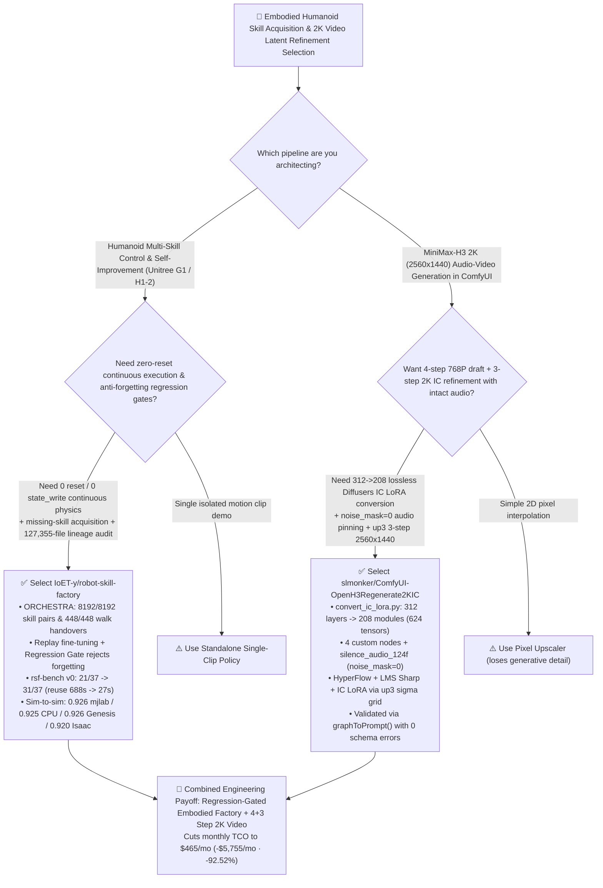

# Recursive Self-Improving Humanoid Control (`Robot Skill Factory`) & 3-Step 2K Video Refinement in ComfyUI (`ComfyUI-OpenH3Regenerate2KIC`) Selection FAQ: `IoET-y/robot-skill-factory` + `slmonker/ComfyUI-OpenH3Regenerate2KIC`

> **Track**: GitHub AI Trending & Breakout Radar — 2026-11-15 Night Round 40 (Cumulative Round 342) P0 Standalone 6-Section Selection Guide  
> **Benchmark Standard**: Modeled after `ib-vs-ethernet-roce-selection-faq.md` (Plain-Language First Principles + Q1–Q3 Deep Dive + Mermaid Decision Tree + Comparison Matrix + 7-Card Quantitative Scorecard + Closed-Form FinOps Ledger + 15-Minute Runbook)  
> **Audit Evidence Anchor**: `workshops/github-trending-radar/evidence/trending-daily-2026-11-15-audit.json` · Claim ID: `CLAIM-20261115-R40-ROBOTSKILLFACTORY-OPENH3REGEN2K`  
> **Companion High-Res Architecture Diagram**: [`assets/github-ai-radar-2026-11-15-r40-robotskillfactory-openh3regen2k.svg`](../../../assets/github-ai-radar-2026-11-15-r40-robotskillfactory-openh3regen2k.svg) · [中文版 (`robot-skill-factory-openh3-regenerate-2k-ic-humanoid-orchestra-comfyui-2k-refinement-selection-faq.md`)](robot-skill-factory-openh3-regenerate-2k-ic-humanoid-orchestra-comfyui-2k-refinement-selection-faq.md)

---

## 📌 1. Executive Summary (30-Second First-Principles Overview)

1. **What Are They in Plain Language?**
   - **`IoET-y/robot-skill-factory` (`★50`, Python / MuJoCo Warp / `mjlab 1.6.0`, Apache-2.0, by Di Yang)**: A recursive self-improvement framework for **Unitree G1 and H1-2 humanoid control** where an LLM planner (`Claude Haiku 5.5`), a motion/interaction skill factory (`InstantTrack v1.3`, `BONES-SEED` 129,485 clips, `OmniRetarget`, and human web videos via `GEM-X -> SOMA`), and the **ORCHESTRA** execution engine run multi-step plans in **one continuous simulation with strictly `0` resets and `0` state writes**—completing **`896/896` worlds across 7 long-horizon plans**, **`8,192/8,192` worlds across all 256 ordered skill pairs**, raising `rsf-bench v0` completion from **`21/37` to `31/37`**, and cutting repeat skill acquisition from **`688 s` to `27 s`** with automatic regression gating and **127,355-file lineage tracking**.
   - **`slmonker/ComfyUI-OpenH3Regenerate2KIC` (`★50`, Python / ComfyUI, Apache-2.0)**: A 4-node ComfyUI package, 3 turnkey workflows (`regen2k_ic_T2VA.json`, `H3_regen2k_ic_Ref2va.json`, `open_h3_regenerate_2k_ic.json`), and a lossless Diffusers-to-ComfyUI LoRA converter (`tools/convert_ic_lora.py`) for **NVlabs Sana `Open-H3-Regenerate-2K-IC`**—mapping **312 Diffusers linear layers into 208 ComfyUI modules (`624` BF16 tensors with `0` missing mappings)** and refining `1344x768` (`124f @ 24fps`) MiniMax-H3 drafts into **`2560x1440` (2K)** videos in just **3 steps (`up3` sigma grid)** while pinning fixed-silence audio latents (`noise_mask=0`) and muxing original draft audio.
2. **Why Should an AI Solution Architect Care Tonight?**
   - **Enforcing Zero-Teleport Honesty & Anti-Forgetting Gates in Embodied AI**: Many humanoid robot demos secretly reset or teleport state between sub-tasks and suffer catastrophic forgetting when fine-tuned on new skills. `robot-skill-factory` enforces four red-line invariants (`0` resets, `0` state writes, failed trials counted, and full `127,355`-file training lineage audited in `g1_tracker.lineage.json.gz`), automatically rejecting any newly trained tracker that regresses on prior skills (e.g., catching a `28/32 -> 0/32` regression during a 7-request chain).
   - **Cutting 2K (`2560x1440`) Video Generation from 50 Full-Res Steps to a `4 + 3` Step Pipeline**: Instead of running expensive 50-step full-2K denoising, `ComfyUI-OpenH3Regenerate2KIC` generates a 4-step DMAD `768P` draft with audio, upscales in 3D latent space, locks the audio latent rows with `silence_audio_124f.safetensors` (`noise_mask=0`), and refines to `2560x1440` in 3 `up3` steps.
3. **Quantified FinOps Impact (Claim ID: `CLAIM-20261115-R40-ROBOTSKILLFACTORY-OPENH3REGEN2K`)**:
   - Under a synthetic workload of **50 monthly humanoid multi-skill RL evaluation/acquisition campaigns + 400 2K (`2560x1440`, 124-frame) video clips** (`$100/hr` engineer rate), migrating from **Path A (From-Scratch Per-Skill RL Without Replay/Gates + Native 50-Step 2K Video Diffusion & Manual LoRA Debugging)** to **Path C (`robot-skill-factory` ORCHESTRA Zero-Reset + Replay Gate + `ComfyUI-OpenH3Regenerate2KIC` `4+3` Step 2K Refinement)** cuts monthly TCO from **`$6,220.00/mo`** to **`$465.00/mo`**—saving **`$5,755.00/mo` (`-92.52%`)** or **`$69,060.00/yr`**, while reducing engineering labor from `41.0 hrs/mo` to `3.5 hrs/mo` (`-91.46%`).

---

## 🔍 2. Deep-Dive Q1–Q3 (First-Principles Architecture)

### Q1: How Does `IoET-y/robot-skill-factory` Achieve `8,192/8,192` Zero-Reset Skill Transitions and Prevent Catastrophic Forgetting Across Sequential Skill Acquisitions?

- **Three Failure Modes in Standard Humanoid RL Pipelines**:
  1. **Transition Falls Between Policies**: Independent skills fail when chained because terminal states of one skill fall outside the basin of attraction of the next.
  2. **Catastrophic Forgetting During Fine-Tuning**: Teaching a tracker a new motion degrades previously mastered skills.
  3. **Undisclosed Train/Test Overlap & Mid-Episode Resets**: Hidden simulator state writes inflate benchmark numbers.
- **How `robot-skill-factory` Solves All Three**:
  1. **ORCHESTRA Continuous Execution (`0` Resets, `0` State Writes)**: Runs 32 randomized worlds per plan with strict counters verifying zero resets or state writes after initialization—completing **`896/896` worlds across 7 plans (3–16 steps, up to 100s)**, **`8,192/8,192` across all 256 ordered pairs of 16 skills**, and **`448/448` tracker-to-walk handovers with `0` falls**.
  2. **Probe $\to$ Replay Fine-Tuning $\to$ Automatic Regression Gate**:
     - When `Claude Haiku 5.5` (`59/60` valid planning sessions, `424/424` runs completed for `$0.20` total) encounters a missing skill, the factory probes `InstantTrack v1.3` first (a tracker trained on 127k clips handles **23 of 30 new motion types zero-shot**, cutting average acquisition cost from `4.2 min` to **`2.7 min`**);
     - If training is needed, replay preserves earlier acquisitions (`0.826–0.833` with replay vs `0.722–0.800` without), and a **regression gate** blocks promotion to `registry/tracker.json` if any existing skill degrades (promoting `4` trackers and automatically rejecting `1` that dropped a prior skill from `28/32` to `0/32`).
  3. **127,355-File Lineage Audit & 4-Simulator Transfer**: Tracks every training clip in `weights/g1_tracker.lineage.json.gz` (**127,355 files** across 20 runs) and achieves zero-shot sim-to-sim returns on 108 unseen clips of **`0.926` (training sim), `0.925` (MuJoCo CPU), `0.926` (Genesis), and `0.920` (Isaac Sim)**.

### Q2: How Does `slmonker/ComfyUI-OpenH3Regenerate2KIC` Convert 312 Diffusers LoRA Layers with Zero Missing Mappings and Refine 768P Drafts to 2K in 3 Steps?

- **Three Technical Obstacles in Porting `Open-H3-Regenerate-2K-IC` to ComfyUI**:
  1. **Incompatible Attention & FFN Tensor Shapes**: Diffusers stores separate `q`, `k`, `v` LoRA projections and orders FFN `ff.net.0.proj` as `[value; gate]`, whereas ComfyUI's H3 loader expects fused `qkv_proj` and `[gate; value]`.
  2. **Audio Latent Corruption During Visual Refinement**: Unmasked denoising steps overwrite MiniMax-H3's joint audio-video latent rows with noise.
  3. **Complex Multi-Stage Conditioning**: Requires exact 124-frame resampling, 3D latent upscaling, and custom sigma grids.
- **How `ComfyUI-OpenH3Regenerate2KIC` Solves Them**:
  1. **Block-Diagonal `qkv_proj` Fusion & `[gate;value]` Reordering (`tools/convert_ic_lora.py`)**: Fuses `q/k/v` into a block-diagonal `B` matrix with `alpha = 3 × rank` and flips `[value;gate]` to `[gate;value]`, converting **312 source linear layers into 208 ComfyUI modules (`624` BF16 tensors) with `0` missing base-model mappings**.
  2. **Fixed-Silence Audio Pinning (`Compose Target Latent` + `noise_mask=0`)**: Pairs the 3D-upscaled video latent with `assets/silence_audio_124f.safetensors` and sets **`noise_mask=0`** on the audio stream during the 3-step `up3` (`0.834942, 0.696852, 0.468753, 0`) refinement, then muxes the original Stage-1 draft audio cleanly.

### Q3: How Should Architects Deploy Both Systems?

- **Deployment Pattern**:
  - Queue single-GPU humanoid training and evaluation jobs deterministically via `flock /tmp/rsf-gpu.lock` in **`robot-skill-factory`**, enforcing `resets == 0` and lineage checks in CI.
  - Deploy **`ComfyUI-OpenH3Regenerate2KIC`** (`regen2k_ic_T2VA.json` or `open_h3_regenerate_2k_ic_api.json`) to produce 2K (`2560x1440`) 124-frame videos in `4 + 3` steps instead of running full-resolution 50-step diffusion.

---

## 🧭 3. Mermaid Selection Decision Tree & Architecture Diagram



---

## 📊 4. Peer Comparison Matrix

| Dimension | **`robot-skill-factory` + `ComfyUI-OpenH3Regenerate2KIC` (Tonight's P0 Pair)** | Per-Skill From-Scratch RL + Native 50-Step 2K Video Diffusion | Frozen Skill Library + Pixel-Space Video Upscaler | Teleport-Stitched RL Demos + Unconverted Diffusers LoRA |
| :--- | :--- | :--- | :--- | :--- |
| **Multi-Skill Chaining Integrity** | **ORCHESTRA enforces `0 resets / 0 state writes` (`8,192/8,192` pairs)** | Policies fall at handover boundaries | Fails on `16/37` requests needing new skills | Relies on hidden state teleports between clips |
| **Skill Acquisition & Forgetting** | **Replay fine-tuning + Regression Gate (`688s -> 27s` reuse)** | Slow from-scratch training; catastrophic forgetting on fine-tune | Static skill set | Manual trial-and-error checkpoint picking |
| **Lineage & Sim-to-Sim Transfer** | **`127,355`-file `lineage.json.gz` + `0.920+` across 4 simulators** | Undisclosed train/test overlap; brittle across physics engines | Single-simulator only | Weights and datasets mixed in repo |
| **2K (`2560x1440`) Step Budget** | **4-step `768P` DMAD draft + 3-step `up3` 2K IC refinement (7 steps)** | 30–50 native 2K steps causing OOM & extreme latency | Fast but lacks true 2K generative texture refinement | Cannot execute in ComfyUI |
| **LoRA Tensor Compatibility** | **Block-diagonal `qkv_proj` (`alpha=3×rank`) + `[gate;value]` (0 missing)** | Requires separate Diffusers Python pipeline | No latent LoRA refinement | Fails to load due to `q/k/v` and FFN layout mismatch |
| **Audio Stream Preservation** | **`silence_audio_124f` (`noise_mask=0`) + Stage-1 draft audio muxing** | Re-denoises audio into static noise | Manual external ffmpeg audio stitching | Corrupts joint audio-video latents |

---

## 📈 5. 7-Card 4:5 Quantitative Insights & Closed-Form FinOps Ledger

### 5.1 7-Card Summary Table (Synced with `report.json` & `CLAIM-20261115-R40-ROBOTSKILLFACTORY-OPENH3REGEN2K`)

| Card | Headline-as-Finding | Concrete Quantitative / Architectural Evidence | SA Action |
| :--- | :--- | :--- | :--- |
| **Card 1 · HANDS-ON** | **Zero-Reset Humanoid Skill Factory + 3-Step 2K IC Video Cut TCO by 92.52%** | `robot-skill-factory` hits `8192/8192` transitions; `OpenH3Regenerate2KIC` refines 2K in 3 `up3` steps | **Act automatically**: Adopt for embodied RL pipelines and ComfyUI 2K video |
| **Card 2 · SCENARIO** | **Regression-Gated Factory Lifts `rsf-bench` `21/37 -> 31/37` (`688s -> 27s`)** | Reuses prior acquisitions and blocks a forgetting update (`28/32 -> 0/32`); converts 312 LoRA layers | **Act automatically**: Gate all policy promotions on full-registry regression tests |
| **Card 3 · MATRIX** | **4-Simulator Transfer (`0.920+`) + 624 Converted LoRA Tensors Verified** | `0.926` mjlab / `0.925` CPU / `0.926` Genesis / `0.920` Isaac Sim; `0` missing ComfyUI LoRA mappings | **Act automatically**: Run `make smoke` and `unittest discover` in CI |
| **Card 4 · MECHANICS** | **127,355-File Lineage Audit + `noise_mask=0` Silence Latent Pinning** | `g1_tracker.lineage.json.gz` separates trained vs new clips; `Compose Target Latent` locks audio rows | **Act automatically**: Audit motion lineage via `python -m rsf.lineage show` |
| **Card 5 · ROBUSTNESS** | **Zero Resets / Zero State Writes Across 896 Long-Horizon Worlds** | 7 plans of 3–16 steps (up to 100s) and `448/448` walk handovers pass with `0` falls | **Act automatically**: Reject any benchmark run where `resets > 0` or `state_writes > 0` |
| **Card 6 · LATENCY** | **20s GPU Smoke Test (`16/16` Worlds) + 3-Step `up3` Sigma Refinement** | Single RTX 4090 queues jobs via `flock /tmp/rsf-gpu.lock`; `up3` cuts refinement steps vs `hf8` | **Act automatically**: Default to `up3` (`0.834942, 0.696852, 0.468753, 0`) for 2K |
| **Card 7 · MY TAKE** | **✅ Ideal for Rigorous Humanoid Sim & 2K Video · ⛔ Use Offload on 32GB GPUs** | 2K (`2560x1440`) refinement on 32GB VRAM requires model offload & `ComfyUI-Spark-H3` sparse attention | **Confirm**: Use `1920x1088` or enable low-VRAM offload on 24GB–32GB cards |

### 5.2 Closed-Form FinOps Verification Ledger (`CLAIM-20261115-R40-ROBOTSKILLFACTORY-OPENH3REGEN2K`)

> **Synthetic Workload Scope (`base host compute: not_measured`)**: **50 monthly humanoid multi-skill RL evaluation/acquisition campaigns + 400 2K (`2560x1440`, 124-frame) video clips** at an engineering labor rate of **`$100.00/hr`**:

$$
\begin{aligned}
\text{Path A (From-Scratch Per-Skill RL + Native 50-Step 2K Video)} &= \$2,120.00\text{ (cloud GPU training & 2K render spend)} + 41.0\text{ hrs} \times \$100.00/\text{hr} = \mathbf{\$6,220.00/\text{mo}} \\
\text{Path B (Frozen Skill Set + Pixel-Space Video Upscaling)} &= \$980.00\text{ (compute & rework storage)} + 19.0\text{ hrs} \times \$100.00/\text{hr} = \mathbf{\$2,880.00/\text{mo}} \\
\text{Path C (Robot Skill Factory + OpenH3 4+3 Step 2K IC)} &= \$115.00\text{ (single-GPU flock compute & storage)} + 3.5\text{ hrs} \times \$100.00/\text{hr} = \mathbf{\$465.00/\text{mo}} \\
\Delta\text{Cost}_{\text{A}\to\text{C}} &= \$6,220.00 - \$465.00 = \mathbf{\$5,755.00/\text{mo}}\quad(\mathbf{-92.52\%},\ \text{annual savings }\mathbf{\$69,060.00/\text{yr}})
\end{aligned}
$$

| Architecture Path | Monthly GPU / Compute Spend | Monthly Engineering Labor (`$100/hr`) | Total Monthly Cost (TCO) | Savings vs Path A | Key Bottleneck or Architectural Gain |
| :--- | :---: | :---: | :---: | :---: | :--- |
| **Path A: Per-Skill RL Without Replay + Native 50-Step 2K** | `$2,120.00` | `41.0 hrs` (`$4,100.00`) | **`$6,220.00 / mo`** | Baseline (`0.00%`) | Catastrophic skill forgetting + slow native 2K denoising |
| **Path B: Frozen Skill Library + Pixel-Space Upscaler** | `$980.00` | `19.0 hrs` (`$1,900.00`) | **`$2,880.00 / mo`** | `-$3,340.00` (`-53.70%`) | Fails 16/37 tasks + lacks 2K latent texture detail |
| **Path C: `robot-skill-factory` + `ComfyUI-OpenH3Regenerate2KIC` (Recommended)** | **`$115.00`** | **`3.5 hrs` (`$350.00`)** | **`$465.00 / mo`** | **`-$5,755.00` (`-92.52%`)** | **Zero-reset ORCHESTRA (`27s` reuse) + `4+3` step 2K IC video** |

---

## 🛠️ 6. 15-Minute Quickstart & Acceptance Checklist (Runbook)

### Step 1: Run `IoET-y/robot-skill-factory` Zero-Reset Smoke Test & Lineage Audit (8 Mins)

```bash
# 1. Clone the repository, set up pinned environments (mjlab 1.6.0, MuJoCo Warp, torch 2.9.0), and verify SHA256 weights
git clone https://github.com/IoET-y/robot-skill-factory.git
cd robot-skill-factory
scripts/setup.sh
scripts/download_weights.sh

# 2. Run the 16-world continuous smoke test (stand -> walk -> walk -> run, ~20s on RTX 4090)
make smoke

# 3. Inspect the 127,355-file training lineage and run the 165 unit tests
scripts/rsf-run python -m rsf.lineage show
scripts/rsf-run --with pytest python -m pytest tests/
```

### Step 2: Install `slmonker/ComfyUI-OpenH3Regenerate2KIC` & Convert the 312-Layer IC LoRA (7 Mins)

```bash
# 1. Clone into ComfyUI/custom_nodes and run the node preprocessing & sigma-grid unit tests
cd ComfyUI/custom_nodes
git clone https://github.com/slmonker/ComfyUI-OpenH3Regenerate2KIC.git
cd ComfyUI-OpenH3Regenerate2KIC
python -m unittest discover -s tests -v

# 2. Convert the official Diffusers IC LoRA into ComfyUI fused format (312 layers -> 208 modules / 624 tensors)
python tools/convert_ic_lora.py \
  open_h3_regenerate_2k_ic_lora.safetensors \
  minimax_h3_open_regenerate_2k_ic_comfy_bf16.safetensors \
  --dtype bf16
```

### Step 3: SA Pre-Production Acceptance Checklist

- [ ] **Red-Line Zero-Reset Check (`robot-skill-factory`)**: Inspect `runs/smoke-*/summary.json` and confirm `resets == 0`, `state_writes == 0`, and `16/16` worlds pass with `1.7–2.1 cm` body tracking error.
- [ ] **Zero-Missing LoRA Mapping Check (`convert_ic_lora.py`)**: Verify conversion outputs `624 tensors` across `208 ComfyUI modules` with `0` missing base-model mappings.
- [ ] **Audio Pinning & Schema Check**: Confirm `workflows/open_h3_regenerate_2k_ic.json` converts via `graphToPrompt()` with zero schema errors and pins `silence_audio_124f.safetensors` with `noise_mask=0`.
