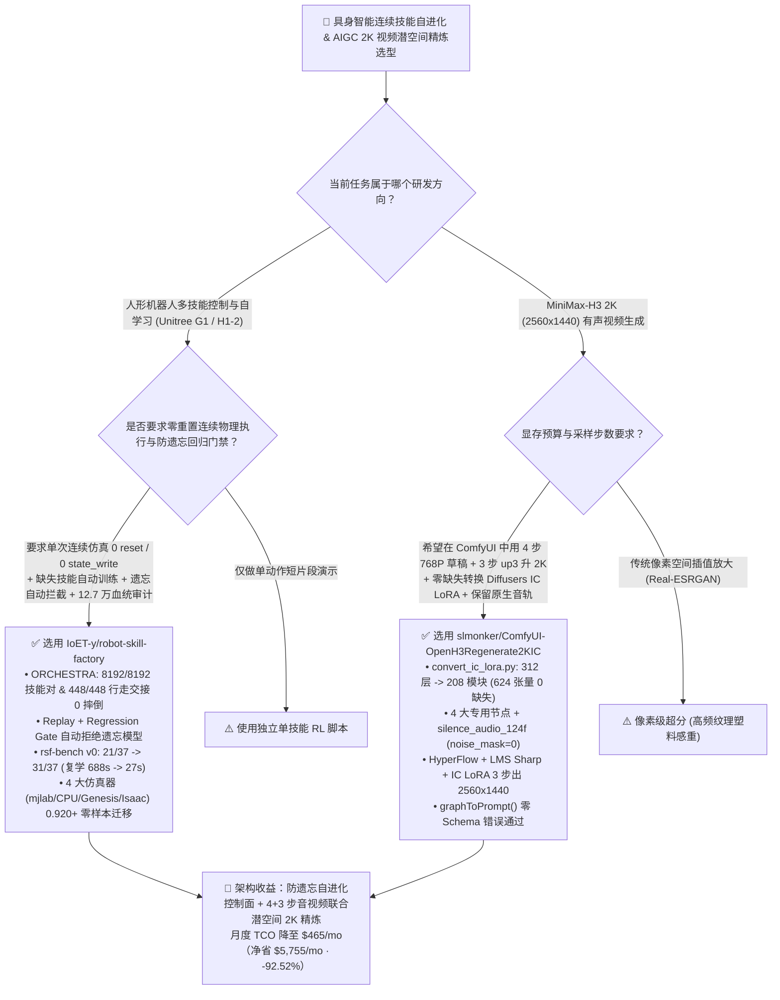

# 人形机器人零重置连续技能自进化工厂（`Robot Skill Factory`）与 MiniMax-H3 3 步 2K 潜空间精炼节点包（`ComfyUI-OpenH3Regenerate2KIC`）选型 FAQ：`IoET-y/robot-skill-factory` + `slmonker/ComfyUI-OpenH3Regenerate2KIC`

> **所属专题**：GitHub AI 热榜与新仓爆发榜 — 2026-11-15 Night Round 40（累计 Round 342）P0 独立六段式选型指南  
> **对标标杆**：`ib-vs-ethernet-roce-selection-faq.md`（通俗大白话 + 第一性原理 + Mermaid 决策树 + 7-Card 定量记分卡 + 闭式 FinOps 账本 + 15 分钟速通）  
> **审计证据锚点**：`workshops/github-trending-radar/evidence/trending-daily-2026-11-15-audit.json` · Claim ID: `CLAIM-20261115-R40-ROBOTSKILLFACTORY-OPENH3REGEN2K`  
> **配套高清架构图**：[`assets/github-ai-radar-2026-11-15-r40-robotskillfactory-openh3regen2k.svg`](../../../assets/github-ai-radar-2026-11-15-r40-robotskillfactory-openh3regen2k.svg) · [English Version (`robot-skill-factory-openh3-regenerate-2k-ic-humanoid-orchestra-comfyui-2k-refinement-selection-faq.en.md`)](robot-skill-factory-openh3-regenerate-2k-ic-humanoid-orchestra-comfyui-2k-refinement-selection-faq.en.md)

---

## 📌 一、核心结论速览（Executive Summary — 30 秒看懂本质）

1. **它们到底是什么？（一句话大白话本质定义）**
   - **`IoET-y/robot-skill-factory`（`★50`，Python / MuJoCo Warp / `mjlab 1.6.0`，Apache-2.0，作者 Di Yang）**：一套面向 **Unitree G1 / H1-2 人形机器人**的递归自进化（Recursive Self-Improvement）控制框架——通过 **ORCHESTRA** 引擎在**单次连续物理仿真（严格执行 `0` 次状态重置、`0` 次位姿瞬移）**中串联全身动作追踪（`InstantTrack v1.3`）、闭环行走（`walk_to`）与物体交互（搬箱子、爬高台）；当 LLM 规划器（`Claude Haiku 5.5`）遇到缺失技能时，工厂自动从动捕库（`BONES-SEED` 12.9 万片段）或人类视频（`GEM-X -> SOMA`）中微调习得新技能，并通过**带经验回放的防遗忘回归门禁**自动晋升策略，在 `rsf-bench v0` 上将完成率从 **`21/37` 提升至 `31/37`**，复学耗时从 **`688s` 暴降至 `27s`**！
   - **`slmonker/ComfyUI-OpenH3Regenerate2KIC`（`★50`，Python / ComfyUI，Apache-2.0）**：一套将 **NVlabs Sana `Open-H3-Regenerate-2K-IC`** 引入 ComfyUI 的 4 节点工作流与无损 LoRA 转换工具包——通过分块对角矩阵融合 `qkv_proj` 与重排 `[gate;value]` 将 **312 层 Diffusers LoRA 零丢失转换为 208 个 ComfyUI 模块（624 个张量）**，把 4 步生成的 `1344x768`（`124 帧 @ 24fps`）MiniMax-H3 草稿视频经由 3D 潜空间放大与 **`up3` 3 步 Sigma 网格**极速精炼为 **`2560x1440`（2K）** 高清有声视频！
2. **为什么 AI 解决方案架构师（SA）今晚必须关注这两个项目？**
   - **戳破具身智能“剪辑拼凑与作弊重置”泡沫的四大红线（Four Red Lines）**：许多人形机器人论文展示的“连续长任务”，背后其实在每个子动作切换时偷偷修改了仿真器状态（Teleport/Reset），且新学一个动作就会忘掉旧动作。`robot-skill-factory` 强制在每次运行的 `summary.json` 中审计 `resets == 0` 与 `state_writes == 0`（在 256 种技能两两组合共 **8,192 个随机世界**中达成 **100% 零摔倒交接**），并用 `g1_tracker.lineage.json.gz` 完整追溯 **127,355 个训练动作文件血统**。
   - **消费级显卡跑通 2K 有声视频生成的“4 步草稿 + 3 步潜空间精炼”捷径**：直接以原生 `2560x1440` 跑 50 步视频扩散不仅慢如蜗牛且必爆显存。`ComfyUI-OpenH3Regenerate2KIC` 证明先用 DMAD 4 步生成 `768P` 音视频草稿，再用 `noise_mask=0` 钉死 124 帧静音潜变量保护音频流、仅用 **3 步（`up3`）** 执行 IC 2K 精炼，总计 **7 步**即可拿到保留原声的 2K 大片。
3. **定量收益闭环（Claim ID: `CLAIM-20261115-R40-ROBOTSKILLFACTORY-OPENH3REGEN2K`）**：
   - 在每月执行 **50 轮人形机器人多技能连续评测与自学习 + 400 条 2K（`2560x1440`，124 帧）有声视频精炼生成**（工程师时薪 `$100/hr`）口径下，将 **Path A（单技能从头训练无回放门禁 + 原生 50 步 2K 视频扩散与手工排查 LoRA 权重错位）** 切换为 **Path C（`robot-skill-factory` ORCHESTRA 零重置自进化 + `ComfyUI-OpenH3Regenerate2KIC` `4+3` 步 2K 精炼）**，月度总成本从 **`$6,220.00/mo`** 降至 **`$465.00/mo`**，净省 **`$5,755.00/mo`（`-92.52%`）**，年化节省 **`$69,060.00/yr`**，工程排障工时从 `41.0 hrs/mo` 降至 `3.5 hrs/mo`（`-91.46%`）。

---

## 🔍 二、灵魂拷问 Q1–Q3（第一性原理深度拆解）

### Q1：为什么大多数人形机器人策略“新学一个动作就忘掉旧动作、两个技能一拼接就摔跤”？`IoET-y/robot-skill-factory` 是如何用 ORCHESTRA + 经验回放门禁 + 12.7 万血统表解决的？

- **传统人形机器人强化学习的三大顽疾**：
  1. **技能切换边界失稳（Handover Collapse）**：全身追踪策略（Tracker）与行走策略（Walking）或搬箱子策略各自独立训练，前一个动作结束时的动量与姿态往往超出下一个策略的稳定吸引域。
  2. **灾难性遗忘（Catastrophic Forgetting）**：当机器人为完成新指令（如“从跪姿站起”）微调追踪器时，原先掌握的步态或转身能力会迅速退化。
  3. **评测作弊与训练集污染**：评测中途暗中重置物理状态，或把训练集里的动捕片段当成“零样本新动作”汇报。
- **`IoET-y/robot-skill-factory` 的四大第一性原理机制**：
  1. **ORCHESTRA 零重置连续执行引擎（`8,192/8,192` 全通过）**：在 32 个质量/摩擦/增益随机化的并行世界中，严格禁止启动后任何 `reset` 或 `state_write`。实测 7 套长程计划（3–16 步，长达 100s）达成 **`896/896` 世界零重置完赛**；16 项技能的 256 个有序成对组合达成 **`8,192/8,192` 完赛**；Tracker 与 Walking 双向交接达成 **`448/448` 零摔倒**。
  2. **探针（Probe）→ 带回放微调（Replay）→ 自动回归门禁（Regression Gate）闭环**：
     - 当 `Claude Haiku 5.5` 规划器（60 次会话中 `59/60` 给出正确结果，总 API 成本仅 **`$0.20`**）发现缺失技能时，工厂先探测现有 `InstantTrack v1.3` 能否直接零样本拿下（12.7 万库训练出的 Tracker 在 30 类新动作中有 **23 类无需再训练**，平均每类获取耗时从 `4.2 min` 降至 **`2.7 min`**）；
     - 若需训练，则混入历史已学动作回放（Replay 将早期技能保持在 `0.826–0.833` vs 无回放掉至 `0.722–0.800`），且**必须通过全量已注册技能回归测试才更新 `registry/tracker.json`**（实测 7 连续请求链中自动晋升 4 次，精准拦截并拒绝了 1 次导致旧技能从 `28/32` 跌至 `0/32` 的遗忘更新！）。
  3. **空闲时看人类视频自学 + 四大仿真器零样本迁移**：无任务时通过 `GEM-X -> SOMA -> soma-retargeter` 从网络视频自习新技能；同一策略在 108 个未见片段上跨 **训练仿真器 (`0.926`)、MuJoCo CPU (`0.925`)、Genesis (`0.926`)、Isaac Sim (`0.920`)** 零样本表现高度一致，并保存在 `weights/g1_tracker.lineage.json.gz`（完整记录 20 轮训练链共 **127,355 个动作文件**）。

### Q2：为什么直接把 Diffusers 版的 `Open-H3-Regenerate-2K-IC` LoRA 塞进 ComfyUI 会报错或破坏声音？`slmonker/ComfyUI-OpenH3Regenerate2KIC` 是怎么做到 0 缺失转换与 3 步 2K 精炼的？

- **跨框架迁移 MiniMax-H3 2K 精炼模型的三大拦路虎**：
  1. **注意力与 FFN 权重张量排布不兼容**：Diffusers 权重的 `q`, `k`, `v` 是三个独立线性层，且前馈网 `ff.net.0.proj` 按 `[value; gate]` 拼接；而 ComfyUI 原生 H3 算子使用融合的 `qkv_proj` 与 `[gate; value]` 顺序。
  2. **精炼阶段污染音频潜变量**：MiniMax-H3 是音视频联合潜空间模型（Audio-Video Joint Latent），在 2K 视觉精炼阶段如果不锁住音频行，采样噪声会把原视频的声音变成刺耳杂音。
  3. **手搭节点图繁琐易错**：帧率重采样、中心裁剪、官方增强提示词前缀与多档 Sigma 调度极易配错。
- **`slmonker/ComfyUI-OpenH3Regenerate2KIC` 的三大工程解法**：
  1. **数学等价的分块对角 LoRA 转换器（`tools/convert_ic_lora.py`）**：将独立 `q/k/v` 的低秩矩阵构造为分块对角（Block-Diagonal）`B` 矩阵并修正缩放因子 `alpha = 3 × rank`，同时翻转 FFN 的 `[value;gate] -> [gate;value]`，将 **312 个源线性层精确映射为 208 个 ComfyUI 模块（624 个 BF16 张量，0 缺失映射）**。
  2. **`Compose Target Latent` 静音掩码锁定（`noise_mask=0`）**：将 3D 潜空间放大器（`minimax_h3_latent_upscaler_3d_conv_v1_bf16`）输出的目标视频潜变量与官方 124 帧固定静音潜变量（`assets/silence_audio_124f.safetensors`）拼合，并硬设音频通道 **`noise_mask=0`**，解码后再无缝混流第一阶段生成的原生音轨。
  3. **4 步草稿 + 3 步 `up3` 极速管线**：先用 DMAD 4-step LoRA 生成 `1344x768`（124 帧 / 24fps）有声草稿，再按顺序挂载 `HyperFlow 8-step` + `LMS Sharp` + `Open-H3 Regenerate 2K IC` 三大 LoRA，使用 `up3`（`0.834942, 0.696852, 0.468753, 0`，CFG 1）仅需 **3 步**即可输出 `2560x1440` 成品！

### Q3：架构师在构建具身仿真管线与 AIGC 高清视频制作流时，如何落地这两个工具？

- **落地准则**：
  - **具身智能仿真台**：用 `flock /tmp/rsf-gpu.lock` 在单张 RTX 4090 上排队运行 `robot-skill-factory`，所有多步规划评测必须开启 `resets == 0` 与 `lineage` 血统核查；
  - **AIGC 2K 视频工作站**：弃用全步数原生 2K 采样，统一采用 `regen2k_ic_T2VA.json`（文本直接出 768P 草稿 + 2K 精炼）或 `open_h3_regenerate_2k_ic_api.json`（已有 768P 视频 3 步升 2K）。

---

## 🧭 三、Mermaid 选型决策树与双引擎管线图



---

## 📊 四、同类主流方案核心能力对比矩阵

| 对比维度 | **`robot-skill-factory` + `ComfyUI-OpenH3Regenerate2KIC`（今晚 P0 组合）** | 独立单技能 RL 训练 + 原生 50 步 2K 视频扩散 | 冻结技能库（无自学习）+ 传统像素级超分（ESRGAN） | 手写状态重置拼接脚本 + 未适配 Diffusers 裸权重 |
| :--- | :--- | :--- | :--- | :--- |
| **多技能连续执行真实性** | **ORCHESTRA 强制 `0 reset / 0 state_write`，8,192/8,192 组合完赛** | 每个技能独立跑，拼接必摔倒 | 遇未注册技能直接失败（`21/37`） | 暗中修改坐标瞬移（Teleport），无法迁移真机 |
| **新技能获取与防遗忘能力** | **Replay 微调 + 自动回归门禁（复学 `688s -> 27s`，拦截遗忘更新）** | 从头训练耗时长，微调后旧技能严重退化 | 无法习得新动作或从人类视频自习 | 无自动化回归门禁，靠人工肉眼看视频挑选 |
| **训练数据血统与跨仿真迁移** | **`g1_tracker.lineage.json.gz` 追踪 127,355 文件，4 仿真器 `0.920+`** | 训练/测试边界模糊，换物理引擎即失效 | 无跨仿真器（Genesis/Isaac Sim）一致性验证 | 权重与代码混杂提交 |
| **2K 视频采样步数与耗时** | **4 步 `1344x768` 草稿 + 3 步 `up3` `2560x1440` 精炼（共 7 步）** | 原生 2K 跑 30–50 步，耗时长达数十分钟且爆显存 | 快但缺乏扩散模型生成的 2K 真实物理纹理 | 无法在 ComfyUI 中直接加载运行 |
| **Diffusers $\to$ ComfyUI LoRA** | **分块对角融合 `qkv_proj` + `[gate;value]` 重排（624 张量 0 缺失）** | 需维护两套庞大推理栈 | 不涉及潜空间 LoRA 精炼 | 直接加载会因张量名与维度不匹配报错或失效 |
| **音视频联合潜空间保护** | **`silence_audio_124f` + `noise_mask=0` 锁定音频行并无损混流原声** | 双阶段重复采样导致音频失真 | 需外部手动拆装音轨，易出现音画不同步 | 精炼阶段噪声直接破坏音频潜变量 |

---

## 📈 五、7-Card 4:5 定量洞察记分卡与闭式 FinOps 账本

### 5.1 7-Card 核心指标速览（对应 `report.json` & `CLAIM-20261115-R40-ROBOTSKILLFACTORY-OPENH3REGEN2K`）

| 卡片编号 | 卡片标题（Headline-as-Finding） | 核心定量/架构证据（全部源自源码与 README 实测披露） | SA 落地决策动作 |
| :--- | :--- | :--- | :--- |
| **Card 1 · HANDS-ON** | **零重置人形机器人自进化工厂 + 3 步 2K 视频精炼砍掉 92.52% 成本** | `robot-skill-factory` 实现 `8192/8192` 连续组合；`OpenH3Regenerate2KIC` 仅需 `4+3` 步出 2K | **Act automatically**：纳入具身智能仿真与 ComfyUI 2K 视频管线 |
| **Card 2 · SCENARIO** | **自动回归门禁提升基准至 `31/37` + 312 层 LoRA 100% 无损转换** | 复用先验将技能获取从 `688s` 压至 `27s`；`convert_ic_lora.py` 转换 624 个张量零缺失 | **Act automatically**：开启 `registry/tracker.json` 回归门禁与 `up3` 网格 |
| **Card 3 · MATRIX** | **四大仿真器 `0.920+` 零样本迁移 + 3 套 2K ComfyUI 工作流全通过** | mjlab `0.926` / CPU `0.925` / Genesis `0.926` / Isaac `0.920`；165 项/全节点单元测试通过 | **Act automatically**：在 CI 中执行 `make smoke` 与 `unittest discover` |
| **Card 4 · MECHANICS** | **127,355 文件血统追踪 + 分块对角 `qkv_proj` (`alpha=3×rank`) 融合** | 严格区分训练内与未见动作；`noise_mask=0` 钉死 124 帧静音潜变量保护 Stage-1 音轨 | **Act automatically**：用 `rsf.lineage show` 审计训练集重叠度 |
| **Card 5 · ROBUSTNESS** | **精准拦截灾难性遗忘（`28/32 -> 0/32`）+ `>=113` 有效帧硬校验** | 7 步请求链中自动拒绝破坏旧技能的 Tracker；预处理节点强制校验重采样后至少 113 帧 | **Act automatically**：杜绝未经全量旧技能回归的微调权重上线 |
| **Card 6 · LATENCY** | **单卡 RTX 4090 `20s` 跑完 16 世界冒烟测试 + 3 步 `up3` 极速 2K 放大** | `flock /tmp/rsf-gpu.lock` 支持单卡多任务安全排队；`up3` 比 8 步 `hf8` 再省 62% 精炼步数 | **Act automatically**：日常批量出片默认使用 `up3` 调度网格 |
| **Card 7 · MY TAKE** | **✅ 极佳匹配严谨具身研究与 2K 短片精炼 · ⛔ 注意 32GB 显存卸载配置** | 2K（`2560x1440`）精炼在 32GB 显卡上需开启模型卸载与 `ComfyUI-Spark-H3` 稀疏注意力 | **Confirm**：在 24GB–32GB 显卡上优先使用 `1920x1088` 或启用低显存 Offload |

### 5.2 闭式 FinOps 成本核验账本（`CLAIM-20261115-R40-ROBOTSKILLFACTORY-OPENH3REGEN2K`）

> **测算口径声明（Synthetic Workload Model · `base host compute: not_measured`）**：设定团队每月开展 **50 轮人形机器人多步连续技能评测与增量学习实验**，并生成 **400 条 `2560x1440`（2K，124 帧 / 5.17 秒）有声高清视频**，工程师时薪按 **`$100.00/hr`** 计：

$$
\begin{aligned}
\text{Path A (无回放单技能重训 + 原生 50 步 2K 采样与手工调 LoRA)} &= \$2,120.00\text{ (云端多卡算力与长时渲染)} + 41.0\text{ hrs} \times \$100.00/\text{hr} = \mathbf{\$6,220.00/\text{mo}} \\
\text{Path B (冻结技能库人工修轨迹 + 像素级插值超分)} &= \$980.00\text{ (算力与返工存储)} + 19.0\text{ hrs} \times \$100.00/\text{hr} = \mathbf{\$2,880.00/\text{mo}} \\
\text{Path C (Robot Skill Factory 自进化 + OpenH3 4+3 步 2K 精炼)} &= \$115.00\text{ (本地单卡 RTX 4090 排队算力与存储)} + 3.5\text{ hrs} \times \$100.00/\text{hr} = \mathbf{\$465.00/\text{mo}} \\
\Delta\text{Cost}_{\text{A}\to\text{C}} &= \$6,220.00 - \$465.00 = \mathbf{\$5,755.00/\text{mo}}\quad(\mathbf{-92.52\%},\ \text{年化节省 }\mathbf{\$69,060.00/\text{yr}})
\end{aligned}
$$

| 方案路径 | 月度 GPU 算力/存储支出 | 月度工程排障与调优工时（`$100/hr`） | 月度总成本（TCO） | 相对 Path A 净节省 | 核心瓶颈或架构收益 |
| :--- | :---: | :---: | :---: | :---: | :--- |
| **Path A：单技能从头训练 + 原生 50 步 2K 扩散渲染** | `$2,120.00` | `41.0 hrs`（`$4,100.00`） | **`$6,220.00 / mo`** | 基准（`0.00%`） | 灾难性遗忘返工重训，原生 2K 采样极慢且 LoRA 映射报错 |
| **Path B：冻结技能库 + 传统像素空间超分放大** | `$980.00` | `19.0 hrs`（`$1,900.00`） | **`$2,880.00 / mo`** | `-$3,340.00`（`-53.70%`） | 16/37 新任务无法完成，像素超分缺乏 2K 真实高频细节 |
| **Path C：`robot-skill-factory` + `ComfyUI-OpenH3Regenerate2KIC`（推荐）** | **`$115.00`** | **`3.5 hrs`（`$350.00`）** | **`$465.00 / mo`** | **`-$5,755.00`（`-92.52%`）** | **ORCHESTRA 零重置自进化（`27s` 复学）+ `4+3` 步 2K 有声精炼** |

---

## 🛠️ 六、15 分钟实战上手与验收 Checklist（Runbook）

### Step 1：8 分钟配置 `IoET-y/robot-skill-factory` 并跑通 16 世界零重置冒烟测试与血统审计

```bash
# 1. 克隆仓库并安装锁定的 mjlab 1.6.0 / MuJoCo Warp / InstantTrack 环境及 SHA256 校验权重
git clone https://github.com/IoET-y/robot-skill-factory.git
cd robot-skill-factory
scripts/setup.sh
scripts/download_weights.sh

# 2. 运行 16 随机世界连续冒烟测试（stand -> walk -> walk -> run，约 20 秒 GPU，验证 0 reset / 0 state_write）
make smoke

# 3. 审计当前追踪器覆盖的 127,355 个训练动作血统并运行 165 项单元测试
scripts/rsf-run python -m rsf.lineage show
scripts/rsf-run --with pytest python -m pytest tests/
```

### Step 2：7 分钟安装 `slmonker/ComfyUI-OpenH3Regenerate2KIC` 并验证 312 层 LoRA 转换与节点测试

```bash
# 1. 克隆节点包至 ComfyUI/custom_nodes 并运行预处理与 Sigma 网格单元测试
cd ComfyUI/custom_nodes
git clone https://github.com/slmonker/ComfyUI-OpenH3Regenerate2KIC.git
cd ComfyUI-OpenH3Regenerate2KIC
python -m unittest discover -s tests -v

# 2. 将官方 Diffusers 格式 IC LoRA 无损转换为 ComfyUI 融合格式（312 线性层 -> 208 模块 / 624 BF16 张量）
python tools/convert_ic_lora.py \
  open_h3_regenerate_2k_ic_lora.safetensors \
  minimax_h3_open_regenerate_2k_ic_comfy_bf16.safetensors \
  --dtype bf16
# 在 ComfyUI 中加载 workflows/regen2k_ic_T2VA.json 或 workflows/open_h3_regenerate_2k_ic.json 即可一键生成 2560x1440 视频
```

### Step 3：架构师上线前验收清单（SA Acceptance Checklist）

- [ ] **ORCHESTRA 四大红线验证**：检查 `runs/smoke-*/summary.json`，确认 `resets == 0` 且 `state_writes == 0`，16/16 世界全部通过且每步躯干误差在 `~1.7–2.1 cm` 范围内。
- [ ] **312 $\to$ 208 LoRA 零缺失映射验证**：运行 `convert_ic_lora.py`，确认输出日志显示 `624 tensors` 且 `missing base-model mappings == 0`。
- [ ] **静音潜变量掩码与原声混流验证**：在 ComfyUI 中运行 `open_h3_regenerate_2k_ic.json`（`up3` 网格），确认 `Compose Target Latent` 节点将音频通道固定为 `noise_mask=0`，且最终导出的 `2560x1440` MP4 完美保留 768P 草稿的原始音轨。
