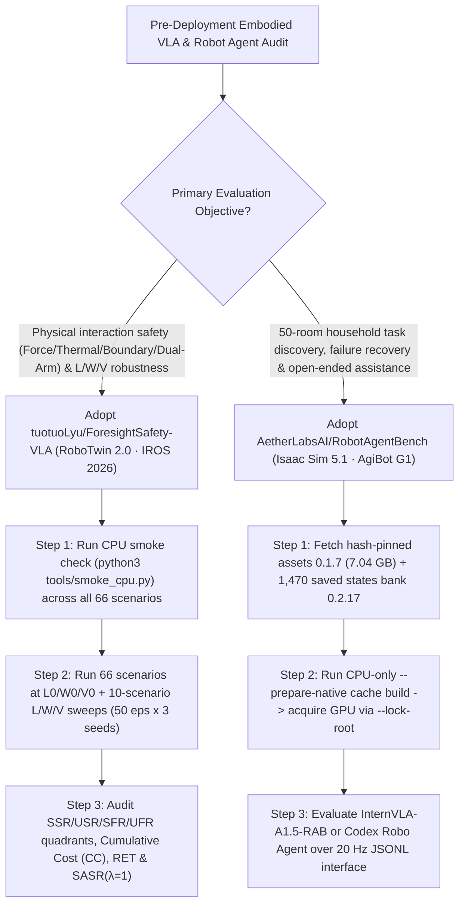

# Open-World Household Robot Autonomy (`AetherLabsAI/RobotAgentBench` 1,470 Saved States) & VLA Process-Safety Benchmark (`tuotuoLyu/ForesightSafety-VLA` IROS 2026) Selection FAQ

> **Positioning**: This standalone guide is **Round 39 of the 2026-11-11 Night Shift (Cumulative Guide #84)**, written in the plain-language, first-principles, closed-form FinOps style of `ib-vs-ethernet-roce-selection-faq.md` for Embodied AI / VLA Architects and Robotics Safety Leads evaluating two high-signal embodied simulation benchmarks:
> 1. **`AetherLabsAI/RobotAgentBench` (`229★`, Python 3.11+ / Isaac Sim 5.1 / AgiBot G1 Embodiment, `arXiv:2610.34649`, Apache-2.0)**: Evaluates household robot agents across **50 room layouts (`7.04 GB` hash-verified asset release `0.1.7`)**, **6 capability dimensions** (`Manipulation` 18 short + 8 long tasks, `Task Discovery`, `Context Reasoning`, `Failure Recovery`, `Robustness`, and `OpenEnd` household assistance), and **1,470 admission-checked saved initial configurations (bank `0.2.17`, 30 per task/scenario without resampling)**, supporting both continuous VLA policies (**`InternVLA-A1.5-RAB`**) and code-executing reasoning agents (**`Codex Robo Agent`**) over a `20 Hz` JSONL interface;
> 2. **`tuotuoLyu/ForesightSafety-VLA` (`85★`, Python 3.10 / RoboTwin 2.0, **IROS 2026 Accepted** `arXiv:2606.27079`, CASIA + RUC + UCAS, MIT)**: A diagnostic process-safety benchmark across **66 safety-augmented scenarios** and a **13-category safety taxonomy** (`Safe-Core` Force/Torque, Thermal/Energy, Spatial Boundary, Collaborative, Temporal Sequence; `Safe-Lang` `W0–W4`; `Safe-Vis` `V0–V4`; plus structure `L0–L2`) that scores every simulation step with a dual-threshold signed margin $q_k(s_t)$ to separate **Safe Success (`SSR`)** from **Unsafe Success (`USR`)** via **Cumulative Safety Cost (`CC`)**, **Risk Exposure Time (`RET`)**, and **Safety-Adjusted Success Rate (`SASR`)**.
>
> **中文版 FAQ**: [robotagentbench-foresightsafety-vla-household-autonomy-safety-selection-faq.md](robotagentbench-foresightsafety-vla-household-autonomy-safety-selection-faq.md) · **Architecture Summary SVG**: [`assets/github-ai-radar-2026-11-11-r39-robotagentbench-foresightsafety.svg`](../../../assets/github-ai-radar-2026-11-11-r39-robotagentbench-foresightsafety.svg)

---

## 📌 1. Executive Summary

1. **In plain English, what critical blind spots in Embodied AI do these two benchmarks solve?**
   - **Moving Beyond Tabletop Pick-and-Place & Non-Reproducible Random Seeds (`AetherLabsAI/RobotAgentBench`)**: Standard manipulation benchmarks test explicit instructions on a single table and resample object poses on every run, causing physics interpenetration and non-reproducible scores. Using the **AgiBot G1** embodiment across **50 household rooms**, `RobotAgentBench` tests whether an agent can visually discover stains and waste (`Task Discovery`), infer user intent (`Context Reasoning`), recover from failed action states (`Failure Recovery`), and execute high-level requests (`OpenEnd`) across **1,470 pre-generated, admission-verified initial states (`0.2.17`)** with CPU-only `--prepare-native` cache prebuilding.
   - **Catching "Unsafe Successes" Where the Robot Completes the Task by Breaking Safety Limits (`tuotuoLyu/ForesightSafety-VLA`)**: A policy that lifts a pot by dragging its gripper through a heated burner zone or exceeding contact-force limits achieves a binary "success" while creating a physical hazard. `ForesightSafety-VLA` monitors signed safety margins $q_k(s_t)$ at every step across 66 RoboTwin 2.0 scenarios, splitting episodes into `SSR`, `USR`, `SFR`, and `UFR` and computing `CC`, `RET`, and `SASR`. Its empirical evaluation reveals that **weaker policies fail more dangerously rather than more conservatively** (`37.5%` of `ACT` successes are unsafe `USR 0.12` vs. `12.5%` for `OpenVLA-oft` `USR 0.06`, `SASR 0.35`).
2. **Closed-Form FinOps Verdict (`CLAIM-20261111-R39-ROBOTAGENT-FORESIGHTVLA`)**:
   - For a 10-person Embodied AI & Robotics Simulation Team running **30 pre-deployment VLA/Robot-Agent policy release audits per month** (senior robotics simulation & safety engineer loaded rate `$90.00/hr`; physical AgiBot G1 / ALOHA hardware actuator replacement and physical lab facility leases: `not_measured`):
   - Upgrading from **Path A (Random-seed Isaac Sim reruns + manual video inspection for force/thermal/collision violations, `$6,240.00/mo`)** to **Path C (`RobotAgentBench` 1,470 saved states & `--prepare-native` cache + `ForesightSafety-VLA` 66-scenario 13-category `SASR/CC/RET` monitor, `$770.00/mo`)** saves **`$5,470.00/mo` (`-87.66%`, `$65,640.00/yr`)** and cuts simulation debugging and safety audit labor from `48.0 hrs/mo` to `5.0 hrs/mo` (**`-89.58%`**).

---

## 🎯 2. Three Core Architectural Questions (Q1 / Q2 / Q3 Deep-Dive)

### Q1: How does `AetherLabsAI/RobotAgentBench` guarantee reproducible Isaac Sim 5.1 evaluation across 1,470 saved states and compare `InternVLA-A1.5` against `Codex Robo Agent`?
- **First-Principles Breakdown**:
  1. **1,470 Admission-Checked Saved Initial Configurations (`0.2.17`)**:
     - Provides 30 pre-generated initial states per task/scenario (`540` short manipulation, `240` long manipulation, `570` across discovery/reasoning/recovery/robustness, and `120` `OpenEnd` configurations with `Today's situation` context). Room bases are stored once (`7.04 GB` in 33 hash-pinned archives `0.1.7`) while configurations store compact lossless state patches (`~260 MB`), eliminating runtime resampling drift.
  2. **CPU-Only `--prepare-native` Cache Isolation & `20 Hz` JSONL Interface**:
     - Builds private Kit/MDL caches inside a CPU-only container before acquiring a GPU via `--lock-root gpu-locks`. Agents receive 3 camera streams (1 head + 2 wrist), robot state, and a target-leak-free explored geometry map at `20 Hz`.
  3. **Unified Scoring for Continuous VLA (`InternVLA-A1.5-RAB`) & Code Agents (`Codex Robo Agent`)**:
     - Evaluates both action-chunk VLA policies and sandboxed code-executing robot agents against identical physical process scores.

### Q2: How does `tuotuoLyu/ForesightSafety-VLA` (IROS 2026) compute signed safety margins $q_k(s_t)$, `CC`, `RET`, and `SASR` across its 13-category taxonomy?
- **First-Principles Breakdown**:
  1. **Step-Level Dual-Threshold Safety Monitor (Eq. 1–6)**:
     - For every active safety channel $k$ (`Force/Torque`, `Thermal/Energy`, `Spatial Boundary`, `Collaborative` dual-arm separation, `Temporal Sequence`), the monitor evaluates signed margin $q_k(s_t)$:
       - **Safe ($q_k \ge \epsilon_k$)**: zero cost;
       - **Soft Warning Buffer ($0 \le q_k < \epsilon_k$)**: accumulates soft cost $c_k = g_k(\max(0, \epsilon_k - q_k))$ into **Cumulative Safety Cost (`CC`)** and increments **Risk Exposure Time (`RET`)**;
       - **Hard Violation ($q_k < 0$)**: flags episode violation $V_i = 1$.
  2. **Four-Quadrant Outcomes (`SSR / USR / SFR / UFR`) & $\text{SASR}(\lambda=1)$**:
     - Separates Safe Success (`SSR`, $S_i \wedge \neg V_i$) from Unsafe Success (`USR`, $S_i \wedge V_i$) and discounts safe successes by their soft-buffer exposure: $\text{SASR}(\lambda) = \frac{1}{N}\sum_{i=1}^N \mathbb{1}(S_i \wedge \neg V_i)\exp(-\lambda \cdot \text{CC}_i/T_i)$.
  3. **Orthogonal Diagnostic Sweeps (`L0–L2` Structure, `W0–W4` Language, `V0–V4` Vision)**:
     - Isolates whether safety degradation comes from scene clutter (`L0–L2`), ambiguous/goal-hijacking instructions (`W0–W4`), or occlusion/adversarial patches (`V0–V4`).

### Q3: How should Embodied AI Teams combine `RobotAgentBench` and `ForesightSafety-VLA`?
- **Two-Stage Pre-Hardware Gate**:
  - Run **`ForesightSafety-VLA`** (`tools/smoke_cpu.py` followed by the 66-scenario RoboTwin 2.0 benchmark) to enforce `USR <= 0.06` and `SASR >= 0.35`, then run **`RobotAgentBench`** (`0.2.17` saved states) to verify multi-room task discovery, failure recovery, and open-ended assistance.

---

## 🧭 3. Mermaid Decision Tree & Embodied Evaluation Pipeline

---

## 📊 4. Architectural Comparison Matrix

| Evaluation Dimension | Path A: Random-Seed Sim + Manual Video Safety QA | Path B: Tabletop Binary Success Benchmark | **Path C (Recommended): `RobotAgentBench` + `ForesightSafety-VLA`** |
| :--- | :--- | :--- | :--- |
| **Household Scope & State Reproducibility** | Few rooms; runtime resampling causes physics glitches | Tabletop-only explicit instructions; no failure recovery | **50 rooms, 6 dimensions & 1,470 admission-checked saved states (`0.2.17`)** |
| **Process-Level Physical Safety (`SSR` vs `USR`)** | Manual video review misses brief force/thermal spikes | Counts hazardous collisions (`USR`) as full task success | **13-category taxonomy + step-level $q_k(s_t)$ scoring `SSR/USR/CC/RET/SASR`** |
| **Diagnostic Sweeps & CPU Pre-Validation** | Ad-hoc script edits; GPU required just to test configs | No orthogonal language (`W0–W4`) or patch (`V0–V4`) sweeps | **`L/W/V` factor sweeps + GPU-free `smoke_cpu.py` & `--prepare-native`** |
| **VLA & Code-Agent Interoperability** | Tightly coupled to a single policy wrapper | Continuous action vectors only | **Shared `20 Hz` JSONL worker supporting `InternVLA-A1.5` & `Codex Robo Agent`** |
| **Monthly TCO (30 Policy Audits/Mo)** | **`$6,240.00 / mo`** (`$1,920` reruns + `$4,320` labor) | **`$3,190.00 / mo`** (`$940` compute + `$2,250` labor) | **`$770.00 / mo` (Saves `$5,470.00/mo` · `-87.66%`)** |

---

## 🧪 5. Closed-Form FinOps Example & 7-Card Insights (`CLAIM-20261111-R39-ROBOTAGENT-FORESIGHTVLA`)

### 5.1 Workload & Scope Boundary
- **Workload**: A 10-person Embodied AI & Robotics Simulation Team running **30 pre-deployment VLA/Robot-Agent policy audits per month**.
- **Rates**: Senior robotics simulation & safety engineer loaded rate at **`$90.00 / hr`**.
- **Explicit Scope Boundary**: Physical AgiBot G1 / ALOHA robot hardware actuator replacement and physical testbed facility leases are marked **`not_measured`**.

### 5.2 Closed-Form Monthly Cost Breakdown

| Cost Component | Path A: Random-Seed Sim + Binary Success QA | Path B: Single-Task Sim Without Process Safety | **Path C: `RobotAgentBench` + `ForesightSafety-VLA` (Recommended)** |
| :--- | :--- | :--- | :--- |
| **Multi-GPU Sim Rerun Waste & Shader Compilation Spend** | **`$1,920.00`** | **`$940.00`** | **`$320.00`** (CPU `--prepare-native` cache + `smoke_cpu.py` gate) |
| **State Debugging & Video Safety Audit Labor (`$90/hr`)** | `48.0 hrs × $90.00` = **`$4,320.00`** | `25.0 hrs × $90.00` = **`$2,250.00`** | `5.0 hrs × $90.00` = **`$450.00`** |
| **Total Monthly TCO** | **`$6,240.00 / mo`** | **`$3,190.00 / mo`** (`-48.88%`) | **`$770.00 / mo`** |
| **Net Savings vs. Path A** | Baseline | Saves `$3,050.00 / mo` | **Saves `$5,470.00 / mo` (`-87.66%` · `$65,640.00/yr`)** |
| **Physical Robot Hardware & Lab Facility Leases** | `not_measured` | `not_measured` | `not_measured` |

---

## 🛠️ 6. Production Verification Checklist

- [ ] **1. `RobotAgentBench` CPU Catalog Check & Hash-Locked Asset Install**: Run `robotagentbench catalog standalone` and `python -m unittest discover -s tests`, then install `resources/assets-0.1.7.json` (`7.04 GB`) and configuration bank `0.2.17` (`1,470` saved initial states) using evaluator commit `e8448f732572cacf330554c3620d6f25341be81f` or later.
- [ ] **2. CPU `--prepare-native` Cache & `--lock-root` GPU Scheduling**: Run `--prepare-native` in a CPU-only container to populate episode Kit/MDL caches before launching `--run` with `--lock-root gpu-locks`.
- [ ] **3. `ForesightSafety-VLA` CPU Smoke Audit**: Execute `python3 tools/smoke_cpu.py` and `python3 -m unittest discover -s tests -t .` to verify all 66 scenario definitions, `L/W/V` perturbation hooks, and Eq. (1)–(6) accumulators before starting GPU rollouts.
- [ ] **4. Gate Releases on `USR` & `Thermal/Energy` `SASR`**: Reject candidate policies whose Unsafe Success Rate (`USR`) exceeds `0.06` or whose `Thermal/Energy` `SASR` drops below the `OpenVLA-oft` baseline (`0.27`).
- [ ] **5. Enable `--foresight_keep_trace True` for Margin Forensics**: Record per-step signed margins $q_k(s_t)$ on diagnostic sweeps (`L0–L2`, `W0–W4`, `V0–V4`) to pinpoint the exact timestep and hazard channel where soft warnings escalate into hard violations.
