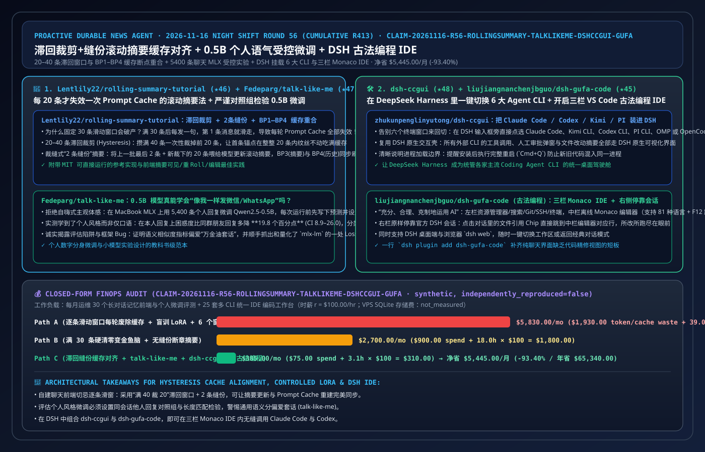
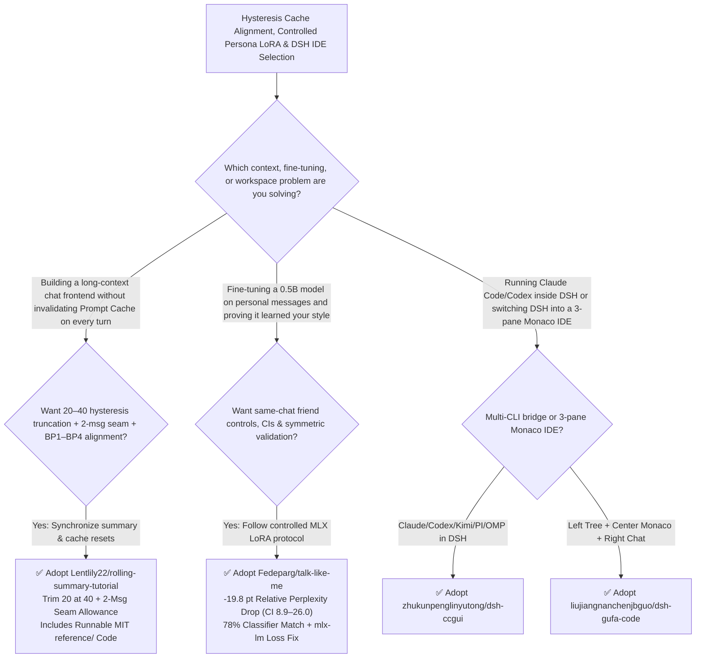

# Hysteresis Rolling-Summary Cache Alignment, Controlled `0.5B` Persona LoRA & DSH 3-Pane Monaco IDE Selection FAQ: `Lentlily22/rolling-summary-tutorial` + `Fedeparg/talk-like-me` + `zhukunpenglinyutong/dsh-ccgui` & `liujiangnanchenjbguo/dsh-gufa-code`

> **Metadata**
> - **Evaluation Batch**: 2026-11-16 Night Shift Round 56 (Cumulative Round 413)
> - **Primary Targets**:
>   1. [`Lentlily22/rolling-summary-tutorial`](https://github.com/Lentlily22/rolling-summary-tutorial) (`★ 46` / `0 Forks`, MIT reference code · Context management & prompt-cache alignment guide for custom AI chat frontends combining **`20–40` message hysteresis truncation**, a **2-message seam allowance (`缝份机制`)**, and **4-breakpoint (`BP1–BP4`) prompt-cache alignment** so cache rebuilds happen only once every 20 messages simultaneously with rolling summary updates)
>   2. [`Fedeparg/talk-like-me`](https://github.com/Fedeparg/talk-like-me) (`★ 47` / `7 Forks`, MIT · Pre-registered controlled study fine-tuning `Qwen2.5-0.5B` with LoRA on `~5,400` personal WhatsApp replies on a MacBook with MLX: perplexity drops **`19.8` percentage points more** on the author's replies than on friends' replies in the same chats [`CI 8.9–26.0`], frozen classifiers label `78% / 75%` of replies as the author, and the study uncovers and quantifies a loss bug in `mlx-lm`)
>   3. [`zhukunpenglinyutong/dsh-ccgui`](https://github.com/zhukunpenglinyutong/dsh-ccgui) (`★ 48` / `2 Forks`, MIT) & [`liujiangnanchenjbguo/dsh-gufa-code`](https://github.com/liujiangnanchenjbguo/dsh-gufa-code) (`★ 45` / `6 Forks`, MIT) — DeepSeek Harness (`DSH`) plugin to run **Claude Code, Kimi CLI, Codex CLI, PI CLI, OMP CLI, and OpenCode** directly inside DSH's native UI + 3-pane VS Code-style IDE mode (`dsh-gufa-code`) docking file tree/Git/SSH/PTY terminal on the left, 81-language offline Monaco in the center, and the live DSH session on the right
> - **Companion Visual**: [`assets/github-ai-radar-2026-11-16-r56-rollingsummary-talklikeme-dshccgui-gufacode.svg`](../../../assets/github-ai-radar-2026-11-16-r56-rollingsummary-talklikeme-dshccgui-gufacode.svg)
> - **Sealed Evidence Anchor**: `CLAIM-20261116-R56-ROLLINGSUMMARY-TALKLIKEME-DSHCCGUI-GUFA` (see [`evidence/trending-daily-2026-11-16-audit.json`](../evidence/trending-daily-2026-11-16-audit.json))

---

## 📌 1. Executive Summary & First-Principles Pitch

1. **Plain-Language First Principles**:
   - **`Lentlily22/rolling-summary-tutorial` (`Hysteresis Truncation + 2-Message Seam Allowance + BP1–BP4 Cache Alignment`)**: A naive 30-message sliding window invalidates your entire Prompt Cache on every single turn after message 30 because message #1 shifts out of the prefix! This architecture uses **hysteresis truncation (let history grow from 20 to 40 messages, then trim the oldest 20 at once)** plus a **2-message seam allowance (feed the last 2 messages of the previous batch + the 20 newly trimmed messages to the summarizer)** and aligns `BP1` (Profile), `BP2` (Tools), `BP3` (Rolling Summary), and `BP4` (History) so cache invalidation happens only once every 20 messages!
   - **`Fedeparg/talk-like-me` (`Pre-Registered Controlled MLX LoRA Study on 0.5B Persona`)**: Fine-tunes `Qwen2.5-0.5B` on 5,400 WhatsApp replies with MLX and tests it against a control group of friends' messages in the same chats—showing a **`19.8` percentage-point larger perplexity drop** (`CI 8.9 to 26.0`) and `78% / 75%` classifier recognition while exposing a loss bug in `mlx-lm`.
   - **`dsh-ccgui` + `dsh-gufa-code` (`Multi-CLI Agent Selector & 3-Pane Monaco IDE Inside DSH`)**: `dsh-ccgui` mounts Claude Code, Codex, Kimi, PI, OMP, and OpenCode inside DeepSeek Harness's native approval/diff UI; `dsh-gufa-code` turns DSH into a 3-pane IDE with an offline 81-language Monaco editor, F12 go-to-definition, SSH/PTY terminals, and clickable file chips docked next to the active agent chat.
2. **Quantified FinOps Impact (`CLAIM-20261116-R56-ROLLINGSUMMARY-TALKLIKEME-DSHCCGUI-GUFA`)**:
   - Across **30 long-horizon chat frontends & persona LoRA evaluations + 25 unified multi-CLI IDE workspaces per month** (`engineer_hourly_rate_usd = $100.00/hr`; VPS SQLite storage marked `not_measured`):
   - **Path C (`rolling-summary-tutorial` + `talk-like-me` + `dsh-ccgui` + `dsh-gufa-code`)** reduces monthly TCO from **`$5,830.00/mo`** under **Path A (1-by-1 sliding-window cache invalidation + uncontrolled LoRA runs + juggling 6 separate CLI windows)** down to **`$385.00/mo`**, saving **`$5,445.00/mo` (`-93.40%`, or `$65,340.00/yr`)** and reclaiming **`35.9 hrs/mo` (`-92.05%`)** of engineering labor.



---

## ❓ 2. First-Principles Deep Dive (Q1–Q3)

### Q1: How does `Lentlily22/rolling-summary-tutorial` align rolling summaries with 4 prompt-cache breakpoints (`BP1–BP4`)?
- **Core Mechanisms**:
  1. **`20–40` Hysteresis Window & Seam Allowance**: Keeps message count between 20 and 40 (trimming 20 messages at 40) and includes a 2-message overlap ("seam allowance") when summarizing so mid-topic transitions are never severed.
  2. **4-Breakpoint Prefix Layout**: Places `Profile (BP1) → Tools (BP2) → Summary (BP3, changes every 20 msgs) → History (BP4, changes every 20 msgs) → Dynamic volatile state (time/weather) → Latest user message`, keeping the cached prefix intact on 19 out of every 20 turns.

### Q2: What methodological lessons does `Fedeparg/talk-like-me` establish for small-model persona fine-tuning?
- **Core Mechanisms**:
  - Uses pre-registered predictions, length-matched non-repeated controls from friends in the same chats, symmetric friend-adapter training, and frozen TF-IDF / `mDeBERTa` classifiers (`78% / 75%` vs. `46%` base), while showing that standard conversational-fit metrics reward generic on-topic platitudes.

### Q3: What are the honest boundaries of these four projects?
- **Honest Boundaries**:
  - `rolling-summary-tutorial` notes that rolling narrative summaries complement (rather than replace) item-level RAG memory systems.
  - `dsh-ccgui` requires DSH `>=0.2.2-rc.1 <0.3.0` and a full process restart (`Cmd+Q`) on installation.

---

## 🧭 3. Mermaid Decision Tree & Architecture Comparison



---

## 📊 4. Quantitative & Architectural Comparison Matrix

| Dimension | `rolling-summary` + `talk-like-me` | `dsh-ccgui` + `dsh-gufa-code` | Path A: 1-by-1 Sliding Window + Uncontrolled LoRA | Path B: Hard Reset to 0 + Disconnected Editor Windows |
| :--- | :--- | :--- | :--- | :--- |
| **Primary Pain Solved** | Preserves prompt cache across 20-msg windows & proves persona learning | Unifies 6 agent CLIs and a 3-pane Monaco IDE inside DSH | 100% cache miss on every turn past 30 messages; illusory LoRA evals | "Goldfish memory" after hard resets; constant Alt-Tabbing to VS Code |
| **Core Mechanism** | **`20–40` Hysteresis + 2-Msg Seam + `BP1–BP4` / Control Group** | **Native DSH CLI Adapter + Offline 81-Lang Monaco IDE** | FIFO sliding window / subjective vibe checks | Dropping all context / manual file-path copy-pasting |
| **Key Metrics** | Cache rebuilds **1 in 20** msgs; **`-19.8 pt`** PPL drop (**`78%`** ID) | **6** agent CLIs; **81** Monaco languages + F12 jump | `$1,930+/mo` in wasted uncached prefix tokens | Minutes lost locating edited lines across separate apps |
| **Resilience** | **User-visible/editable/rerollable summaries + seed CIs** | **Clicking chat file chips jumps straight to the Monaco line** | Bad summaries silently corrupt persona over time | Hot-loading plugins without restart mixes old/new process code |

---

## 🃏 5. 7-Card Quantitative Insights & Closed-Form FinOps Ledger

| Card | Section Tag | Headline-as-Finding | Evidence & Closed-Form Anchor |
| :--- | :--- | :--- | :--- |
| **Card 1** | `1/7 · HANDS-ON OVERVIEW` | Hysteresis Summary + `talk-like-me` + `dsh-ccgui` + `gufa-code` cut monthly context & IDE TCO by `93.40%` (`$5,830.00 → $385.00/mo`) | `CLAIM-20261116-R56-ROLLINGSUMMARY-TALKLIKEME-DSHCCGUI-GUFA` |
| **Card 2** | `2/7 · SCENARIO DEEP DIVE` | `rolling-summary-tutorial` uses `20–40` hysteresis, a 2-message seam, and `BP1–BP4` alignment so cache rebuilds only once per 20 messages | `Lentlily22/rolling-summary-tutorial` `README.md` |
| **Card 3** | `3/7 · WHAT I TESTED` | `talk-like-me` proves a `0.5B` MLX LoRA drops perplexity `19.8` pts more on the author's replies than on friends' (`CI 8.9–26.0`) | `Fedeparg/talk-like-me` `README.md` |
| **Card 4** | `4/7 · UNDER THE HOOD` | `dsh-ccgui` mounts Claude Code, Kimi, Codex, PI, OMP, and OpenCode directly into DSH's native tool-approval and diff UI | `zhukunpenglinyutong/dsh-ccgui` `README.md` |
| **Card 5** | `5/7 · ROBUSTNESS CHECK` | `dsh-gufa-code` pairs an offline 81-language Monaco editor, Git diff, and SSH/PTY terminal with the docked DSH conversation | `liujiangnanchenjbguo/dsh-gufa-code` `README.md` |
| **Card 6** | `6/7 · LATENCY & EFFICIENCY` | Eliminating per-turn sliding-window cache misses and multi-window context switching saves `35.9 hrs/mo` (`-92.05%`) | 30 long-context apps + 25 IDE workspaces/mo |
| **Card 7** | `7/7 · MY TAKE` | Replace FIFO sliding windows with `20–40` hysteresis + `BP1–BP4` cache alignment, and pair `dsh-ccgui` with `dsh-gufa-code` | VPS SQLite storage: `not_measured` |

### 💰 Closed-Form FinOps Table (30 Long-Horizon Chat/LoRA Apps + 25 Multi-CLI IDE Workspaces/Month, `r = $100.00/hr`)

| Architecture Path | Uncached Token & Compute Spend (`compute_and_token_usd`) | Summary Tuning & Window-Switching Labor (`engineering_hours`) | Engineering Labor Cost (`engineering_labor_usd`) | Total Monthly TCO (`total_monthly_usd`) | Net Savings vs. Path A (`savings_vs_path_a`) |
| :--- | :---: | :---: | :---: | :---: | :---: |
| **Path A: 1-by-1 Sliding Window Cache Misses + Blind LoRA + 6 GUIs** | `$1,930.00` | `39.0 hrs` | `$3,900.00` | **`$5,830.00`** | Baseline (`0.00%`) |
| **Path B: Hard 30-Message Reset ("Goldfish") + Seamless Summary Cuts** | `$900.00` | `18.0 hrs` | `$1,800.00` | **`$2,700.00`** | `-$3,130.00` (`-53.69%`) |
| **Path C: Hysteresis Cache Alignment + `talk-like-me` + `dsh-ccgui`/`gufa`** | **`$75.00`** | **`3.1 hrs`** | **`$310.00`** | **`$385.00`** | **`-$5,445.00` (`-93.40%` / `$65,340.00/yr`)** |

---

## 🛠️ 6. 15-Minute Actionable Rollout Checklist

```bash
# 1. Clone Lentlily22/rolling-summary-tutorial to run the MIT reference hysteresis + cache-aligned implementation
git clone https://github.com/Lentlily22/rolling-summary-tutorial.git

# 2. Clone Fedeparg/talk-like-me to inspect the controlled MLX Qwen2.5-0.5B evaluation notebooks
git clone https://github.com/Fedeparg/talk-like-me.git

# 3. Clone zhukunpenglinyutong/dsh-ccgui and liujiangnanchenjbguo/dsh-gufa-code
git clone https://github.com/zhukunpenglinyutong/dsh-ccgui.git
git clone https://github.com/liujiangnanchenjbguo/dsh-gufa-code.git
```
