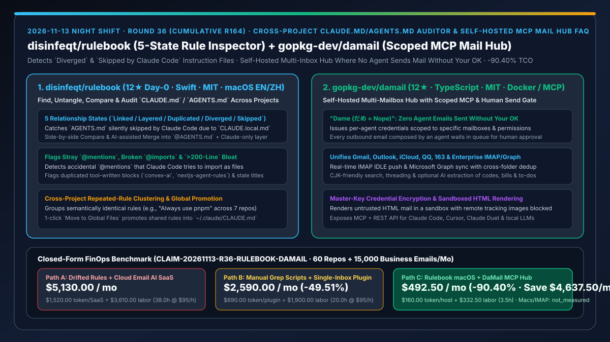
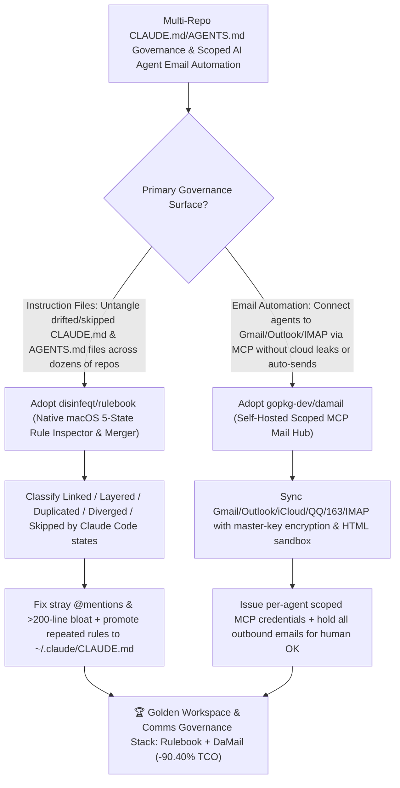

# Cross-Project `CLAUDE.md`/`AGENTS.md` Auditor (`disinfeqt/rulebook`) & Self-Hosted Scoped Mail Hub MCP (`gopkg-dev/damail`) Selection FAQ

> **Document Scope**: This is the **2026-11-13 Night Shift Round 36 (Cumulative #164) standalone 6-part selection guide**, modeled strictly after `ib-vs-ethernet-roce-selection-faq.md` with first-principles explanations and closed-form FinOps math. It is written for AI Solution Architects, Multi-Repo Engineering Leads, and Enterprise Security Architects evaluating two instruction-hygiene and email-governance tools:
> 1. **`disinfeqt/rulebook` (`12★` on Day 0, Swift, MIT, native macOS app in English & Simplified Chinese, `rulebook.duxi.ao`)**: A native macOS app that finds, untangles, compares, merges, and audits every `CLAUDE.md`, `AGENTS.md`, and `CLAUDE.local.md` across your projects — classifying files into **5 relationship states (`Linked / Layered / Duplicated / Diverged / Skipped by Claude Code`)**, flagging broken `@imports`, stray `@mentions`, duplicated tool-written blocks (`convex-ai`, `nextjs-agent-rules`), files over 200 lines, and repeated rules across repos (with one-click promotion to `~/.claude/CLAUDE.md`)!
> 2. **`gopkg-dev/damail` (`12★` in 1 day, TypeScript, MIT, `ghcr.io/gopkg-dev/damail`, `damail.app`)**: A self-hosted unified mail hub (syncing Gmail, Outlook, iCloud, QQ Mail, NetEase 163, Tencent/Alibaba business mail, and any IMAP / Microsoft Graph server) with scoped, auditable **MCP + REST API** credentials for AI agents — encrypting credentials with your master key, rendering HTML mail in an image-blocked sandbox, and enforcing the **"dame (だめ = nope)" rule: no agent ever sends a single email without your explicit OK**!
>
> **中文版本**: [rulebook-damail-claude-agents-md-auditor-selfhosted-scoped-mail-mcp-selection-faq.md](rulebook-damail-claude-agents-md-auditor-selfhosted-scoped-mail-mcp-selection-faq.md) · **Daily Digest**: [`daily/2026-11-13.en.md`](../daily/2026-11-13.en.md) · **Topic SVG**: [`assets/github-ai-radar-2026-11-13-r36-rulebook-damail.svg`](../../../assets/github-ai-radar-2026-11-13-r36-rulebook-damail.svg)

---

## 📌 1. Executive Summary

1. **In plain English, what core pain points do these two repositories solve?**
   - **Ending "`AGENTS.md` files silently ignored by Claude Code because of a stray `CLAUDE.local.md`, `CLAUDE.md` and `AGENTS.md` drifting apart across 60 repos, or accidental `@mentions` triggering broken file imports" (`disinfeqt/rulebook`)**: Point `Rulebook` at your projects folder on macOS and it maps every instruction file into **5 clear states (`Linked`, `Layered`, `Duplicated`, `Diverged`, and `Skipped by Claude Code`)**. It flags broken `@imports`, stray `@mentions`, duplicated tool-injected blocks (`convex-ai`, `nextjs-agent-rules`), and files over 200 lines, merges diverged files into a clean `@AGENTS.md` layered structure, and groups repeated rules across repositories so you can promote them to `~/.claude/CLAUDE.md` in one click!
   - **Ending "giving AI agents unscoped full access to your email accounts or paying third-party cloud SaaS tools to read your private Gmail, Outlook, and enterprise IMAP inboxes" (`gopkg-dev/damail`)**: `DaMail` is a self-hosted mail hub (`ghcr.io/gopkg-dev/damail`) that syncs Gmail, Outlook, iCloud, QQ Mail, NetEase 163, Tencent/Alibaba business mail, and any IMAP/Graph server with master-key encryption and sandboxed HTML rendering. It issues **scoped per-agent MCP and REST credentials** and enforces its namesake rule (*dame* = nope): **every email an agent drafts waits for your explicit human approval before sending**!
2. **Closed-Form FinOps Conclusion (`CLAIM-20261113-R36-RULEBOOK-DAMAIL`)**:
   - Modeled for a **20-engineer organization maintaining `60 repositories with CLAUDE.md/AGENTS.md files` and triaging `15,000 multi-account business emails / month`** (fully loaded software & operations engineer rate `$95.00/hr`; Mac workstation hardware and base mail server contracts: `not_measured`):
   - Switching from **Path A (drifted/bloated instruction files + commercial cloud AI email SaaS subscriptions, `$5,130.00/mo`)** to **Path C (`Rulebook` 5-state macOS auditor/merger + `DaMail` self-hosted scoped MCP mail hub, `$492.50/mo`)** saves **`$4,637.50/mo` (`-90.40%`, or `$55,650.00/yr`)** and cuts rule-drift debugging and multi-inbox triage labor from `38.0 hrs/mo` to `3.5 hrs/mo` (**`-90.79%`**).

---

## 🎯 2. Three First-Principles Deep-Dive Questions (Q1 / Q2 / Q3)

### Q1: How do `CLAUDE.md` and `AGENTS.md` files silently break or bloat across multi-CLI engineering workspaces?
- **First-Principles Breakdown**:
  1. **Precedence Shadowing (`Skipped by Claude Code`) & `Diverged` Edits**: A `CLAUDE.local.md` or parent `CLAUDE.md` can cause Claude Code to skip `AGENTS.md` entirely, while developers using different CLIs edit separate files until rules contradict each other.
  2. **Stray `@mention` Imports & Duplicated Tool Blocks**: Unescaped `@mentions` get parsed by Claude Code as `@import` file directives, and CLI installers (`convex-ai`, `nextjs-agent-rules`) often append duplicate rule blocks that push files past 200 lines.

### Q2: How does `disinfeqt/rulebook` untangle, merge, and deduplicate agent instruction files across projects?
- **First-Principles Breakdown**:
  1. **5-State Inspector & Side-by-Side Layered Merge**:
     - Classifies every project (`Linked`, `Layered`, `Duplicated`, `Diverged`, `Skipped by Claude Code`) and merges drifted files into a single `AGENTS.md` imported via `@AGENTS.md` inside `CLAUDE.md` (plus any Claude-specific overrides).
  2. **Semantic Repeated-Rule Clustering & Global Promotion**:
     - Groups rules that state the same convention in different words across projects and promotes them to `~/.claude/CLAUDE.md` with one click.

### Q3: How does `gopkg-dev/damail` expose multi-provider email to MCP agents without data leakage or unauthorized sends?
- **First-Principles Breakdown**:
  1. **Scoped Per-Agent Credentials & Mandatory Human Send Approval**:
     - Issues agent-specific tokens restricted to chosen mailboxes and permissions, while holding all agent-authored outbound emails for human sign-off.
  2. **Master-Key Encryption, Sandboxed HTML & Opt-In AI Triage**:
     - Encrypts mailbox credentials with your own master key, blocks remote tracking images inside an HTML sandbox, and keeps AI triage (summaries, verification codes, bills, to-dos) off by default until configured with your chosen local or API model.

---

## 🧭 3. Mermaid Decision Tree & Rulebook + DaMail Architecture

---

## 📊 4. Head-to-Head Selection Matrix

| Dimension | Path A: Manual Rule Edits + Cloud AI Email SaaS | Path B: Ad-Hoc Grep Scripts + Single-Inbox Plugin | **Path C (Recommended): `disinfeqt/rulebook` + `gopkg-dev/damail`** |
| :--- | :--- | :--- | :--- |
| **`CLAUDE.md` / `AGENTS.md` Alignment** | Frequent drift & silent `Skipped by Claude Code` bugs | Filename listing only; misses precedence shadowing | **5-state visual inspector + side-by-side Compare & `@AGENTS.md` layered Merge** |
| **Stray `@mentions` & Cross-Repo Dedup** | Broken `@imports` & `>200-line` duplicated tool blocks | Manual per-repo editing | **One-click fixes for broken `@imports` + semantic clustering into `~/.claude/CLAUDE.md`** |
| **Multi-Provider Email Unification** | High per-seat SaaS fees; third-party cloud data storage | Locked to a single email provider | **Self-hosted IMAP IDLE + Microsoft Graph across Gmail, Outlook, iCloud, QQ, 163 & enterprise mail** |
| **Agent Access Scope & Outbound Safety** | Broad mailbox access; risk of prompt-injected auto-sends | No MCP support or coarse permissions | **Scoped per-agent MCP/REST credentials + HTML sandbox + mandatory human approval before send** |
| **Monthly TCO (60 Repos + 15k Emails/Mo)** | **`$5,130.00 / mo`** (`$1,520` token/SaaS + `$3,610` labor) | **`$2,590.00 / mo`** (`$690` token + `$1,900` labor) | **`$492.50 / mo` (Saves `$4,637.50/mo` · `-90.40%`)** |

---

## 🧪 5. Closed-Form FinOps Worked Example & 7-Card Insights (`CLAIM-20261113-R36-RULEBOOK-DAMAIL`)

### 5.1 Baseline Parameters & Explicit Scope Boundaries
- **Scenario**: A 20-engineer organization maintaining **60 active repositories with `CLAUDE.md` / `AGENTS.md` files** and processing **15,000 multi-account business emails per month** with AI agent triage.
- **Labor Rate**: Fully loaded software and operations engineer rate of **`$95.00 / hr`**.
- **Explicit Not-Measured Boundary**: Mac workstation hardware capex and base domain/mail-server hosting contracts are marked **`not_measured`**. This model strictly accounts for bloated instruction-file prefill tokens, commercial AI email SaaS fees, and engineering hours spent debugging drifted/skipped agent rules and manually triaging multi-account inboxes.

### 5.2 Three-Path Monthly Cost Comparison

| Cost Component | Path A: Drifted Rules + Cloud Email AI SaaS | Path B: Manual Grep Scripts + Single-Inbox Plugin | **Path C: `Rulebook` macOS + `DaMail` MCP Hub (Recommended)** |
| :--- | :--- | :--- | :--- |
| **Monthly Rule-Prefill Token & Email SaaS Spend** | **`$1,520.00`** (`>200-line` duplicated rules + cloud email SaaS seats) | **`$690.00`** (moderate token & plugin spend) | **`$160.00`** (lean `<200-line` layered rules + self-hosted DaMail triage) |
| **Rule-Drift Debugging & Multi-Inbox Triage Labor (`$95/hr`)** | `38.0 hrs × $95.00` = **`$3,610.00`** | `20.0 hrs × $95.00` = **`$1,900.00`** | `3.5 hrs × $95.00` = **`$332.50`** |
| **Total Monthly TCO** | **`$5,130.00 / mo`** | **`$2,590.00 / mo`** (`-49.51%`) | **`$492.50 / mo`** |
| **Net Savings vs. Path A** | Baseline | Saves `$2,540.00 / mo` | **Saves `$4,637.50 / mo` (`-90.40%` · `$55,650.00/yr`)** |
| **Mac Workstations & Base Mail Server Contracts** | `not_measured` | `not_measured` | `not_measured` |

---

## 🛠️ 6. Production Adoption Checklist

- [ ] **1. `disinfeqt/rulebook` Workspace Audit**: Point `Rulebook` at your projects root on macOS and resolve all `Diverged` and `Skipped by Claude Code` files first.
- [ ] **2. Stray `@mention` Cleanup & Global Rule Promotion**: Fix unintended `@imports`, deduplicate `convex-ai` / `nextjs-agent-rules` blocks, and use `Move to Global Files` to consolidate shared conventions into `~/.claude/CLAUDE.md`.
- [ ] **3. `gopkg-dev/damail` Self-Hosted Deployment**: Deploy `ghcr.io/gopkg-dev/damail` with your master encryption key and connect your IMAP / Microsoft Graph mailboxes.
- [ ] **4. Scoped MCP Credential & Outbound Approval Test**: Issue a scoped credential for Claude Code or Cursor, verify read/triage over MCP, and confirm that agent-composed replies remain queued until manually approved.
