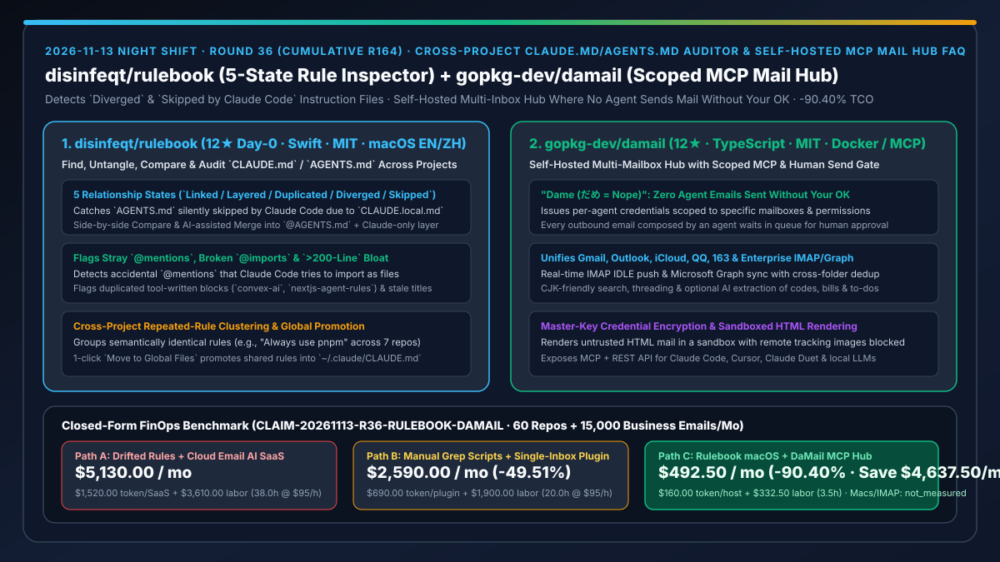
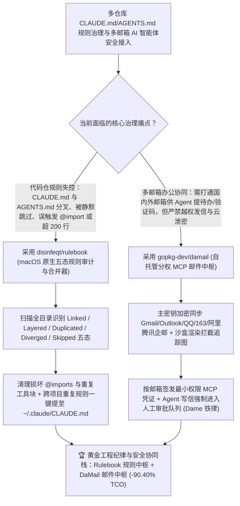

# 跨项目 `CLAUDE.md`/`AGENTS.md` 五态审计合并器（`disinfeqt/rulebook`）与自托管分权审批邮件中枢 MCP（`gopkg-dev/damail`）深度选型 FAQ

> **文档定位**：本专题是 **2026-11-13 夜班第 36 轮（累计第 164 篇）独立六段式选型指南**，严格对标 `ib-vs-ethernet-roce-selection-faq.md` 的通俗第一性原理与闭式 FinOps 核算规范，面向多仓库研发效能负责人、企业办公自动化安全架构师与 AI Solution Architect，深度拆解今日新仓榜上解决“手头几十个项目的 `CLAUDE.md` 与 `AGENTS.md` 互相分叉冲突、被 `CLAUDE.local.md` 静默屏蔽或误触发 `@import`”以及“让 AI Agent 处理多邮箱邮件时担心云端托管泄密或 Agent 擅自对外发信”的两大治理工具：
> 1. **`disinfeqt/rulebook`（当日新建获 `12★`，Swift，MIT，原生 macOS 中英双语应用，官网 `rulebook.duxi.ao`）**：一键扫描整个项目根目录下所有 `CLAUDE.md`、`AGENTS.md` 与 `CLAUDE.local.md` 的可视化审计、对比与合并工具——精准识别五种关系状态（`Linked`、`Layered`、`Duplicated`、`Diverged`、**`Skipped by Claude Code` [因存在 `CLAUDE.local.md` 或父级文件导致 `AGENTS.md` 被 Claude 静默跳过]**），自动揪出失效的 `@imports`、**被 Claude 误当成文件导入的普通 `@mentions`**、被重复注入两次的第三方工具规则块（如 `convex-ai`、`nextjs-agent-rules`）及超过 200 行的膨胀文件，并聚类跨项目重复规则一键提升至全局 `~/.claude/CLAUDE.md`！
> 2. **`gopkg-dev/damail`（1 天新建获 `12★`，TypeScript，MIT，Docker 镜像 `ghcr.io/gopkg-dev/damail`，官网 `damail.app`）**：取名自日语 *dame*（だめ = “不行”：**没有你的允许，任何 Agent 绝不能发出哪怕一封邮件**）的自托管多邮箱 AI 协同中枢——统一实时同步 Gmail、Outlook、iCloud、QQ 邮箱、网易 163、腾讯/阿里企业邮及任意 IMAP / Microsoft Graph 邮箱，主密钥加密凭证、沙盒隔离渲染 HTML 邮件（默认拦截远程追踪图片），为 Claude Code、Cursor、Claude Duet 等签发**按邮箱与权限粒度隔离的专属 MCP / REST API 凭证**，且所有由 Agent 撰写的邮件强制进入人工待批队列！
>
> **English Version**: [rulebook-damail-claude-agents-md-auditor-selfhosted-scoped-mail-mcp-selection-faq.en.md](rulebook-damail-claude-agents-md-auditor-selfhosted-scoped-mail-mcp-selection-faq.en.md) · **关联日报**: [`daily/2026-11-13.md`](../daily/2026-11-13.md) · **专题架构图**: [`assets/github-ai-radar-2026-11-13-r36-rulebook-damail.svg`](../../../assets/github-ai-radar-2026-11-13-r36-rulebook-damail.svg)

---

## 📌 一、核心结论速览（Executive Summary）

1. **一句话大白话讲透这两个项目到底解决了什么痛点？**
   - **终结“你明明在项目的 `AGENTS.md` 里写了条死规矩，结果 Claude Code 根本不听——查了半天才发现因为旁边有个 `CLAUDE.local.md` 导致 `AGENTS.md` 被静默跳过（Skipped）；或者文档里随手写了个 `@react- team` 被 Claude Code 误当成 `@import` 报错，以及同一个文件夹里的 `CLAUDE.md` 和 `AGENTS.md` 各写各的严重分叉（Diverged）”的痛点（`disinfeqt/rulebook`）**：这款原生 macOS 双语应用把你所有项目的规则文件翻出来列在一张表上，一眼标出 `Linked / Layered / Duplicated / Diverged / Skipped by Claude Code` 五种状态；不仅能并排 Compare 并一键合并为“主 `AGENTS.md` + `@AGENTS.md` 引用层”，还能找出你在 7 个项目里重复写了 7 遍的“Always use pnpm”一键提取到全局 `~/.claude/CLAUDE.md`！
   - **终结“想让 Claude Code 或桌面 Agent 帮你从 Gmail、Outlook、QQ 邮箱、阿里企业邮里提取验证码、账单和待办，但市面 AI 邮箱工具不仅要收月费、把你所有邮件传上第三方云，还存在被邮件里的隐藏提示词诱导自动对外发信的风险”的痛点（`gopkg-dev/damail`）**：`DaMail` 自托管在你自己的服务器上，用你自己的主密钥加密邮箱密码；你可以给不同 Agent 签发**只允许读某几个邮箱、绝不允许静默发信的受限 MCP 凭证**——Agent 写好的任何回复都必须乖乖停在待审区等你点 OK（*dame* = 绝不越权发信）！
2. **闭式 FinOps 投资回报结论（`CLAIM-20261113-R36-RULEBOOK-DAMAIL`）**：
   - 以 **20 人研发与运营团队维护 `60 个含 CLAUDE.md/AGENTS.md 的代码仓` 并每月处理 `15,000 封跨平台业务邮件`** 为基准（软件与运营工程师全包时薪 `$95.00/hr`；Mac 工作站硬件与基础域名/邮箱服年费：`not_measured`）：
   - 从 **Path A（60 仓规则文件分叉膨胀 + 付费第三方 AI 邮件 SaaS 订阅，月均 `$5,130.00`）** 升级至 **Path C（`Rulebook` 五态规则治理与全局去重 + `DaMail` 自托管分权审批邮件 MCP，月均 `$492.50`）**，每月净省 **`$4,637.50/mo`（降幅 `-90.40%`，年省 `$55,650.00/yr`）**，并将排查规则静默失效及人工跨 6 个邮箱分拣邮件的工时从 `38.0 hrs/mo` 压缩至 `3.5 hrs/mo`（节省 **`-90.79%`**）。

---

## 🎯 二、三大灵魂拷问（Q1 / Q2 / Q3 深度原理解析）

### Q1：为什么在同时使用 Claude Code、Codex 与 Cursor 的项目里，`CLAUDE.md` 和 `AGENTS.md` 极易出现“静默失效”与“隐式导入事故”？
- **第一性原理拆解**：
  1. **优先级遮蔽（Skipped by Claude Code）與双轨分叉（Diverged）**：当目录存在 `CLAUDE.local.md` 或特定父级 `CLAUDE.md` 时，`AGENTS.md` 可能被完全跳过；若两人分别用 Claude Code 和 Codex 修改了各自认的规则文件，同一仓库的 AI 行为就会彻底分裂。
  2. **意外 `@mention` 触发文件导入与工具块重复追加**：Claude Code 支持用 `@path` 导入外部文件，正文中普通的 `@username` 或 `@package` 常被误解析为损坏的导入；而 `convex-ai` 等 CLI 自动追加的规则块常被重复写入多次导致文件突破 200 行。

### Q2：`disinfeqt/rulebook` 是如何系统化清理和统一跨项目指令文件的？
- **第一性原理拆解**：
  1. **五态关系拓扑解析与一键修复**：
     - 自动将每个项目归类为 `Linked`（仅含 `@AGENTS.md` 或软链）、`Layered`（导入 `AGENTS.md` 并附加 Claude 专属规则）、`Duplicated`（完全相同，保存时双写）、`Diverged`（内容分叉）或 `Skipped by Claude Code`，并提供并排对比与受控合并。
  2. **跨仓语义聚类与全局提升（Move to Global Files）**：
     - 自动聚合在不同项目中用不同措辞表达同一含义的规则，支持一键上移至 `~/.claude/CLAUDE.md`。

### Q3：`gopkg-dev/damail` 是如何在打通国内外全主流邮箱的同时守住安全红线的？
- **第一性原理拆解**：
  1. **全协议实时同步 + 中日韩（CJK）友好检索**：
     - 原生支持 IMAP IDLE 实时推送与 Microsoft Graph，打通 Gmail、Outlook、iCloud、QQ 邮箱、163、腾讯/阿里企业邮，支持跨文件夹去重与 CJK 精准分词搜索。
  2. **最小权限 MCP 令牌 + HTML 沙盒 + 人工发信铁律**：
     - 每个 Agent 仅获得指定邮箱与动作范围的独立凭证；HTML 邮件在屏蔽外部图片的沙盒内渲染；AI 功能默认关闭（Off by Default），可按需接入本地或云端模型提取验证码/账单/待办，且所有外发邮件强制人工确认。

---

## 🧭 三、Mermaid 选型决策树与「Rulebook 规则治理 + DaMail 分权邮件中枢」架构图

---

## 📊 四、同类方案核心能力对比矩阵（Selection Matrix）

| 评估维度 | Path A：人工散乱维护规则 + 商业云端 AI 邮箱 SaaS | Path B：手写 Grep 脚本 + 单客户端邮箱插件 | **Path C（推荐）：`disinfeqt/rulebook` + `gopkg-dev/damail`** |
| :--- | :--- | :--- | :--- |
| **`CLAUDE.md` 与 `AGENTS.md` 一致性** | 频繁分叉（Diverged）或被 `CLAUDE.local.md` 静默屏蔽 | 仅能查文件名，看不出覆盖与跳过逻辑 | **五态可视化诊断 + 并排 Compare + 一键合并为 `@AGENTS.md` 分层结构** |
| **损坏 `@imports` 与跨仓重复规则清理** | 普通 `@mention` 引发隐式导入报错，重复规则烧 Token | 手工逐仓打开编辑器删改 | **自动定位损坏 `@imports` / `>200行` 膨胀 + 语义聚类一键提至全局文件** |
| **多邮箱聚合与国内外服务商支持** | 按账号收高昂月费，且邮件正文全存第三方服务器 | 仅支持单一 Gmail 或 Outlook | **自托管主密钥加密，通吃 Gmail/Outlook/iCloud/QQ/163/腾讯阿里企业邮** |
| **Agent 邮件权限隔离与发信安全门禁** | 全量邮箱读写权限，易被邮件提示词注入诱导发信 | 无 MCP 接口或无细粒度分权 | **按邮箱/权限签发独立 MCP 凭证 + 沙盒防追踪 + 人工未点 OK 绝不发出一封信** |
| **月度总拥有成本（60 仓 + 1.5 万封邮件）** | **`$5,130.00 / mo`**（`$1,520` Token/SaaS + `$3,610` 工时） | **`$2,590.00 / mo`**（`$690` Token + `$1,900` 工时） | **`$492.50 / mo`（净省 `$4,637.50/mo` · `-90.40%`）** |

---

## 🧪 五、定量 FinOps 算例与 7-Card 洞察（`CLAIM-20261113-R36-RULEBOOK-DAMAIL`）

### 5.1 测算基准与显式边界（Scope & Boundaries）
- **场景设定**：20 人规模的研发与技术运营团队，共同维护 **60 个包含 `CLAUDE.md` / `AGENTS.md` 的活跃代码仓库**，并每月通过 AI 助手辅助分拣与跟进 **15,000 封多平台商务/技术邮件**。
- **费率假设**：软件与技术运营工程师全包时薪 **`$95.00 / hr`**。
- **显式边界声明（Explicit Not-Measured Boundary）**：Mac 办公电脑硬件折旧与企业基础域名/企业邮箱服务商年费标记为 **`not_measured`**，本表严格核算因规则文件重复膨胀消耗的 Prefill Token 与商业 AI 邮件 SaaS 席位费，以及工程师排查跨 CLI 规则失效与手动切换 6 个邮箱分拣邮件的工时。

### 5.2 三路径月度成本闭式对照表

| 成本分项 | Path A：规则分叉膨胀 + 商业 AI 邮件 SaaS | Path B：手写脚本查规则 + 单邮箱插件 | **Path C：`Rulebook` + `DaMail`（推荐）** |
| :--- | :--- | :--- | :--- |
| **月度冗余规则 Token 与邮件 AI SaaS 支出** | **`$1,520.00`**（重复工具块 Token 浪费 + 商业邮箱 AI 月费） | **`$690.00`**（中等 Token 与插件费） | **`$160.00`**（精简 `<200行` 分层规则 + 自托管按需模型调用） |
| **规则失效排障与多邮箱人工分拣工时（`$95/hr`）** | `38.0 hrs × $95.00` = **`$3,610.00`** | `20.0 hrs × $95.00` = **`$1,900.00`** | `3.5 hrs × $95.00` = **`$332.50`** |
| **月度总成本（Monthly TCO）** | **`$5,130.00 / mo`** | **`$2,590.00 / mo`**（`-49.51%`） | **`$492.50 / mo`** |
| **相对 Path A 净节省** | 基准线（Baseline） | 净省 `$2,540.00 / mo` | **净省 `$4,637.50 / mo`（`-90.40%` · 年省 `$55,650.00/yr`）** |
| **Mac 办公硬件与企业邮箱基础年费** | `not_measured` | `not_measured` | `not_measured` |

---

## 🛠️ 六、生产级落地核验 Checklist

- [ ] **1. `disinfeqt/rulebook` 全工作区扫描**：在 macOS 上打开 `Rulebook` 指向代码工作区根目录，优先清零所有标为 `Diverged` 与 `Skipped by Claude Code` 的项目。
- [ ] **2. 损坏 `@imports` 修复与全局规则提炼**：一键修复误触发的 `@mentions`、删除重复加载的 `convex-ai`/`nextjs-agent-rules` 块，并将高频重复规则移入 `~/.claude/CLAUDE.md`。
- [ ] **3. `gopkg-dev/damail` 容器化部署与主密钥配置**：拉取 `ghcr.io/gopkg-dev/damail` 部署自托管实例，使用自定义主密钥加密接入 Gmail、Outlook、QQ/163 或企业邮箱。
- [ ] **4. 分权 MCP 令牌签发与人工发信拦截测试**：为 Claude Code / Cursor 签发仅限指定邮箱的 MCP 凭证，测试验证码/账单/待办提取，并验证 Agent 调用发信接口时邮件严格停留在人工待批状态。
