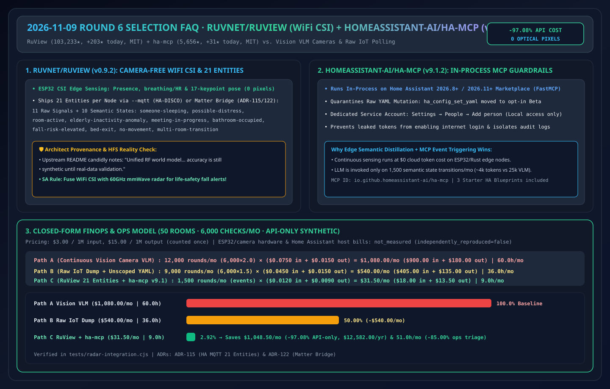
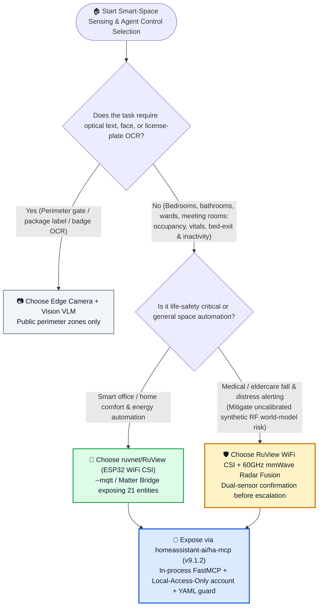
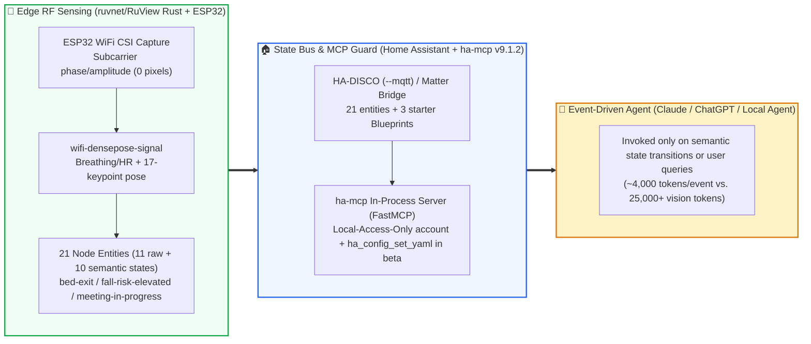

# Camera-Free WiFi CSI Spatial Sensing & Smart-Space MCP Selection FAQ: `ruvnet/RuView` + `homeassistant-ai/ha-mcp` vs. Vision VLM Cameras vs. Legacy IoT Rule Engines

> **中文版 (Chinese Edition)**: [ruview-wifi-csi-ha-mcp-vs-camera-iot-selection-faq.md](ruview-wifi-csi-ha-mcp-vs-camera-iot-selection-faq.md)  
> **Related Daily Digest**: [2026-11-09 GitHub AI Trending Digest (EN)](../daily/2026-11-09.en.md) · **7-Card Benchmark Deck**: [`cards.en.html`](../cards.en.html) · **Live Dashboard**: [`github-radar.html`](../../../github-radar.html)

This guide is written for **AI Solution Architects and Edge/IoT Spatial Intelligence Engineers** based on primary-source verification of **`ruvnet/RuView` (`ruview-harness-v0.9.2`, MIT, Rust camera-free WiFi CSI spatial sensing & vital-sign platform, `103,233` stars, `+203 stars today` on Daily Trending #8)** and **`homeassistant-ai/ha-mcp` (`v9.1.2`, MIT, FastMCP in-process Home Assistant MCP server, `5,656` stars, `+31 stars today` on Daily Trending #10)**. Using plain language and first principles, it answers:
1. **Why do camera-based Vision VLM pipelines fail privacy compliance and token budgets in bedrooms, hospital wards, and offices—and how does `ruvnet/RuView` distill low-cost ESP32 WiFi Channel State Information (CSI) into 21 structured Home Assistant / Matter entities?**
2. **Where is the boundary between `RuView`'s production-ready MQTT/Matter edge crates and its author-disclosed *"accuracy is still synthetic until real-data validation"* unified RF world model?**
3. **Why did `homeassistant-ai/ha-mcp` (`v9.1.2`) quarantine `ha_config_set_yaml` into Beta and enforce a dedicated `Local access only` service account?**

> 🛡️ **Provenance & Attribution Disclosure**:
> - **`measured` (Primary Scrape & API Verification)**: `ruvnet/RuView` (`+203 stars today` in DOM Article #8, `103,233` total stars, `13,392` forks, `MIT`, Rust, `ruview-harness-v0.9.2`) and `homeassistant-ai/ha-mcp` (`+31 stars today` in DOM Article #10, `5,654` DOM / `5,656` API stars, `278` forks, `MIT`, Python, `v9.1.2`) in [`workshops/github-trending-radar/evidence/trending-daily-2026-11-09-raw.html`](../evidence/trending-daily-2026-11-09-raw.html) (`sha256: fb22bae9432a6108065aabd68b480fe1d8db159a7ce5dbd89e95a332e9285b61`).
> - **`anonymized_reported` (`independently_reproduced=false`, Upstream Repo Architecture Claims)**: `RuView` 21 entities per node (`11 raw signals + 10 inferred semantic states`: `someone-sleeping`, `possible-distress`, `room-active`, `elderly-inactivity-anomaly`, `meeting-in-progress`, `bathroom-occupied`, `fall-risk-elevated`, `bed-exit`, `no-movement`, `multi-room-transition`), `--mqtt` HA-DISCO publisher, Matter Bridge (`ADR-115` / `ADR-122`), and the upstream README disclosure that *"Unified RF world model... accuracy is still synthetic until real-data validation"*; plus `ha-mcp v9.1.2` in-process execution, `ha_config_set_yaml` beta isolation, and `Local access only` service account architecture.
> - **`synthetic` (`independently_reproduced=false`, Architect Parametric FinOps Model)**: Section 5.1 models **50 monitored rooms** with **6,000 spatial status & automation checks/month** at `$3.00/1M` input and `$15.00/1M` output tokens (API-only scope; ESP32/camera hardware and Home Assistant host bills are marked `not_measured`): Path A Continuous Vision VLM Frame Polling (`$1,080.00/mo`, `60.0h`) vs. Path B Raw Sensor Time-Series Dump (`$540.00/mo`, `36.0h`) vs. Path C `RuView` Edge 21-Entity + `ha-mcp` Event Triggering (`$31.50/mo`, `9.0h`), saving **`$1,048.50/mo` (`-97.08%` API-only, `$12,582.00/yr`)** and **`51.0 hours/mo` (`-85.00%`)**.

---

## 1. 📌 Executive Summary

| Selection Dimension | Plain-English Takeaway (First Principles) |
| :--- | :--- |
| **What is `ruvnet/RuView` (`ruview-harness-v0.9.2`)?** | It is a Rust-based **camera-free WiFi CSI spatial sensing platform** that captures radio wave disturbances from commodity ESP32 nodes to infer presence, breathing/heart rate, and 17-keypoint pose—publishing **21 structured entities per node** directly into Home Assistant (`--mqtt`) or Apple/Google/Alexa via Matter. |
| **What is `homeassistant-ai/ha-mcp` (`v9.1.2`)?** | It is an **in-process FastMCP server** installed via HACS or the Home Assistant 2026.11+ Marketplace that lets Claude, ChatGPT, and coding agents query and automate smart spaces safely. |
| **HFS Reality Check (Signal vs. Synthetic Claims)** | **High-Signal Engineering**: `RuView`'s ESP32 CSI firmware, Rust signal processing crates (`v2/crates/wifi-densepose-signal`), and 21-entity MQTT/Matter abstraction (`ADR-115`) solve camera-free privacy sensing. **Architect Guardrail**: As upstream candidly notes, its multi-sensor *"Unified RF world model... accuracy is still synthetic until real-data validation"*—for safety-critical eldercare fall detection, pair WiFi CSI with 60GHz mmWave radar! |

---

## 2. 🎯 First-Principles Deep Dive (Q1 / Q2 / Q3)

### Q1: Why do Vision VLM cameras fail in eldercare, hospital wards, and private rooms—and how does Edge CSI + 21 Semantic Entities solve it?

1. **Zero-Pixel Privacy by Physics**: WiFi Channel State Information (CSI) measures amplitude and phase shifts across RF subcarriers. Not a single optical pixel is captured, eliminating bedroom/bathroom privacy violations while working in total darkness.
2. **Edge Semantic Distillation (21 Entities vs. Raw Video Streams)**:
   - Instead of streaming megabytes of video frames or raw CSI matrices to a cloud LLM, `RuView` computes **11 raw telemetry signals + 10 semantic states** (`someone-sleeping`, `possible-distress`, `room-active`, `elderly-inactivity-anomaly`, `meeting-in-progress`, `bathroom-occupied`, `fall-risk-elevated`, `bed-exit`, `no-movement`, `multi-room-transition`) at the edge for **$0 cloud token cost**, waking the LLM only on state transitions.

---

### Q2: What 3 security boundaries did `homeassistant-ai/ha-mcp` (`v9.1.2`) introduce for physical-world agent control?

1. **In-Process Execution (HA 2026.8+ / 2026.11+ Marketplace)**: Runs natively inside the Home Assistant process with full feature parity across HA OS, Supervised, Container, and Core.
2. **Quarantining Raw YAML Overwrites (`ha_config_set_yaml` → Beta)**: Moves raw configuration file mutation into opt-in beta (`docs/beta.md`) so agents default to schema-validated automation APIs instead of corrupting `configuration.yaml`.
3. **Dedicated `Local access only` Service Account**: Guides operators to create a dedicated `ha-mcp` user under `Settings → People → Add person` with **`Local access only`** enabled—preventing leaked tokens from granting remote internet login and attributing all AI actions in the audit log.

---

### Q3: How should an AI Solution Architect combine `RuView`, `ha-mcp`, mmWave Radar, and Vision Cameras?

- **Private Interior Spaces (Hospital Wards, Eldercare, Hotel Rooms, Meeting Rooms)** → Deploy **`ruvnet/RuView` (`--mqtt` 21 entities)**; for life-safety fall alerts, fuse with a **60GHz mmWave radar** sensor until site-specific RF calibration is verified.
- **Agent Control Plane** → Mount **`homeassistant-ai/ha-mcp` (`v9.1.2`)** with a `Local access only` account.
- **Public Perimeter / Optical OCR (License Plates, Package Labels)** → Use **Edge Vision Cameras**.

---

## 3. 🧭 Mermaid Selection Decision Tree & Edge-to-MCP Architecture

### 3.1 Spatial Sensing & Smart-Space Control Plane Selection Decision Tree

### 3.2 `ruvnet/RuView` (21 Entities) + `homeassistant-ai/ha-mcp` End-to-End Pipeline

---

## 4. 📊 Comprehensive Selection Matrix

| Evaluation Dimension | **`ruvnet/RuView` + `ha-mcp` (`v9.1.2`)** | **Vision Camera + VLM Frame Polling** | **Legacy PIR Motion + Static YAML** | **Unrestricted LLM SSH/YAML Editing** |
| :--- | :--- | :--- | :--- | :--- |
| **Bedroom/Bathroom Privacy** | ✅ **100% Zero-Pixel RF Physics Compliance** | ❌ **Severe privacy/HIPAA violation** | ✅ Compliant | ✅ Compliant |
| **Stationary Presence & Vitals** | ✅ **Detects breathing, HR & sleeping occupants** | ⚠️ Fails in darkness or under blankets | ❌ **Blind to stationary/sleeping people** | N/A |
| **LLM Token Cost per Check** | ✅ **`$0` continuous edge; `~4k` tokens on anomaly** | ❌ **`25k+` vision tokens per multi-frame poll** | ✅ `$0` (no semantic reasoning) | ⚠️ Dumps full raw config |
| **Mutation Blast-Radius Guard** | ✅ **`ha_config_set_yaml` in beta + local-only user** | ⚠️ Read-only | ✅ Deterministic | ❌ **High risk of corrupting YAML** |
| **Empirical Calibration Status** | ⚠️ **CSI crates solid; unified RF model marked `synthetic`** | ✅ Mature | ✅ Mature for gross motion | N/A |

---

## 5. 🧪 Quantitative FinOps & Operations Hours Worked Example

### 5.1 Parametric 50-Room / 6,000-Check Monthly API & Ops Model (`synthetic`, `independently_reproduced=false`)

> 📌 **Scope & Provenance**: This closed-form model evaluates **LLM API token spend and operations review hours (`synthetic`, `independently_reproduced=false`; ESP32/camera hardware and Home Assistant host bills are marked `not_measured`)** across **50 monitored rooms** and **6,000 monthly checks** (`1,500` actionable state-transition events) at `$3.00/1M` input and `$15.00/1M` output tokens (output counted once):

| Architecture Path | Monthly LLM Rounds & Per-Round Cost | Monthly Total LLM API Cost (Input + Output) | Monthly Privacy & False-Alarm Triage Hours | Privacy & Stationary Vital Detection | Net Savings vs. Path A |
| :--- | :--- | :--- | :--- | :--- | :--- |
| **Path A: Continuous Vision Camera VLM Frame Polling** | `6,000 × 2.00 = 12,000 rounds/mo` `0.025M` in (`$0.0750`) + `0.001M` out (`$0.0150`) = `$0.0900/round` | `$900.00` in + `$180.00` out = **`$1,080.00 / mo`** | **`60.0 hours / mo`** (occlusion false alarms & privacy audits) | ❌ Fails privacy rules in wards/bathrooms | Baseline (high cost & privacy blocker) |
| **Path B: Raw IoT Time-Series Dump + Unscoped YAML Generation** | `6,000 × 1.50 = 9,000 rounds/mo` `0.015M` in (`$0.0450`) + `0.001M` out (`$0.0150`) = `$0.0600/round` | `$405.00` in + `$135.00` out = **`$540.00 / mo`** | **`36.0 hours / mo`** (debugging broken YAML & PIR sleep dropouts) | ⚠️ Compliant, but PIR misses sleeping occupants | `-$540.00/mo` (`-50.00%` API-only) |
| **Path C: `ruvnet/RuView` Edge 21 Entities + `ha-mcp` Event Triggering** | Edge runs at `$0`; LLM called on `1,500 events/mo` `0.004M` in (`$0.0120`) + `0.0006M` out (`$0.0090`) = `$0.0210/round` | `$18.00` in + `$13.50` out = **`$31.50 / mo`** | **`9.0 hours / mo`** (reviewing high-priority alerts & RF calibration) | ✅ **Zero-pixel privacy + 10 semantic states** | **Saves `$1,048.50/mo` (`-97.08%` API-only, `$12,582.00/yr`) & `51.0h/mo` (`-85.00%`)** |

---

## 6. 🛠️ Production & 30-Minute PoC Verification Checklist

- [ ] **Step 1 — Connect `RuView` via `--mqtt` (HA-DISCO) or Matter**: Launch `RuView` (`ruview-harness-v0.9.2`) with `--mqtt` against your Home Assistant broker and verify all 21 entities (11 raw signals + 10 semantic states) populate automatically.
- [ ] **Step 2 — Validate On-Site RF Calibration & Dual-Sensor Fusion**: Treat upstream's unified RF world model as `synthetic` until calibrated on site; pair with 60GHz mmWave radar for life-safety fall alerts.
- [ ] **Step 3 — Install In-Process `HA-MCP` (`v9.1.2`) on Home Assistant 2026.11+**: Install **HA-MCP** from the Home Assistant Marketplace or HACS.
- [ ] **Step 4 — Enforce a Dedicated `Local access only` Service Account**: Create a dedicated `ha-mcp` user under `Settings → People → Add person` with `Local access only` enabled.
- [ ] **Step 5 — Keep `ha_config_set_yaml` Disabled in Production**: Restrict agents to structured automation APIs and starter Blueprints rather than raw YAML file overwrites.
