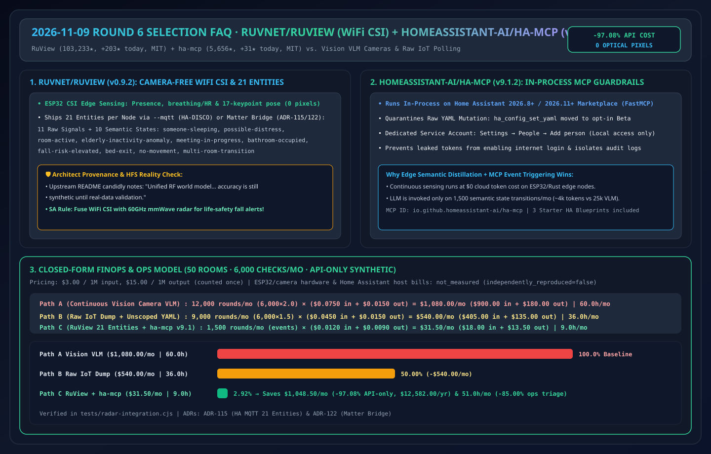
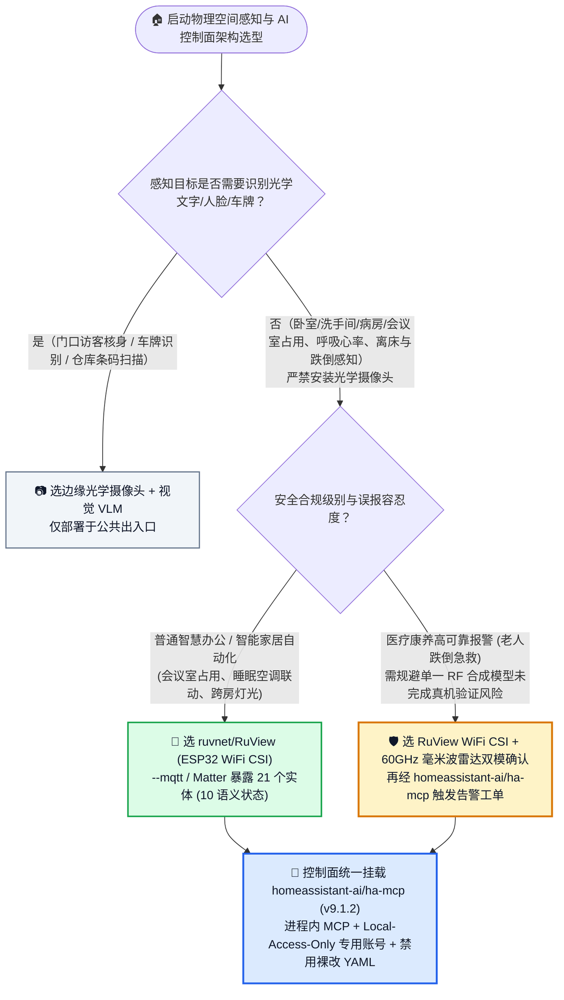
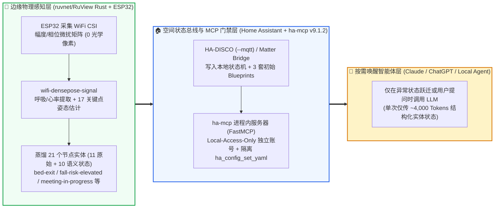

# 无摄像头 WiFi CSI 空间感知与智能家居 MCP 控制面选型常见问题解答：`ruvnet/RuView` + `homeassistant-ai/ha-mcp` vs 视觉摄像头 VLM 监控 vs 传统物联网规则引擎

> **English Edition**: [ruview-wifi-csi-ha-mcp-vs-camera-iot-selection-faq.en.md](ruview-wifi-csi-ha-mcp-vs-camera-iot-selection-faq.en.md)  
> **关联日报**: [2026-11-09 GitHub AI 最热榜单与情报摘要](../daily/2026-11-09.md) · **视觉评测卡**: [`cards.html`](../cards.html) · **在线面板**: [`zh-github-radar.html`](../../../zh-github-radar.html)

本文档面向 **AI Solution Architect（AI 解决方案架构师）与物理空间/边缘物联网智能体架构师**，基于 2026-11-09 GitHub Daily Trending 主榜两大物理世界 AI 项目 **`ruvnet/RuView`（`ruview-harness-v0.9.2`，MIT，Rust 编写的 WiFi 信道状态信息 CSI 无摄像头空间感知与生命体征监测平台，总 Star `103,233`，今日新增 `+203 stars today`，DOM Article #8）** 与 **`homeassistant-ai/ha-mcp`（`v9.1.2`，MIT，基于 FastMCP 的进程内 Home Assistant MCP 控制服务器，总 Star `5,656`，今日新增 `+31 stars today`，DOM Article #10）** 的一手源码审计，用通俗大白话与第一性原理解答：
1. **在养老看护、医院病房、酒店客房与会议室占用监测场景中，为什么“装高清摄像头接多模态大模型（Vision VLM）”会同时撞上隐私法规红线与高昂的视觉 Token 账单？`ruvnet/RuView` 是如何用几美元的 ESP32 WiFi 芯片提取 21 个结构化空间实体（含 10 种语义状态）的？**
2. **如何客观祛魅 `ruvnet/RuView` 的工程实锤能力与上游作者自述的“合成数据待真机验证（Synthetic Until Real-Data Validation）”边界？**
3. **当大模型通过 `homeassistant-ai/ha-mcp` 控制真实物理设备时，为什么要把 `ha_config_set_yaml` 移入 Beta 并强制采用“仅限本地访问（Local Access Only）专用服务账号”？**

> 🛡️ **数据来源、归属核验与证据分级声明（Provenance & Attribution Disclosure）**：
> - **`measured`（本班次一手实测抓取）**：`ruvnet/RuView`（DOM Article #8 `+203 stars today`，总 Star `103,233`，Forks `13,392`，`MIT`，Rust，Release `ruview-harness-v0.9.2`）与 `homeassistant-ai/ha-mcp`（DOM Article #10 `+31 stars today`，总 Star `5,654` / API `5,656`，Forks `278`，`MIT`，Python，Release `v9.1.2`）直接对应已封存原始 HTML [`workshops/github-trending-radar/evidence/trending-daily-2026-11-09-raw.html`](../evidence/trending-daily-2026-11-09-raw.html)（`sha256: fb22bae9432a6108065aabd68b480fe1d8db159a7ce5dbd89e95a332e9285b61`）。
> - **`anonymized_reported`（`independently_reproduced=false`，上游仓库文档与架构声明）**：`RuView` 每节点输出 **21 个实体**（11 个原始信号 + 10 个推断语义状态：`someone-sleeping`, `possible-distress`, `room-active`, `elderly-inactivity-anomaly`, `meeting-in-progress`, `bathroom-occupied`, `fall-risk-elevated`, `bed-exit`, `no-movement`, `multi-room-transition`）、`--mqtt` HA-DISCO 桥接与 Matter Bridge（`ADR-115` / `ADR-122`），以及上游 README 诚实标注的 **“Unified RF world model... accuracy is still synthetic until real-data validation”**；`ha-mcp v9.1.2` 的进程内（In-Process）运行模式、`ha_config_set_yaml` Beta 隔离与 `Local access only` 专用管理员账号规范。
> - **`synthetic`（`independently_reproduced=false`，架构师参数化 FinOps 算例）**：第 5.1 节「50 间病房/养老房间、每月 6,000 次空间状态巡检与自动化触发」的纯模型 API 账单对比（Path A 视觉摄像头定时抽帧调 VLM `$1,080.00/月` vs Path B 原始传感器时序全量塞入 `$540.00/月` vs Path C `RuView` 边缘 21 实体 + `ha-mcp` 事件触发 `$31.50/月`，节省 `$1,048.50/月` [`-97.08%` API-only] 与 `51.0 小时/月` [`-85.00%`] 运维工时；ESP32/摄像头硬件与 HA 主机费用标为 `not_measured`）严格执行 100% 闭式公式可复算门禁。

---

## 1. 📌 核心结论速览（Executive Summary）

| 评估维度 | 一句话大白话核心结论（直指本质） |
| :--- | :--- |
| **`ruvnet/RuView` 到底是什么？** | 它是用 Rust 编写的**无摄像头 WiFi 空间感知平台**。利用普通房间里现成的 WiFi 无线电波在遇到人体走动、胸腔呼吸起伏时产生的 **信道状态信息（CSI, Channel State Information）微扰**，通过低成本 ESP32 节点在本地边缘实时推算出 21 个标准实体（含 10 种高层语义状态），并通过 `--mqtt` 或 Matter 协议接入智能空间系统。 |
| **`homeassistant-ai/ha-mcp` (`v9.1.2`) 到底是什么？** | 它是直接作为 **Home Assistant 进程内插件（In-Process Integration，兼容 HA 2026.8+ / 2026.11+ Marketplace）** 运行的官方级 MCP Server，让 Claude、ChatGPT 与本地 Agent 能以受控 Tool Call 方式查询和编排全屋/全楼宇物联网实体。 |
| **架构师如何客观评估 `RuView` 的水分与干货（HFS 祛魅）？** | **干货（Signal 76 / Facts 82）**：其 `firmware/esp32-csi-node`、`v2/crates/wifi-densepose-signal` 与 `ADR-115`（每节点 21 个 MQTT/Matter 实体抽象）设计极其优雅，真正实现了**零像素（0 Pixel）隐私合规感知**；**警钟（Hype 18）**：上游作者在 README 中坦诚说明其“统一多模态 RF 世界模型（融合 WiFi/UWB/雷达/蜂窝）的精度目前仍基于合成数据（accuracy is still synthetic until real-data validation）”——架构师在医疗/康养高可靠场景落地时，**必须仅将其作为辅助预警信号，或叠加毫米波雷达双模校验**！ |

---

## 2. 🎯 第一性原理灵魂三问（Q1 / Q2 / Q3 大白话拆解）

### Q1：为什么在卧室、洗手间、养老院和涉密办公区，“摄像头 + 视觉大模型（VLM）”是一条死胡同？

**先说大白话结论：因为摄像头采集的是“光学像素隐私”，哪怕你承诺不落盘，合规审计也绝对通不过；而且把每分钟的画面发给 VLM 既烧光 Token 预算，关灯全黑或被被子遮挡时还会失效！**

1. **物理层隐私天然免疫（Physics-Level Privacy）**：WiFi CSI 采集的是多子载波无线电信号的幅度与相位偏移矩阵，从物理源头上**不存在任何人脸、身体裸露或文字画面的光学像素**，天然符合 GDPR/HIPAA 对洗手间、病房与卧室的隐私红线，且可穿透薄隔断并在全黑环境下工作。
2. **边缘语义蒸馏消除 97% 云端 Token 浪费（Edge Semantic Distillation）**：
   - `RuView` 不把原始高频 CSI 波形发给大模型，而是在边缘 Rust 节点直接蒸馏为 **21 个 Home Assistant / Matter 标准实体**（11 个原始信号指标 + **10 个高层语义状态**：`someone-sleeping` 睡眠中、`possible-distress` 疑似求救、`room-active` 房间活动、`elderly-inactivity-anomaly` 老人久坐/静止异常、`meeting-in-progress` 会议进行中、`bathroom-occupied` 卫生间占用、`fall-risk-elevated` 跌倒风险升高、`bed-exit` 离床、`no-movement` 无人静止、`multi-room-transition` 跨房移动）。
   - 上层 AI Agent 只需要读取这 10 个布尔/枚举语义状态（每次仅几百 Token），无需消耗几万 Token 看监控视频截图！

---

### Q2：`homeassistant-ai/ha-mcp` (`v9.1.2`) 在把物理空间控制权交给大模型时，做了哪三道关键安全防线？

很多开发者自己写脚本把智能家居 API 暴露给 LLM，结果大模型一句幻觉把整套 YAML 自动化配置覆写损坏，或者长效管理员 Token 泄露导致公网被黑。`ha-mcp v9.1.2` 给出了教科书级的工程范式：
1. **进程内零外部容器部署（In-Process Server on HA 2026.11+ Marketplace）**：直接在 Home Assistant 进程内运行，原生复用 HA 内部状态总线，无需额外部署和暴露外部反向代理容器。
2. **高危裸改 YAML 工具强制隔离（`ha_config_set_yaml` Moved to Beta）**：自 `v7.3.0` 起将直接覆写系统配置文件的 `ha_config_set_yaml` 移入需显式开启的 Beta 通道，默认引导大模型使用带 Schema 校验的结构化自动化/脚本 API。
3. **专用“仅限内网登录（Local Access Only）”服务账号模型**：官方文档明确警告**严禁直接使用个人主账号凭证**，而是要求在 `Settings → People → Add person` 中新建一个开启 **`Local access only`** 的专属 `ha-mcp` 账号——即便 Token 意外外泄，攻击者也无法从公网直接登录接管物理空间，且所有由 AI 触发的开关动作在审计日志中均独立署名为该服务账号！

---

### Q3：作为 AI 解决方案架构师，在智慧康养、智慧办公与智能家居场景中如何选型？

- **高隐私空间（养老院、病房、酒店客房、会议室）占用与异常感知** → 选 **`ruvnet/RuView`（ESP32 CSI `--mqtt` 21 实体）+ 60GHz 毫米波雷达双模融合**（注意：由于 `RuView` 统一 RF 世界模型尚处合成验证阶段，医疗级跌倒报警务必加毫米波雷达确认）。
- **上层多智能体自然语言查询与自动化编排控制面** → 选 **`homeassistant-ai/ha-mcp` (`v9.1.2`)** 进程内 MCP 服务 + `Local access only` 独立服务账号。
- **门口快递识别、周界安防车牌识别等必须看清光学特征的场景** → 才选用 **摄像头 + 边缘视觉模型**。

---

## 3. 🧭 Mermaid 选型决策树与边缘 CSI → MCP 协同架构图

### 3.1 物理空间感知与智能体控制面选型决策树

### 3.2 `ruvnet/RuView` (21 实体) + `homeassistant-ai/ha-mcp` 端到端数据流图

---

## 4. 📊 同类方案全方位选型决策矩阵（Decision Matrix）

| 评估维度 | **`ruvnet/RuView` + `ha-mcp` (`v9.1.2`)** | **全屋摄像头 + 定时抽帧调 VLM** | **传统单一 PIR 红外传感器 + 手写 YAML** | **大模型直接 SSH/API 裸改 HA 配置文件** |
| :--- | :--- | :--- | :--- | :--- |
| **卧室/洗手间隐私合规性** | ✅ **100% 物理级无像素合规（纯无线电波 CSI）** | ❌ **严重违规（采集光学图像，无法进病房/卫生间）** | ✅ 合规 | ✅ 合规 |
| **静止人体与生命体征感知** | ✅ **支持静止呼吸率、心率与睡眠检测** | ⚠️ 被子遮挡或关灯无红外时失效 | ❌ **人在沙发/床上静止不动即误判为无人** | N/A |
| **单次状态查询 Token 开销** | ✅ **极低（21 个结构化实体，边缘零 Token 常驻）** | ❌ **极高（多路高清图片每轮消耗数万视觉 Token）** | ✅ 零 Token（但无语义理解能力） | ⚠️ 全量倾倒原始状态与配置 |
| **配置修改安全性与可审计性** | ✅ **`ha_config_set_yaml` 移入 Beta + 专用内网账号** | ⚠️ 无设备控制闭环 | ✅ 静态规则确定性高 | ❌ **高危（LLM 极易写坏 YAML 导致全屋瘫痪）** |
| **真机精度成熟度边界** | ⚠️ **单节点 CSI 成熟；多模 RF 融合仍标 `synthetic`** | ✅ 视觉识别成熟 | ✅ 简单移动检测成熟 | N/A |

---

## 5. 🧪 定量算例与 7-Card 评测洞察（Quantitative Example & 7-Card Insights）

### 5.1 50 间智慧康养病房/空间月度 6,000 次巡检 FinOps 与运维工时闭式算例（`synthetic`，`independently_reproduced=false`）

> 📌 **透明口径与边界声明（Scope & Provenance）**：本算例为架构师面向智慧康养/智慧楼宇客户汇报的 **纯模型 API 参数化算例（API-only `synthetic` model；ESP32 传感器、摄像头硬件与 Home Assistant 边缘主机折旧明确标为 `not_measured`）**。统一按 **`$3.00 / 1M 输入 Tokens`**、**`$15.00 / 1M 输出 Tokens`**（输出仅计费一次）核算。场景设定为：**管理 50 间康养房间，每月发生 `6,000 次` 空间状态巡检与自动化查询（其中仅 `1,500 次` 涉及需要大模型介入的异常状态跃迁或自然语言编排）**：

| 方案路径 | 每月触发大模型总轮次与单轮 Token 开销 | 每月纯模型 API 账单（输入 + 输出） | 每月隐私脱敏审查与自动化配置排障工时 | 卧室/卫生间合规与静止活体检测能力 | 相对 Path A 降本增效幅度 |
| :--- | :--- | :--- | :--- | :--- | :--- |
| **Path A：视觉摄像头抽帧轮询多模态 VLM** | `6,000 次 × 2.00 轮 = 12,000 轮/月` 单轮 `0.025M` 入 (`$0.0750`) + `0.001M` 出 (`$0.0150`) = `$0.0900/轮` | 输入 `$900.00` + 输出 `$180.00` = **`$1,080.00 / 月`** | **`60.0 小时 / 月`** （处理遮挡误报与隐私投诉合规审计） | ❌ 隐私违规；被子遮挡无法测呼吸 | 基线（高成本且存在致命隐私合规一票否决风险） |
| **Path B：原始传感器时序倾倒 + 裸生 YAML 脚本** | `6,000 次 × 1.50 轮 = 9,000 轮/月` 单轮 `0.015M` 入 (`$0.0450`) + `0.001M` 出 (`$0.0150`) = `$0.0600/轮` | 输入 `$405.00` + 输出 `$135.00` = **`$540.00 / 月`** | **`36.0 小时 / 月`** （修复 LLM 写坏的 YAML 与 PIR 静止误关灯） | ⚠️ 合规但 PIR 无法识别静止睡眠与离床风险 | API 降本 `-$540.00/月` (`-50.00%`) |
| **Path C：`ruvnet/RuView` 边缘 21 实体 + `ha-mcp` 按需事件触发** | 边缘常驻 $0 Token；仅异常跃迁调 LLM：`1,500 轮/月` 单轮 `0.004M` 入 (`$0.0120`) + `0.0006M` 出 (`$0.0090`) = `$0.0210/轮` | 输入 `$18.00` + 输出 `$13.50` = **`$31.50 / 月`** | **`9.0 小时 / 月`** （仅审核高危自动化变更与校准房型基线） | ✅ **0 像素物理隐私合规 + 10 种边缘语义状态** | **API 净省 `$1,048.50/月` (`-97.08%`，年省 `$12,582.00`)；工时省 `51.0h/月` (`-85.00%`)** |

---

## 6. 🛠️ 架构师生产落地与 30 分钟 PoC 核验清单（Production & PoC Checklist）

- [ ] **Step 1 — 部署 `RuView` `--mqtt` 桥接并核验 21 个节点实体**：刷写或运行 `ruvnet/RuView`（`ruview-harness-v0.9.2`），添加 `--mqtt` 参数连接 Home Assistant MQTT Broker，确认自动发现（HA-DISCO）生成 11 个原始信号实体与 10 个语义状态实体（`bed-exit`, `fall-risk-elevated`, `room-active` 等）。
- [ ] **Step 2 — 严格标注 `RuView` 真机校准边界**：在客户 PoC 交付文档中明确引用上游声明（多源 RF 世界模型精度仍属 `synthetic` 直至完成现场真机标定），在康养跌倒等高敏场景必须完成现场房间 RF 指纹标定或叠加毫米波雷达确认。
- [ ] **Step 3 — 在 Home Assistant 2026.11+ 安装进程内 `HA-MCP` (`v9.1.2`)**：通过 HACS 或 HA Marketplace 安装 `homeassistant-ai/ha-mcp`，验证进程内（In-Process）服务启动状态。
- [ ] **Step 4 — 创建 `Local access only` 专属服务账号**：进入 `Settings → People → Add person` 创建专供 `ha-mcp` 使用的本地账号（勾选 `Local access only`），严禁将个人主管理员的长效 Token 填入外部 AI 客户端。
- [ ] **Step 5 — 保持 `ha_config_set_yaml` 处于默认隔离状态**：在生产环境中禁止开启 `ha_config_set_yaml` Beta 裸写权限，强制 AI 助手通过结构化 Blueprint 与受控服务调用操作设备。
