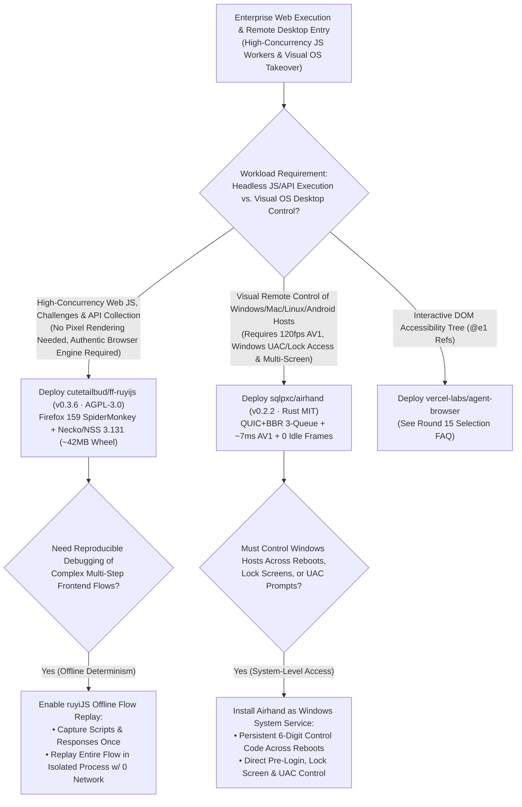

# Rendererless Firefox JS Engine & 120FPS QUIC Remote Desktop Console Selection FAQ: `cutetailbud/ff-ruyijs` (`v0.3.6`) + `sqlpxc/airhand` (`v0.2.2`) vs. Heavy Headless Chromium & Legacy VNC

> **Document Scope**: A first-principles architecture and FinOps selection guide for AI Solution Architects, High-Concurrency Web Automation Platform Leads, and Multi-Host Computer-Use Infrastructure Engineers. Focusing on two standout browser-runtime and remote-desktop repositories from the `2026-11-09` GitHub AI Radar — **`cutetailbud/ff-ruyijs`** (`ruyijs v0.3.6`, C++ Firefox 159.0 source build, AGPL-3.0, **1,188 Stars** / **1,196 Stars** live API, `stars_today = not_measured`) and **`sqlpxc/airhand`** (`v0.2.2`, Rust + QUIC/BBR + Hardware AV1, MIT, **980 Stars** / **987 Stars** live API, `stars_today = not_measured`) — this guide dissects how **Authentic Firefox 159 SpiderMonkey + Necko/NSS 3.131 Without a Window or Renderer (`38` Contexts, `-75%` RAM)** and **`~7 ms` Hardware AV1 Encoding over QUIC + BBR with Windows Lock/UAC Service Penetration (`120 fps`)** replace memory-bloated Chromium clusters and lag-prone VNC desktops.
>
> **Navigation**: [中文版 (`ruyijs-airhand-rendererless-browser-quic-desktop-selection-faq.md`)](./ruyijs-airhand-rendererless-browser-quic-desktop-selection-faq.md) · [2026-11-09 Daily Radar](../daily/2026-11-09.en.md) · [Back to Radar Index](../README.en.md)

---

## 📌 1. Executive Summary

1. **First-Principles Definition**:
   - **`cutetailbud/ff-ruyijs` (`ruyijs v0.3.6`, Python 3.10+ C++ extension built from official Firefox 159.0 source, AGPL-3.0 + commercial license)** embeds the **authentic Firefox 159.0 SpiderMonkey JavaScript engine, 38 native browser Web API contexts, and the Necko networking stack (NSS 3.131 + Neqo HTTP/3 QUIC)** into a `~42 MB` SHA-256-pinned PyPI wheel — **with no window, no layout engine, and no GPU renderer**. Each `Context` runs in its own isolated OS process with a persistent JS world, independent proxy routing, and 100% offline captured-flow replay.
   - **`sqlpxc/airhand` (`v0.2.2`, Rust, MIT)** is a **120 FPS low-latency remote desktop and multi-screen control console** across Windows, macOS, Linux, Android, and web browsers. It encodes the host screen on the GPU (`NVENC / Quick Sync / AMF / VideoToolbox / MediaCodec` without B-frames; **4K-to-1080p hardware AV1 takes `~7 ms/frame` on RTX**, `anonymized_reported (independently_reproduced=false)`), streams over **QUIC + BBR** with **separate queues for control, Opus audio, and video**, caps frames-in-flight to `≈ RTT × fps + 2` (skipping stale frames on slow links), sends **0 frames when the screen is still** (dropping unfocused overview tabs to `5 fps`), and runs as a **Windows system service** to view and control the lock screen, pre-login screen, and **UAC elevation prompts**.
2. **Core Architectural Insight (Why Full Headless Chromium & Legacy TCP/VNC Fail at Fleet Scale)**:
   - **Failure Mode #1 (Full Headless Chromium Wastes 75% RAM on Unseen Pixel Rasterization, While JSDOM Fails Bot Checks)**: Spawning 500 full Chromium instances burns `~256 GB` RAM (`8 × 32GB` nodes) rendering pixels nobody views while leaking CDP automation markers; conversely, Node.js JSDOM shims fail authentic WebCrypto/TLS/HTTP3 checks. `ruyiJS` runs genuine Firefox 159 SpiderMonkey + Necko without a renderer, fitting 500 isolated worker contexts onto `2 × 32GB` nodes.
   - **Failure Mode #2 (VNC/TCP Remote Desktops Pile Up Lag & Go Blind on Windows UAC / Pre-Login Screens)**: When a desktop agent hits a Windows UAC prompt or reboots to the sign-in screen, user-space VNC servers disconnect or show a black screen. `Airhand`'s Windows system service captures secure desktops directly and streams at up to 120fps over QUIC + BBR with zero lag accumulation.
3. **30-Second Selection Rule**:
   - Choose **`cutetailbud/ff-ruyijs` (`v0.3.6`)** for **high-concurrency Python web automation, JS challenge execution, and offline flow replay where visual pixel rendering is unnecessary**.
   - Choose **`sqlpxc/airhand` (`v0.2.2`)** for **120fps visual remote desktop control, multi-host agent fleet monitoring, and Windows UAC / pre-login human takeover**.

---

## 🎯 2. Architect's First-Principles Deep Dive (Q1 / Q2 / Q3)

### Q1: How does `cutetailbud/ff-ruyijs` (`v0.3.6`) differ from both Playwright/Headless Chrome and Node.js JSDOM emulators?

Inspecting `README.md`, `pyproject.toml` (`v0.3.6`), `firefox/`, and `native/` in `cutetailbud/ff-ruyijs` reveals three core architectural properties:

1. **Genuine Firefox 159.0 Internals (`SpiderMonkey + 38 Contexts + Necko`)**:
   - Compiled directly from official Firefox 159.0 source (`~42 MB` Windows wheel, macOS `libnecko_core.dylib` + `libnecko_quic.dylib`, and Linux `manylinux_2_39_x86_64` ELF with FreeType/HarfBuzz/OpenSSL 3/NSS 3.131/Neqo HTTP/3).
   - Executes site JavaScript, WebCrypto signatures, and TLS/HTTP2/HTTP3 handshakes identically to Firefox rather than faking DOM objects in Node.js.
2. **True Rendererless Execution (`0 Window, 0 Layout, 0 GPU`)**:
   - Strips the window manager and pixel compositor while keeping each `Context` in an isolated OS process with its own proxy — cutting per-worker memory by ~75% vs. full Chromium.
3. **Deterministic Offline Flow Replay**:
   - Captures scripts and network responses so entire multi-step JS flows can be replayed offline with zero network calls.

### Q2: How does `sqlpxc/airhand` (`v0.2.2`) achieve `~7 ms` 4K-to-1080p AV1 encoding and zero lag pile-up over lossy networks?

Inspecting `README.md` and `docs/architecture.md` in `sqlpxc/airhand` highlights seven low-latency mechanisms:

1. **B-Frame-Free Hardware GPU Codec Negotiation (`AV1 > HEVC > H.264`, `~7 ms`)**:
   - Uses NVENC, Quick Sync, AMF, VideoToolbox, and MediaCodec in low-latency mode without B-frames, reusing SIMD-scaled buffers to encode 4K-to-1080p AV1 in `~7 ms/frame` on RTX GPUs.
2. **Bounded Frames-in-Flight (`≈ RTT × fps + 2`) & Stale-Frame Skipping**:
   - Caps in-flight frames to `≈ RTT × frame_rate + 2` and skips directly to the latest frame when congestion occurs rather than queuing seconds of stale video.
3. **QUIC + BBR with 3 Separated Queues & Byte-Only Relay**:
   - Separates control messages, Opus audio, and video into independent QUIC queues so mouse clicks and pings never block behind video frames; the Docker Compose relay forwards raw bytes without parsing video.
4. **Desynchronized Canvas, Local Cursor, Zero Idle Bandwidth & Windows System Service**:
   - Renders decoded frames immediately to a `desynchronized` canvas (`0 vsync wait`), draws the cursor locally, sends **0 frames when the screen is still** (dropping unfocused tabs to `5 fps`), and runs as a **Windows system service** to control pre-login, lock screen, and UAC prompts using persistent 6-digit control codes.

### Q3: How do `ff-ruyijs` and `airhand` complement each other in an enterprise AI agent fleet?

- **Headless Protocol & JS Worker Pool (`cutetailbud/ff-ruyijs`)**: Run 95% of high-concurrency JS/API workflows in rendererless `ruyiJS` contexts at 4× node density.
- **Visual Desktop Fleet Console & HITL Takeover (`sqlpxc/airhand`)**: Monitor 30+ full-OS desktop agent VMs from `Airhand`'s multi-screen overview (`5 fps` background / `0 fps` idle) and jump into `120 fps` hardware-AV1 control whenever a Windows UAC prompt or login screen requires human intervention.

---

## 🧭 3. Mermaid Decision Tree & Execution Sequence

### 3.1 Rendererless Browser & QUIC Remote Desktop Decision Tree

### 3.2 End-to-End Execution Sequence (`ruyiJS` Process Pool + `Airhand` 120FPS QUIC Console)

```mermaid
sequenceDiagram
    autonumber
    participant Orch as Python Orchestrator / Operator
    participant Ruyi as cutetailbud/ff-ruyijs (v0.3.6)<br/>(SpiderMonkey + 38 Contexts + Necko)
    participant Site as Target Web Origin (HTTP/2 & HTTP/3)
    participant Host as Remote Desktop Agent Host<br/>(Airhand Windows System Service)
    participant Relay as Airhand QUIC+BBR Console<br/>(Desynchronized Canvas · 120fps)

    Orch->>Ruyi: 1. Spawn 500 isolated Context processes (each w/ own proxy, -75% RAM)
    Ruyi->>Site: 2. Execute authentic Firefox 159 TLS/HTTP3 handshake via Necko + NSS 3.131
    Site-->>Ruyi: 3. Return JS challenge → SpiderMonkey + 38 contexts execute w/ 0 renderer overhead
    Ruyi-->>Orch: 4. Deliver structured payload & archive flow for offline replay

    rect rgb(10, 34, 57)
    Note over Orch,Relay: Multi-Screen Fleet Monitoring & 120FPS UAC Takeover (sqlpxc/airhand)
    Host->>Relay: 5. Connect 30 hosts to Multi-Screen Overview (0 frames when still, 5fps unfocused)
    Host->>Relay: 6. Windows host triggers UAC elevation prompt (captured by System Service)
    Orch->>Relay: 7. Focus host tab → activate ~7ms hardware AV1 (120fps) + local cursor
    Orch->>Host: 8. Click Allow via dedicated QUIC control queue (zero video-frame HOL blocking)
    end
```

---

## 📊 4. Comparison Matrix Across Browser Runtimes & Remote Desktops

| Dimension | `cutetailbud/ff-ruyijs` (`v0.3.6`) | `sqlpxc/airhand` (`v0.2.2`, MIT) | Full Headless Chromium / Node JSDOM | Legacy VNC (RFB) / Commercial RMM SaaS |
| :--- | :--- | :--- | :--- | :--- |
| **Core Architecture** | **Firefox 159 SpiderMonkey + Necko (`0` window/renderer)** | **Hardware AV1/HEVC + QUIC/BBR 3-queue + multi-screen console** | Full Blink/GPU browser process or incomplete JSDOM shim | TCP software-encoded frame stream or closed commercial SaaS |
| **Memory & Bandwidth Efficiency** | **`~42 MB` runtime; `4x` worker density per node (-75% RAM)** | **`~7 ms` GPU encode; `0` frames when still; `5 fps` unfocused** | 400–800 MB RAM per Chromium instance | Continuous idle bandwidth burn & multi-second lag buildup |
| **Fidelity & OS Penetration** | **Genuine Firefox 159 JS + 38 contexts + NSS 3.131 / Neqo** | **Windows System Service views pre-login, lock screen & UAC** | Chromium CDP easily fingerprinted; JSDOM fails WebCrypto | User-space VNC goes black on Windows UAC / lock screens |
| **Congestion & Input Latency** | 100% offline deterministic flow replay | **Caps in-flight frames (`≈ RTT×fps+2`) + separate control queue** | Timeouts require full page reload | Mouse clicks stall behind video frames on lossy Wi-Fi |
| **License & Fleet Cost** | AGPL-3.0 open source (+ commercial OEM option) | **MIT Free & Open Source** (1-command Docker Compose relay) | Free software but 4× higher cloud VM bill | **`$20–$35 / host / month`** for commercial unattended access |

---

## 🧪 5. Closed-Form FinOps Worked Example & 7-Card Insights

### 5.1 Monthly 500 Concurrent JS Workers & 30 Remote Desktop Hosts Cost Model (`synthetic (independently_reproduced=false)`)

> **Provenance Notice**: This closed-form calculation is a synthetic architectural model (`synthetic (independently_reproduced=false)`) comparing **Path A (8× 32GB Cloud VMs Running 500 Full Headless Chromium Instances + 30 Commercial Unattended Remote Desktop Subscriptions + Fingerprint/UAC Triage Labor)** against **Path B (2× 32GB Cloud VMs Running 500 `ff-ruyijs` Contexts + Self-Hosted `airhand` QUIC Console)**. The RTX hardware AV1 encoding figure (`~7 ms/frame`) is labeled `anonymized_reported (independently_reproduced=false)`; commercial closed-source `ruyiJS` licensing (`COMMERCIAL-LICENSE.md`) and residential proxy bandwidth are explicitly marked `not_measured`.

**Workload Parameters**:
- **Concurrent JS Worker Pool**: **`500` concurrent browser JS contexts** running on 32GB cloud nodes (`$180.00 / node / month`).
- **Remote Desktop Fleet**: **`30` unattended remote desktop hosts**; engineering triage labor valued at **`$60.00 / hour`**.

| Cost Component | Path A: 500 Full Chromiums + Commercial RMM SaaS | Path B: `ruyiJS v0.3.6` + `Airhand v0.2.2` Relay | Governing Engineering Mechanism |
| :--- | :--- | :--- | :--- |
| **1. 500 Concurrent JS Contexts Cloud VM RAM** | **$1,440.00 / mo** (`8 × 32GB nodes` at ~512MB/Chromium × `$180.00`) | **$360.00 / mo** (`2 × 32GB nodes` running rendererless `ruyiJS` × `$180.00`) | Stripping window/layout/GPU renderer cuts cluster RAM by **75.0%** |
| **2. 30 Unattended Remote Desktop & UAC Access Hosts** | **$750.00 / mo** (`30 hosts` × `$25.00/host/mo` commercial RMM) | **$12.00 / mo** (MIT self-hosted `Airhand` byte-forwarding Docker relay) | Self-hosted QUIC relay replaces per-host SaaS licensing (**-98.4%**) |
| **3. Bot-Check & UAC/Lag-Stall Triage Labor (`@$60/hr`)** | **$2,700.00 / mo** (`45.0 hours/mo` fixing CDP blocks & UAC lockups × `$60`) | **$270.00 / mo** (Authentic Firefox 159 + Windows UAC service = **`4.5 hours/mo`**) | Native SpiderMonkey/Necko + UAC service penetration save **`40.5 hours/mo`** |
| **4. Closed-Source Commercial License & Proxy Bandwidth** | `not_measured` | `not_measured` | Proprietary OEM licensing and proxy traffic are decoupled and never fabricated |
| **Total Modeled Monthly Cost** | **$4,890.00 / mo** | **$642.00 / mo** | **Net Savings: `$4,248.00 / mo` (`-86.87%` cost reduction, `7.62x` efficiency, `40.5 hours` saved)** |

### 5.2 Key Systems & Protocol Invariants

- **Bounded Frames-in-Flight & Split-Queue Invariant**: `sqlpxc/airhand` bounds unacknowledged video frames to `≈ RTT × frame_rate + 2` and queues control packets separately from video over QUIC + BBR so mouse input never blocks behind video frames.
- **Strict Protocol Version Parity Invariant**: In `Airhand` (`0.2.2`), host, controller, and relay must run matching versions; version mismatches are detected and rejected immediately at handshake.

---

## 🛠️ 6. Actionable Production Checklist

- [ ] **1. Install `ruyijs` (`v0.3.6`) on Supported OS/glibc Targets**: Run `python -m pip install ruyijs` on Windows x64, macOS 26+ arm64, or Linux `x86_64` (`glibc >= 2.39`, Ubuntu 24.04 / Debian 13 / Fedora 40) and isolate each session in its own `Context(proxy=...)`.
- [ ] **2. Use `ruyiJS` Offline Flow Replay for Deterministic Parser Tests**: Capture target scripts and responses once and run CI regression tests in offline replay mode with zero external network calls.
- [ ] **3. Deploy `Airhand` (`v0.2.2`) Relay via Docker Compose with Version Pinning**: Keep the relay server, hosts, and controllers on the exact same `0.2.2` version and configure persistent 6-digit control codes.
- [ ] **4. Register `Airhand` as a Windows System Service on Unattended Hosts**: Enable system-service installation so operators and agents can see and interact with pre-login screens, lock screens, and UAC prompts.
- [ ] **5. Monitor Multi-Host Fleets via `Airhand`'s Multi-Screen Overview**: Use browser tabs and the multi-screen overview wall so idle desktops consume `0` frame bandwidth and background feeds throttle automatically to `5 fps`.
