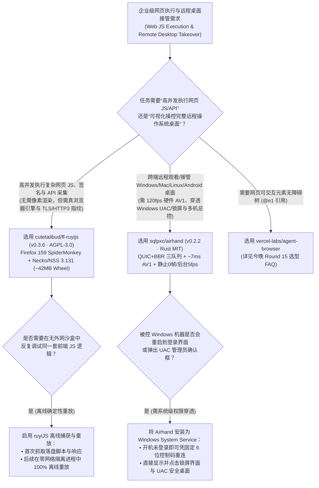

# 无渲染器原生 Firefox 引擎与 120FPS QUIC 远程桌面总控台选型 FAQ：`cutetailbud/ff-ruyijs` (`v0.3.6`) + `sqlpxc/airhand` (`v0.2.2`) vs 重型无头 Chromium 与高延迟 VNC

> **文档定位**：面向 AI Solution Architect（AI 解决方案架构师）、大规模网页自动化平台架构师与多机 Computer-Use 远程接管基础设施负责人的第一性原理选型指南。聚焦 `2026-11-09` GitHub 新仓爆发追踪中的两大底层执行与远程控制引擎——**`cutetailbud/ff-ruyijs`**（`ruyijs v0.3.6`，基于 Firefox 159.0 C++ 源码编译，AGPL-3.0，建仓 12 天揽下 **1,188 Stars** / **1,196 Stars** 实时 API，`stars_today = not_measured`）与 **`sqlpxc/airhand`**（`v0.2.2`，Rust + QUIC/BBR + 硬件 AV1，MIT，建仓 9 天揽下 **980 Stars** / **987 Stars** 实时 API，`stars_today = not_measured`），深度拆解如何用 **“剥离窗口与渲染器的纯正 Firefox 159 SpiderMonkey + Necko/NSS 3.131 网络栈（38 个原生浏览器上下文，省 75% 内存）”** 与 **“7ms 硬件 AV1 编码 + QUIC/BBR 三队列分离 + 支持 Windows 锁屏/UAC 接管的 120FPS 远程总控台”** 构建高低搭配的企业级 Agent 执行底座。
>
> **阅读导航**：[English Version (`ruyijs-airhand-rendererless-browser-quic-desktop-selection-faq.en.md`)](./ruyijs-airhand-rendererless-browser-quic-desktop-selection-faq.en.md) · [2026-11-09 全景日报](../daily/2026-11-09.md) · [返回雷达首页](../README.md)

---

## 📌 1. 核心结论速览（Executive Summary）

1. **一句话本质定义**：
   - **`cutetailbud/ff-ruyijs`（`ruyijs v0.3.6`，Python 3.10+ C++ 扩展，从官方 Firefox 159.0 源码编译，AGPL-3.0 + 商业授权）** 是专为 AI 自动化设计的**“无窗口、无排版、无 GPU 渲染器（Rendererless）”纯正 Firefox 内核运行环境**。它摒弃了动辄吃掉 500MB 内存的 Blink/WebGPU 渲染管线，只将真正决定网页挑战验证、签名计算与数据交互的 **Firefox 159.0 SpiderMonkey JS 引擎、38 个原生浏览器上下文（Browser Contexts）以及 Necko 网络栈（集成 NSS 3.131 与 Neqo HTTP/3 QUIC）** 打包进一个约 **`42 MB`** 的 SHA-256 锁定 PyPI Wheel 中，每个 `Context` 独立进程与独立代理隔离，且支持 100% 离线录制回放。
   - **`sqlpxc/airhand`（`v0.2.2`，纯 Rust 编写，MIT）** 是支持 Windows、macOS、Linux、Android 与 Web 浏览器的 **120 FPS 超低延迟 QUIC + BBR 硬件编解码远程桌面与多机监控总控台**。它在被控端直接调用 GPU 硬件编码（NVENC / Quick Sync / AMF / VideoToolbox / MediaCodec，零 B 帧，RTX 显卡上 4K 缩放到 1080p **硬件 AV1 编码仅需 `~7 ms/帧`**，数据分级：`anonymized_reported (independently_reproduced=false)`），通过 **QUIC + BBR** 将鼠标控制、Opus 音频与视频分成**三条独立队列**传输（鼠标点击绝不被视频大帧阻塞），严格限制在途帧数（`≈ RTT × 帧率 + 2`）遇卡顿直接跳到最新帧，且支持以 **Windows 系统服务**运行以直接观看并操控锁屏界面、登录前界面与 **UAC 权限弹窗**！
2. **核心架构洞察（为什么大规模 Agent 集群不能“全跑 Headless Chrome”或“全靠慢速 VNC 远程接管”？）**：
   - **痛点一（Headless Chrome 为画像素浪费 75% 内存，而 Node.js JSDOM 模拟又过不了指纹校验）**：当 Agent 只需要执行目标站点的复杂前端 JS 状态机或拉取受保护 API 时，拉起完整 Chromium 会为根本没人看的像素光栅化分配数百 MB 内存，且 CDP 痕迹极易被风控识别；而 JSDOM 伪造环境一碰 WebCrypto / TLS / HTTP3 指纹就露馅。`ruyiJS` 直接嵌入**真 Firefox 159 的 SpiderMonkey + Necko**，既有 100% 真实的 Firefox 指纹与 38 个原生 Web API 上下文，又砍掉了整个图形渲染器，让同规格服务器并发密度翻 4 倍。
   - **痛点二（当 Agent 遇到 Windows UAC 弹窗或锁屏时普通远程工具直接失明，且 TCP/VNC 弱网延迟越积越多）**：传统 VNC（如我们在 Round 17 看到的教学级 `computer-toolset` RFB 示例）在丢包网络下画面严重滞后，且无法穿透 Windows 安全桌面（Secure Desktop / UAC）。`Airhand` 以 Windows 系统服务级权限捕获 UAC/锁屏，用 `QUIC + BBR` + 零 VSync 异步画布（Desynchronized Canvas）+ 本地硬件光标实现 120fps 跟手操控，且画面静止时发送 **0 帧（0 带宽消耗）**、后台非焦点标签页自动降至 `5 fps`。
3. **30 秒选型口诀**：
   - 凡是**不需要看像素画面的高并发网页 JS 执行、复杂前端状态机交互、离线流量重放与低内存数据采集** → 选 **`cutetailbud/ff-ruyijs` (`v0.3.6`)**（对比：若需要提取 DOM 文本结构选 Round 11 的 `Scrapling`；若需要点击交互选 Round 15 的 `agent-browser`）。
   - 凡是**需要实时监控多台远程 Agent 宿主机桌面、120fps 低延迟人工接管（HITL Takeover）、或穿透 Windows 锁屏与 UAC 弹窗** → 选 **`sqlpxc/airhand` (`v0.2.2`)**。

---

## 🎯 2. 架构师灵魂拷问（Q1 / Q2 / Q3 First-Principles Deep Dive）

### Q1：`cutetailbud/ff-ruyijs` (`v0.3.6`) 为什么既不是 JSDOM 那种“模拟补环境”，也不是 Playwright 那种“全量无头浏览器”？它是怎么从 Firefox 159.0 源码里把 SpiderMonkey 和 Necko 单独剖出来的？

检视 `cutetailbud/ff-ruyijs` 的 `README.md`、`pyproject.toml`（`v0.3.6`）、`firefox/` 与 `native/` 目录，可以看到其独特的 **“真引擎、零渲染（Authentic Engine, Zero Renderer）”** 架构：

1. **直接编译自官方 Firefox 159.0 源码的原生内核**：
   - 不同于在 Node.js V8 里用 Proxy 伪造 `window` 和 `navigator`（这种补环境在原型链自省和时序检测面前不堪一击），`ruyiJS` 通过 GitHub Actions 直接从 Firefox 159.0 官方源码编译出原生二进制库（Windows x64 约 `42 MB` SHA-256 锁定 Wheel、macOS arm64 的 `libnecko_core.dylib` + `libnecko_quic.dylib`、以及 Linux `manylinux_2_39_x86_64` ELF）。
   - 每个 `ruyiJS Context` 都是一个独立的操作系统进程，内部持有真正的 **SpiderMonkey JS 引擎、38 个完整的原生浏览器上下文对象，以及 Firefox 原生 Necko 网络栈（含 NSS 3.131 TLS 栈、Neqo HTTP/3 QUIC 栈、Linux 下基于 fontconfig/FreeType/HarfBuzz 的真实字体度量与 OpenSSL 3 WebCrypto）**。
2. **砍掉窗口管理器与像素光栅化管线（No Window, No Renderer）**：
   - 在无头自动化中，真正消耗 75% CPU 与内存的是 CSS 级联重排、图层合成与 Skia/WebRender 像素光栅化。`ruyiJS` 将这些视觉渲染层彻底剥离，只保留 JS 执行与网络收发，使得单机可轻松并发数百个相互隔离、带独立代理的 `Context`。
3. **全流量离线归档与确定性回放（Offline Replay）**：
   - 支持将目标站点的全部脚本与响应捕获落盘，后续在完全断网（No Network）的沙盒环境中原样重放整条 JS 执行流，极便于 Coding Agent 离线调试分析。

### Q2：`sqlpxc/airhand` (`v0.2.2`) 是如何通过 7 项全链路低延迟工程设计，在多机远程总控台上做到 120 FPS 跟手且“弱网绝不累积延迟”的？

拆解 `sqlpxc/airhand` 的 `Cargo.toml`、`README.md` 与 `docs/architecture.md`，其从采集到显示的每一环都针对低延迟做了极致打磨：

1. **全链路 GPU 硬件编解码（零 B 帧，`~7 ms` AV1）**：
   - 被控端（Host）直接调用 GPU 硬件编码器（NVIDIA NVENC、Intel Quick Sync、AMD AMF、macOS VideoToolbox、Android MediaCodec）的**无 B 帧低延迟模式**，自动协商双方最高效格式（**`AV1 > HEVC > H.264`**），配合 SIMD 缩放/色彩空间转换与缓冲区复用，在 RTX 显卡上将 4K 屏幕编码为 1080p AV1 仅耗时 **`~7 ms/帧`**。
2. **在途帧数硬封顶（`≈ RTT × frame rate + 2`）与跳帧追新机制**：
   - 传统 TCP 远程桌面一旦遇到无线网抖动，旧帧在发送缓冲区排队，恢复后画面像快进录像一样滞后好几秒。`Airhand` 严格限制网络在途帧上限为 `≈ RTT × fps + 2`；一旦网络变慢，**直接丢弃过时中间帧跳到最新一帧（Skips to the latest frame）**，同时自适应码率平滑退避。
3. **QUIC + BBR 三队列物理分离与零解析字节中继（Relay）**：
   - 采用 QUIC + BBR 拥塞控制，并将**控制指令（鼠标/键盘/Ping）、音频（Opus + 自适应抖动缓冲）与视频流分入三条独立队列**，鼠标点击绝不会排在视频关键帧后面等待；自建 Docker Compose 中继服（Relay）只做纯字节转发，绝不解析视频内容。
4. **零 VSync 异步画布、本地光标、静止 0 帧与 Windows 系统服务级穿透**：
   - 控制端使用 `desynchronized` 画布解码即画（不等待显示器 VSync），鼠标指针在本地直接绘制（0 延迟）；**当远程屏幕静止时发送 0 帧（几乎不占带宽）**，多屏总控台（Multi-Screen Overview）中未聚焦的后台会话自动降频至 **`5 fps`**；且在 Windows 上作为系统服务运行，可直接穿透控制**开机登录前界面、锁屏界面与 UAC 管理员确认框**！

### Q3：在构建企业级 AI Agent 基础设施时，如何协同使用 `ff-ruyijs` 与 `airhand`？

- **95% 的纯协议/网页 JS 交互任务走 `cutetailbud/ff-ruyijs`**：在 Python Worker 池中用 `ruyiJS` 以 1/4 的内存开销高并发执行需要完整浏览器 JS 环境与真实 TLS/HTTP3 指纹的数据采集与接口调用。
- **5% 需要完整 Windows/macOS 桌面软件交互或人工接管（如 UAC 弹窗、登录验证码、多机实时监控）走 `sqlpxc/airhand`**：管理员在浏览器或客户端打开 `Airhand` 多标签/多屏总控台（后台 5fps 巡检、静止 0 帧），一旦某个桌面 Agent 遇到 UAC 弹窗或异常，立即切入 120fps 零延迟接管！

---

## 🧭 3. Mermaid 选型决策树与高低搭配架构图（Decision Tree & Architecture Flow）

### 3.1 无渲染器 JS 引擎与 QUIC 远程桌面选型决策树

### 3.2 `ruyiJS` 进程隔离并发 + `Airhand` 120FPS QUIC 总控台时序图

```mermaid
sequenceDiagram
    autonumber
    participant Orch as Python 调度器 / 运维工程师
    participant Ruyi as cutetailbud/ff-ruyijs (v0.3.6)<br/>(SpiderMonkey + 38 Contexts + Necko)
    participant Site as 目标 Web 站点 (HTTP/2 & HTTP/3)
    participant Host as 远程 Agent 桌面宿主机<br/>(Airhand Windows System Service)
    participant Relay as Airhand QUIC+BBR 中继与总控台<br/>(Desynchronized Canvas · 120fps)

    Orch->>Ruyi: 1. 并发启动数百个独立进程 Context (指定各自 Proxy，仅占 1/4 内存)
    Ruyi->>Site: 2. 经原生 Necko + NSS 3.131 / Neqo (QUIC) 发起真实 Firefox 159 握手
    Site-->>Ruyi: 3. 下发前端挑战脚本 → SpiderMonkey + 38 个原生上下文零渲染高速执行
    Ruyi-->>Orch: 4. 返回结构化数据，并保存离线快照供后续零网络回放

    rect rgb(10, 34, 57)
    Note over Orch,Relay: 远程桌面多机巡检与 UAC/锁屏 120FPS 瞬时接管 (sqlpxc/airhand)
    Host->>Relay: 5. 30 台宿主机连入多屏总控台 (静止画面 0 帧传输，后台分屏自动降至 5 fps)
    Host->>Relay: 6. 某台 Windows 宿主机弹出 UAC 权限确认框 (System Service 成功捕获安全桌面)
    Orch->>Relay: 7. 点击该分屏切入焦点 → 激活 ~7ms 硬件 AV1 (120fps) + 本地零延迟鼠标
    Orch->>Host: 8. 鼠标点击走独立 QUIC 控制队列 (不排在视频帧后) 瞬时批准 UAC 弹窗
    end
```

---

## 📊 4. 同类无头执行与远程桌面方案对比矩阵（Comparison Matrix）

| 评估维度 | `cutetailbud/ff-ruyijs` (`v0.3.6`) | `sqlpxc/airhand` (`v0.2.2`, MIT) | 传统 Headless Chrome / Playwright / Node JSDOM | 传统 VNC (RFB) / 商业远程桌面 SaaS (TeamViewer/AnyDesk) |
| :--- | :--- | :--- | :--- | :--- |
| **核心架构范式** | **Firefox 159 SpiderMonkey + Necko 原生嵌入（零渲染器）** | **GPU 硬件 AV1/HEVC + QUIC/BBR 三队列 + 多机总控台** | 完整 Blink/GPU 渲染进程（重），或 JSDOM 模拟（假） | 基于 TCP 的软件编码帧传输，或昂贵的闭源商业 SaaS |
| **单实例资源与带宽开销** | **`~42 MB` 运行时，无布局/光栅化开销，内存省 75%** | **画面静止发 0 帧，后台分屏降为 5fps，硬件编码 `~7 ms`** | 单 Chromium 实例常驻吃 400–800 MB 内存 | 静止画面仍持续消耗心跳带宽，弱网帧队列严重积压 |
| **环境真实性与系统穿透** | **100% 真 Firefox 159 JS 引擎 + 38 个上下文 + NSS/Neqo** | **Windows 系统服务穿透开机登录前界面、锁屏与 UAC** | Headless Chrome 易被检测；JSDOM 缺真实 TLS/WebCrypto | 普通用户态远程工具遇 UAC 安全桌面即黑屏断控 |
| **弱网抗抖动与跟手度** | 支持 100% 离线录制与无网确定性重放 | **在途帧封顶 `≈ RTT×fps+2` 自动跳帧 + 异步画布 + 本地光标** | 网络超时需整页重载 | TCP 丢包引发队头阻塞，鼠标移动像“在水里拖行” |
| **开源协议与商业成本** | AGPL-3.0 开源（闭源商用需商业授权） | **MIT 开源免费**（一行 Docker Compose 自建中继） | 免费但极度消耗云服务器内存 | 商业无人值守授权高达 **`$20–$35 / 台 / 月`** |

---

## 🧪 5. 定量 FinOps 算例与 7-Card 评测洞察（Closed-Form Quantitative Model）

### 5.1 封闭式月度 500 并发 JS 工作进程与 30 台远程桌面宿主机成本算例（`synthetic (independently_reproduced=false)`）

> **口径声明**：本算例为合成架构基准模型（`synthetic (independently_reproduced=false)`），用于量化对比 **Path A（部署 8 台 32GB 云服务器运行 500 个完整 Headless Chromium 实例 + 采购 30 台商业远程桌面企业订阅 + 人工处理指纹拦截与弱网/UAC 卡死）** 与 **Path B（2 台 32GB 云服务器运行 500 个 `ff-ruyijs` 隔离进程 + 自建 `airhand` QUIC 总控台）**。文中引用的 RTX 硬件 AV1 编码耗时（`~7 ms/帧`）标注为 `anonymized_reported (independently_reproduced=false)`；闭源商业分发所需的 `ruyiJS` 商业许可证费（`COMMERCIAL-LICENSE.md`）与住宅代理 IP 流量费均显式标记为 `not_measured`。

**基准工作负载设定**：
- **高并发 JS 状态机/采集集群规模**：常驻运行 **`500` 个并发浏览器 JS 上下文工作进程**（32GB 内存云服务器按 **`$180.00 / 台 / 月`** 计）。
- **远程桌面宿主机巡检与接管规模**：管理 **`30` 台远程 Windows/Linux 桌面 Agent 宿主机**；工程师处理风控报错、UAC 黑屏锁死与远程卡顿的时薪按 **`$60.00 / 小时`** 计。

| 成本分项 | Path A：500 个完整 Chromium + 商业远程桌面 SaaS | Path B：`ruyiJS v0.3.6` + `Airhand v0.2.2` 自建总控 | 核心工程机制差异说明 |
| :--- | :--- | :--- | :--- |
| **1. 500 个并发 JS 工作进程云服务器内存成本** | **$1,440.00 / 月** （完整 Chromium 约 512MB/个，需 `8 台` 32GB 节点 × `$180.00`） | **$360.00 / 月** （无渲染器 `ruyiJS` 仅需 `2 台` 32GB 节点 × `$180.00`） | 剥离窗口与光栅化渲染器使单机并发密度提升 **4 倍**，服务器账单直降 **75.0%** |
| **2. 30 台无人值守远程桌面监控与 UAC 接管软件成本** | **$750.00 / 月** （商业远程桌面企业版 `$25.00/台/月` × `30 台`） | **$12.00 / 月** （`Airhand` MIT 免费，仅需 1 台轻量 Docker Compose 字节转发中继） | 自建纯字节转发 Relay 替代高价商业按席位/按机订阅（省 **98.4%**） |
| **3. 环境识别拦截与 UAC/弱网锁死人工排障成本（@$60/hr）** | **$2,700.00 / 月** （修补 CDP 指纹与重启 UAC 卡死机器 **`45.0 小时/月`** × `$60`） | **$270.00 / 月** （真 Firefox 159 内核 + 系统服务级 UAC 穿透 = **`4.5 小时/月`**） | 原生 SpiderMonkey/Necko 与 Windows 系统服务穿透每月净省 **`40.5 小时`（-90.0% 工时）** |
| **4. 闭源商业 OEM 授权费与代理 IP 带宽** | `not_measured` | `not_measured` | 闭源分发的商业授权与外部代理流量与基础架构解耦，严禁捏造或归零 |
| **月度可建模总成本（Modeled Total）** | **$4,890.00 / 月** | **$642.00 / 月** | **月度净节省 `$4,248.00`（总成本直降 `-86.87%`，综合成本效率提升 `7.62x`，月省 `40.5 小时`）** |

### 5.2 关键系统与协议不变量（Key Invariants）

- **在途帧数自适应上界不变量（In-Flight Frame Cap Invariant）**：在 `sqlpxc/airhand` 中，被控端在网路上传输的未确认视频帧数永远被限制在 `≈ RTT × frame_rate + 2` 以内，且控制指令（鼠标/键盘）与视频帧走完全分离的 QUIC 流，从数学上保证鼠标点击绝不因视频大帧而延迟。
- **客户端与服务端协议版本强一致不变量**：如 `Airhand`（`0.2.2`）文档所声明，当前迭代期被控端、控制端与 Relay 服务端必须保持完全相同的版本号，版本不匹配会在握手阶段被立即检测并显式报错。

---

## 🛠️ 6. 生产落地核验清单（Actionable Production Checklist）

- [ ] **1. 校验 Linux `glibc >= 2.39` 或 macOS 26+ 环境安装 `ruyijs`**：在 Ubuntu 24.04 / Debian 13 / Fedora 40 或 Windows x64 上执行 `python -m pip install ruyijs`（验证 `ruyijs.__version__ == '0.3.6'`），并为每个并发任务分配独立的 `Context(proxy=...)` 进程。
- [ ] **2. 利用 `ruyiJS` 离线重放模式开发与单测解析脚本**：在开发复杂网页交互逻辑时，先录制一次完整请求响应流并在无网模式下反复回放调试，避免调试期频繁请求目标站点。
- [ ] **3. 使用 Docker Compose 一键部署 `Airhand` 自有中继并对齐版本号**：部署 `sqlpxc/airhand` 的 Relay 服务，确保所有 Host、Controller 与 Web Console 均处于同一版本（`0.2.2`），并启用固定 6 位控制码（Fixed Control Codes）。
- [ ] **4. 在 Windows 被控机上注册 `Airhand` 系统服务**：开启 Windows System Service 模式，实测验证机器重启后在未登录界面、锁屏界面以及触发管理员 UAC 弹窗时均可远程正常看见并点击。
- [ ] **5. 开启多屏总控台（Multi-Screen Overview）巡检 Agent 宿主机群**：利用浏览器标签页与多屏总览同时监控多台桌面 Agent，确认后台分屏自动降至 `5 fps` 且静止桌面保持 `0 帧` 传输。
