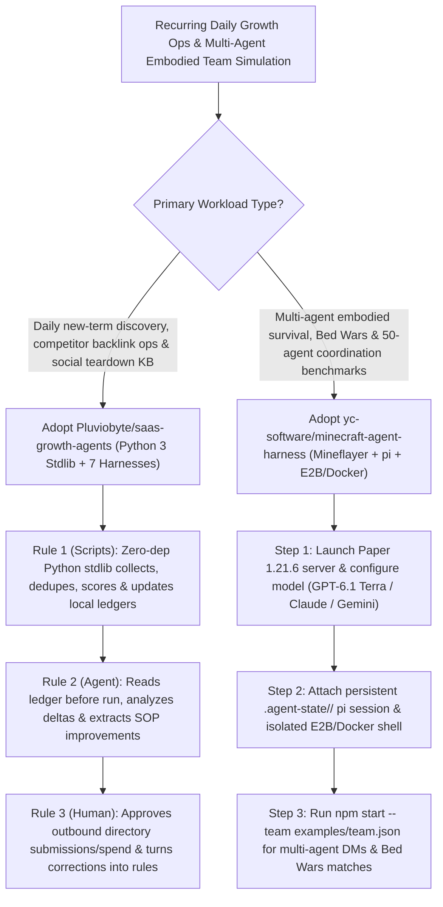

# Deterministic Script-First Growth SOPs (`Pluviobyte/saas-growth-agents`) & 50-Agent Persistent Mineflayer Harness (`yc-software/minecraft-agent-harness`) Selection FAQ

> **Positioning**: This standalone guide is **Round 51 of the 2026-11-11 Night Shift (Cumulative Guide #96)**, written in the plain-language, first-principles, closed-form FinOps style of `ib-vs-ethernet-roce-selection-faq.md` for Growth AgentOps Architects and Multi-Agent Embodied Simulation Leads evaluating two high-velocity open-source repositories:
> 1. **`Pluviobyte/saas-growth-agents` (`525★`, Python 3 stdlib-only scripts + multi-harness SOPs for Grok Bot, Muse, Dot, Hermes, OpenClaw, Claude Code, and Codex, MIT)**: Enforces a strict **3-Rule Architecture (`1. Scripts do deterministic collection, deduplication, scoring, and logging; 2. The agent judges, verifies, and reports; 3. You decide: spending, sending, and deleting require human OK`)** across **New-term radar** (3×/day), **Site ops** (competitor DR/backlinks & directory submissions), and **Social analysis pack** (including the `douyin-comments` skill);
> 2. **`yc-software/minecraft-agent-harness` (`207★`, JavaScript / Node.js 22.19+ / `Mineflayer` + `earendil-works/pi` + Paper `1.21.6`, MIT)**: Runs multi-agent teams (Claude, `GPT-6.1 Terra`, Gemini, OpenRouter) in Minecraft `1.21.6` across **Bed Wars matches and 50-agent survival servers**—equipping every agent with a **restart-persistent `.agent-state/<name>/` `pi` session**, an **isolated shell sandbox (`E2B`, `Docker`, or `--sandbox none`)** where it writes scripts that call its own game tools, and **single-JSON team coordination (`examples/team.json`)** with inter-agent DMs.
>
> **中文版 FAQ**: [saas-growth-agents-minecraft-agent-harness-deterministic-sop-50-agent-teams-selection-faq.md](saas-growth-agents-minecraft-agent-harness-deterministic-sop-50-agent-teams-selection-faq.md) · **Architecture Summary SVG**: [`assets/github-ai-radar-2026-11-11-r51-saasgrowth-minecraft.svg`](../../../assets/github-ai-radar-2026-11-11-r51-saasgrowth-minecraft.svg)

---

## 📌 1. Executive Summary

1. **In plain English, what problems do these two repositories actually solve?**
   - **Ending Hallucinated SEO Metrics & Duplicate Directory Submissions in Daily Growth Agents (`Pluviobyte/saas-growth-agents`)**: Asking an LLM to directly scrape trends, check backlinks, and submit to directories every day burns tokens on repetitive HTML parsing and forgets what was already processed yesterday. `saas-growth-agents` delegates all collection, deduplication, scoring, and ledger persistence to **zero-dependency Python 3 stdlib scripts (`lib/aisa/client.py`)** read before every run; the agent only analyzes incremental outputs across `New-term radar`, `Site ops`, and `Social analysis pack` (`douyin-comments`), while any outbound submission, spend, or deletion waits for human approval.
   - **Ending Stateless Multi-Agent Resets & Single-Action Bottlenecks in Embodied Game Harnesses (`yc-software/minecraft-agent-harness`)**: Standard game wrappers lose all context when a bot disconnects and force the LLM to issue every primitive movement one turn at a time. Powered by `Mineflayer` and `earendil-works/pi`, `minecraft-agent-harness` persists each agent's session under `.agent-state/<name>/` (kill and restart by name to resume seamlessly), gives each agent an isolated `E2B` or `Docker` shell where it keeps notes and writes helper scripts that call its own game tools, and launches multi-agent Bed Wars and 50-agent survival teams from a single `examples/team.json` file.
2. **Closed-Form FinOps Verdict (`CLAIM-20261111-R51-SAASGROWTH-MINECRAFTHARNESS`)**:
   - For a 10-person AI Agent Operations & Multi-Agent Simulation Team running **90 daily automated growth/SEO/social intelligence pipelines and 30 multi-agent 50-bot embodied simulation runs per month** (senior AI operations & multi-agent systems engineer loaded rate `$90.00/hr`; external AIsa data credits and E2B cloud sandbox subscriptions: `not_measured`):
   - Upgrading from **Path A (Pure LLM web scraping without ledgers + stateless multi-agent bots restarting from scratch, `$5,730.00/mo`)** to **Path C (`saas-growth-agents` Python stdlib deterministic SOPs + `minecraft-agent-harness` persistent `pi` sessions & Docker/E2B shells, `$700.00/mo`)** saves **`$5,030.00/mo` (`-87.78%`, `$60,360.00/yr`)** and cuts pipeline maintenance and simulation recovery labor from `45.0 hrs/mo` to `5.0 hrs/mo` (**`-88.89%`**).

---

## 🎯 2. Three Core Architectural Questions (Q1 / Q2 / Q3 Deep-Dive)

### Q1: How does `Pluviobyte/saas-growth-agents` separate deterministic Python stdlib scripts from LLM judgment across 7 agent harnesses?
- **First-Principles Breakdown**:
  1. **The Three-Rule Contract (`Scripts → Agent → Human`)**:
     - Python 3 stdlib scripts handle deterministic collection, deduplication, scoring, and ledger updates; the agent reads the ledger before each run to analyze and verify findings; and human approval gates all spending, outbound submissions, and deletions (recording every human correction as a permanent skill rule).
  2. **Three Core Growth Bots (`New-term radar`, `Site ops`, `Social analysis pack`)**:
     - Runs 3×/day new-term discovery (Google Trends, competitor sitemaps, Product Hunt, GitHub Trending, Reddit, TikTok), daily DR/backlink and directory ops, and multi-platform social teardown (`X`, `Douyin` full comments, `RedNote`, `YouTube`, `WeChat`) across Grok Bot, Muse, Dot, Hermes, OpenClaw, Claude Code, and Codex.

### Q2: How does `yc-software/minecraft-agent-harness` scale to 50 concurrent agents and enable self-scripting inside `E2B`/`Docker` shells?
- **First-Principles Breakdown**:
  1. **Restart-Resilient `pi` Sessions (`.agent-state/<name>/`)**:
     - Stores full session history and notes per agent name so interrupted agents resume immediately without losing long-horizon objectives.
  2. **Per-Agent Shell Sandboxes & JSON Team Orchestration (`examples/team.json`)**:
     - Gives each agent an isolated `E2B` or `Docker` shell to write custom scripts over its Mineflayer tools, and coordinates multi-agent teams with inter-agent DMs (`/tell`) and optional shared VMs for Bed Wars and 50-agent survival servers.

### Q3: How should AI Architects apply these two patterns?
- **Architectural Takeaways**:
  - Use **`saas-growth-agents`'s stdlib-ledger + agent-judgment split** for any recurring daily intelligence or SEO/growth workflow to eliminate duplicate work and hallucinated metrics.
  - Use **`minecraft-agent-harness`** (`GPT-6.1 Terra` / Claude / Gemini) as a stress-testbed for multi-agent team communication, self-scripting tool synthesis, and persistent session recovery.

---

## 🧭 3. Mermaid Decision Tree & Execution Pipeline

---

## 📊 4. Architectural Comparison Matrix

| Evaluation Dimension | Path A: Pure LLM Scraping + Stateless Bots | Path B: Raw Cron Scripts + Single-Bot Loop | **Path C (Recommended): `saas-growth-agents` + `minecraft-harness`** |
| :--- | :--- | :--- | :--- |
| **Daily Data Deduplication & Cost** | LLM re-parses raw HTML daily; high token waste | Rigid tables with no SOP synthesis or judgment | **Zero-dep Python stdlib deduplication/ledgers + scoped agent judgment** |
| **Outbound Safety & Self-Improvement** | Unchecked auto-submissions risk spam/account bans | Static scripts never learn from human edits | **Human-approval gate on spend/send/delete + corrections saved to skills** |
| **Multi-Agent Crash Recovery** | Restarting a bot wipes all memory and goals | Saves coordinates only; loses reasoning state | **Persistent `.agent-state/<name>/` `pi` sessions survive restarts** |
| **Tool Composition & Team Coordination** | Primitive single-step tool calls; no team DMs | Hardcoded FSMs fail in dynamic Bed Wars games | **Per-agent Docker/E2B shell for self-scripting + `team.json` DMs (50 bots)** |
| **Monthly TCO (90 Ops + 30 Sims)** | **`$5,730.00 / mo`** (`$1,680` tokens + `$4,050` labor) | **`$2,880.00 / mo`** (`$810` compute + `$2,070` labor) | **`$700.00 / mo` (Saves `$5,030.00/mo` · `-87.78%`)** |

---

## 🧪 5. Closed-Form FinOps Example & 7-Card Insights (`CLAIM-20261111-R51-SAASGROWTH-MINECRAFTHARNESS`)

### 5.1 Workload & Scope Boundary
- **Workload**: A 10-person AI Agent Operations & Multi-Agent Simulation Team running **90 daily automated growth/SEO/social intelligence pipelines and 30 multi-agent 50-bot simulation runs per month**.
- **Rates**: Senior AI operations & multi-agent systems engineer loaded rate at **`$90.00 / hr`**.
- **Explicit Scope Boundary**: External AIsa API data credits, E2B cloud sandbox subscriptions, and dedicated game server hosting are marked **`not_measured`**.

### 5.2 Closed-Form Monthly Cost Breakdown

| Cost Component | Path A: Pure LLM Scraping + Stateless Bots | Path B: Raw Cron Scripts + Single-Bot Loop | **Path C: `saas-growth-agents` + `minecraft-harness` (Recommended)** |
| :--- | :--- | :--- | :--- |
| **Scraping/Dedupe Token Waste & Restart Rerun Spend** | **`$1,680.00`** | **`$810.00`** | **`$250.00`** (Stdlib script deduplication + `.agent-state` resume) |
| **Duplicate Cleanup, Dependency Fixes & Bot Ops (`$90/hr`)** | `45.0 hrs × $90.00` = **`$4,050.00`** | `23.0 hrs × $90.00` = **`$2,070.00`** | `5.0 hrs × $90.00` = **`$450.00`** |
| **Total Monthly TCO** | **`$5,730.00 / mo`** | **`$2,880.00 / mo`** (`-49.74%`) | **`$700.00 / mo`** |
| **Net Savings vs. Path A** | Baseline | Saves `$2,850.00 / mo` | **Saves `$5,030.00 / mo` (`-87.78%` · `$60,360.00/yr`)** |
| **External AIsa Credits & E2B Sandbox Subscriptions** | `not_measured` | `not_measured` | `not_measured` |

---

## 🛠️ 6. Production Verification Checklist

- [ ] **1. Bootstrap `saas-growth-agents` & Verify Pre-Run Ledger Reads**: Set up `New-term radar`, `Site ops`, and `Social analysis pack` (`douyin-comments`) via `bootstrap.md` and confirm scripts read local ledgers before each run.
- [ ] **2. Enforce Human Approval on Spend/Send/Delete**: Verify that directory submissions and deletions pause for human confirmation and that `Trade radar` remains strictly analysis-only.
- [ ] **3. Isolate `minecraft-agent-harness` Shells (`Docker` / `E2B` / `--sandbox none`)**: Ensure Docker or `E2B_API_KEY` is active (or pass `--sandbox none`) so agent-written shell scripts never execute directly on the host user account.
- [ ] **4. Test `.agent-state/<name>/` Session Resumption**: Interrupt a running agent with `Ctrl+C` and restart it with the same name to verify seamless `pi` session continuity.
- [ ] **5. Run Multi-Agent `examples/team.json` & Bed Wars Referee Suite**: Execute `npm start -- team examples/team.json` and `npm run check` to validate inter-agent DMs and team coordination.
