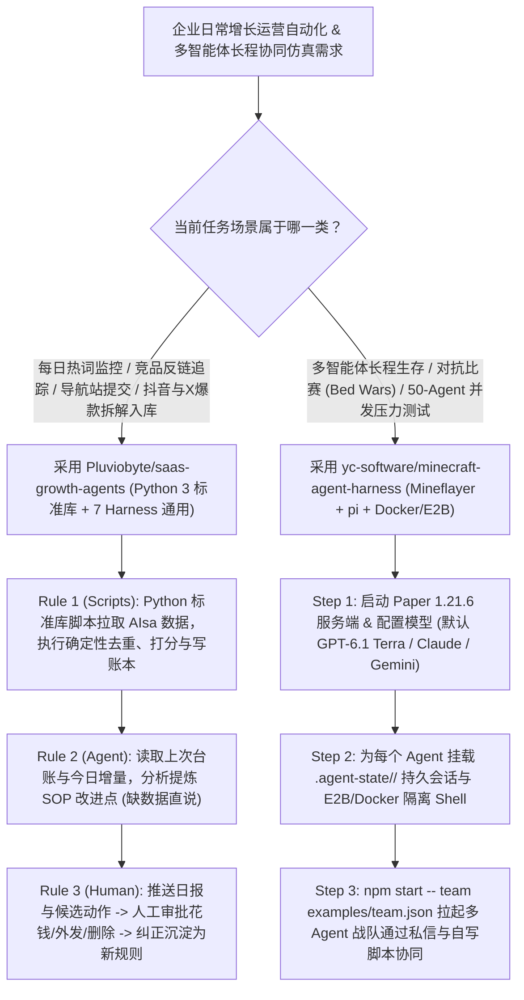

# “脚本采集去重+Agent判断+人工拍板”增长智能体（`Pluviobyte/saas-growth-agents`）与 50-Agent 持久会话自脚本化沙盒（`yc-software/minecraft-agent-harness`）深度选型 FAQ

> **文档定位**：本专题是 **2026-11-11 夜班第 51 轮（累计第 96 篇）独立六段式选型指南**，严格对标 `ib-vs-ethernet-roce-selection-faq.md` 的通俗第一性原理与闭式 FinOps 核算规范，面向全天候业务增长自动化（Growth AgentOps）架构师与多智能体协同仿真（Multi-Agent Embodied Simulation）负责人，深度拆解今日在确定性脚本驱动 SOP 与 50-Agent 并发自治沙盒赛道爆发的两大新锐开源仓：
> 1. **`Pluviobyte/saas-growth-agents`（`525★`，Python 3 纯标准库脚本 + 跨 7 大 Harness 通用 SOP，MIT）**：立下**“① 脚本干确定性的脏活（采集、去重、打分、记账）；② Agent 只负责分析、核验与写报告；③ 花钱、外发与删除必须由人拍板”**三大铁律——内置 **每日 3 次新词雷达（New-term radar）**、**竞品外链与导航站自动提交（Site ops）** 及 **社媒拆解知识库（Social analysis pack，含原版 `douyin-comments` 抖音评论全量抓取技能）**，无缝运行于 Grok Bot、Muse、Dot、Hermes、OpenClaw、Claude Code 与 Codex；
> 2. **`yc-software/minecraft-agent-harness`（`207★`，JavaScript / Node.js 22.19+，基于 `Mineflayer` + `earendil-works/pi` + Paper `1.21.6`，MIT）**：经受住**激烈 Bed Wars（起床战争）对抗赛与 50 个 Agent 同服生存实测**的多智能体自治执行器——每个 Agent 不仅拥有跨重启不丢状态的 `.agent-state/<name>/` 持久会话（由 `pi` 驱动），还独享一个**隔离 Shell 沙箱（`E2B` / `Docker`）来自己记笔记、自己写脚本调用游戏工具**，并支持通过单个 `examples/team.json` 拉起支持私聊（DMs）与共享虚拟机的多 Agent 战队！
>
> **English Version**: [saas-growth-agents-minecraft-agent-harness-deterministic-sop-50-agent-teams-selection-faq.en.md](saas-growth-agents-minecraft-agent-harness-deterministic-sop-50-agent-teams-selection-faq.en.md) · **架构总结图**: [`assets/github-ai-radar-2026-11-11-r51-saasgrowth-minecraft.svg`](../../../assets/github-ai-radar-2026-11-11-r51-saasgrowth-minecraft.svg)

---

## 📌 一、核心结论速览（Executive Summary）

1. **一句话大白话讲透这两个项目到底解决了什么痛点？**
   - **终结“让大模型直接去爬全网热词和外链，结果又贵又慢、还天天重复汇报旧数据或乱发垃圾外链”的痛点（`Pluviobyte/saas-growth-agents`）**：日常增长运营（监控 Google Trends/GitHub Trending/Product Hunt 新词、查竞品 DR 与外链、提交免费导航站、抓取抖音评论与小红书/X 爆款帖入库）是高度重复的 SOP。如果让 Agent 凭“感觉”去跑，不仅每次重新抓全量网页烧光 Token，还会因为没账本而把同一个导航站提交十遍。`saas-growth-agents` 用**零第三方依赖的 Python 3 标准库脚本（`lib/aisa/client.py`）**接管所有确定性采集、去重、打分与本地台账读写，Agent 每次启动先读台账，只对增量信号做分析判断，且**任何花钱、对外提交、删除动作及 `Trade radar` 异动预警都严格停在“推送结论等你点头”**！
   - **终结“多智能体游戏/仿真一重启就集体失忆、且 Agent 只能机械单步调工具而不会自己写组合脚本”的痛点（`yc-software/minecraft-agent-harness`）**：在评测 `GPT-6.1 Terra`、Claude、Gemini 等模型的多智能体长程协作能力时，普通 Mineflayer 包装器一旦断线重连就会丢失全部记忆，且每个动作都要走一次漫长的模型推理。该项目引入 **`earendil-works/pi`** 管理持久会话（杀掉进程再用同名启动即可从 `.agent-state/<name>/` 满血续跑），给每个 Agent 配备 **Docker 或 E2B 隔离 Shell**（让 Agent 自己写小脚本组合调用游戏 API 并维护战术笔记），支持用一份 `team.json` 启动多 Agent 战队通过私信协同打赢 Bed Wars 或支撑 **50 个 Agent 同服并发**！
2. **闭式 FinOps 投资回报结论（`CLAIM-20261111-R51-SAASGROWTH-MINECRAFTHARNESS`）**：
   - 以 10 人海外 SaaS 增长自动化与多智能体协同评测团队每月运行 **90 轮每日全渠道新词/SEO/社媒拆解流水线** 与 **30 场 50-Agent 级长程对抗/生存协同仿真** 为基准（高级 AI 运营与多智能体系统工程师含税费率 `$90.00/hr`；外部 AIsa 数据接口点卡与 E2B 云沙箱商业订阅费：`not_measured`）：
   - 从 **Path A（纯大模型无账本网页抓取去重 + 无状态单步重跑多智能体仿真，月均 `$5,730.00`）** 升级至 **Path C（`saas-growth-agents` Python 标准库确定性台账 SOP + `minecraft-agent-harness` `pi` 持久会话与自脚本化战队沙盒，月均 `$700.00`）**，每月净省 **`$5,030.00/mo`（降幅 `-87.78%`，年省 `$60,360.00/yr`）**，并将增长流水线维护与多智能体断线恢复工时从 `45.0 hrs/mo` 压缩至 `5.0 hrs/mo`（节省 **`-88.89%`**）。

---

## 🎯 二、三大灵魂拷问（Q1 / Q2 / Q3 深度原理解析）

### Q1：`Pluviobyte/saas-growth-agents` 的“三铁律”与四大内置 Bot 是如何把每日增长杂活变成零漂移 SOP 的？
- **第一性原理拆解**：
  1. **铁律一（脚本干确定性工作）+ 铁律二（Agent 做判断）+ 铁律三（人类掌握终审权）**：
     - 所有数据拉取、哈希去重、指标计算与台账落盘全部由纯 Python 3 标准库脚本完成（无需 `pip install` 一堆脆弱依赖），保证 100% 可复现、可重放；
     - Agent 读取脚本产出的结构化增量数据后进行分析与交叉核验（缺数据时显式报告而非脑补）；
     - 凡涉及花钱、向外发送表单或删除数据，一律阻塞等待人工确认，且人工的每一次纠正都会被沉淀为 Skill 中的新规则。
  2. **三大主力增长 Bot + `Trade radar` 异动分析师**：
     - **`New-term radar`（每日 3 报）**：扫描 Google Trends、竞品 Sitemap、新导航站、Product Hunt、GitHub Trending、Reddit 与 TikTok，捕捉最新 AI 产品/模型/模板热词；
     - **`Site ops`（站点 SEO 运营）**：找出目标关键词的所有竞争站点，核查其 DR 与反链，每日追踪己方指标并按规则准备免费导航站提交；
     - **`Social analysis pack`（社媒拆解入库，含 `douyin-comments`）**：丢入一条 X、抖音（支持拉取完整评论区洞察用户痛点）、小红书、YouTube 或微信公众号链接，自动提取“哪些点能改进我方现有 SOP”并按主题归档；
     - **`Trade radar`**：监控价格异动与突发事件推送分析，严禁自动下单。

### Q2：`yc-software/minecraft-agent-harness` 是如何支撑 50 个 Agent 同服并发，并让 Agent 在 Docker/E2B Shell 里“自己写脚本玩游戏”的？
- **第一性原理拆解**：
  1. **基于 `pi` 的跨重启持久会话（`.agent-state/<name>/`）**：
     - 每个 Agent 的完整上下文、笔记与工具状态都实时保存在 `.agent-state/<name>/`（或 Docker `agent-state` 卷）中；即使进程崩溃或被 `Ctrl+C` 终止，只要以相同名字重新启动即可无缝恢复记忆继续执行目标。
  2. **赋予每个 Agent 专属 Shell 沙箱（Self-Scripting Embodied Agent）**：
     - 不同于只能一问一答调固定 JSON 工具的传统 Bot，该执行器默认给每个 Agent 分配一个 Shell 环境（优先使用 `E2B` 云沙箱，其次本地 `Docker`，或通过 `--sandbox none` 显式关闭）：Agent 可以在 Shell 里维护自己的生存笔记，并**自己编写小型脚本组合调用自身的 Mineflayer 游戏工具**（如自动化挖矿、合成与建房循环）。
  3. **单文件战队编排（`examples/team.json`）与 Bed Wars 裁判系统**：
     - 一行 `npm start -- team examples/team.json` 即可拉起多个可互相发送私信（DMs）并共享同一台沙箱机器的团队 Agent，配套完整的 Bed Wars 规则与裁判示例（`examples/bedwars/`）。

### Q3：AI 架构师如何将这两套设计模式迁移到企业级多智能体系统中？
- **架构师迁移指南**：
  - 在构建**企业日常运营监控、竞品情报、自动化营销（MarTech）Agent** 时，严格照搬 `saas-growth-agents` 的**“Python 标准库确定性脚本管采集去重 + 本地 Ledger 防重 + Agent 仅做增量判断 + 外发动作人工审批”**架构；
  - 在评测或设计**多智能体协作、红蓝对抗与长程具身任务**时，采用 `minecraft-agent-harness` 的**“`pi` 命名持久状态目录 + Agent 专属 Docker/E2B 自脚本化沙箱 + `team.json` 私信协同”**模式！

---

## 🧭 三、Mermaid 选型决策树与“确定性运营 + 多智能体协同”流水线

---

## 📊 四、同类方案核心能力对比矩阵（Selection Matrix）

| 评估维度 | Path A：纯大模型直接爬网页 + 无状态游戏 Bot | Path B：传统定时爬虫脚本 + 单智能体循环 | **Path C（推荐）：`saas-growth-agents` + `minecraft-harness`** |
| :--- | :--- | :--- | :--- |
| **日常数据采集去重可靠性与成本** | 每次调 LLM 读网页去重，既烧 Token 又常漏记重复提交 | 只有死板的抓取表格，缺乏针对业务 SOP 的洞察提炼 | **零依赖 Python 标准库确定性去重记账 + Agent 专注高价值判断** |
| **跨 Agent 平台兼容性与风控边界** | 绑死特定框架；自动外发极易触发平台封号或乱花钱 | 无交互式人类反馈学习闭环 | **兼容 Grok Bot/Hermes/OpenClaw/Claude/Codex + 外发必审 + 纠错入规** |
| **多智能体会话持久性（Crash Recovery）** | 进程一停全部记忆归零，50 个 Bot 需从头重跑 | 仅保存简单坐标，丢失长程规划上下文 | **基于 `pi` 的 `.agent-state/<name>/` 持久会话，同名重启无缝续跑** |
| **Agent 工具扩展与团队协同能力** | 只能单步调用预设 JSON 工具，多 Bot 间无私信与共享沙箱 | 硬编码状态机，无法适应动态对抗（如 Bed Wars） | **每 Agent 独享 Docker/E2B Shell 自写组合脚本 + `team.json` 私信协同** |
| **月度总拥有成本（90 运营 + 30 仿真）** | **`$5,730.00 / mo`**（`$1,680` Token + `$4,050` 人工） | **`$2,880.00 / mo`**（`$810` 算力 + `$2,070` 人工） | **`$700.00 / mo`（净省 `$5,030.00/mo` · `-87.78%`）** |

---

## 🧪 五、定量 FinOps 算例与 7-Card 洞察（`CLAIM-20261111-R51-SAASGROWTH-MINECRAFTHARNESS`）

### 5.1 测算基准与显式边界（Scope & Boundaries）
- **场景设定**：10 人海外 SaaS 增长自动化与多智能体仿真评测团队，每月运行 **90 轮每日全网热词/外链/社媒（含抖音评论）运营流水线**，并开展 **30 场 50-Agent 级长程协同与对抗评测**。
- **费率假设**：高级 AI 运营与多智能体系统工程师全包时薪 **`$90.00 / hr`**。
- **显式边界声明（Explicit Not-Measured Boundary）**：外部第三方数据源（AIsa）点卡充值、E2B 云沙箱商业配额及独立游戏物理服务器月租标记为 **`not_measured`**，本表核算大模型推理 Token 与工程师排障/去重维护工时。

### 5.2 三路径月度成本闭式对照表

| 成本分项 | Path A：纯 LLM 网页抓取 + 无状态多 Bot 重跑 | Path B：传统定时脚本 + 单智能体循环 | **Path C：`saas-growth-agents` + `minecraft-harness`（推荐）** |
| :--- | :--- | :--- | :--- |
| **日常抓取/去重冗余 Token 与断线重跑 API 开销** | **`$1,680.00`** | **`$810.00`** | **`$250.00`**（标准库脚本零 Token 去重 + `.agent-state` 断点续跑） |
| **重复外链清理、依赖报错修复与多 Bot 状态恢复工时（`$90/hr`）** | `45.0 hrs × $90.00` = **`$4,050.00`** | `23.0 hrs × $90.00` = **`$2,070.00`** | `5.0 hrs × $90.00` = **`$450.00`** |
| **月度总成本（Monthly TCO）** | **`$5,730.00 / mo`** | **`$2,880.00 / mo`**（`-49.74%`） | **`$700.00 / mo`** |
| **相对 Path A 净节省** | 基准线（Baseline） | 净省 `$2,850.00 / mo` | **净省 `$5,030.00 / mo`（`-87.78%` · 年省 `$60,360.00/yr`）** |
| **外部数据源点卡与云沙箱商业配额** | `not_measured` | `not_measured` | `not_measured` |

---

## 🛠️ 六、生产级落地核验 Checklist

- [ ] **1. `saas-growth-agents` 一句话自引导与台账前置读取**：通过 `bootstrap.md` 在 Grok Bot、Hermes、OpenClaw、Claude Code 或 Codex 中完成初始化，确认每次定时任务启动前先读取本地状态台账再执行增量拉取。
- [ ] **2. 外发/付费人工审批门禁与 `Trade radar` 只读红线**：验证 `Site ops` 导航站外发提交、数据删除等操作均处于待人工确认状态，且 `Trade radar` 仅推送分析报告、绝不挂载任何真实交易下单接口。
- [ ] **3. `minecraft-agent-harness` Shell 沙箱安全隔离**：在启动多智能体前，显式配置 `E2B_API_KEY` 或本地 `Docker` 容器（或在无需脚本执行时传入 `--sandbox none`），严禁在生产宿主机上直接使用无隔离的本地目录 Shell。
- [ ] **4. `.agent-state/<name>/` 杀进程重连恢复演练**：在 Agent 执行建房或挖矿任务中途发送 `Ctrl+C` 终止进程，再以相同名称重启，验证 `pi` 会话与沙箱笔记完整恢复。
- [ ] **5. `examples/team.json` 多智能体私信与 Bed Wars 对抗压测**：运行 `npm start -- team examples/team.json` 与 `examples/bedwars/`，验证多 Agent 间的 `/tell` 私信通信、共享机器协作及裁判计分逻辑。
