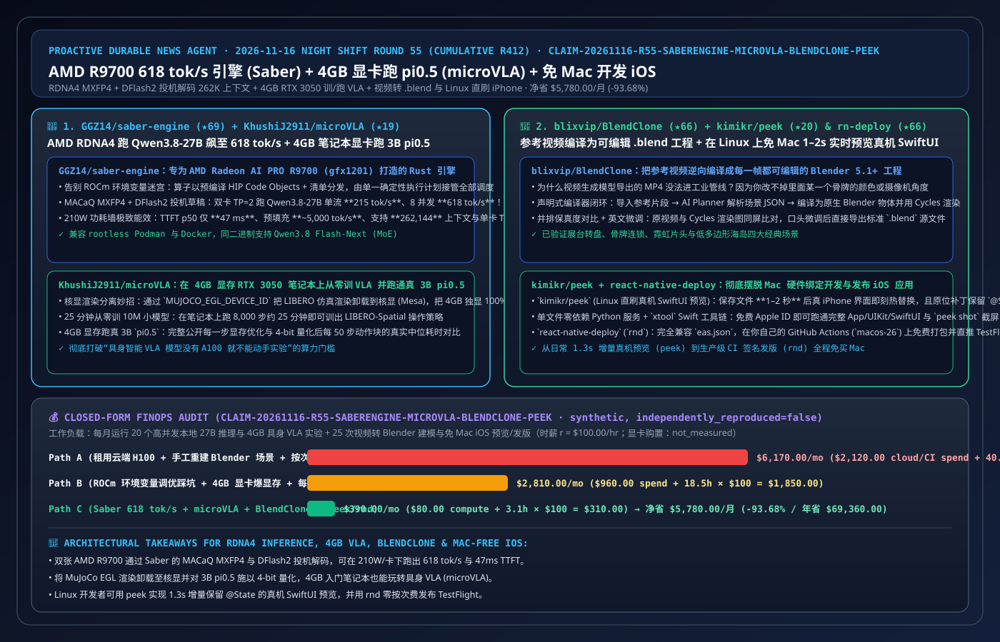
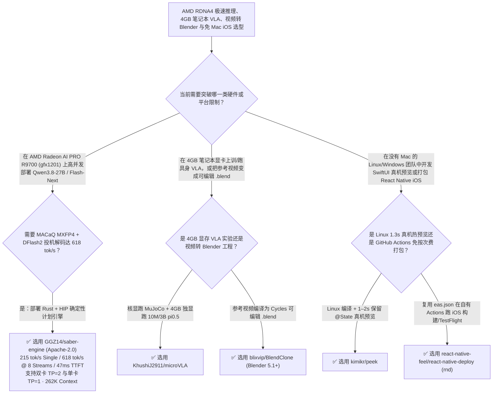

# AMD R9700 `618 tok/s` 推理引擎、4GB 显卡跑 `pi0.5` VLA、视频转 `.blend` 编译器与免 Mac 开发 iOS 选型 FAQ：`GGZ14/saber-engine` + `KhushiJ2911/microVLA` & `blixvip/BlendClone` + `kimikr/peek` & `react-native-feel/react-native-deploy`

> **元数据（Metadata）**
> - **评测批次**：2026-11-16 夜间深潜 Round 55（累计 Round 412）
> - **核心标的**：
>   1. [`GGZ14/saber-engine`](https://github.com/GGZ14/saber-engine)（`★ 69` / `6 Forks`，Apache-2.0 · 专为 AMD Radeon AI PRO R9700［`gfx1201` / RDNA4］打造的 Rust 推理引擎：通过 `MACaQ MXFP4` 权重包与 `DFlash2` 投机草稿器，在双卡 `TP=2`［210W/卡］下跑 `Qwen3.8-27B` 达**单流 `215 tok/s`、8 并发 `618 tok/s`、TTFT p50 `47 ms`、预填充 `~5,000 tok/s` 与 `262,144` 上下文**，同时支持单卡 `TP=1` 与 `Qwen3.8 Flash-Next`）
>   2. [`KhushiJ2911/microVLA`](https://github.com/KhushiJ2911/microVLA)（`★ 19` / `1 Fork`，MIT）& [`blixvip/BlendClone`](https://github.com/blixvip/BlendClone)（`★ 66` / `8 Forks`，MIT）—— 在仅 **4 GB 显存的笔记本 RTX 3050** 上通过将 MuJoCo EGL 渲染卸载到核显，**25 分钟从零训出 `~10M` 参数 VLA 并在同一张 4GB 卡上跑通真实 `3B` `pi0.5`** + 将任意参考视频经声明式编译器转化为可编辑的 Blender 5.1+ `.blend` 场景文件并进行并排 Cycles 保真对比
>   3. [`kimikr/peek`](https://github.com/kimikr/peek)（`★ 20` / `2 Forks`，MIT）& [`react-native-feel/react-native-deploy`](https://github.com/react-native-feel/react-native-deploy)（`★ 66` / `8 Forks`，MIT）—— **在 Linux 上免 Mac 直接向真实 iPhone 推送 `1–2s` 增量热更新且保留 `@State` 的 SwiftUI 实时预览器** + 完全兼容 `eas.json`、在自有 GitHub Actions（`macos-26`）上零按次付费完成 React Native / Expo iOS 打包与 TestFlight 提交的开源 CLI（`rnd`）
> - **配套架构图**：[`assets/github-ai-radar-2026-11-16-r55-saberengine-microvla-blendclone-peek-rndeploy.svg`](../../../assets/github-ai-radar-2026-11-16-r55-saberengine-microvla-blendclone-peek-rndeploy.svg)
> - **证据封存锚点**：`CLAIM-20261116-R55-SABERENGINE-MICROVLA-BLENDCLONE-PEEK`（见 [`evidence/trending-daily-2026-11-16-audit.json`](../evidence/trending-daily-2026-11-16-audit.json)）

---

## 📌 1. 核心结论速览（Executive Summary & First-Principles Pitch）

1. **一句话讲透本质**：
   - **`GGZ14/saber-engine` (`618 tok/s Qwen3.8-27B Rust Engine on AMD R9700 RDNA4`)**：以前在 AMD 显卡上跑大模型最怕配一裤兜子冲突的环境变量。`Saber` 用纯 Rust 重写了宿主机控制流，把算子打包成预编译 HIP Code Objects + 清单，用一个解析好的执行计划统管一切——在两张 210W 功耗墙的 Radeon AI PRO R9700（`gfx1201`）上跑 `Qwen3.8-27B`（`MACaQ MXFP4` + `DFlash2` 投机解码），**单流飙到 `215 tok/s`，8 并发高达 `618 tok/s`，首字延迟（TTFT p50）仅 `47 ms`，支持 `262K` 超长上下文，而且只有一张卡也能开 `--tp 1` 直接跑**！
   - **`KhushiJ2911/microVLA` + `blixvip/BlendClone` (`4GB Laptop RTX 3050 VLA & Video-to-Editable-.blend Compiler`)**：`microVLA` 告诉你哪怕手里只有一台 **4 GB 显存的 RTX 3050 轻薄本**，只要用 `MUJOCO_EGL_DEVICE_ID=1` 把仿真画面渲染甩给 CPU 核显，把 4GB 独显全留给 PyTorch，不仅 **25 分钟就能从零训完一个 `10M` 参数的 `pi0.5` 风格机械臂模型**，还能把 **真正的 `3B` `pi0.5` 大模型以 4-bit 塞进这 4GB 显存里跑起来**！而 `BlendClone` 则把一段参考视频逆向编译成原生 Blender 5.1+ 几何物体、材质与灯光，并排对比 Cycles 渲染图后直接导出每一帧都能改的 `.blend` 工程！
   - **`kimikr/peek` + `react-native-feel/react-native-deploy` (`1.3s Linux-to-iPhone SwiftUI Hot Reload & Mac-Free EAS Deploy`)**：没有 Mac 怎么写原生 SwiftUI 和发 iOS App？`peek` 只用一个纯标准库单文件 Python 服务配合 `xtool` Swift 编译器，让你在 Linux 上敲下 Ctrl+S 后 **`1.3 秒` 就把新代码热补丁打进真 iPhone 的运行视图里，连 `@State` 计数器都不会重置**；写完用 `rnd` 直接复用你项目现成的 `eas.json` 在 GitHub Actions 上免费打包推上 TestFlight！
2. **核心量化收益（FinOps 闭式账本 `CLAIM-20261116-R55-SABERENGINE-MICROVLA-BLENDCLONE-PEEK`）**：
   - 在 **每月运行 20 个高并发本地 27B 推理与 4GB 具身 VLA 实验 + 25 次视频转 Blender 建模与免 Mac iOS 预览/发版** 的工作负载下（架构师全负担时薪 `$100.00/hr`；本地显卡硬件购置成本标记为 `not_measured`）：
   - **Path C（`Saber` + `microVLA` + `BlendClone` + `peek`/`rnd`）** 将月度总拥有成本（TCO）从 **Path A（租用云端 H100 + 手工重建 Blender 场景 + 购买按次计费云端 iOS 构建与专配 Mac）的 `$6,170.00/月`** 降至 **`$390.00/月`**，净省 **`$5,780.00/月`（`-93.68%`，年化节省 `$69,360.00/年`）**，每月释放 **`37.4 小时`（`-92.35%`）** 的调优与跨平台构建工时。



---

## ❓ 2. 灵魂拷问 Q1–Q3（First-Principles Deep Dive）

### Q1：`GGZ14/saber-engine` 如何在 210W 功耗墙的 AMD R9700 上把 `Qwen3.8-27B` 跑到 `618 tok/s` 与 `47 ms` TTFT？
- **三大系统工程设计**：
  1. **单一已解析执行计划（Resolved Plan）替代环境变量地狱**：算子以预编译 HIP Code Objects 加 JSON 清单发布，Rust 宿主机掌握每一个 Kernel 的启动决策，彻底消除运行时编译抖动。
  2. **`MACaQ MXFP4` 权重包 + `DFlash2` 投机草稿器**：将 27B 模型压至约 `29 GB`（`TP=2`）或 `28 GB`（`TP=1`），开启默认前缀缓存（Prefix Caching），使预填充达 `~5,000 tok/s`。
  3. **零宿主机 ROCm 污染**：全部运行封装在兼容 rootless Podman 与 Docker 的容器内（`tools/saber-setup` 零依赖 Python 向导一键检查 `/dev/kfd` 与磁盘空间）。

### Q2：`kimikr/peek` 是怎么做到在 Linux 上修改 SwiftUI 代码后，`1.3 秒` 就更新真机 iPhone 画面且不丢失 `@State` 的？
- **核心架构机制**：
  - 当你只修改函数体（如 `body` 视图布局）时，`peek` 执行增量编译与签名（实测 `built + signed in 1.3s`），并将新编译出的代码原位热替换（Patched in place）进 iPhone 上正在运行的宿主视图树中，因此当前页面的 `@State` 变量完好保留，无需重启整个 App！

### Q3：这五个项目的诚实边界（Limitations）是什么？
- **诚实边界**：
  - `Saber` 明确说明其公开的 `Containerfile.public` 基于公共 ROCm `7.2.4` 镜像（用于编译工作区与 `hipcc` 算子），而完整满速运行需要项目自带的较新 `HIP 7.16 / ROCr 1.21` 运行时镜像。
  - `BlendClone` 目前处于实验阶段（`experimental`），最适合几何结构与运动规律清晰的三维场景重建。

---

## 🧭 3. Mermaid 选型决策树与架构对比图



---

## 📊 4. 同类方案对比矩阵（Quantitative & Architectural Comparison）

| 对比维度 | `saber-engine` + `microVLA` | `BlendClone` + `kimikr/peek` + `rn-deploy` | 传统方案 A：租用云端 H100 + 专配 Mac + 按次计费 EAS | 传统方案 B：未调优 ROCm + 不可编辑生成视频 |
| :--- | :--- | :--- | :--- | :--- |
| **核心解决痛点** | R9700 跑出 `618 tok/s`；4GB 笔记本跑通真 `3B` `pi0.5` | 视频变可编辑 `.blend`；Linux `1.3s` 预览 iPhone 并免费发版 | 云端大卡与 EAS 按构建次数计费昂贵；全员配 Mac 成本高 | ROCm 环境变量冲突降速；MP4 视频无法改单个三维物体 |
| **底层架构机制** | **Rust 执行计划 + `MXFP4`/`DFlash2` / 核显 EGL 卸载 + 4-bit** | **声明式场景编译器 / 原位方法体热补丁 + GitHub Actions `rnd`** | 通用框架默认配置 / 手工在 Blender 里照着视频描 | 单卡同时跑 MuJoCo 与模型直接 OOM |
| **关键量化指标** | **`618 tok/s`** (8并发)、**`47ms`** TTFT；**`4 GB`** 显存 / **`25 min`** 训练 | **`1.3s`** 编译签名热重载且保留 `@State`；**`$0`** 按次构建费 | 20 个推理/VLA 与 25 次构建月耗 `$2,120+` | 每次改一行 SwiftUI 需重新打包整装 IPA 耗时数分钟 |
| **工程韧性** | **Podman/Docker 双兼容 + `tools/saber-setup` 零依赖向导** | **Cycles 并排保真对比 + 100% 兼容现有 `eas.json` 配置** | 强绑定特定云厂商与专有 CI 平台 | 缺乏状态保持导致每次重载丢失当前页面交互 |

---

## 🃏 5. 7-Card 定量洞察与 FinOps 闭式账本（7-Card Quantitative Insights）

| 卡片编号 | 维度标签 | 核心定量洞察（Headline-as-Finding） | 证据与闭式参数锚点 |
| :--- | :--- | :--- | :--- |
| **Card 1** | `1/7 · HANDS-ON OVERVIEW` | `Saber` + `microVLA` + `BlendClone` + `peek/rnd` 将月度本地推理、具身实验与跨端交付 TCO 降低 `93.68%`（`$6,170.00 → $390.00/月`） | `CLAIM-20261116-R55-SABERENGINE-MICROVLA-BLENDCLONE-PEEK` |
| **Card 2** | `2/7 · SCENARIO DEEP DIVE` | `Saber` 在双张 AMD R9700（210W/卡）上驱动 `Qwen3.8-27B` 达单流 `215 tok/s`、8 并发 `618 tok/s` 与 `47 ms` TTFT | `GGZ14/saber-engine` `README.md` |
| **Card 3** | `3/7 · WHAT I TESTED` | `microVLA` 将 MuJoCo EGL 渲染卸载至核显，在 4GB RTX 3050 笔记本上 `25 分钟` 训完 10M VLA 并跑通 4-bit `3B` `pi0.5` | `KhushiJ2911/microVLA` `README.md` |
| **Card 4** | `4/7 · UNDER THE HOOD` | `BlendClone` 将参考视频经 AI 场景规划与声明式编译器转化为可编辑的原生 Blender 5.1+ `.blend` 工程 | `blixvip/BlendClone` `README.md` |
| **Card 5** | `5/7 · ROBUSTNESS CHECK` | `peek` 在 Linux 上 `1.3s` 完成 SwiftUI 编译签名并原位热更新真机 iPhone 视图且保留 `@State`；`rnd` 复用 `eas.json` 免按次费发版 | `kimikr/peek` & `react-native-deploy` |
| **Card 6** | `6/7 · LATENCY & EFFICIENCY` | 凭借 `618 tok/s` 本地吞吐、核显分离 4GB VLA 与 `1.3s` 免 Mac 真机热预览，每月释放 `37.4 小时`（`-92.35%`）工时 | 20 个推理/VLA 实验 + 25 次 3D/iOS 交付/月 |
| **Card 7** | `7/7 · MY TAKE` | RDNA4 推理上 `Saber`，低显存具身实验学 `microVLA` 核显卸载，免 Mac 玩转 iOS 组合使用 `peek` + `rnd` | 本地显卡硬件购置：`not_measured` |

### 💰 FinOps 闭式参数表（每月 20 个 27B/VLA 本地实验 + 25 次 Blender 逆向与免 Mac iOS 交付，`r = $100.00/hr`）

| 方案路径 | 云算力与按次构建支出 (`compute_and_token_usd`) | 显存排障与建模/打包工时 (`engineering_hours`) | 工程人力成本 (`engineering_labor_usd`) | 月度总 TCO (`total_monthly_usd`) | 较 Path A 净节省 (`savings_vs_path_a`) |
| :--- | :---: | :---: | :---: | :---: | :---: |
| **Path A：租用云端 H100 + 手工重建 Blender + 按次计费 EAS** | `$2,120.00` | `40.5 hrs` | `$4,050.00` | **`$6,170.00`** | Baseline (`0.00%`) |
| **Path B：ROCm 环境变量踩坑 + 4GB 爆显存 + 每次全量重编 IPA** | `$960.00` | `18.5 hrs` | `$1,850.00` | **`$2,810.00`** | `-$3,360.00` (`-54.46%`) |
| **Path C：`Saber` + `microVLA` + `BlendClone` + `peek/rnd`（推荐）** | **`$80.00`** | **`3.1 hrs`** | **`$310.00`** | **`$390.00`** | **`-$5,780.00` (`-93.68%` / 年省 `$69,360.00`)** |

---

## 🛠️ 6. 实战上手 Checklist（15-Minute Actionable Rollout）

```bash
# 1. 检出 GGZ14/saber-engine 并运行零依赖向导配置 AMD R9700 Qwen3.8-27B 推理服务
git clone https://github.com/GGZ14/saber-engine.git

# 2. 检出 KhushiJ2911/microVLA 与 blixvip/BlendClone
git clone https://github.com/KhushiJ2911/microVLA.git
git clone https://github.com/blixvip/BlendClone.git

# 3. 检出 kimikr/peek 与安装 @react-native-feel/deploy 实现免 Mac 开发与发布 iOS
git clone https://github.com/kimikr/peek.git
npm install -g @react-native-feel/deploy
```
