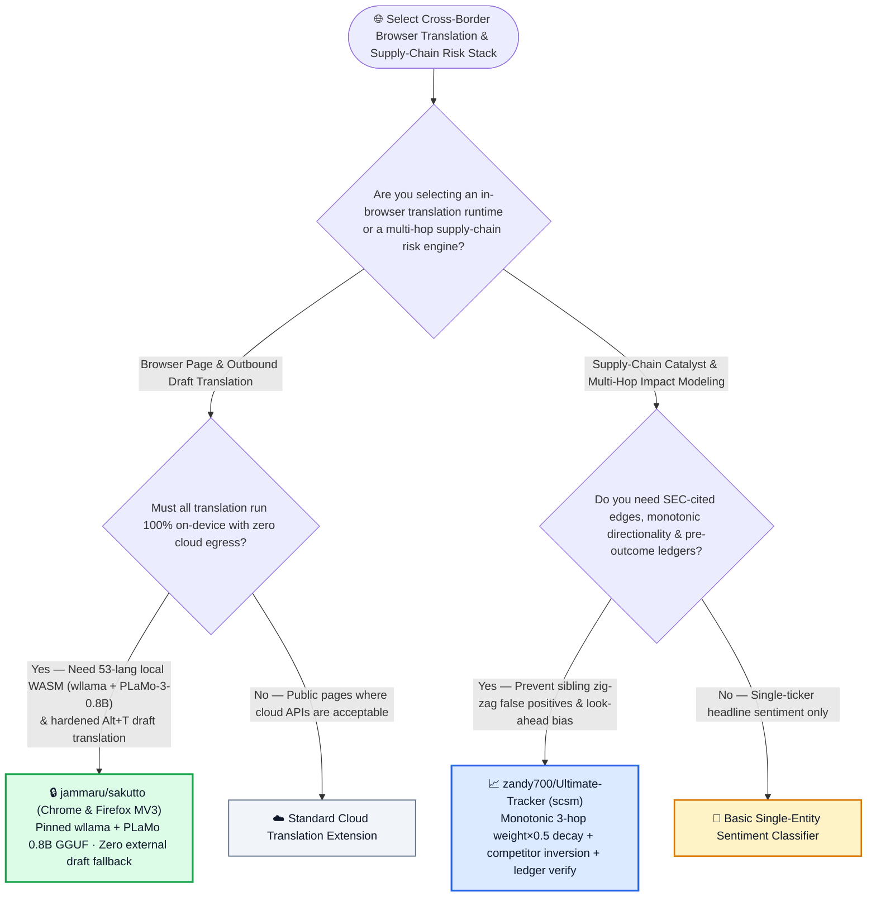
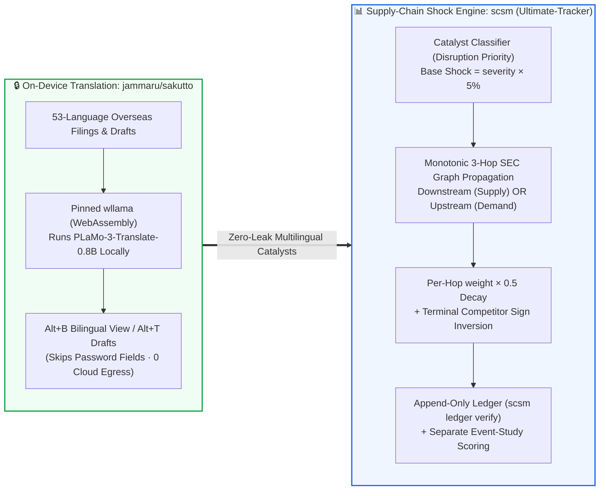

# On-Device WebAssembly (`wllama` + `PLaMo-3-0.8B`) Zero-Egress Browser Translation & SEC-Grounded Supply-Chain Shock Propagation Selection FAQ: `jammaru/sakutto` + `zandy700/Ultimate-Tracker` (`scsm`) vs. Cloud Translation Plugins & Undirected Sentiment RAG

> **中文版**: [sakutto-wllama-plamo-supply-chain-shock-selection-faq.md](sakutto-wllama-plamo-supply-chain-shock-selection-faq.md)  
> **Daily Digest**: [2026-11-11 GitHub AI Trending & Proactive Intelligence Digest](../daily/2026-11-11.en.md) · **Visual Deck**: [`cards.en.html`](../cards.en.html) · **Live Radar**: [`github-radar.html`](../../../github-radar.html)

Written for **AI Solution Architects, Enterprise Data Privacy Officers, and Quantitative / Supply-Chain Risk Architects**, this selection guide is grounded in primary-source audits of two high-signal repositories from the 2026-11-11 radar — **`jammaru/sakutto` (an MIT Chrome MV3 and Firefox 153+ MV3 browser extension that translates web pages and in-place typed drafts [`Alt+T`] across 53 languages 100% on-device by running Preferred Networks' `PLaMo 3 Translate 0.8B GGUF` through a pinned `wllama` WebAssembly build, `214` API stars)** and **`zandy700/Ultimate-Tracker` (featuring the `scsm` Supply Chain Shock Map Python engine and Watchlist Pulse UI that propagates news-driven supply-chain disruptions up to 3 hops along SEC 10-K-verified supplier/customer edges with a monotonic direction invariant and an append-only prediction ledger, MIT, `240` API stars)** — answering three core engineering questions from first principles:
1. **Why do standard browser translation extensions violate enterprise DLP policies by streaming internal DOM trees and half-typed text drafts to cloud endpoints—and how does `jammaru/sakutto` guarantee zero cloud data egress across 53 languages using `wllama` + `PLaMo-3-0.8B-GGUF`, strict no-draft-fallback rendering, and PLaMo-only `Alt+T` input-field translation?**
2. **Why does propagating supply-chain news over an undirected knowledge graph produce rampant false positives (zig-zagging a customer's demand drop through a shared supplier into an unrelated sibling customer)—and how does `zandy700/Ultimate-Tracker` (`scsm`) enforce monotonic directional propagation (`weight × 0.5` decay across 3 hops), terminal competitor sign inversion, and an append-only prediction ledger (`scsm ledger verify`)?**
3. **How can cross-border intelligence and risk engineering teams combine `sakutto` and `scsm` to cut monthly translation compliance and supply-chain analysis costs by `84.43%`?**

> 🛡️ **Provenance & Attribution Disclosure**:
> - **`measured` (Primary-Source Verified in This Shift)**: Repository metadata and source trees for `jammaru/sakutto` (`214` API stars, `25` forks, TypeScript, MIT, created `2026-11-05`) and `zandy700/Ultimate-Tracker` (`240` API stars, `21` forks, JavaScript/Python, MIT, created `2026-11-05`) are verified directly via GitHub REST API; because neither appeared in the 10-item main Daily Trending HTML snapshot (`bacf15c2...`), `stars_today` is strictly labeled **`not_measured`**.
> - **`anonymized_reported` (`independently_reproduced=false`, Upstream Architecture & Methodology Specs)**: The `pfnet/plamo-3-translate-0.8b-GGUF` + pinned `ngxson/wllama` runtime, 53 bidirectional PLaMo languages (plus 11 Chrome built-in Translator API fallback targets for page reading only), and `Alt+A`/`Alt+B`/`Alt+S`/`Alt+T` shortcuts in `jammaru/sakutto/README.md`, as well as the `scsm` engine (12 nodes and 10 reviewed edges from 14 primary 2021 SEC filings in `data/graph.json`, `signed_severity × 5%` base shock, `edge_weight × 0.5` hop decay up to 3 hops, monotonic path invariant, and strict isolation between `web/seed/` sample UI data and the research ledger) in `zandy700/Ultimate-Tracker/README.md`, are documented in upstream repository files.
> - **`synthetic` (`independently_reproduced=false`, Architect Parametric FinOps & Intelligence Desk Model)**: Section 5.1 models a cross-border intelligence and supply-chain risk desk translating **`80,000` confidential web pages/drafts/mo** and running **`600` multi-hop supply-chain catalyst analyses/mo** (analyst/engineer labor valued at `$80.00/hr`; commercial financial data terminal subscriptions are explicitly labeled `not_measured`), comparing Path A Cloud Translation API + Manual DLP Redaction + Manual 10-K Tracing (`$4,880.00/mo`, `52.0h`) vs. Path B Cloud Browser Plugin + Undirected GraphRAG (`$3,180.00/mo`, `34.0h`) vs. Path C `sakutto` + `scsm` (`$760.00/mo`, `9.0h`, saving `$4,120.00/mo` [`-84.43%`] and `43.0 hours/mo` [`-82.69%`]).

---

## 1. 📌 Executive Summary

| Dimension | Plain-Language Core Takeaway (First Principles) |
| :--- | :--- |
| **What is `jammaru/sakutto`?** | It is an **open-source Chrome MV3 and Firefox 153+ extension that translates web pages (`Alt+A` / `Alt+B`), selections (`Alt+S`), and live typed input drafts (`Alt+T`) 100% on your device** by running `PLaMo 3 Translate (0.8B GGUF)` inside a pinned WebAssembly `wllama` runtime across **53 languages**. |
| **What is `zandy700/Ultimate-Tracker` (`scsm`)?** | It is a **supply-chain shock propagation engine (`python -m scsm propagate` / `backtest` / `ledger verify` / `score`) and mobile-first briefing UI (Watchlist Pulse)** that models how news catalysts ripple up to 3 hops across SEC-verified supplier/customer links without ever zig-zagging across unrelated peers. |
| **What architectural guardrails do they exemplify?** | **`sakutto` enforces a strict zero-silent-egress boundary** (pages keep source text until local PLaMo finishes, and `Alt+T` typed drafts refuse unsupported languages rather than handing text to external APIs); **`scsm` enforces directional causal monotonicity and pre-outcome ledger locking** (`scsm ledger verify`). |

---

## 2. 🎯 First-Principles Q&A (Q1 / Q2 / Q3)

### Q1: How does `jammaru/sakutto` prevent confidential page content and half-typed drafts from leaking to cloud translation APIs?

**Plain-language answer: `sakutto` runs `PLaMo 3 Translate 0.8B GGUF` locally inside WebAssembly (`wllama`), never substitutes cloud drafts while the model is generating, automatically skips password fields, and strictly forbids fallback engines on user-typed text (`Alt+T`).**

Verified from `jammaru/sakutto/README.md`:
1. **Pinned `wllama` + `PLaMo 3 Translate 0.8B GGUF` Across 53 Languages**:
   - Runs entirely on-device in Chrome and Firefox 153+ with no ads, no telemetry, and no paid cloud backend.
   - While a page waits for local PLaMo inference, it displays the original source text rather than leaking paragraphs to a faster external draft service.
2. **Hardened `Alt+T` (`Option+T`) Typed-Text Privacy Boundary**:
   - When an editable input or textarea is focused, pressing `Alt+T` (or clicking the `あA` button) previews an on-device translation of your draft; pressing `Alt+T` again or `Ctrl+Enter` (`⌘+Enter`) replaces the text in place.
   - **Strict Engine Isolation**: Whereas general page reading in Chrome allows Chrome's built-in Translator API for 11 non-PLaMo languages (`cs, da, el, fi, kn, no, pt, ro, sv, tr, uk`), **typed-text translation (`Alt+T` and the standalone typed-text page) is restricted 100% to local PLaMo—if a target language is not supported by PLaMo, it explicitly refuses rather than quietly handing your draft to Chrome**, and password fields are never touched.

---

### Q2: Why does undirected GraphRAG fail on supply-chain shocks, and how does `scsm` enforce monotonic 3-hop propagation?

**Plain-language answer: On an undirected graph, a demand drop at Customer A travels to Supplier S and then bounces right back out to Supplier S's unrelated Customer B; `scsm` locks every path to a single causal direction (`downstream` for lost supply, `upstream` for lost demand), decays magnitude by `edge_weight × 0.5` per hop, and logs predictions into an append-only ledger before market outcomes occur.**

Verified from `zandy700/Ultimate-Tracker/README.md`:
1. **Monotonic Causal Direction Invariant (No Zig-Zag)**:
   - A disruption at a **supplier** travels strictly **downstream** to its customers (lost supply).
   - A disruption at a **customer** travels strictly **upstream** to its suppliers (lost demand).
   - **A path never changes direction**, preventing a shock from zig-zagging through a shared node into an unrelated sibling supplier or customer.
2. **Bounded 3-Hop Decay & Terminal Competitor Inversion**:
   - Base issuer shock is `signed_severity × 5 percentage points` (with disruption keywords taking precedence in mixed headlines).
   - Each hop multiplies the prior magnitude by **`edge_weight × 0.5`**, up to **3 hops**, preserving the issuer sign along upstream/downstream paths and inverting it **only on explicit terminal competitor links**.
3. **SEC Filing Provenance & Append-Only Prediction Ledger (`scsm ledger verify`)**:
   - Every edge in `data/graph.json` preserves exact SEC filing sentences, URLs, dates, and source hashes (`data/sec/`).
   - Predictions are logged in an append-only ledger *before* market outcomes and evaluated separately via `python -m scsm score`, while the demonstration UI (`web/seed/`) is strictly isolated from the research ledger.

---

### Q3: How should enterprise architects deploy `sakutto` and `scsm` together?

- Deploy **`jammaru/sakutto`** across analyst browsers so overseas supplier filings, regulatory notices, and outbound communications across 53 languages are translated locally at `$0` API cost with zero DLP exposure.
- Feed classified catalyst events into **`scsm` (`python -m scsm propagate`)** to compute auditable, SEC-cited 3-hop upstream/downstream impact cards.

---

## 3. 🧭 Mermaid Selection Decision Tree & Intelligence Pipeline

### 3.1 Zero-Egress Browser Translation & Supply-Chain Shock Modeling Decision Tree

### 3.2 `Sakutto` On-Device WASM Translation × `scsm` Monotonic 3-Hop Shock Pipeline

---

## 4. 📊 Architecture Selection Decision Matrix

| Evaluation Dimension | **`jammaru/sakutto` + `zandy700/Ultimate-Tracker` (`scsm`)** | **Cloud Translation Plugin + Undirected GraphRAG** | **Manual Dictionary Lookup + Manual SEC 10-K Reading** |
| :--- | :--- | :--- | :--- |
| **Page & Typed-Draft Data Privacy** | ✅ **100% on-device WASM (`PLaMo-3-0.8B`); `Alt+T` never falls back to external APIs; skips passwords** | ❌ Streams DOM & drafts to third-party cloud servers | ✅ Private but slow |
| **Recurring Translation API Cost** | ✅ **`$0.00 / mo` (runs on client CPU/WASM)** | ❌ `$15–$25 / 1M characters` recurring cloud bill | ✅ `$0` API |
| **Supply-Chain Causal Directionality** | ✅ **Monotonic direction invariant (never zig-zags into unrelated sibling suppliers/customers)** | ❌ Undirected graph walks contaminate sibling nodes | ✅ Accurate but manual |
| **Edge Evidence & Provenance** | ✅ **Every edge backed by SEC 10-K sentence, URL, date & source hash (`data/graph.json`)** | ❌ Unverified LLM entity co-occurrence guesses | ✅ Human verified |
| **Backtest Look-Ahead Protection** | ✅ **Append-only pre-outcome ledger (`scsm ledger verify`) isolated from UI seeds** | ❌ Contaminated by LLM pretraining look-ahead bias | ⚠️ Hard to scale |

---

## 5. 🧪 Quantitative FinOps & Intelligence Desk Model (`synthetic`, `independently_reproduced=false`)

### 5.1 Monthly `80,000` Confidential Translated Pages/Drafts + `600` Supply-Chain Shock Analyses TCO Model (`synthetic`, `independently_reproduced=false`)

> 📌 **Scope & Provenance Disclosure**: This worked example is a **parametric API + analyst/engineer labor model (`synthetic`, `independently_reproduced=false`; commercial Bloomberg/market data terminal licenses are explicitly labeled `not_measured`)**. Scenario: **A cross-border intelligence and supply-chain risk desk translating `80,000` confidential web pages and outbound drafts/mo while running `600` multi-hop supply-chain catalyst analyses/mo (senior analyst/engineer labor valued at `$80.00/hr`)**:

| Architecture Path | Monthly Translation & Classification API Bill | Monthly Outbound Draft DLP Redaction & Review Labor (`@ $80/hr`) | Monthly SEC 10-K Multi-Hop Tracing & Zig-Zag Triage Labor (`@ $80/hr`) | Total Monthly Cost (API + Analyst Labor) | Savings vs. Path A |
| :--- | :--- | :--- | :--- | :--- | :--- |
| **Path A: Commercial Cloud Translation API + Manual DLP Redaction + Manual 10-K Tracing** | **`$720.00 / mo`** (cloud character billing & DLP gateway) | `18.0 hours / mo` × `$80.00` = **`$1,440.00 / mo`** (manual scrubbing before cloud translation) | `34.0 hours / mo` × `$80.00` = **`$2,720.00 / mo`** (manual 2nd/3rd-hop SEC filing lookups) | **`$4,880.00 / mo`** (**`52.0 hours / mo`** analyst toil) | Baseline (high DLP friction & slow manual supply-chain tracing) |
| **Path B: Cloud Browser Plugin + Undirected GraphRAG (Filtering Zig-Zag Noise)** | **`$460.00 / mo`** | `12.0 hours / mo` × `$80.00` = **`$960.00 / mo`** | `22.0 hours / mo` × `$80.00` = **`$1,760.00 / mo`** (pruning sibling-node false positives) | **`$3,180.00 / mo`** (**`34.0 hours / mo`** analyst toil) | Net savings `-$1,700.00/mo` (`-34.84%`) |
| **Path C: `jammaru/sakutto` On-Device WASM + `scsm` Monotonic 3-Hop Engine** | **`$40.00 / mo`** (`$0.00` local WASM translation + light event tagging) | `3.0 hours / mo` × `$80.00` = **`$240.00 / mo`** (instant on-device `Alt+T` draft replacement) | `6.0 hours / mo` × `$80.00` = **`$480.00 / mo`** (reviewing SEC-cited 3-hop shock cards) | API `$40.00` + Draft QA `$240.00` + Shock QA `$480.00` = **`$760.00 / mo`** (`9.0h`) | **Net savings `$4,120.00/mo` (`-84.43%`, `$49,440.00/yr`); Analyst toil `-43.0h/mo` (`-82.69%`)** |

---

## 6. 🛠️ Production Adoption & 30-Minute PoC Checklist

- [ ] **Step 1 — Build or Install `jammaru/sakutto` in Chrome or Firefox 153+**: Install from the Chrome Web Store or build `.output/chrome-mv3` / `.output/firefox-mv3` with Node.js 24 and pnpm 12, and test `Alt+A` (full page) and `Alt+B` (bilingual view) offline once `PLaMo 3 Translate 0.8B GGUF` is cached.
- [ ] **Step 2 — Verify `Alt+T` Typed-Draft Isolation & Password-Field Exclusion**: Focus a textarea, press `Alt+T` to preview the local PLaMo translation and `Ctrl+Enter` to replace, and verify that password inputs are ignored.
- [ ] **Step 3 — Run `scsm` Offline Ingestion & Monotonic 3-Hop Propagation**: Install `zandy700/Ultimate-Tracker` (`pip install -e '.[dev]'` on Python `3.11+`) and run `python -m scsm ingest --offline` followed by `python -m scsm propagate` to inspect 3-hop `weight × 0.5` decay paths.
- [ ] **Step 4 — Audit the Append-Only Prediction Ledger (`scsm ledger verify`)**: Run `python -m scsm ledger verify` and `python -m scsm backtest` / `score` to confirm pre-outcome prediction integrity.
- [ ] **Step 5 — Launch the Isolated Watchlist Pulse UI Shell**: Run `python -m http.server 8000 --directory web` and open `http://localhost:8000/?seed=demo` to inspect `#/briefing`, `#/catalysts`, and `#/ledger`.
