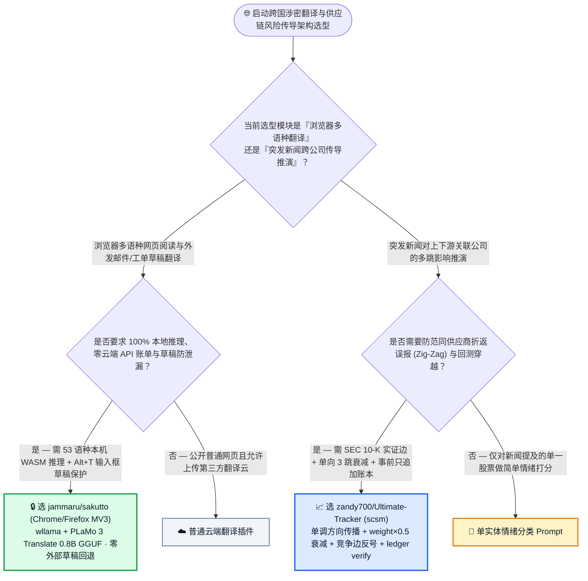
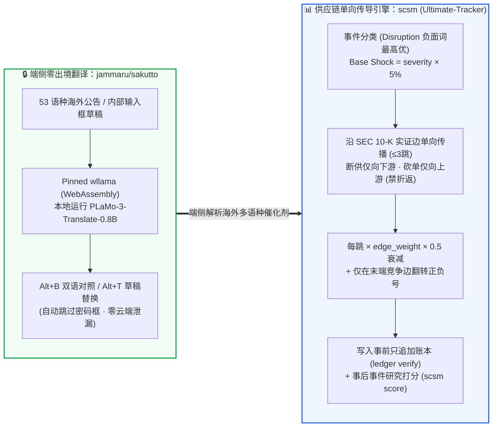

# 浏览器端侧 WebAssembly (`wllama` + `PLaMo-3-0.8B`) 零出境翻译与新闻驱动供应链多跳冲击传导选型常见问题解答：`jammaru/sakutto` + `zandy700/Ultimate-Tracker` (`scsm`) vs 云端翻译插件 & 无向图情绪打分

> **English Edition**: [sakutto-wllama-plamo-supply-chain-shock-selection-faq.en.md](sakutto-wllama-plamo-supply-chain-shock-selection-faq.en.md)  
> **关联日报**: [2026-11-11 GitHub AI 最热榜单与情报摘要](../daily/2026-11-11.md) · **视觉评测卡**: [`cards.html`](../cards.html) · **在线面板**: [`zh-github-radar.html`](../../../zh-github-radar.html)

本文档面向 **AI Solution Architect（AI 解决方案架构师）、企业数据合规负责人与金融/供应链风控架构师**，基于 2026-11-11 GitHub 新仓爆发榜两款直击“浏览器端侧隐私推理”与“结构化因果传导建模”的标杆项目 —— **`jammaru/sakutto`（基于锁定版 `wllama` 在 Chrome MV3 与 Firefox 153+ 本机运行 Preferred Networks `PLaMo 3 Translate 0.8B GGUF` 模型、支持 53 语种双向网页与输入框草稿 `Alt+T` 零出境翻译的开源扩展，MIT，建仓 6 天 `214★`）** 与 **`zandy700/Ultimate-Tracker`（底层搭载 `scsm` Supply Chain Shock Map 引擎，基于 SEC 10-K 实证供应商/客户边执行单调方向 3 跳指数衰减冲击传导与事前只追加预测账本 `ledger verify` 的风险推演系统，MIT，建仓 6 天 `240★`）** 的一手源码与文档深度核验，用通俗大白话与第一性原理解答：
1. **为什么企业严禁员工在浏览内网工单、海外专利或撰写跨国邮件草稿时使用普通双语翻译插件？`jammaru/sakutto` 是如何通过「WebAssembly (`wllama`) 本机跑 `PLaMo-3-0.8B-GGUF` + 输入框打字翻译（`Alt+T`）100% 物理阻断外部引擎回退 + 自动跳过密码框」实现零数据出境的？**
2. **当某家上游芯片代工厂突发停产或某家终端巨头大幅砍单时，为什么用普通无向知识图谱或大模型直接猜“哪些关联公司受影响”，会把无辜的兄弟供应商也判成暴跌（Zig-Zag 折返假阳性）？`zandy700/Ultimate-Tracker` (`scsm`) 是如何用「单调方向铁律（A path never changes direction）+ `weight × 0.5` 三跳衰减 + 仅在末端竞争边翻转正负号 + 事前只追加账本」锁死量化严谨性的？**
3. **在跨国投研与企业供应链情报工作台中，如何将这两款工具组合为“53 语种海外信源本机私密精读 → 单向 3 跳供应链冲击推演”的标准闭环？**

> 🛡️ **数据来源、归属核验与证据分级声明（Provenance & Attribution Disclosure）**：
> - **`measured`（本班次一手实测抓取）**：`jammaru/sakutto`（`214` API Stars，`25` Forks，TypeScript，MIT，创建于 `2026-11-05`）与 `zandy700/Ultimate-Tracker`（`240` API Stars，`21` Forks，JavaScript/Python，MIT，创建于 `2026-11-05`）均通过 GitHub REST API 源码树与 README 一手核验；两者不在主日榜 24h DOM 快照内，故 `stars_today` 严格标注为 **`not_measured`**。
> - **`anonymized_reported`（`independently_reproduced=false`，上游仓库技术规格与研究方法声明）**：`jammaru/sakutto` 披露的 `pfnet/plamo-3-translate-0.8b-GGUF` + `ngxson/wllama` 架构、53 语种双向本机支持（加上 Chrome 下 11 个小语种内置 API 补充）、以及 `Alt+A`/`Alt+B`/`Alt+S`/`Alt+T` 快捷键体系；`zandy700/Ultimate-Tracker` 披露的 `scsm` Python 引擎（14 份 2021 SEC 财报提取的 12 节点 10 条实证边 `data/graph.json`、基础冲击 `signed_severity × 5%`、每跳 `edge_weight × 0.5` 最高 3 跳、单向不折返规则、以及演示 UI 种子数据与真实研究账本的严格隔离）。
> - **`synthetic`（`independently_reproduced=false`，架构师参数化 FinOps 与研判工时算例）**：第 5.1 节「跨国情报与供应链风控团队每月翻译审阅 `80,000 页` 涉密多语种网页/外发草稿 + 执行 `600 次` 供应链突发事件上下游传导推演（分析师/工程师综合时薪 `$80.00/h`；商业金融终端订阅费明确标注为 `not_measured`）」的闭式成本对比（Path A 商用云翻译 API + 人工脱敏 + 人工翻 10-K 追上下游 `$4,880.00/月` vs Path B 普通云翻译插件 + 无方向约束图谱排障 `$3,180.00/月` vs Path C `sakutto` + `scsm` `$760.00/月`，净省 `$4,120.00/月` [`-84.43%`] 与 `43.0 小时/月` [`-82.69%`] 工时）。

---

## 1. 📌 核心结论速览（Executive Summary）

| 评估维度 | 一句话大白话核心结论（直指本质） |
| :--- | :--- |
| **`jammaru/sakutto` 到底是个什么东西？** | 它是一款**100% 在你电脑浏览器本地运行 `PLaMo 3 Translate (0.8B GGUF)` 翻译专用小模型的 Chrome / Firefox 开源插件**：通过锁定的 `wllama`（WebAssembly 版 `llama.cpp`）引擎，不用调任何云端 API 就能双向互译 **53 种语言**，支持双语对照（`Alt+B`）和**输入框打字实时本地翻译（`Alt+T`）**！ |
| **`zandy700/Ultimate-Tracker` (`scsm`) 到底是什么？** | 它是一套**用 SEC 原始财报证据建图、按“断供往下游传、砍单往上游传、严禁半路折返”规则推演新闻事件如何沿供应链扩散 3 跳**的量化事件研究引擎（`python -m scsm propagate`）与关注列表脉冲看板（Watchlist Pulse）。 |
| **这两者分别确立了什么架构设计标杆？** | **`sakutto` 确立了端侧 AI 插件的“零静默降级隐私铁律”**（模型没跑完前只显示原文，且用户在输入框写的草稿绝不交给外部翻译器）；**`scsm` 确立了金融/产业知识图谱的“单调因果传播与事前不可篡改账本铁律”**（杜绝无向图折返噪声与回测数据穿越）！ |

---

## 2. 🎯 第一性原理灵魂三问（Q1 / Q2 / Q3 大白话拆解）

### Q1：为什么企业在浏览器翻译上最怕“静默云端回退”？`jammaru/sakutto` 是怎么把隐私边界焊死的？

**先说大白话结论：很多打着“本地 AI”旗号的插件，一旦遇到本地模型加载慢或语种不支持，就会在后台悄悄把你的内网页面或正在敲的邮件草稿发给云端翻译接口——而 `sakutto` 宁可保持原文或显式拒止，也绝不越界半步！**

根据 `jammaru/sakutto` 官方架构设计，其三大隐私与交互护栏极其严谨：
1. **`wllama` + `PLaMo 3 Translate 0.8B GGUF` 53 语种纯本机推理**：
   - 将 Preferred Networks 专为翻译训练的 `0.8B` 紧凑模型通过 WebAssembly 在浏览器沙盒内直接运行，零服务器成本、零广告、零遥测。
   - **等待期零外部草稿（No Draft Fallback）**：当页面正在等待本地 PLaMo 模型生成译文时，未完成段落严格保持原始文本，绝不先调另一个在线引擎垫底。
2. **输入框打字翻译（`Alt+T` / `あA`）的最高安全等级**：
   - 当焦点位于网页输入框、工单回复框或邮件编辑器时，按 `Alt+T`（Mac 为 `Option+T`，Firefox 为 `Alt+Shift+T`）即可在本地预览当前输入草稿的译文，再按一次或按 `Ctrl+Enter` 直接替换，且**自动忽略所有密码框（Password fields）与黑名单站点**。
   - **最硬核的边界**：在网页阅读模式下，Chrome 允许对 PLaMo 53 语种之外的 11 个语种（如捷克语、丹麦语、土耳其语等）调用 Chrome 内置 Translator API；但在 **Typed Text（用户自己打字的草稿）模式下，一律 100% 强制只用本地 PLaMo 模型——如果选了那 11 个不支持的语种，页面直接拒绝翻译，绝不悄悄转交给浏览器内置接口**！

---

### Q2：为什么无向图 RAG 做供应链冲击推演必出假阳性？`scsm` 的「单调方向 3 跳衰减」到底是怎么算的？

**先说大白话结论：假设台积电（供应商 S）同时给苹果（客户 A）和某车企（客户 B）代工——如果苹果手机销量下滑砍单（冲击从客户 A 传向供应商 S），普通无向图会顺着 S 继续把冲击传给车企 B，得出“苹果砍单导致车企 B 缺芯暴跌”的荒谬结论！**

根据 `zandy700/Ultimate-Tracker` (`scsm`) 的核心传播算法：
1. **单调方向传播铁律（Monotonic Direction — No Zig-Zag）**：
   - **供应商发生断供/火灾（Supplier Disruption）**：冲击只能沿着 **`供应商 → 客户 → 下游客户`（Downstream，失去供给）** 方向一路向下游传；
   - **客户发生砍单/需求萎缩（Customer Disruption）**：冲击只能沿着 **`客户 → 供应商 → 上游原材料`（Upstream，失去需求）** 方向一路向上游传；
   - **一条传播路径中途绝对不允许改变方向（A path never changes direction）**！因此客户 A 的需求冲击传到供应商 S 后只能继续往 S 的上游传，绝不会折返感染 S 的另一个平行客户 B！
2. **三跳指数衰减公式与末端竞争对手符号翻转**：
   - 当事公司基础冲击幅度：`Base Shock = signed_severity × 5 percentage points`（在混合正负面词汇的新闻标题中，Disruption 负面词强制享有最高优先级）；
   - 每经过一跳 SEC 实证边，冲击幅度按 **`prior_magnitude × edge_weight × 0.5`** 衰减，最多传播 **3 跳（Up to 3 hops）**；
   - 沿上下游供应链传导时保持正负号不变（一荣俱荣、一损俱损），**唯独在末端显式标注的“竞争对手边（Terminal Competitor Link）”上将正负号反转（对手断供利好本方）**！
3. **SEC 原文证据锁定 + 事前只追加预测账本（Append-Only Ledger）**：
   - 图谱中的每条边都必须附带 SEC 10-K 原始财报中的证据原句、URL、日期与源码 Hash（剔除模糊简称匹配）；且每次预测在市场结果出来前先写入只追加账本（`python -m scsm ledger verify`），事后再用事件研究法（`python -m scsm score`）独立打分，而且前端演示壳（`web/seed/`）与真实研究账本严格隔离，绝不混用。

---

### Q3：架构师该如何组合使用这两套工具？

- **跨国供应链与竞品情报工作台**：在分析团队浏览器统一部署 **`jammaru/sakutto`**（将日文、韩文、德文、法文等 53 语种海外供应商公告与财报新闻在端侧零出境翻成双语对照），提取出的结构化催化剂事件直接送入 **`scsm` 单向 3 跳传导引擎**，秒级生成带 SEC 证据链的关注列表风险简报！

---

## 3. 🧭 Mermaid 选型决策树与端到端情报研判架构图

### 3.1 涉密网页翻译与供应链风险传导建模选型决策树（Decision Tree）

### 3.2 `Sakutto` 端侧 53 语种翻译 × `scsm` 单向 3 跳供应链传导流水线图

---

## 4. 📊 同类方案全方位选型决策矩阵（Decision Matrix）

| 评估维度 | **`jammaru/sakutto` + `zandy700/Ultimate-Tracker` (`scsm`)** | **商业云端翻译插件 + 无方向约束 GraphRAG** | **人工本地词典查词 + 人工翻阅 SEC 10-K 财报** |
| :--- | :--- | :--- | :--- |
| **网页与输入框草稿隐私安全** | ✅ **53 语种 100% 本地 WASM 推理；`Alt+T` 草稿严禁转交外部接口；自动跳过密码框** | ❌ 全量 DOM 与输入框内容上传第三方云端服务器 | ✅ 安全但效率极低 |
| **持续翻译 Token / API 成本** | ✅ **`$0.00 / 月`（纯客户端 CPU/WASM 算力）** | ❌ 按字符量持续计费（`$15 ~ $25 / 1M chars`） | ✅ `$0` API |
| **供应链传导方向与防折返机制** | ✅ **强制单调方向（断供往下游、砍单往上游，永不折返感染平行同行）** | ❌ 无向图遍历会把客户砍单顺着供应商折返传给无关同行 | ✅ 逻辑准确但覆盖慢 |
| **关系边证据溯源度** | ✅ **每条边绑定 SEC 10-K 原句、URL、日期与源码 Hash（剔除模糊匹配）** | ❌ LLM 凭记忆臆造上下游关系，缺乏时点证据 | ✅ 人工核对 |
| **回测防穿越与预测审计** | ✅ **事前写入只追加账本（`ledger verify`）与事后打分（`score`）物理分离** | ❌ 常受大模型训练语料后视偏差（Look-Ahead Bias）污染 | ⚠️ 缺乏自动化统计回测 |

---

## 5. 🧪 定量算例与 7-Card 评测洞察（Quantitative Example & 7-Card Insights）

### 5.1 月翻 80,000 页涉密外文页面/草稿 + 600 次供应链多跳冲击推演闭式成本算例（`synthetic`，`independently_reproduced=false`）

> 📌 **透明口径与边界声明（Scope & Provenance）**：本算例为架构师评估跨国情报桌面与供应链风控推演的 **API + 分析师/工程师脱敏与核对工时参数化算例（`synthetic` model；底层 Bloomberg/Wind 等商业行情终端固定年费明确标注为 `not_measured`）**。场景设定为：**跨国制造与投研团队每月需双语翻译审阅 `80,000 页` 海外多语种公告与外发沟通草稿，并对 `600 起` 供应链催化剂事件执行上下游 3 跳传导推演（资深分析师/工程师综合时薪按 `$80.00 / 小时` 计算）**：

| 方案路径 | 每月翻译与事件分类 API 账单 | 每月外发草稿人工脱敏与术语修正工时 (`@ $80/h`) | 每月人工翻 10-K 追查上下游与剔除折返误报工时 (`@ $80/h`) | 每月总综合成本（API + 分析师/工程工时） | 相对 Path A 降本增效幅度 |
| :--- | :--- | :--- | :--- | :--- | :--- |
| **Path A：商用云翻译 API + 人工脱敏 + 人工翻 SEC 10-K 追上下游** | **`$720.00 / 月`** （云端字符计费与 DLP 网关开销） | `18.0 小时 / 月` × `$80.00` = **`$1,440.00 / 月`**（外发敏感草稿手工替换脱敏） | `34.0 小时 / 月` × `$80.00` = **`$2,720.00 / 月`**（人工翻阅财报查找二三跳客户） | **`$4,880.00 / 月`** （耗费 **`52.0 小时 / 月`** 工时） | 基线（云端翻译合规成本高，人工追多跳传导极慢） |
| **Path B：普通云插件 + 无方向约束图谱（排查折返误报）** | **`$460.00 / 月`** | `12.0 小时 / 月` × `$80.00` = **`$960.00 / 月`** | `22.0 小时 / 月` × `$80.00` = **`$1,760.00 / 月`**（人工剔除无向图折返污染的假阳性） | **`$3,180.00 / 月`** （耗费 **`34.0 小时 / 月`** 工时） | 综合降本 `-$1,700.00/月` (`-34.84%`) |
| **Path C：`jammaru/sakutto` 端侧 WASM + `scsm` 单向 3 跳图谱** | **`$40.00 / 月`** （端侧翻译 **`$0.00`** + 轻量事件分类） | `3.0 小时 / 月` × `$80.00` = **`$240.00 / 月`**（`Alt+T` 本机零出境实时翻译草稿） | `6.0 小时 / 月` × `$80.00` = **`$480.00 / 月`**（审阅带 SEC 原句引用的 3 跳传导卡） | API `$40.00` + 草稿审校 `$240.00` + 传导复核 `$480.00` = **`$760.00 / 月`** (`9.0h`) | **月度净省 `$4,120.00/月` (`-84.43%`，年省 `$49,440.00`)；研判工时省 `43.0h/月` (`-82.69%`)** |

---

## 6. 🛠️ 架构师生产落地与 30 分钟 PoC 核验清单（Production & PoC Checklist）

- [ ] **Step 1 — 在 Chrome 或 Firefox 153+ 部署 `jammaru/sakutto` 本地翻译扩展**：从 Chrome Web Store 安装或克隆仓库运行 `pnpm install` 构建 `.output/chrome-mv3`（或 `.output/firefox-mv3`），首次加载 `PLaMo 3 Translate 0.8B GGUF` 权重后断网测试 `Alt+A`（整页翻译）与 `Alt+B`（双语对照），验证 100% 本地 WASM 离线可用。
- [ ] **Step 2 — 验证 `Alt+T` 输入框草稿翻译的严格本地边界与密码框豁免**：在任意网页文本框聚焦按 `Alt+T` 预览本地译文并按 `Ctrl+Enter` 替换，确认密码框被自动跳过且不支持语种不会悄悄回退外部服务。
- [ ] **Step 3 — 安装 `Ultimate-Tracker` (`scsm`) 研究引擎并跑通离线传导**：在 Python `3.11+` 下执行 `pip install -e '.[dev]'`，依次运行 `python -m scsm ingest --offline` 与 `python -m scsm propagate`，检查生成的冲击路径是否严格遵守“单向不折返”与 `weight × 0.5` 三跳衰减。
- [ ] **Step 4 — 执行 `scsm ledger verify` 与 `scsm score` 验证事前账本完整性**：运行 `python -m scsm ledger verify` 校验只追加预测账本的哈希与时间戳完整性，并运行 `python -m scsm backtest` / `score` 查看事件研究法评估结果。
- [ ] **Step 5 — 启动 Watchlist Pulse 移动端/桌面端自适应演示看板**：运行 `python -m http.server 8000 --directory web` 并打开 `http://localhost:8000/?seed=demo`，确认演示种子数据（`web/seed/`）与真实研究账本严格隔离，体验 `#/briefing`、`#/catalysts` 与 `#/ledger` 视图。
