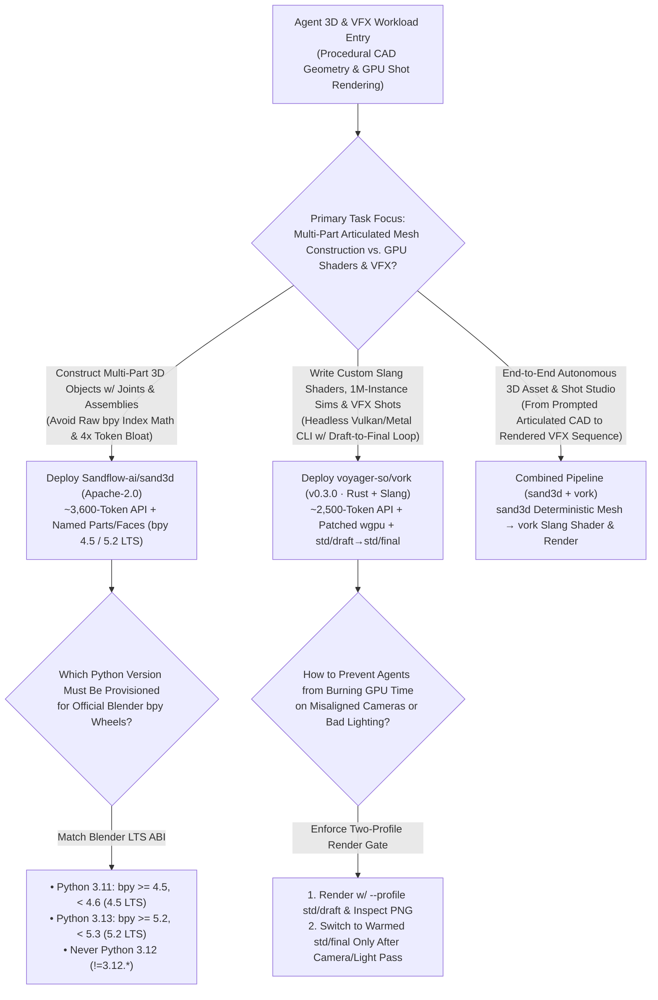
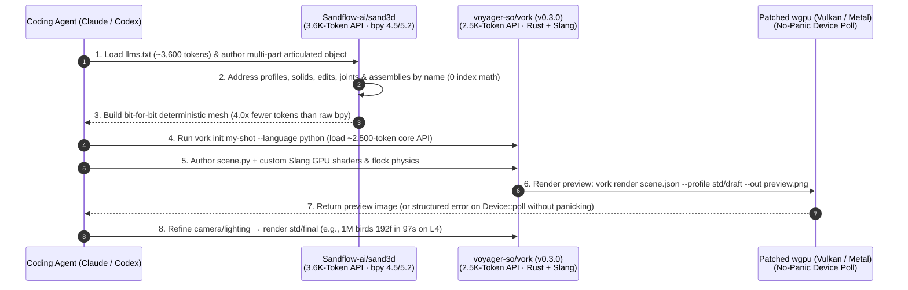

# LLM-Native 3D CAD Modeling & Headless Rust/Slang VFX Engine Selection FAQ: `Sandflow-ai/sand3d` + `voyager-so/vork` (`v0.3.0`) vs. Raw Blender `bpy` Coordinate Scripting & Heavy GUI Renderers

> **Document Scope**: A first-principles architecture and FinOps selection guide for AI Solution Architects, Spatial Computing / Digital-Twin Engineers, and Procedural 3D/VFX Pipeline Leads. Focusing on two standout agent-native 3D and VFX repositories from the `2026-11-09` GitHub AI Radar — **`Sandflow-ai/sand3d`** (Apache-2.0, **1,603 Stars** / **1,604 Stars** live API in 6 days, **`267 Stars/day`** lifecycle velocity, `stars_today = not_measured`) and **`voyager-so/vork`** (`v0.3.0`, Rust 2024 + Slang, **1,271 Stars** / **1,272 Stars** live API in 4 days, **`318 Stars/day`** lifecycle velocity, `stars_today = not_measured`) — this guide dissects how a **`3,600`-Token Named-Part 3D Modeling DSL (`4.0x` fewer tokens than raw Blender Python)** and a **`2,500`-Token Headless Rust/Slang/wgpu VFX Engine (rendering 1,000,000 birds in `97s` on 1× L4 GPU)** eliminate vertex-index hallucinations, shader panics, and GUI rendering bottlenecks.
>
> **Navigation**: [中文版 (`sand3d-vork-agent-3d-vfx-engine-selection-faq.md`)](./sand3d-vork-agent-3d-vfx-engine-selection-faq.md) · [2026-11-09 Daily Radar](../daily/2026-11-09.en.md) · [Back to Radar Index](../README.en.md)

---

## 📌 1. Executive Summary

1. **First-Principles Definition**:
   - **`Sandflow-ai/sand3d` (Python `3.11` w/ `bpy 4.5 LTS` & Python `3.13` w/ `bpy 5.2 LTS`, Apache-2.0)** is a declarative Python 3D modeling library purpose-built for LLMs over Blender's `bpy`. It expresses 3D objects through six compact primitives — **`profiles`, `solids`, `edits`, `frames`, `joints`, and `assemblies`** — where **parts, edges, and faces are addressed by semantic name rather than hand-computed coordinates or vertex indices**. The **entire API fits in `~3,600 tokens` (`llms.txt`)**, produces bit-for-bit deterministic meshes, and requires **`4.0x` fewer tokens per part than raw Blender Python** (`2.3x` fewer than CadQuery, `6.0x` fewer than FeatureScript, `2.0x` fewer than Articraft SDK; `anonymized_reported (independently_reproduced=false)`).
   - **`voyager-so/vork` (`v0.3.0`, Rust 2024 + Slang shaders + patched `wgpu` on Vulkan/Metal)** is a headless GPU 3D and VFX engine built for AI agents. Its **core API fits in `~2,500 tokens`**, allowing agents to write entire scenes (`scene.json`, `scene.ts`, `scene.py`) **including custom Slang GPU shaders, materials, ray queries, cameras, and physics** mid-shot. On a single NVIDIA L4 GPU, `vork` renders a **1,000,000-bird murmuration (`192` frames at 1080p) in `97 seconds`** compared to Blender EEVEE's projected `13–18 minutes` (**`8x–11x` faster** on massive instanced simulations, and `1.1x–2.3x` faster on default stills/movies; `anonymized_reported (independently_reproduced=false)`).
2. **Core Architectural Insight (Why Raw Blender `bpy` & GUI Renderers Fail When Driven by AI Agents)**:
   - **Failure Mode #1 (Raw `bpy` Vertex-Index Shift & 4x Token Bloat)**: Raw Blender `bpy` and CAD macros rely on fragile numeric face/edge indices (e.g., `bm.faces[17]`) and manual 3D trigonometry. When an LLM modifies an upstream bevel or boolean cut, every downstream face index shifts, forcing 5+ debugging turns. `sand3d` addresses every topological feature by name (`Named, Not Computed`) inside a `3,600`-token API spec.
   - **Failure Mode #2 (GUI Overhead & Unhandled GPU Device-Loss Panics)**: Traditional 3D tools assume a human operating a viewport, and standard `wgpu` builds panic on GPU timeouts when an agent writes an experimental shader. `vork` runs 100% headlessly via CLI (`--profile std/draft` → inspect → `std/final`) and patches `vendor/wgpu` so `Device::poll` returns device loss as a recoverable error rather than panicking.
3. **30-Second Selection Rule**:
   - Choose **`Sandflow-ai/sand3d`** when an LLM needs to **author multi-part, articulated 3D objects (`joints` + `assemblies`) in a few hundred tokens with bit-for-bit mesh determinism**.
   - Choose **`voyager-so/vork` (`v0.3.0`)** when an agent needs to **write custom GPU shaders (Slang), ray queries, large-scale particle/flock simulations, and render VFX shots headlessly on Vulkan/Metal**.
   - Combine **Both (`sand3d` Geometry + `vork` Shader/VFX Rendering)** for an end-to-end 3D asset & shot pipeline: generate named-part articulated geometry in `sand3d`, then import into `vork` for custom Slang lighting, physics, and fast GPU rendering.

---

## 🎯 2. Architect's First-Principles Deep Dive (Q1 / Q2 / Q3)

### Q1: How does `Sandflow-ai/sand3d` cut per-part modeling tokens by 4.0x against Blender `bpy` (and 6.0x against FeatureScript) while guaranteeing bit-for-bit mesh reproducibility?

Inspecting `pyproject.toml`, `llms.txt`, and `README.md` in `Sandflow-ai/sand3d` highlights three architectural choices:

1. **Full API Fits in One Prompt (`~3,600 Tokens`)**:
   - Instead of exposing thousands of stateful `bpy.ops` operators that depend on active GUI window context, `sand3d` distills 3D construction into `profiles`, `solids`, `edits`, `frames`, `joints`, and `assemblies`. Because the entire specification fits in `~3,600` tokens, an LLM never has to guess function signatures.
2. **Named Topological References (`Named, Not Computed`)**:
   - Every part, face, and edge is referenced by human-readable semantic name rather than hand-computed `(x, y, z)` coordinates or array indices. Across Sandflow's per-part median benchmark (`tokens.html`, `anonymized_reported`), equivalent parts take **4.0×** more tokens in Blender Python, **2.3×** in CadQuery, **6.0×** in FeatureScript, and **2.0×** in Articraft SDK.
3. **Strict Blender LTS CPython ABI Pinning (`pyproject.toml`)**:
   - Enforces `requires-python = ">=3.11,!=3.12.*,<3.14"`, pairing **Python `3.11` with `bpy >= 4.5, < 4.6` (4.5 LTS)** and **Python `3.13` with `bpy >= 5.2, < 5.3` (5.2 LTS)** (explicitly excluding `3.12` which has no LTS `bpy` release), ensuring bit-for-bit identical mesh generation across machines.

### Q2: Why did `voyager-so/vork` (`v0.3.0`) build a custom Rust + Slang engine with patched `wgpu`, and how does it render 1,000,000 birds in 97 seconds on an L4 GPU?

Inspecting `Cargo.toml` (`v0.3.0`) and `vendor/` in `voyager-so/vork` reveals three purpose-built mechanisms:

1. **`~2,500`-Token Core API with Mid-Shot Agent Shader Authoring**:
   - While human editors expose fixed sliders, coding agents can write custom GPU code on the fly. `vork` provides geometry, ray queries, and GPU execution primitives, letting `scene.json` / `scene.ts` / `scene.py` programs define custom **Slang** shaders, materials, cameras, light propagation, simulation, and compositing.
2. **Four Hardened `vendor/` GPU Patches (`Cargo.toml` `[patch.crates-io]`)**:
   - **`vendor/wgpu`**: Reports a lost device from `Device::poll` as an error instead of panicking, allowing agents to recover gracefully from buggy shaders;
   - **`vendor/wgpu-hal`**: Preserves invariant positions in Metal passthrough shaders for cross-platform determinism;
   - **`vendor/exr`**: Bounds OpenEXR DWA chunk section sizes before allocating memory;
   - **`vendor/basisu_c_sys`**: Skips discarded Basis statistics to accelerate ASTC texture preparation.
3. **Draft-to-Final Visual Self-Correction Loop (`--profile std/draft` → `std/final`)**:
   - Agents initialize a shot (`vork init my-shot`), render a fast preview (`--profile std/draft`), visually inspect `render.png` to refine camera and lighting, and render at `std/final` — achieving **`97 seconds` on 1× L4** for the 192-frame 1,000,000-bird murmuration (`8x–11x` faster than EEVEE's projected `13–18 minutes`).

### Q3: When should a spatial AI team use `Sandflow-ai/sand3d` vs. `voyager-so/vork`?

- **Use `Sandflow-ai/sand3d`** for **parametric CAD, articulated appliances/robots (`joints` + `assemblies`), and clean manifold mesh synthesis**.
- **Use `voyager-so/vork` (`v0.3.0`)** for **procedural GPU shaders, million-instance simulations, lighting/camera look-dev, and headless Vulkan/Metal batch rendering**.

---

## 🧭 3. Mermaid Decision Tree & Execution Sequence

### 3.1 Agent 3D Modeling & Headless VFX Decision Tree

### 3.2 End-to-End Execution Sequence (`sand3d` Named DSL + `vork v0.3.0` Headless GPU)

---

## 📊 4. Comparison Matrix Across 3D & VFX Agent Tooling

| Dimension | `Sandflow-ai/sand3d` (`Apache-2.0`) | `voyager-so/vork` (`v0.3.0`, Rust + Slang) | Raw Blender Python (`bpy`) / CadQuery / FeatureScript | GUI-Driven Blender EEVEE / Legacy Game Engines |
| :--- | :--- | :--- | :--- | :--- |
| **Core Scope** | **LLM-native declarative 3D CAD, joints & assemblies over `bpy`** | **Headless GPU 3D scene, Slang shader & VFX engine for agents** | Human/macro-oriented imperative 3D scripting APIs | Interactive GUI editors designed for human mouse control |
| **API Context Size** | **`~3,600 tokens` (entire API fits in 1 prompt)** | **`~2,500 tokens` (core engine API fits in 1 prompt)** | Tens of thousands of tokens across fragmented docs | Massive surface area unsuitable for single-prompt context |
| **Tokens per Part (Median)** | **`1.0x` baseline (semantic named topology)** | Compact `scene.json` / `.ts` / `.py` descriptions | **`4.0x` in `bpy`, `2.3x` in CadQuery, `6.0x` in FeatureScript** | Verbose project/scene serialization files |
| **Instanced VFX Render Speed** | Deterministic mesh compilation | **`97s` on 1× L4 for 1M birds (192f 1080p; `8–11x` vs. EEVEE)** | Mesh generation only | Projected **`13–18 minutes`** in EEVEE at matching samples |
| **Resilience & Determinism** | **Bit-for-bit deterministic meshes**; zero face-index drift | **Patched `wgpu` no-panic device poll** + `std/draft` preview loop | Upstream edits invalidate downstream numeric face indices | Shader bugs or headless context loss crash the process |

---

## 🧪 5. Closed-Form FinOps Worked Example & 7-Card Insights

### 5.1 Monthly 3D Asset Synthesis & Headless VFX Rendering Cost Model (`synthetic (independently_reproduced=false)`)

> **Provenance Notice**: This closed-form calculation is a synthetic architectural model (`synthetic (independently_reproduced=false)`) comparing **Path A (Raw Blender `bpy` Coordinate Scripting + Unoptimized Headless EEVEE Rendering)** against **Path B (`Sandflow-ai/sand3d` 3.6K-Token Named DSL + `voyager-so/vork` v0.3.0 Rust/Slang Engine)**. Per-part token ratios (`4.0x` / `2.3x` / `6.0x`) and the 1M-bird L4 render benchmark (`97s` vs. `13–18m`) are labeled `anonymized_reported (independently_reproduced=false)`; commercial DCC software licenses (Maya/Houdini) and offline path-tracing farms are explicitly marked `not_measured`.

**Workload Parameters**:
- **3D Asset Generation Volume**: **`300` multi-part articulated 3D assets/month**; frontier LLM priced at **`$2.50 / 1M` input tokens** and **`$10.00 / 1M` output tokens**.
- **Headless VFX Shot Volume**: **`120` 1080p (192-frame) procedural VFX shots/month**.
- **3D Technical Artist Remediation Labor**: Manual vertex-index fixing and shader debugging valued at **`$60.00 / hour`**.

| Cost Component | Path A: Raw Blender `bpy` + Unoptimized EEVEE | Path B: `sand3d` Named DSL + `vork v0.3.0` | Governing Engineering Mechanism |
| :--- | :--- | :--- | :--- |
| **1. 300 Multi-Part 3D Asset LLM Token Cost** | **$138.00 / mo** (4x verbose code + 5 index-fix turns: `120K` in + `16K` out = `$0.460/asset` × `300`) | **$24.00 / mo** (`3.6K` API + named topology in 2 turns: `20K` in + `3K` out = `$0.080/asset` × `300`) | `sand3d` cuts per-part code tokens by **4.0x** and eliminates index-shift retries (**-82.6%** token cost) |
| **2. 120 192-Frame VFX Shots GPU Render & Retry Cost** | **$180.00 / mo** (Slow EEVEE runs & shader-panic retries = `$1.50/shot` × `120`) | **$24.00 / mo** (`std/draft` preview + fast Rust/Slang L4 render = `$0.20/shot` × `120`) | `vork` renders instanced/shader scenes **1.1x–11x faster** with no-panic `wgpu` recovery |
| **3. 3D Technical Artist Index & Shader Fix Labor (`@$60/hr`)** | **$3,600.00 / mo** (`12 min/asset` manual coordinate/shader fixes × `300` = **`60.0 hours/mo`**) | **$360.00 / mo** (Bit-for-bit named meshes + `std/draft` visual loop = **`6.0 hours/mo`**) | Named topological addressing & draft preview loop save **`54.0 hours/mo` (-90.0% labor)** |
| **4. Commercial Maya/Houdini Seats & Offline Render Farms** | `not_measured` | `not_measured` | Proprietary DCC seats and offline farms are decoupled and never fabricated |
| **Total Modeled Monthly Cost** | **$3,918.00 / mo** | **$408.00 / mo** | **Net Savings: `$3,510.00 / mo` (`-89.59%` cost reduction, `9.60x` efficiency, `54.0 hours` saved)** |

### 5.2 Key Architectural & Runtime Invariants

- **Blender LTS CPython ABI Pairing Invariant**: `Sandflow-ai/sand3d` strictly requires **Python `3.11` for `bpy 4.5 LTS`** or **Python `3.13` for `bpy 5.2 LTS`** (`!=3.12.*`), matching Blender's official prebuilt CPython wheels.
- **No-Panic `Device::poll` Recovery Invariant**: `voyager-so/vork` patches `vendor/wgpu` so GPU device loss or shader timeouts return a structured error rather than panicking the host process.

---

## 🛠️ 6. Actionable Production Checklist

- [ ] **1. Provision Python `3.13` (`bpy 5.2 LTS`) or `3.11` (`bpy 4.5 LTS`) for `sand3d`**: Create a dedicated Python 3.13 or 3.11 environment and inject `llms.txt` (`~3,600` tokens) into the modeling agent's system prompt.
- [ ] **2. Ban Numeric Vertex/Face Indexing in Agent Prompts**: Instruct coding agents to reference all `profiles`, `solids`, `edits`, `joints`, and `assemblies` exclusively by `sand3d` semantic names.
- [ ] **3. Enforce the `--profile std/draft` → Inspect → `std/final` Loop in `vork`**: Require agents to render a quick draft preview (`vork render scene.json --profile std/draft --out preview.png`) and visually verify framing and lighting before running `std/final`.
- [ ] **4. Use `--language python` or `--language typescript` for Procedural VFX**: Initialize complex instanced shots via `vork init my-shot --language python` so agents can programmatically generate motion paths and custom Slang shaders.
- [ ] **5. Keep Large External Footage & HDRIs Outside Git**: Follow `vork`'s repository convention by committing only code, Slang shaders, and `scene.json` while fetching heavy external assets via local paths or setup scripts.
