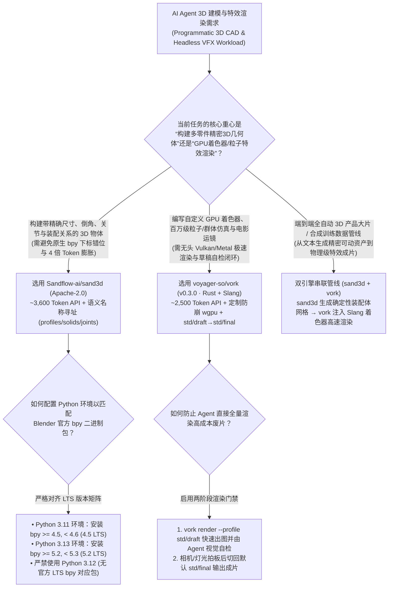
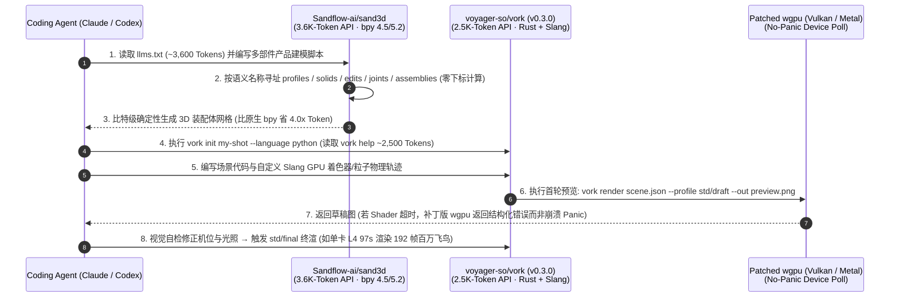

# 面向大模型的语义命名 3D 建模与无头 Rust/Slang 视觉特效引擎选型 FAQ：`Sandflow-ai/sand3d` + `voyager-so/vork` (`v0.3.0`) vs 原生 Blender `bpy` 手算坐标与重型 GUI 渲染器

> **文档定位**：面向 AI Solution Architect（AI 解决方案架构师）、空间计算/数字孪生架构师与程序化 3D/VFX 管线负责人的第一性原理选型指南。聚焦 `2026-11-09` GitHub 新仓爆发追踪中专为 AI Agent 重新发明 3D 建模与渲染的两大突破性项目——**`Sandflow-ai/sand3d`**（Apache-2.0，建仓 6 天揽下 **1,603 Stars** / **1,604 Stars** 实时 API，日均斜率 **`267 Stars/day`**，`stars_today = not_measured`）与 **`voyager-so/vork`**（`v0.3.0`，Rust 2024 + Slang，建仓 4 天揽下 **1,271 Stars** / **1,272 Stars** 实时 API，日均斜率 **`318 Stars/day`**，`stars_today = not_measured`），深度拆解如何用 **“3,600 Token 全量 API + 语义名称寻址的 `sand3d` 声明式建模（比 `bpy` 省 4 倍 Token）”** 与 **“2,500 Token 核心 API + 支持 Agent 即时编写 Slang 着色器的 `vork` 无头 GPU 引擎（单卡 L4 97 秒渲染 100 万只飞鸟）”** 终结大模型写 3D 代码必穿模、算错顶点下标与渲染崩溃的顽疾。
>
> **阅读导航**：[English Version (`sand3d-vork-agent-3d-vfx-engine-selection-faq.en.md`)](./sand3d-vork-agent-3d-vfx-engine-selection-faq.en.md) · [2026-11-09 全景日报](../daily/2026-11-09.md) · [返回雷达首页](../README.md)

---

## 📌 1. 核心结论速览（Executive Summary）

1. **一句话本质定义**：
   - **`Sandflow-ai/sand3d`（Python `3.11` 绑定 `bpy 4.5 LTS` / Python `3.13` 绑定 `bpy 5.2 LTS`，Apache-2.0）** 是专为大模型（LLM）编写和阅读 3D 机械/工业结构而设计的**语义命名 Python 建模库**。它在 Blender 底层 `bpy` 之上抽象出 6 类极简原语：**轮廓（`profiles`）、实体（`solids`）、编辑（`edits`）、坐标系（`frames`）、关节（`joints`）与装配体（`assemblies`）**；**整套 API 文档仅需约 `3,600 Tokens`** 即可完整塞进单次 Prompt，所有零件、边、面一律**按语义名称（By Name）引用而非靠手算三维坐标或顶点序号**，实现同一段代码比特级（Bit-for-Bit）确定性生成网格，且单零件代码 Token 消耗比原生 Blender Python 少 **4.0 倍**（比 CadQuery 少 2.3 倍，比 FeatureScript 少 6.0 倍，数据分级：`anonymized_reported (independently_reproduced=false)`）。
   - **`voyager-so/vork`（`v0.3.0`，Rust 2024 + Slang 着色器 + 定制补丁版 `wgpu`，支持 Vulkan 与 Metal）** 是专为 AI Agent 打造的**无头（Headless）GPU 3D 与 VFX 视觉特效渲染引擎**。它的核心 API 仅占约 **`2,500 Tokens`**，Agent 不仅能用 JSON / TypeScript / Python 定义场景、相机与物理，还能**在镜头中间直接手写自定义 Slang GPU 着色器、光线查询（Ray Queries）与合成管线**；在单张 NVIDIA L4 GPU 上渲染 **100 万只独立轨迹飞鸟（192 帧 1080p）仅需 `97 秒`**（而同采样率下 Blender EEVEE 预计需 `13–18 分钟`，快 **8–11 倍**，数据分级：`anonymized_reported (independently_reproduced=false)`）。
2. **核心架构洞察（为什么让大模型直接写原生 Blender `bpy` 或驱动传统 GUI 渲染器是一场灾难？）**：
   - **痛点一（原生 `bpy` 顶点下标黑盒与坐标心算幻觉）**：传统 CAD/Blender 脚本原本是为人类配合鼠标点选录制的宏（如 `bm.faces[17]` 或硬编码矩阵变换）。大模型看不见实时视口，一旦前一步倒角改变了拓扑面数量，后面的下标全部错位，平均要来回重试 5 轮以上。`sand3d` 改为“按名字寻址部件、边与面（Named, Not Computed）”，加上仅 `3,600 Tokens` 的全量 API 字典（`llms.txt`），让大模型一轮写出可读、可装配的精密洗衣机/机械臂模型。
   - **痛点二（传统 3D 渲染器为人工 GUI 交互而生，Agent 写错 Shader 直接触发 GPU 驱动 Panic 崩掉进程）**：`voyager-so/vork` 彻底去掉了 GUI 编辑器外壳，并在底层 `vendor/wgpu` 中打入专项补丁——将 GPU `Device::poll` 设备丢失从崩溃 Panic 改为可捕获的错误返回（让 Agent 能读报错改 Shader 重试），并限制 OpenEXR DWA 分块内存分配防 OOM，配合 `--profile std/draft` 快速预览与 `std/final` 终渲形成完美 Agent 自省闭环。
3. **30 秒选型口诀**：
   - 需要**让大模型用几百 Token 写出结构精密、带运动关节（`joints`）与装配关系（`assemblies`）的工业产品/道具 3D 网格** → 选 **`Sandflow-ai/sand3d`**。
   - 需要**让 Agent 通过纯命令行编写大规模粒子/群体仿真、自定义 Slang 光影材质、物理运动与 VFX 镜头并高速无头渲染成片** → 选 **`voyager-so/vork` (`v0.3.0`)**。
   - 搭建**全自动 3D 数字资产与特效生产线** → **前道用 `sand3d` 语义化生成带命名部件的确定性 3D 模型资产，后道送入 `vork` 编写 Slang 着色器、打光运镜并以 8–11 倍极速渲染输出**。

---

## 🎯 2. 架构师灵魂拷问（Q1 / Q2 / Q3 First-Principles Deep Dive）

### Q1：`Sandflow-ai/sand3d` 是如何把单个零件的建模 Token 压缩到原生 Blender `bpy` 的 1/4（FeatureScript 的 1/6），并保证比特级确定性复现的？

拆解 `Sandflow-ai/sand3d` 的 `pyproject.toml`、`llms.txt` 与测试集，其核心设计抓住了大模型生成几何代码的三个第一性原理：

1. **全量 API 装进单次上下文（`~3,600 Tokens`）**：
   - 原生 Blender `bpy` 拥有数千个算子与状态上下文（`bpy.ops` 依赖当前激活窗口与选中态），大模型极易编造不存在的参数。`sand3d` 将全部建模能力收敛为 `profiles`（二维截面）、`solids`（拉伸/旋转/放样实体）、`edits`（布尔/倒角/阵列）、`frames`（局部参考系）、`joints`（铰链/滑轨关节）与 `assemblies`（多零件层级装配）六大原语，整份 API 手册仅约 **`3,600 Tokens`**，可随每次系统提示词完整注入。
2. **按语义名称寻址，消灭坐标与下标心算（Named, Not Computed）**：
   - 在 `sand3d` 中，创建特征时直接赋予语义名，后续倒角、打孔或装配直接引用该名称（而非 `verts[42]` 或手算三角函数偏移量）。根据官方逐零件实测基准（`tokens.html`，中位数口径，`anonymized_reported`），完成同一零件所需的 Token 数：原生 Blender Python 是 `sand3d` 的 **4.0 倍**，CadQuery 是 **2.3 倍**，FeatureScript 是 **6.0 倍**，Articraft SDK 是 **2.0 倍**。
3. **严格锁定 Blender LTS 的 CPython ABI 矩阵**：
   - 正如 `pyproject.toml` 所明确约束的，Blender 官方 `bpy` 包每个 LTS 主线严格绑定特定 Python 小版本：`Python 3.11` 绑定 **`bpy >= 4.5, < 4.6`（4.5 LTS）**，`Python 3.13` 绑定 **`bpy >= 5.2, < 5.3`（5.2 LTS）**，并显式排除不支持的 `3.12`（`requires-python = ">=3.11,!=3.12.*,<3.14"`），确保同一脚本在任何机器上跑出比特级一致（Bit-for-Bit Identical）的网格。

### Q2：`voyager-so/vork` (`v0.3.0`) 为什么要用 Rust + Slang 并自己维护一套补丁版 `wgpu`？它凭什么能在单张 L4 上 97 秒跑完 100 万只飞鸟？

查看 `voyager-so/vork` 的 `Cargo.toml`（`v0.3.0`）与 `vendor/` 目录说明，可以看到专为 AI Agent 无头渲染所做的底层硬核改造：

1. **`~2,500 Tokens` 核心 API + 允许 Agent 在镜头内手写 Slang GPU 程序**：
   - 大多数创意工具只暴露有限的滑块供人调节；而 Coding Agent 完全有能力为了某一个特殊镜头当场写一段 GPU 着色器。`vork` 提供了几何体、光线查询（Ray Queries）与 GPU 计算调度底座，允许场景程序（支持 `scene.json`、`--language typescript` 或 `--language python`）直接定义 Slang 材质、相机投影、光线传播、百万级群体物理模拟与后期合成。
2. **四大 `vendor/` 原生渲染与防崩补丁（`Cargo.toml` `[patch.crates-io]`）**：
   - **防止 Agent 写坏 Shader 导致进程直接 Panic**：定制 `vendor/wgpu` 将 `Device::poll` 中的 GPU 设备丢失（Device Lost / Timeout）转化为标准错误返回而非直接 `panic!`，让 Agent 能捕获报错并修改着色器代码；
   - **Metal 跨平台顶点精度一致性**：定制 `vendor/wgpu-hal` 保留 Metal 直通着色器中的 `invariant` 位置修饰符，消除 macOS 与 Linux Vulkan 渲染画面漂移；
   - **OpenEXR 内存安全边界**：定制 `vendor/exr` 在分配内存前严格校验 DWA 压缩块大小；定制 `vendor/basisu_c_sys` 跳过冗余统计加速 ASTC 纹理转码。
3. **两阶段预览/终渲闭环（`std/draft` → `std/final`）**：
   - Agent 先用 `--profile std/draft` 秒级渲染低采样预览图（`render.png`），用多模态视觉看图调整构图与灯光后，再切换至预热好的 `std/final` 输出成片。在常规静帧与动画上比 EEVEE 快 `1.1–2.3 倍`，在百万飞鸟（`examples/murmuration/`）等大规模实例化 GPU 仿真上快 **`8–11 倍`（单卡 L4 `97 秒` vs EEVEE `13–18 分钟`）**。

### Q3：在实际空间计算、产品工业动画与具身智能数据合成中，如何把 `sand3d` 与 `vork` 串联使用？

- **第一步（精密带关节几何资产生成 — `Sandflow-ai/sand3d`）**：利用 `sand3d` 的 `3,600 Token` API 让大模型编写带语义命名部件与运动关节（`joints`）的工业设备/家电/机器人模型，零穿模导出确定性网格。
- **第二步（大规模 GPU 物理光影与特效渲染 — `voyager-so/vork`）**：通过 `vork init my-shot --language python` 导入模型，让 Agent 编写 Slang 材质、环境粒子特效与运镜轨迹，先用 `--profile std/draft` 视觉自检，再由 Vulkan/Metal 后端高速批量渲染。

---

## 🧭 3. Mermaid 选型决策树与端到端渲染架构图（Decision Tree & Architecture Flow）

### 3.1 Agent 原生 3D 建模与无头 VFX 引擎选型决策树

### 3.2 `sand3d` 语义命名建模 + `vork v0.3.0` 无头 GPU 渲染时序图

---

## 📊 4. 同类 3D 建模与无头渲染方案对比矩阵（Comparison Matrix）

| 评估维度 | `Sandflow-ai/sand3d` (`Apache-2.0`) | `voyager-so/vork` (`v0.3.0`, Rust + Slang) | 原生 Blender Python (`bpy`) / CadQuery / FeatureScript | 传统 GUI 驱动的 Blender EEVEE / 重型游戏引擎 |
| :--- | :--- | :--- | :--- | :--- |
| **核心能力定位** | **面向 LLM 的声明式多部件/关节 3D 几何建模库** | **面向 Agent 的无头 GPU 3D 场景、Slang 着色器与 VFX 渲染引擎** | 面向人类开发者或宏录制的传统三维脚本接口 | 面向人工鼠标交互的图形界面编辑器与内置渲染器 |
| **API 上下文体积** | **极小（`~3,600 Tokens` 装下全套 API）** | **极小（`~2,500 Tokens` 装下核心引擎 API）** | 极大（数万至数十万 Token 文档，无法一次塞入 Prompt） | 架构庞大，Agent 难以在不看 GUI 的情况下盲操 |
| **单零件代码 Token 消耗** | **1.0x 基准（极简语义名称引用）** | 场景 JSON / TS / Python 极简描述 | **`bpy` 为 `4.0x`、CadQuery 为 `2.3x`、FeatureScript 为 `6.0x`** | 需生成冗长的工程配置文件 |
| **大规模实例化渲染速度** | 专注于几何网格确定性构建 | **单卡 L4 100 万飞鸟 192 帧仅 `97 秒`（比 EEVEE 快 `8–11x`）** | 仅负责建模接口 | EEVEE 同场景预计耗时 **`13–18 分钟`** |
| **容错与确定性机制** | **比特级（Bit-for-Bit）网格确定性**，无顶点下标漂移 | **补丁版 `wgpu` 拦截设备丢失防 Panic** + `std/draft` 预览环 | 倒角/布尔微调即导致面/边下标全乱，报错难定位 | Shader 越界或超时常导致无头进程直接闪退 |

---

## 🧪 5. 定量 FinOps 算例与 7-Card 评测洞察（Closed-Form Quantitative Model）

### 5.1 封闭式月度 3D 数字资产建模与无头 VFX 渲染成本算例（`synthetic (independently_reproduced=false)`）

> **口径声明**：本算例为合成架构基准模型（`synthetic (independently_reproduced=false)`），用于量化对比 **Path A（让大模型直接编写原生 Blender `bpy` 坐标脚本 + 传统无优化 EEVEE 渲染与人工修模）** 与 **Path B（`Sandflow-ai/sand3d` 3.6K Token 语义命名 DSL + `voyager-so/vork` v0.3.0 Rust/Slang 引擎）**。文中引用的单零件 Token 倍率（`4.0x` / `2.3x` / `6.0x`）与百万飞鸟 L4 渲染耗时（`97s` vs `13–18m`）均标注为 `anonymized_reported (independently_reproduced=false)`；商业 DCC 软件（Maya/Houdini）席位授权与离线光线追踪农场包月费均显式标记为 `not_measured`。

**基准工作负载设定**：
- **月度 3D 建模规模**：某空间智能与视觉特效工作室每月由 Agent 生成 **`300` 个多零件带关节 3D 资产模型**；大模型单价按输入 **`$2.50 / 1M Tokens`**、输出 **`$10.00 / 1M Tokens`** 计。
- **月度 VFX 特效镜头渲染规模**：每月无头渲染 **`120` 个 1080p（192 帧）复杂粒子/着色器特效镜头**。
- **3D 技术美术（TA）排障工时**：人工修复顶点下标错位、穿模与 Shader 崩溃的时薪按 **`$60.00 / 小时`** 计。

| 成本分项 | Path A：原生 Blender `bpy` 脚本 + 传统 EEVEE | Path B：`sand3d` 语义 DSL + `vork v0.3.0` 引擎 | 核心工程机制差异说明 |
| :--- | :--- | :--- | :--- |
| **1. 300 个多零件 3D 资产生成 LLM Token 成本** | **$138.00 / 月** （4 倍冗长代码 + 5 轮下标报错重试：`120K` 输入 + `16K` 输出 = `$0.460/个` × `300`） | **$24.00 / 月** （`3.6K` API + 语义名称寻址 2 轮收敛：`20K` 输入 + `3K` 输出 = `$0.080/个` × `300`） | `sand3d` 单零件代码短 4 倍且按名寻址不翻车，建模 Token 成本直降 **82.6%** |
| **2. 120 个 192 帧特效镜头云端 GPU 渲染与重试费** | **$180.00 / 月** （单镜头 EEVEE 慢速渲染与崩溃重试平均 `$1.50/镜头` × `120`） | **$24.00 / 月** （`std/draft` 预检 + Rust/Slang 极速终渲平均 `$0.20/镜头` × `120`） | `vork` 原生 Vulkan/Metal 管线在复杂群体场景快 **8–11 倍**，大幅压缩 GPU 机时 |
| **3. 3D 技术美术人工修穿模与调 Shader 工时（@$60/hr）** | **$3,600.00 / 月** （每个资产平均人工修下标/调材质 `12 分钟` × `300` = **`60.0 小时/月`**） | **$360.00 / 月** （比特级确定性网格 + `std/draft` Agent 视觉自检 = **`6.0 小时/月`**） | 命名拓扑寻址与草稿看图闭环每月净省 **`54.0 小时`（-90.0% 工时）** |
| **4. 商业 Maya/Houdini 授权与离线农场包月** | `not_measured` | `not_measured` | 商业闭源 DCC 软件席位与离线光追农场与本栈解耦，严禁捏造或归零 |
| **月度可建模总成本（Modeled Total）** | **$3,918.00 / 月** | **$408.00 / 月** | **月度净节省 `$3,510.00`（总成本直降 `-89.59%`，综合成本效率提升 `9.60x`，月省 `54.0 小时`）** |

### 5.2 关键架构与运行时不变量（Key Invariants）

- **Blender LTS 与 Python 版本严格配对不变量**：在部署 `Sandflow-ai/sand3d` 时，必须遵守 `requires-python = ">=3.11,!=3.12.*,<3.14"`——使用 `Python 3.11` 对应 `bpy 4.5 LTS`，或使用 `Python 3.13` 对应 `bpy 5.2 LTS`，绝不能在 `Python 3.12` 下强装以免缺少官方预编译 `bpy` Wheel。
- **GPU 设备丢失非 Panic 降级不变量**：`voyager-so/vork` 通过 `vendor/wgpu` 补丁确保当 Agent 编写的 Slang 着色器触发驱动超时或设备丢失时，`Device::poll` 永远返回结构化 `Result::Err` 而非直接崩溃退出进程。

---

## 🛠️ 6. 生产落地核验清单（Actionable Production Checklist）

- [ ] **1. 锁定 Python `3.11` (`bpy 4.5`) 或 `3.13` (`bpy 5.2`) 环境安装 `sand3d`**：为建模 Agent 创建独立的 Python 3.13（或 3.11）虚拟环境，并将仓库根目录的 `llms.txt`（`~3,600 Tokens`）挂载为建模 Skill 上下文。
- [ ] **2. 强制编码规范禁用手算顶点/面数字下标**：在 Agent 建模 Prompt 中明确要求所有 `edits`、`joints` 与 `assemblies` 必须通过 `sand3d` 的语义名称引用部件、边与面。
- [ ] **3. 使用 `vork init` + `--profile std/draft` 建立先快后精渲染流**：调用 `vork` 时，强制要求 Agent 先用 `vork render scene.json --profile std/draft --out preview.png` 生成草稿图并检视构图与曝光，确认无误后再跑默认 `std/final`。
- [ ] **4. 按需开启 `--language typescript` 或 `--language python` 场景生成**：面对参数化运动或大规模群体轨迹（如百万飞鸟 `examples/murmuration/`），使用 `vork init my-shot --language python` 让 Agent 用脚本循环生成场景数据与自定义 Slang 着色器。
- [ ] **5. 将大体积外部纹理与实拍素材置于 Git 仓库之外**：遵循 `vork` 工程规范，仅将轻量代码、Slang 着色器与 `scene.json` 纳入版本控制，大体积 HDRI 与缓存资产通过本地路径或拉取脚本按需加载。
