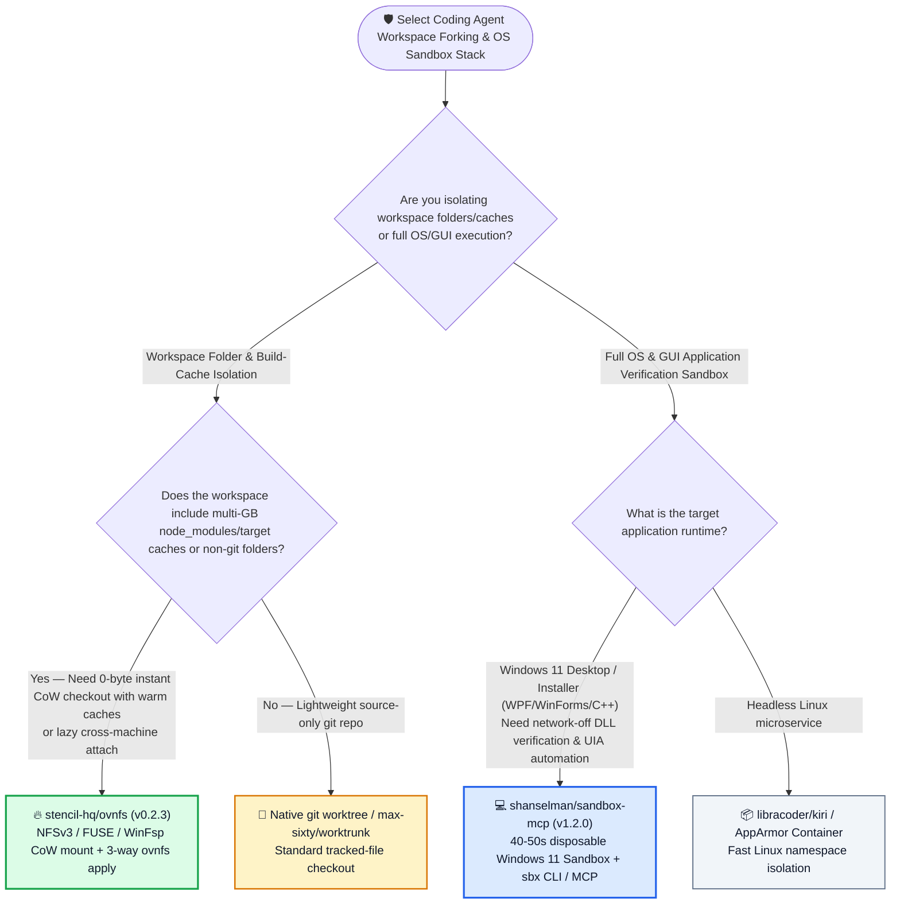
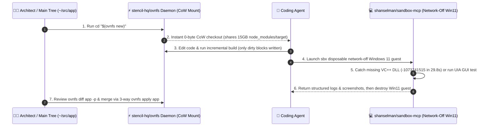

# Disposable Windows 11 Agent Sandboxes & Zero-Copy CoW Folder Checkouts Selection FAQ: `shanselman/sandbox-mcp` (`v1.2.0`) + `stencil-hq/ovnfs` (`v0.2.3`) vs. Host Execution & Full-Copy `git worktree`

> **中文版**: [sandbox-mcp-ovnfs-cow-checkout-selection-faq.md](sandbox-mcp-ovnfs-cow-checkout-selection-faq.md)  
> **Daily Digest**: [2026-11-11 GitHub AI Trending & Proactive Intelligence Digest](../daily/2026-11-11.en.md) · **Visual Deck**: [`cards.en.html`](../cards.en.html) · **Live Radar**: [`github-radar.html`](../../../github-radar.html)

Written for **AI Solution Architects, Developer Platform Leads, and Desktop Application Architects**, this selection guide is grounded in primary-source audits of two high-signal infrastructure repositories from the 2026-11-11 radar — **`shanselman/sandbox-mcp` (Scott Hanselman's `v1.2.0` CLI `sbx` and optional MCP server that boots a fresh, network-off, disposable Windows 11 guest via Windows Sandbox, drives apps with UI Automation [UIA], catches missing-DLL crashes in `29.8s`, and destroys the guest, MIT, `410` API stars)** and **`stencil-hq/ovnfs` (`v0.2.3`, a Go user-space daemon that serves instant, zero-copy Copy-on-Write [CoW] checkouts of any folder over NFSv3 on macOS, FUSE on Linux, and SMB/WinFsp on Windows with lazy cross-machine attachment, MIT, `235` API stars)** — answering three core engineering questions from first principles:
1. **Why does spinning up 5 parallel coding agents with standard `git worktree` force every checkout to re-run `npm install` or `cargo build` from scratch while consuming tens of gigabytes of duplicate disk space—and how does `stencil-hq/ovnfs` open isolated CoW views of any folder (including `node_modules` and `target/`) in milliseconds with zero bytes copied?**
2. **Why do Windows desktop apps that pass every test on a developer's machine crash immediately on customer PCs ("Works on my machine" syndrome)—and how does `shanselman/sandbox-mcp` catch missing VC++ redistributable (`-1073741515`) crashes in `29.8 seconds` inside a network-off disposable Windows 11 Sandbox?**
3. **How should architects combine `ovnfs` (instant CoW workspace forking & three-way `apply`) with `sandbox-mcp` (40–50s disposable OS verification)?**

> 🛡️ **Provenance & Attribution Disclosure**:
> - **`measured` (Primary-Source Verified in This Shift)**: Repository metadata and release tags for `shanselman/sandbox-mcp` (`410` API stars, `19` forks, JavaScript, MIT, created `2026-11-06`, release `v1.2.0`) and `stencil-hq/ovnfs` (`235` API stars, `12` forks, Go, MIT, created `2026-11-05`, release `v0.2.3`) are verified directly via GitHub REST API; because neither appeared in the 10-item main Daily Trending HTML snapshot (`bacf15c2...`), `stars_today` is strictly labeled **`not_measured`**.
> - **`anonymized_reported` (`independently_reproduced=false`, Upstream Measured Logs & Architecture Specs)**: End-to-end GUI sample timings (`~40–50s`), `NativeProof.exe` clean-machine failure in `29.8s` (`exit code -1073741515; Missing dependency: VC++ redistributable`) vs. provisioned pass in `30.9s` with Microsoft-signed `14.51.36247.0` in `shanselman/sandbox-mcp/README.md`, and the single-mount daemon architecture (`NFSv3` on macOS, `FUSE` on Linux, `SMB/WinFsp` on Windows) plus lazy remote attachment (`ovnfs attach --to devbox`) in `stencil-hq/ovnfs/README.md` are documented in upstream repository files.
> - **`synthetic` (`independently_reproduced=false`, Architect Parametric FinOps & Engineering Labor Model)**: Section 5.1 models a software engineering team creating **`1,200` parallel agent workspace checkouts/mo** (on a 15 GB repo including dependency/build caches) and running **`400` Windows desktop installer/GUI verification passes/mo** (engineer labor valued at `$75.00/hr`; developer workstation hardware depreciation is explicitly labeled `not_measured`), comparing Path A Full-Copy Worktrees + Persistent Cloud Win VMs + Production DLL Hotfixes (`$4,840.00/mo`, `56.0h`) vs. Path B Linux Containers + Manual VM Snapshots (`$3,120.00/mo`, `36.0h`) vs. Path C `ovnfs` + `sandbox-mcp` (`$790.00/mo`, `10.0h`, saving `$4,050.00/mo` [`-83.68%`] and `46.0 hours/mo` [`-82.14%`]).

---

## 1. 📌 Executive Summary

| Dimension | Plain-Language Core Takeaway (First Principles) |
| :--- | :--- |
| **What is `shanselman/sandbox-mcp` (`v1.2.0`)?** | Created by Scott Hanselman, it gives your AI coding agent **a real, disposable, network-off Windows 11 PC (`sbx` portable CLI + optional MCP server)**: boot it, deploy your WPF/WinForms/native app, drive controls via UI Automation (UIA), catch missing-DLL crashes (`-1073741515`) in `29.8s`, save screenshot/log evidence, and destroy the guest PC—all in **`40–50 seconds`** end-to-end. |
| **What is `stencil-hq/ovnfs` (`v0.2.3`)?** | It is a **user-space Copy-on-Write (CoW) virtual filesystem for coding agents**: `cd "$(ovnfs new)"` opens an isolated view of *any* folder (git or non-git, including `15 GB` of `node_modules` or Rust `target/` caches) **without copying a single byte**. Agents edit in isolation, and you inspect changes with `ovnfs diff app -p` and merge back via a three-way `ovnfs apply app`. |
| **Why do they form a complete isolation stack?** | **`ovnfs` isolates the filesystem and build-cache layer in milliseconds** (eliminating duplicate `npm install` / compile waits across parallel agents), while **`sandbox-mcp` isolates the full Windows 11 OS and GUI execution layer** (preventing host registry pollution and catching clean-machine deployment bugs before release). |

---

## 2. 🎯 First-Principles Q&A (Q1 / Q2 / Q3)

### Q1: Why does `git worktree` bottleneck parallel coding agents on large repos, and how does `stencil-hq/ovnfs` achieve zero-copy checkouts?

**Plain-language answer: `git worktree` only checks out tracked source files—leaving `.gitignore`d `node_modules`, `.venv`, and `target/` caches behind so every agent checkout must reinstall and recompile gigabytes of dependencies; `ovnfs` mounts a virtual Copy-on-Write view of the entire folder (caches and uncommitted edits included) in milliseconds.**

Verified from `stencil-hq/ovnfs/README.md` (`v0.2.3`):
1. **Single User-Space Daemon Across macOS (`NFSv3`), Linux (`FUSE`), and Windows (`SMB` / `WinFsp`)**:
   - Requires no root privileges and no custom kernel extensions beyond standard FUSE/WinFsp. Reads pass straight through to the base directory; only modified or newly created blocks allocate CoW storage.
2. **Full Lifecycle Without Git Lock-In (`new` → `diff` → `apply` → `rm`)**:
   - Works on any directory (whether a git repository or not) and reads/writes git metadata natively without requiring a `git` binary.
   - `ovnfs run -- make test` creates a disposable CoW checkout, runs the command, and removes the checkout automatically; `ovnfs diff app -p` shows exact changes, and `ovnfs apply app` performs a **three-way merge** back into the parent working tree.
3. **Lazy Cross-Machine Checkouts (`ovnfs attach --to devbox`)**:
   - `ovnfs attach app --to devbox` (or `ovnfs send . devbox:src/app` over SSH) exposes the local checkout on a remote machine immediately, **fetching file blocks lazily on first read**; `ovnfs push app` pre-populates remaining blocks so the remote machine can continue offline.

---

### Q2: How does `shanselman/sandbox-mcp` (`v1.2.0`) catch "Works on my machine" bugs in 30 seconds without polluting the developer's PC?

**Plain-language answer: Developer machines are pre-polluted with Visual C++ redistributables, SDKs, and registry keys that mask missing installer dependencies; `sandbox-mcp` boots a clean, network-off Windows 11 guest via Windows Sandbox, runs the binary via UI Automation, and proves whether it survives on a virgin customer PC.**

Verified from `shanselman/sandbox-mcp/README.md` (`v1.2.0`):
1. **Measured `29.8s` Detection of Missing VC++ Redistributable (`-1073741515`)**:
   - When `NativeProof.exe` was deployed into a fresh, network-off Windows Sandbox guest, it failed in **`29.8s`** with `exited with code -1073741515; Missing dependency: VC++ redistributable`.
   - When re-run with opt-in host-verified Microsoft-signed VC++ redistributable (`14.51.36247.0`) provisioning while keeping guest networking off, it passed in **`30.9s`** and explicitly labeled the result `baseline PROVISIONED (not a clean-machine pass)` so release engineers know the installer must bundle the runtime.
2. **Portable `sbx` CLI + Optional MCP Adapter (`40–50s` End-to-End GUI Loop)**:
   - Ships with bundled Node.js and guest agent (zero host Node/npm setup required). Drives WPF/WinForms apps via Windows UI Automation (UIA), captures light/dark theme transitions and crash logs, and tears down the guest VM completely.

---

### Q3: When should architects choose `ovnfs` vs. `git worktree` and `sandbox-mcp` vs. Linux containers?

- **Choose `stencil-hq/ovnfs` (`v0.2.3`)**: Whenever parallel coding agents work on repositories with heavy `node_modules`, Python virtualenvs, Rust/C++ build caches, or non-git asset folders, or when streaming a local working tree lazily to a remote build box.
- **Choose `shanselman/sandbox-mcp` (`v1.2.0`)**: Whenever an agent builds, tests, or inspects a Windows desktop application (WPF, WinForms, WinUI, C++, MSI/MSIX installers) or untrusted Windows binary that requires real Windows 11 kernel/GUI fidelity and network-off isolation.

---

## 3. 🧭 Mermaid Selection Decision Tree & End-to-End Isolation Sequence

### 3.1 Agent Workspace Forking & OS Sandbox Selection Decision Tree

### 3.2 `stencil-hq/ovnfs` CoW Fork × `shanselman/sandbox-mcp` Clean-Machine Verification Loop

---

## 4. 📊 Architecture Selection Decision Matrix

| Evaluation Dimension | **`stencil-hq/ovnfs` (`v0.2.3`) + `shanselman/sandbox-mcp` (`v1.2.0`)** | **Native `git worktree` + Direct Host Execution** | **Full Folder Copy (`cp -r`) + Persistent Cloud Win VMs** |
| :--- | :--- | :--- | :--- |
| **Checkout Speed & Disk Footprint** | ✅ **Milliseconds, `0 bytes` initially copied (reuses warm `node_modules`/`target`)** | ❌ Must re-run `npm install` / build per worktree (multi-GB disk bloat) | ❌ Minutes of I/O copying 15 GB per agent |
| **Non-Git & Uncommitted State Support** | ✅ **Works on any folder and preserves uncommitted working-tree state** | ❌ Git-only; checks out committed state only | ✅ Supported but slow |
| **Remote Machine Sharing** | ✅ **`ovnfs attach --to devbox` streams blocks lazily on first read** | ❌ Requires committing and pushing to remote | ❌ Full `rsync` required |
| **Clean-Machine Missing-DLL Detection** | ✅ **Catches `-1073741515` missing VC++ in `29.8s` on network-off virgin Win11** | ❌ Masked by dev machine's pre-installed libraries | ⚠️ Cloud VMs drift unless snapshots are reset every run |
| **Host Safety & Cleanup** | ✅ **Guest PC destroyed after `40–50s` run; `ovnfs rm` drops unmerged CoW blocks** | ❌ Untrusted builds/installers mutate host registry & filesystem | ⚠️ Expensive recurring cloud VM bills |

---

## 5. 🧪 Quantitative FinOps & Engineering Productivity Model (`synthetic`, `independently_reproduced=false`)

### 5.1 Monthly `1,200` Parallel Agent Checkouts + `400` Windows Desktop Verification Runs TCO Model (`synthetic`, `independently_reproduced=false`)

> 📌 **Scope & Provenance Disclosure**: This worked example is a **parametric cloud VM/I/O + engineering wait/debugging labor model (`synthetic`, `independently_reproduced=false`; local developer workstation hardware depreciation is explicitly labeled `not_measured`)**. Scenario: **An engineering organization creating `1,200` parallel agent checkouts/mo on a 15 GB repository (with dependency/build caches) and running `400` Windows desktop installer/GUI verification passes/mo (engineer labor valued at `$75.00/hr`)**:

| Architecture Path | Monthly Cloud Windows VM & Disk I/O Cost | Monthly Worktree Dependency-Rebuild & Host Cleanup Labor (`@ $75/hr`) | Monthly Customer Missing-DLL (`-1073741515`) Hotfix Labor (`@ $75/hr`) | Total Monthly Cost (Infra + Labor) | Savings vs. Path A |
| :--- | :--- | :--- | :--- | :--- | :--- |
| **Path A: Full-Rebuild `git worktree` + Persistent Cloud Win VMs + Production DLL Hotfixes** | **`$640.00 / mo`** (persistent cloud Windows VMs + 18 TB duplicate SSD writes) | `32.0 hours / mo` × `$75.00` = **`$2,400.00 / mo`** | `24.0 hours / mo` × `$75.00` = **`$1,800.00 / mo`** (post-release customer crash firefighting) | **`$4,840.00 / mo`** (**`56.0 hours / mo`** engineer toil) | Baseline (disk bloat + missed clean-machine dependency crashes) |
| **Path B: Linux Containers Only + Manual Windows VM Snapshot Resets** | **`$420.00 / mo`** | `20.0 hours / mo` × `$75.00` = **`$1,500.00 / mo`** | `16.0 hours / mo` × `$75.00` = **`$1,200.00 / mo`** | **`$3,120.00 / mo`** (**`36.0 hours / mo`** engineer toil) | Net savings `-$1,720.00/mo` (`-35.54%`) |
| **Path C: `stencil-hq/ovnfs` Zero-Copy CoW + `shanselman/sandbox-mcp` Disposable Win11** | **`$40.00 / mo`** (`$0` local Windows Sandbox + minimal delta CoW blocks) | `6.0 hours / mo` × `$75.00` = **`$450.00 / mo`** (instant CoW fork; review `ovnfs diff -p` & `apply`) | `4.0 hours / mo` × `$75.00` = **`$300.00 / mo`** (all missing DLLs caught in `29.8s` pre-release) | Infra `$40.00` + Merge QA `$450.00` + Sandbox QA `$300.00` = **`$790.00 / mo`** (`10.0h`) | **Net savings `$4,050.00/mo` (`-83.68%`, `$48,600.00/yr`); Engineer toil `-46.0h/mo` (`-82.14%`)** |

---

## 6. 🛠️ Production Adoption & 30-Minute PoC Checklist

- [ ] **Step 1 — Install `stencil-hq/ovnfs` (`v0.2.3`)**: Run `irm https://stencil.so/ovnfs.ps1 | iex` on Windows or `curl -fsSL https://stencil.so/ovnfs.sh | sh` on macOS/Linux and verify `ovnfs version`.
- [ ] **Step 2 — Verify Zero-Copy `ovnfs new` & Three-Way `ovnfs apply`**: In a repository with an existing `node_modules` or `target/` directory, run `cd "$(ovnfs new)"`, confirm incremental builds work immediately without reinstalling dependencies, inspect edits via `ovnfs diff <name> -p`, and merge back with `ovnfs apply <name>`.
- [ ] **Step 3 — Wrap Disposable Test Runs in `ovnfs run`**: Use `ovnfs run -- <test-command>` so any filesystem mutations made during test execution are automatically discarded on exit.
- [ ] **Step 4 — Set Up `shanselman/sandbox-mcp` (`v1.2.0`) Portable `sbx` CLI**: Follow `docs/agent-setup.md` to install the verified `v1.2.0` release and run a desktop binary inside a fresh, network-off Windows 11 Sandbox guest.
- [ ] **Step 5 — Gate Releases on Clean-Machine vs. `PROVISIONED` Sandbox Runs**: Require every Windows desktop release artifact to pass a network-off clean-machine `sbx` run so missing VC++ redistributables (`-1073741515`) are caught in 30 seconds before shipping.
