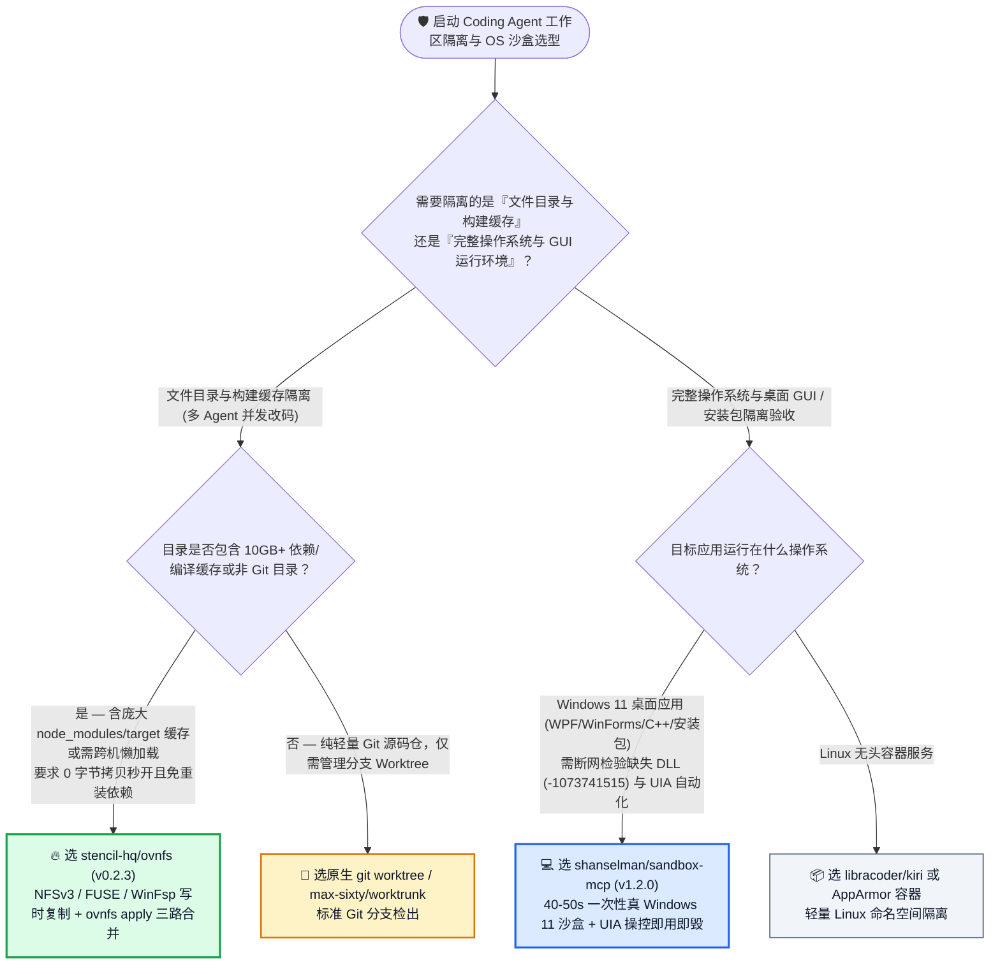
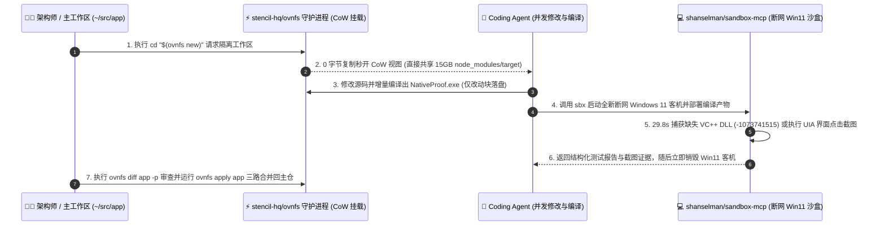

# Coding Agent 一次性真机级 Windows 11 沙盒与免拷贝写时复制（CoW）跨机工作区选型常见问题解答：`shanselman/sandbox-mcp` (`v1.2.0`) + `stencil-hq/ovnfs` (`v0.2.3`) vs 宿主机裸跑 & 全量拷贝 `git worktree`

> **English Edition**: [sandbox-mcp-ovnfs-cow-checkout-selection-faq.en.md](sandbox-mcp-ovnfs-cow-checkout-selection-faq.en.md)  
> **关联日报**: [2026-11-11 GitHub AI 最热榜单与情报摘要](../daily/2026-11-11.md) · **视觉评测卡**: [`cards.html`](../cards.html) · **在线面板**: [`zh-github-radar.html`](../../../zh-github-radar.html)

本文档面向 **AI Solution Architect（AI 解决方案架构师）、研发效能平台负责人与桌面客户端架构师**，基于 2026-11-11 GitHub 新仓爆发榜两款直击多智能体隔离与执行环境痛点的重磅工具 —— **`shanselman/sandbox-mcp`（微软副总裁 Scott Hanselman 开源的基于原生 Windows Sandbox 的一次性 Windows 11 客机自动化 CLI `sbx` 与 MCP Server，`v1.2.0`，MIT，建仓 5 天 `410★`）** 与 **`stencil-hq/ovnfs`（基于单守护进程 NFSv3 / FUSE / WinFsp 的跨平台零拷贝写时复制 Copy-on-Write 智能体工作区文件系统，`v0.2.3`，MIT，Go 语言编写，建仓 6 天 `235★`）** 的一手源码与实测日志深度核验，用通俗大白话与第一性原理解答：
1. **为什么当你同时启动 5 个 Coding Agent 并行改代码时，传统的 `git worktree` 会让每个新工作区都重新跑一遍几分钟的 `pnpm install` / `cargo build`、瞬间吃光上百 GB 磁盘空间？`stencil-hq/ovnfs` 是如何用用户态写时复制挂载（NFSv3 / FUSE / WinFsp）实现“0 字节复制秒开带完整依赖的隔离目录、甚至跨机器懒加载挂载”的？**
2. **为什么在开发者的 Windows 宿主机上测试通过的桌面软件/安装器，发给客户却经常弹窗报错崩溃（“我电脑上明明能跑”综合征）？`shanselman/sandbox-mcp` 是如何用 `40–50 秒` 拉起一台完全断网的全新一次性 Windows 11 真机沙盒、在 `29.8 秒` 内精准捕获 `-1073741515`（缺失 VC++ 运行库）并自动完成 UI Automation 验收后即用即毁的？**
3. **在企业研发基础设施选型中，如何将 `ovnfs`（代码与依赖目录秒级分叉）与 `sandbox-mcp`（断网洁净 OS 级运行验收）组合为黄金防线？**

> 🛡️ **数据来源、归属核验与证据分级声明（Provenance & Attribution Disclosure）**：
> - **`measured`（本班次一手实测抓取）**：`shanselman/sandbox-mcp`（`410` API Stars，`19` Forks，JavaScript，MIT，创建于 `2026-11-06`，最新 Release `v1.2.0`）与 `stencil-hq/ovnfs`（`235` API Stars，`12` Forks，Go，MIT，创建于 `2026-11-05`，最新 Release `v0.2.3`）均通过 GitHub REST API 一手核验；两者不在主日榜 24h DOM 快照内，故 `stars_today` 严格标注为 **`not_measured`**。
> - **`anonymized_reported`（`independently_reproduced=false`，上游仓库实测数据与架构规格）**：`shanselman/sandbox-mcp` 官方文档披露的端到端 GUI 采样耗时（`~40–50 秒`）、`NativeProof.exe` 在断网全新 Windows Sandbox 上 `29.8s` 捕获退出码 `-1073741515`（缺失 VC++ 运行库）及注入微软签名 `14.51.36247.0` 运行库后 `30.9s` 通过（标记 `PROVISIONED`），以及 `stencil-hq/ovnfs` 的三端挂载架构（macOS `NFSv3`、Linux `FUSE`、Windows `SMB/WinFsp`）与跨机懒加载命令集（`ovnfs attach --to`、`ovnfs send`、`ovnfs push`）。
> - **`synthetic`（`independently_reproduced=false`，架构师参数化 FinOps 与工程工时算例）**：第 5.1 节「研发团队每月创建 `1,200 个` 并发 Agent 工作区（基于含 15GB 依赖/构建缓存的单体仓库）+ 执行 `400 次` Windows 桌面端安装与 GUI 验收测试（工程师综合时薪 `$75.00/h`；宿主机硬件折旧明确标注为 `not_measured`）」的闭式成本对比（Path A 全量复制 Worktree + 云端常驻 Win VM + 客户缺 DLL 救火 `$4,840.00/月` vs Path B 仅 Linux 容器 + 手工恢复 VM 快照 `$3,120.00/月` vs Path C `ovnfs` + `sandbox-mcp` `$790.00/月`，净省 `$4,050.00/月` [`-83.68%`] 与 `46.0 小时/月` [`-82.14%`] 工程工时）。

---

## 1. 📌 核心结论速览（Executive Summary）

| 评估维度 | 一句话大白话核心结论（直指本质） |
| :--- | :--- |
| **`shanselman/sandbox-mcp` (`v1.2.0`) 到底是什么？** | 它是微软 Scott Hanselman 打造的**“给 AI Agent 一台全新、断网的真 Windows 11 电脑，测完直接扔进垃圾桶”**的命令行工具（`sbx`）与可选 MCP 服务器。它底层调用系统自带的 Windows Sandbox，启动客机、塞入待测程序、用 UI Automation (UIA) 自动点按钮切主题、抓崩溃退出码、存截图证据、最后彻底销毁客机，全程仅需 **`40–50 秒`**！ |
| **`stencil-hq/ovnfs` (`v0.2.3`) 到底是什么？** | 它是专为多智能体并发工作设计的**用户态写时复制（Copy-on-Write）虚拟文件系统**：无论是不是 Git 仓库，敲一下 `cd "$(ovnfs new)"`，它不用复制一个字节就能秒开一个包含主目录全部 `node_modules`、Rust `target/` 与未提交改动的独立目录；Agent 改完后你用 `ovnfs diff -p` 看差异、用 `ovnfs apply` 三路合并回主目录！ |
| **这两者分别补齐了 Agent 工程化的哪块短板？** | **`ovnfs` 补齐了“文件与构建缓存层”的毫秒级隔离**（彻底免除 `git worktree` 创建后重新 `npm install` 和编译等待）；**`sandbox-mcp` 补齐了“Windows 操作系统与 GUI 执行层”的零污染验证**（杜绝 Agent 搞乱宿主机注册表，并在 30 秒内揪出“开发机有 VC++ DLL 但客户裸机没有”的隐蔽崩溃）！ |

---

## 2. 🎯 第一性原理灵魂三问（Q1 / Q2 / Q3 大白话拆解）

### Q1：为什么 `git worktree` 在大型项目的多 Agent 并发下会变慢？`stencil-hq/ovnfs` 是如何做到“连 `node_modules` 一起零拷贝秒开”的？

**先说大白话结论：因为 `git worktree` 只检出受 Git 跟踪的源码，不检出 `.gitignore` 里的 `node_modules`、Python `.venv` 或 Rust `target/`——你每开一个新 Worktree 让 Agent 跑测试，都得重新装几 GB 依赖、重新编译几分钟；而 `ovnfs` 在虚拟文件系统层把整个目录树直接做成写时复制（CoW）视图！**

根据 `stencil-hq/ovnfs` (`v0.2.3`) 一手架构设计：
1. **单守护进程跨三端免 Root 挂载（NFSv3 / FUSE / SMB & WinFsp）**：
   - 一个后台用户态守护进程将所有 Checkout 挂载为单个挂载点下的子文件夹：在 **macOS 上走原生 `NFSv3`**，在 **Linux 上走 `FUSE` (`fusermount3`)**，在 **Windows 上走 `SMB` 或 `WinFsp`**——不需要 Root 权限，也不需要编写高危内核驱动。
2. **零字节拷贝与三路合并闭环（`new` → `diff` → `apply` → `rm`）**：
   - 当你在 `~/src/app` 下运行 `cd "$(ovnfs new)"`（或一次性跑完即焚的 `ovnfs run -- make test`），Agent 看到的是一个一模一样的完整目录（包含已编译好的二进制缓存和未提交的本地修改），读取时直接穿透到底层原文件，只有当 Agent 修改或新建文件时才会分配增量 CoW 块，主目录 `~/src/app` 纹丝不动！
   - 任务完成后，执行 `ovnfs diff app -p` 查看完整补丁，满意后运行 **`ovnfs apply app` 执行三路合并（Three-Way Merge）** 写回主目录，最后 `ovnfs rm app` 秒删工作区。
3. **跨机器按需懒加载挂载（`ovnfs attach` & `ovnfs send`）**：
   - 如果本地笔记本算力不够，直接运行 `ovnfs attach app --to devbox`（或 `ovnfs send . devbox:src/app` 通过 SSH 自动在远端安装 `ovnfs` 并挂载）：远端机器瞬间看到整个工作区目录树，**数据块只在远端进程真正首次读取（First Read）时才通过网络按需拉取**；若想拔掉网线脱机运行，再跑 `ovnfs push app` 把剩余块推过去即可！

---

### Q2：为什么 Linux 容器测不了 Windows 桌面软件，而开发机本机测试又会漏掉“缺失 DLL 崩溃”？`shanselman/sandbox-mcp` 是怎么破局的？

**先说大白话结论：因为开发者的电脑早就装满了各种 Visual C++ 运行库、.NET SDK 和全局环境变量，程序在开发机上跑通纯属“沾了老环境的光”；只有扔进一台刚拆封、断掉外网的纯净 Windows 11 沙盒里跑一遍，才能看到真实客户打开软件时的死活！**

根据 `shanselman/sandbox-mcp` (`v1.2.0`) 官方实测数据与架构拆解：
1. **30 秒抓获 `-1073741515`（`0xC0000135` STATUS_DLL_NOT_FOUND）的真实案例**：
   - 在开发机上运行正常的 `NativeProof.exe`，被 `sbx` 扔进一台**全新、断网（Network-Off）的 Windows Sandbox** 后，在 **`29.8 秒`** 内当场暴雷退出：`exited with code -1073741515; Missing dependency: VC++ redistributable`（`anonymized_reported`）。
   - 随后在沙盒配置中显式开启经主机 SHA256 与微软签名校验（`14.51.36247.0`）的 VC++ 运行库注入并重跑另一台全新沙盒，**`30.9 秒`** 顺利通过（且报告诚实标注为 `baseline PROVISIONED (not a clean-machine pass)`，提醒发布者必须在安装包里打包该运行库！）。
2. **`sbx` 便携式 CLI 与 MCP 双模同核**：
   - 发布的 `v1.2.0` 捆绑了独立 Node.js、Guest Agent 与宿主控制端，无需本机安装 Node/npm 即可直接运行 `sbx` 命令；对于需要视觉感知的 Agent，开启可选的 MCP 适配器即可直接调用 UI Automation（选择控件、切换深浅色主题、重启应用）并获取内联截图（全流程仅需 **`40–50 秒`**）。

---

### Q3：作为 AI 解决方案架构师，如何把 `ovnfs`、`worktrunk` 与 `sandbox-mcp` 对号入座？

- **选 `stencil-hq/ovnfs` (`v0.2.3`)**：当项目包含庞大的构建产物或依赖目录（`node_modules`、`target/`、`.venv`、或者干脆不是 Git 仓库的大型数据集目录），需要让多个 Agent 零拷贝瞬间分叉并支持跨机懒加载时首选。
- **选 `max-sixty/worktrunk`**：当项目是纯轻量级 Git 仓库、团队工作流强绑定原生 Git 分支名与 PR 生命周期时使用。
- **选 `shanselman/sandbox-mcp` (`v1.2.0`)**：凡是涉及 **Windows 桌面应用（WPF / WinForms / WinUI / C++ / Electron 安装包）、系统级脚本或不可信外部二进制测试**，必须强制在 `sbx` 断网一次性 Windows 11 沙盒中完成验收！

---

## 3. 🧭 Mermaid 选型决策树与端到端隔离验收架构图

### 3.1 多智能体工作区隔离与操作系统沙盒选型决策树（Decision Tree）

### 3.2 `stencil-hq/ovnfs` 零拷贝分叉 × `shanselman/sandbox-mcp` 断网真机沙盒闭环图

---

## 4. 📊 同类方案全方位选型决策矩阵（Decision Matrix）

| 评估维度 | **`stencil-hq/ovnfs` (`v0.2.3`) + `shanselman/sandbox-mcp` (`v1.2.0`)** | **原生 `git worktree` + 宿主机直接跑测试** | **全量目录复制 (`cp -r`) + 云端常驻 Windows VM** |
| :--- | :--- | :--- | :--- |
| **新建并发工作区耗时与磁盘开销** | ✅ **毫秒级、`0 字节` 初始拷贝（直接复用主目录 `node_modules` / `target`）** | ❌ 源码快，但每个 Worktree 需重跑数分钟 `npm install` 并占数 GB 磁盘 | ❌ 每次复制 15GB 耗时数分钟且撑爆 SSD |
| **非 Git 目录与未提交改动支持** | ✅ **支持任意普通文件夹，且新 Checkout 自动继承当前未提交工作树状态** | ❌ 仅限 Git 仓库且只检出已提交 Commit | ✅ 支持但极慢 |
| **跨机器工作区共享能力** | ✅ **`ovnfs attach --to devbox` 按首次读取（First Read）懒加载传输块** | ❌ 必须先提交并 `git push/fetch` 全部历史 | ❌ 需全量 `rsync` 同步 |
| **Windows 缺失依赖（DLL）检出能力** | ✅ **断网全新 Windows 11 沙盒 `29.8s` 必现 `-1073741515` 缺失 VC++ 等裸机故障** | ❌ 被开发机已安装的全局运行库掩盖（典型“我电脑上能跑”） | ⚠️ 常驻云 VM 被历史测试残留污染，需频繁回滚快照 |
| **宿主机安全与清理成本** | ✅ **客机用完即毁（`40–50s` 周期），`ovnfs rm` 秒删未合并分支** | ❌ Agent 恶意或错误脚本直接污染宿主机注册表与系统目录 | ⚠️ 需支付高昂云端 Windows 许可证与常驻算力费 |

---

## 5. 🧪 定量算例与 7-Card 评测洞察（Quantitative Example & 7-Card Insights）

### 5.1 月度 1,200 个并发 Agent 工作区 + 400 次 Windows 桌面端验收闭式成本算例（`synthetic`，`independently_reproduced=false`）

> 📌 **透明口径与边界声明（Scope & Provenance）**：本算例为架构师评估多 Agent 并发工作区管理与 Windows 桌面端验收管线的 **云资源/IO + 工程师等待与排障工时参数化算例（`synthetic` model；工程师本地开发机硬件折旧费明确标注为 `not_measured`）**。场景设定为：**软件工程团队在含 15GB 依赖/构建缓存的项目上每月开启 `1,200 个` 并发 Agent 隔离工作区，并执行 `400 次` Windows 桌面应用安装与 GUI 自动化验收（工程师综合时薪按 `$75.00 / 小时` 计算）**：

| 方案路径 | 每月云端 Windows 测试机与磁盘 IO 账单 | 每月等待 Worktree 重装依赖与清理宿主机污染工时 (`@ $75/h`) | 每月排查客户现场“缺失 DLL / 环境不一致”救火工时 (`@ $75/h`) | 每月总综合成本（资源 + 工程师工时） | 相对 Path A 降本增效幅度 |
| :--- | :--- | :--- | :--- | :--- | :--- |
| **Path A：全量重装依赖 `git worktree` + 云端常驻 Win VM + 客户现场缺 DLL 救火** | **`$640.00 / 月`** （云端常驻 Windows VM 与 18TB 重复磁盘写入损耗） | `32.0 小时 / 月` × `$75.00` = **`$2,400.00 / 月`** | `24.0 小时 / 月` × `$75.00` = **`$1,800.00 / 月`**（发布后客户裸机报 `-1073741515` 紧急排查） | **`$4,840.00 / 月`** （耗费 **`56.0 小时 / 月`** 工程工时） | 基线（磁盘被 `node_modules` 塞满，开发机掩盖裸机缺失依赖） |
| **Path B：仅 Linux 容器隔离 + 手工恢复 Windows 虚拟机快照** | **`$420.00 / 月`** | `20.0 小时 / 月` × `$75.00` = **`$1,500.00 / 月`** | `16.0 小时 / 月` × `$75.00` = **`$1,200.00 / 月`** | **`$3,120.00 / 月`** （耗费 **`36.0 小时 / 月`** 工时） | 综合降本 `-$1,720.00/月` (`-35.54%`) |
| **Path C：`stencil-hq/ovnfs` 零拷贝 CoW + `shanselman/sandbox-mcp` 断网真机沙盒** | **`$40.00 / 月`** （本地 Windows Sandbox `$0` 云费 + 极小增量 CoW 块） | `6.0 小时 / 月` × `$75.00` = **`$450.00 / 月`**（秒开工作区，仅审阅 `ovnfs diff -p` 与 `apply`） | `4.0 小时 / 月` × `$75.00` = **`$300.00 / 月`**（发版前 `29.8s` 断网沙盒提前拦截全部缺失依赖） | 资源 `$40.00` + 合并审查 `$450.00` + 沙盒验收 `$300.00` = **`$790.00 / 月`** (`10.0h`) | **月度净省 `$4,050.00/月` (`-83.68%`，年省 `$48,600.00`)；工程工时省 `46.0h/月` (`-82.14%`)** |

---

## 6. 🛠️ 架构师生产落地与 30 分钟 PoC 核验清单（Production & PoC Checklist）

- [ ] **Step 1 — 在三端开发机安装 `stencil-hq/ovnfs` (`v0.2.3`)**：Windows 下执行 `irm https://stencil.so/ovnfs.ps1 | iex`（macOS/Linux 执行 `curl -fsSL https://stencil.so/ovnfs.sh | sh`），验证 `ovnfs version` 与后台单守护进程挂载正常。
- [ ] **Step 2 — 实测零拷贝 `ovnfs new` 与三路合并 `ovnfs apply`**：在含大型 `node_modules` 或 `target/` 的仓库中运行 `cd "$(ovnfs new)"`，确认无需重新安装依赖即可直接运行构建测试，修改文件后执行 `ovnfs diff <name> -p` 与 `ovnfs apply <name>` 验证三路合并。
- [ ] **Step 3 — 用 `ovnfs run` 包裹高危或一次性 Agent 试错命令**：对不确定是否会污染工作目录的 Agent 任务，直接使用 `ovnfs run -- <command>` 在临时 CoW 视图中运行并在退出后自动销毁。
- [ ] **Step 4 — 部署 `shanselman/sandbox-mcp` (`v1.2.0`) 便携式 `sbx` CLI**：按照 `docs/agent-setup.md` 下载校验 `v1.2.0` Release，在不装任何额外 npm 包的情况下用 `sbx` 拉起断网 Windows 11 沙盒跑通一次桌面应用冷启动与退出码核验。
- [ ] **Step 5 — 在发版门禁中强制区分 `Clean-Machine Pass` 与 `PROVISIONED Pass`**：将编译产物放入默认断网、未预装 VC++ / .NET 的裸沙盒中测试，若触发 `-1073741515` 崩溃，必须在安装器打包脚本中显式内联对应签名运行库，严禁带病发布！
