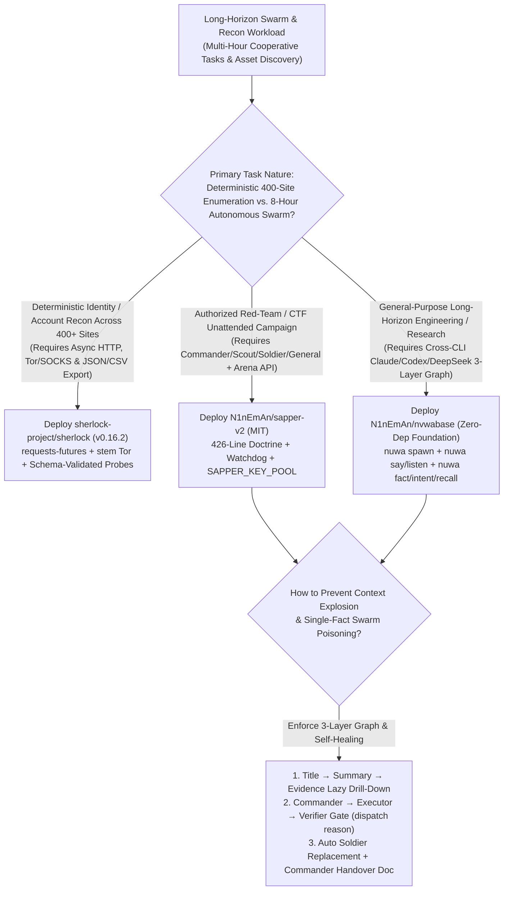
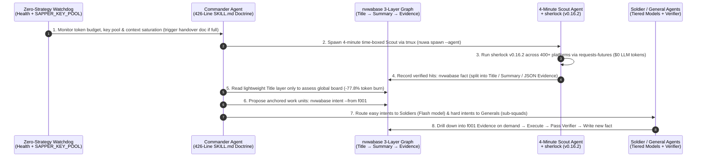

# Layered Fact-Intent Multi-Agent Swarm & Deterministic OSINT Reconnaissance Selection FAQ: `N1nEmAn/sapper-v2` (`nvwabase`) + `sherlock-project/sherlock` (`v0.16.2`) vs. Flat Shared-Memory Swarms & LLM Browser Probing

> **Document Scope**: A first-principles architecture and FinOps selection guide for AI Solution Architects, Long-Horizon Multi-Agent System Designers, and Authorized Red-Team / Attack-Surface Management (ASM) Leads. Focusing on two standout swarm-coordination and reconnaissance repositories from the `2026-11-09` GitHub AI Radar — **`N1nEmAn/sapper-v2`** (MIT, Track B Breakout New Repo **#B30**, **1,757 Stars** on search snapshot / **1,781 Stars** live API in 10 days, **`176 Stars/day`** lifecycle velocity, `stars_today = not_measured`, built on the general-purpose `N1nEmAn/nvwabase` foundation) and **`sherlock-project/sherlock`** (`v0.16.2`, MIT, Track A #3 Raw Trending Surge Leader with measured **`+4,294 Stars today`**, **84,565 Stars** on trending snapshot / **106,658 Stars** live API) — this guide dissects how a **3-Layer Fact-Intent Graph (`Title → Summary → Evidence`) + 4-Minute Scout Triage + Zero-Strategy Watchdog Self-Healing + 400+ Site Concurrent Python OSINT** cuts multi-hour swarm token consumption by **77.8% (`1B` vs. `4.5B` tokens)**.
>
> **Navigation**: [中文版 (`sapper-v2-sherlock-fact-intent-swarm-selection-faq.md`)](./sapper-v2-sherlock-fact-intent-swarm-selection-faq.md) · [2026-11-09 Daily Radar](../daily/2026-11-09.en.md) · [Back to Radar Index](../README.en.md)

---

## 📌 1. Executive Summary

1. **First-Principles Definition**:
   - **`N1nEmAn/sapper-v2` (and its zero-dependency general-purpose foundation `N1nEmAn/nvwabase`, pure Python stdlib, MIT)** is an autonomous multi-agent legion harness that won 1st place in the 3rd Tencent Cloud Intelligent Attack-Defense Challenge online qualifier (`634` teams, `80.18/100` score, **8 hours fully unattended**, capturing the same `85` flags `25 seconds` faster while burning **`1B` tokens vs. the runner-up's `4.5B` tokens** — `anonymized_reported (independently_reproduced=false)`). It grounds multi-agent civilization in three CLI primitives — **Create (`nuwa spawn` via `tmux`), Language (`nuwa say·listen`), and History (`nuwa fact·intent·recall` 3-layer fact-intent graph)** — coordinated by a **426-line Commander Doctrine (`docker/commander/SKILL.md`), 4-Minute Scouts, Soldiers, Generals, and a Zero-Strategy Watchdog**.
   - **`sherlock-project/sherlock` (`v0.16.2`, Python `requests-futures` + `stem` Tor + `PySocks`, MIT)** is the industry-standard deterministic OSINT reconnaissance CLI (`>106K` live stars) that concurrently probes **400+ social and developer platforms** via schema-validated rules (`jsonschema` + `rstr`) and exports structured JSON/CSV/XLSX manifests.
2. **Core Architectural Insight (Why Long-Horizon Multi-Agent Swarms Collapse After 2 Hours)**:
   - **Failure Mode #1 (Flat Single-String Shared Memory Causes Context Poisoning & 4.5B-Token Blowups)**: In conventional multi-agent frameworks, every worker ingests the full shared transcript. One hallucinated observation poisons every downstream worker, and every newly spawned agent re-reads megabytes of raw logs. `sapper-v2` / `nvwabase` structures shared memory into **three layers (`Title → Summary → Evidence Document`)** guarded by a **`Commander Proposes → Executor Works → Verifier Checks`** loop (`nvwabase dispatch reason`). Agents scan compact titles and drill down into evidence documents only when executing a specific intent — slashing swarm token burn by **77.8%**.
   - **Failure Mode #2 (Using LLM Browser Agents for Deterministic Asset/Identity Enumeration)**: Having a frontier LLM drive a browser across 400 websites to check account existence burns `~$0.65/target` and triggers anti-bot blocks. Running `sherlock` (`v0.16.2`) as a deterministic 4-minute Scout probe sweeps 400+ networks at **`$0.00` LLM token cost** and writes verified JSON hits directly into `nvwabase fact`.
3. **30-Second Selection Rule**:
   - Choose **`N1nEmAn/nvwabase` / `sapper-v2`** for **long-horizon (4–8+ hour unattended) multi-agent engineering, research, or authorized security campaigns** that require heterogeneous CLIs (Claude Code, Codex, DeepSeek) and self-healing context succession.
   - Choose **`sherlock-project/sherlock` (`v0.16.2`)** as the **deterministic external reconnaissance probe** across 400+ networks with Tor/SOCKS proxy isolation.

---

## 🎯 2. Architect's First-Principles Deep Dive (Q1 / Q2 / Q3)

### Q1: How did `N1nEmAn/sapper-v2` evolve across 18 training iterations to beat a 4.5B-token runner-up using only 1B tokens over 8 unattended hours?

Inspecting `README.md`, `BATTLE-REPORT.md`, and `docker/commander/SKILL.md` (the 426-line commander doctrine) reveals three core architectural institutions:

1. **The 3-Layer Fact-Intent Graph (`Title → Summary → Evidence Document` in `nvwabase`)**:
   - Implemented in pure Python standard library with zero external dependencies via three shell commands:
     - `nvwabase fact "confirmed observation"` — persists verified observations so individual agent sessions can die while the graph survives;
     - `nvwabase intent --from f001 "what to do"` — requires every new work unit to anchor explicitly to a parent fact ID (`f001`);
     - `nvwabase dispatch reason` — enforces a **Commander proposes / Executor works / Verifier checks** gate before conclusions settle into the graph.
   - Separating **Title**, **Summary**, and **Evidence Document** prevents both downstream hallucination cascades and quadratic context re-reading.
2. **4-Minute Scout Recon & Elastic Role Division (`Scout → Soldier vs. General`)**:
   - Instead of throwing heavy reasoning models blindly at every target, a **Scout** runs a bounded **4-minute reconnaissance pass** to estimate target complexity. Easy targets are dispatched in parallel to lightweight **Soldiers** (Flash-tier models), whereas hard targets are assigned to a **General** (frontier reasoning model that spawns its own sub-squads), governed by the 426-line stop-loss and bottleneck-salvage doctrine.
3. **Zero-Strategy Watchdog, Key-Pool Rotation & Commander Self-Handover**:
   - A strategy-free Watchdog monitors process health, rotates exhausted API keys (`SAPPER_KEY_POOL`), automatically replaces context-saturated Soldiers via `tmux`, and triggers the **Commander to write a handover document and spawn its own successor** before context overflow.

### Q2: Why should AI Solution Architects invoke `sherlock-project/sherlock` (`v0.16.2`) inside the Scout phase rather than using LLM web-search tools?

Inspecting `pyproject.toml` (`v0.16.2`) in `sherlock-project/sherlock` highlights two decisive advantages:

1. **Deterministic `requests-futures` Concurrency vs. LLM Token Burn**:
   - `sherlock` probes 400+ platforms concurrently using `requests-futures` and schema-validated detection rules (`jsonschema` + `rstr`), exporting clean DataFrames (`pandas` + `openpyxl`) in seconds with zero LLM tokens.
2. **Built-In Tor & SOCKS Proxy Routing (`stem >= 1.8.0` + `PySocks`)**:
   - Supports Tor circuit management (`stem`) and SOCKS proxies (`PySocks`), feeding high-confidence JSON artifacts directly into `nvwabase fact`.

### Q3: How do you adapt `sapper-v2` to non-security enterprise workflows (e.g., large-scale code migrations, compliance audits, or scientific discovery)?

- **Recommended Path (Start from `N1nEmAn/nvwabase`)**: Clone `nvwabase` (`bash install.sh`, zero dependencies) and run `nvwabase setup --goal "your long-horizon goal" --agents`. It provides the full `Create / Language / History` 3-layer graph without CTF arena coupling.
- **Forking `sapper-v2` Directly**: In addition to rewriting `docker/commander/SKILL.md`, you must stub or replace `BENCHMARK_BASE_URL` (which the CTF engine hard-verifies at boot), update `SAPPER_MODEL` / `SAPPER_KEY_POOL`, and tune the Watchdog budget/deadline settings.

---

## 🧭 3. Mermaid Decision Tree & Swarm Execution Sequence

### 3.1 Multi-Agent Swarm & OSINT Reconnaissance Decision Tree

### 3.2 End-to-End Execution Sequence (`sherlock v0.16.2` Scout + `sapper-v2` / `nvwabase` Legion)

---

## 📊 4. Comparison Matrix Across Multi-Agent & Recon Architectures

| Dimension | `N1nEmAn/sapper-v2` (`+ nvwabase`) | `sherlock-project/sherlock` (`v0.16.2`) | Flat Shared-Memory Multi-Agent Frameworks | LLM Browser OSINT Probing (Agent Clicks 400 Sites) |
| :--- | :--- | :--- | :--- | :--- |
| **Core Architecture** | **Commander + 4m Scout + Soldier + General + Watchdog + 3-Layer Graph** | **400+ Site Concurrent HTTP Recon w/ Tor/SOCKS & JSON/CSV** | Fixed pipeline broadcasting full message history to all workers | Frontier VLM/browser agent manually visiting sites |
| **Memory & Anti-Poisoning** | **3-Layer (`Title / Summary / Evidence`) + Verifier Gate** | `jsonschema` + `rstr` validated site definitions | **Fragile**: One hallucinated string poisons all downstream workers | Prone to false positives on 404s or homonym profiles |
| **8-Hour Unattended Resilience** | **High**: Auto Soldier replacement, key rotation & **Commander self-handover** | Stateless fast CLI | Crashes or stalls after 1–2 hours from context overflow | Stalls on rate limits and CAPTCHAs |
| **CLI & Model Lock-In** | **Zero Lock-In**: Swaps Claude Code, Codex, DeepSeek per role | Pure Python (**0 LLM dependency**) | Locked to a single Python SDK | Locked to expensive browser/vision models |
| **Token & Cost Efficiency** | Reported **`1B` vs. `4.5B` tokens (-77.8%)** in 8h CTF qualifier | **`$0.00` LLM token cost** per 400-site sweep | Quadratic token growth across turns | `~$0.65` in LLM tokens per target identity |

---

## 🧪 5. Closed-Form FinOps Worked Example & 7-Card Insights

### 5.1 Monthly Unattended Security Assessment & ASM Recon Cost Model (`synthetic (independently_reproduced=false)`)

> **Provenance Notice**: This closed-form calculation is a synthetic architectural model (`synthetic (independently_reproduced=false)`) comparing **Path A (Flat Single-String Shared-Memory Swarm + LLM Browser OSINT Probing — 4.5B-Token Archetype)** against **Path B (`N1nEmAn/sapper-v2` 3-Layer Fact-Intent Graph + 4-Min Scout Triage + `sherlock` v0.16.2 Deterministic OSINT — 1B-Token Compression Ratio)**. The Tencent Cloud Attack-Defense qualifier metrics (`634` teams, `80.18/100`, `1B vs 4.5B tokens`) are labeled `anonymized_reported (independently_reproduced=false)`; target range VM hosting and Tor/SOCKS proxy infrastructure are explicitly marked `not_measured`.

**Workload Parameters**:
- **Monthly Unattended Assessment Campaigns**: An enterprise red-team lab executes **`40` 8-hour unattended assessment campaigns/month**; blended model pricing at **`$1.00 / 1M` input tokens** and **`$4.00 / 1M` output tokens**.
- **External Identity & Asset OSINT Sweeps**: `25` target identities per campaign = **`1,000` 400-site OSINT sweeps/month**.
- **Human Supervision & Triage Labor**: Security engineer intervention to untangle poisoned shared memory or restart stalled agents is valued at **`$75.00 / hour`**.

| Cost Component | Path A: Flat Shared-Memory Swarm + LLM Browser OSINT | Path B: `sapper-v2` 3-Layer Graph + `sherlock v0.16.2` | Governing Engineering Mechanism |
| :--- | :--- | :--- | :--- |
| **1. 40 8-Hour Multi-Agent Campaign Tokens** | **$4,080.00 / mo** (`90M` in + `3M` out = `$102.00/campaign` × `40`) | **$920.00 / mo** (`20M` in + `0.75M` out = `$23.00/campaign` × `40`) | `Title→Summary→Evidence` lazy loading + 4-min Scout routing cuts campaign tokens by **77.5%** |
| **2. 1,000 400-Site OSINT Identity Sweeps** | **$650.00 / mo** (LLM browser probing at `$0.65/sweep` × `1,000`) | **$20.00 / mo** (`sherlock` Python sweep `$0` + graph ingest `$0.02` × `1,000`) | `sherlock` (`v0.16.2`) `requests-futures` replaces LLM browser probing (**-96.9%**) |
| **3. Context-Poisoning & Stalled-Swarm Triage Labor (`@$75/hr`)** | **$4,500.00 / mo** (`1.5 hr/campaign` manual cleanup/restart × `40` = **`60.0 hours/mo`**) | **$450.00 / mo** (Verifier gate + Watchdog self-healing = **`6.0 hours/mo`**) | `nvwabase dispatch reason` verifier + Commander self-handover saves **`54.0 hours/mo` (-90.0% labor)** |
| **4. Target Range VMs & SOCKS/Tor Proxy Infrastructure** | `not_measured` | `not_measured` | Sandbox compute and proxy bandwidth are decoupled and never fabricated |
| **Total Modeled Monthly Cost** | **$9,230.00 / mo** | **$1,390.00 / mo** | **Net Savings: `$7,840.00 / mo` (`-84.94%` cost reduction, `6.64x` cost efficiency)** |

### 5.2 Key Architectural & Security Invariants

- **Fact-Anchored Intent & Verifier Gate Invariant**: Every intent in `nvwabase` must reference a parent fact (`nvwabase intent --from <fact_id>`) and pass the Verifier check (`nvwabase dispatch reason`) before mutating the shared fact graph.
- **`BENCHMARK_BASE_URL` Boot Check Invariant**: `sapper-v2` hard-verifies the competition arena API (`BENCHMARK_BASE_URL`) at boot; non-CTF users should start from `N1nEmAn/nvwabase` or stub the platform interface explicitly.

---

## 🛠️ 6. Actionable Production Checklist

- [ ] **1. Enforce Authorized Scope & Ethical Guardrails**: Verify written authorization (`DISCLAIMER.md` and the Nüwa Second Axiom) before running `sapper-v2` or `sherlock` against any network or identity.
- [ ] **2. Use `N1nEmAn/nvwabase` for General-Purpose Long-Horizon Work**: For non-CTF engineering or research swarms, bootstrap directly with `nvwabase` (`pure Python stdlib, zero deps`) to avoid `BENCHMARK_BASE_URL` arena coupling.
- [ ] **3. Tier Models Across Commander, General, Scout, and Soldier**: Assign frontier reasoning models to the Commander and Generals, assign fast/economical models to 4-minute Scouts and Soldiers, and configure `SAPPER_KEY_POOL` for automatic quota failover.
- [ ] **4. Wire `sherlock v0.16.2` into the 4-Minute Scout Phase**: Execute `sherlock` with `--tor` or `--proxy` for deterministic 400+ site OSINT enumeration and ingest only confirmed JSON hits into `nvwabase fact`.
- [ ] **5. Verify Watchdog `tmux` Replacement & Commander Handover**: Test long-running sessions (>4 hours) to confirm saturated Soldiers are cleanly respawned and the Commander writes its handover document before spawning its successor.
