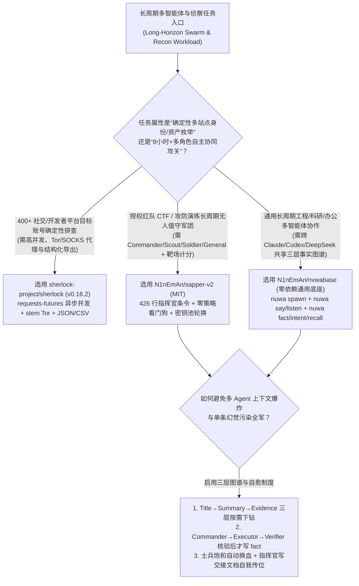
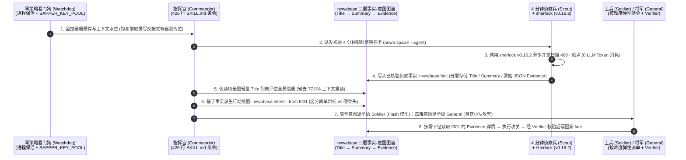

# 三层事实意图图谱多智能体军团与确定性 OSINT 侦察选型 FAQ：`N1nEmAn/sapper-v2` (`nvwabase`) + `sherlock-project/sherlock` (`v0.16.2`) vs 扁平共享记忆群智与 LLM 盲扫

> **文档定位**：面向 AI Solution Architect（AI 解决方案架构师）、长周期多智能体（Long-Horizon Multi-Agent）系统设计师与授权红队/攻击面管理（ASM）负责人的第一性原理选型指南。聚焦 `2026-11-09` GitHub AI 全景热榜与新仓爆发榜同日登榜的两大“军团级协同与开源情报侦察”标杆——**`N1nEmAn/sapper-v2`**（MIT，Track B 新仓黑马榜 **#B30**，建仓 10 天揽下 **1,757 Stars** 搜索快照 / **1,781 Stars** 实时 API，日均斜率 **`176 Stars/day`**，`stars_today = not_measured`；底层通用底座为 `N1nEmAn/nvwabase`）与 **`sherlock-project/sherlock`**（`v0.16.2`，MIT，Track A 单日飙升绝对增量第 1 名，今日实测 **`+4,294 Stars today`**，榜单快照 **84,565 Stars** / 实时 API **106,658 Stars**），深度拆解如何用 **“三层事实-意图图谱（Title/Summary/Evidence）+ 4 分钟侦察兵分级调度 + 零策略看门狗自愈 + 400+ 站点并发确定性 OSINT 探针”** 实现 8 小时无人值守下以 **1B Tokens 击败 4.5B Tokens（省 77.8% 算力）** 的长程群体智能。
>
> **阅读导航**：[English Version (`sapper-v2-sherlock-fact-intent-swarm-selection-faq.en.md`)](./sapper-v2-sherlock-fact-intent-swarm-selection-faq.en.md) · [2026-11-09 全景日报](../daily/2026-11-09.md) · [返回雷达首页](../README.md)

---

## 📌 1. 核心结论速览（Executive Summary）

1. **一句话本质定义**：
   - **`N1nEmAn/sapper-v2`（及其零依赖通用底座 `N1nEmAn/nvwabase`，纯 Python 标准库，MIT）** 是夺得第三届腾讯云智能攻防挑战赛线上预选赛冠军（634 支战队、8 小时全程无人值守、以 **`1B Tokens` 击败亚军 `4.5B Tokens`** 斩获相同 85 个 Flag 且快 25 秒，数据分级：`anonymized_reported (independently_reproduced=false)`）的**多智能体军团编排框架（Multi-Agent Orchestration Harness）**。它将多 Agent 协作抽象为三大文明基础能力——**繁衍（Create：通过 `tmux` 拉起任意 CLI Agent）、语言（Language：`nuwa say·listen` 跨窗格通信）与历史（History：`nuwa fact·intent·recall` 三层事实-意图图谱）**，配合 **指挥官（Commander）+ 4 分钟侦察兵（Scout）+ 士兵（Soldier）+ 将军（General）+ 零策略看门狗（Watchdog）** 实现个体会话随时消亡重置、全局图谱永续演进。
   - **`sherlock-project/sherlock`（`v0.16.2`，Python `requests-futures` + `stem` Tor + `PySocks`，MIT）** 是 GitHub 破 10 万星的**确定性跨平台账号与外部攻击面 OSINT 侦察标准工具**。它基于异步并发 HTTP 与 JSON Schema 校验规则库，在数秒内完成 400+ 社交与开发者平台的目标身份排查并导出结构化 JSON/CSV/XLSX。
2. **核心架构洞察（为什么长周期多智能体跑满 2 小时就会陷入“单条脏数据毒化全场 + 上下文雪崩”？）**：
   - **痛点一（扁平单字符串共享记忆的“一粒老鼠屎坏一锅汤”与 4.5B Token 巨额燃烧）**：传统多 Agent 框架把所有子 Agent 的发现拼成一张扁平列表或大文本塞给每个 Worker。一旦某个子 Agent 产生一条错误推断（幻觉事实），下游所有 Agent 全被带偏；且每个新拉起的 Worker 都要重读全部历史证据。`sapper-v2` / `nvwabase` 将历史图谱严格拆分为 **“标题（Title）→ 摘要（Summary）→ 证据文档（Evidence Document）”三层结构**，并执行 `Commander 提议 → Executor 执行 → Verifier 核验` 才写入 `fact`，平时只读标题、按需下钻证据，直接砍掉 **77.8%** 的群体 Token 消耗。
   - **痛点二（用大模型驱动浏览器去干确定性枚举侦察是极度的算力错配）**：在授权安全测试或尽调初期，若让大模型开着浏览器逐个平台搜索目标账号，排查一个身份就要花掉 `$0.65` Token 费且极易触发风控。用 `sherlock` (`v0.16.2`) 作为确定性 4 分钟前置侦察探针，以 **`$0` LLM 成本** 并发扫完 400+ 站点并将命中 JSON 直接写入 `nvwabase fact` 图谱，才是正确的“确定性工具 + 认知军团”分工。
3. **30 秒选型口诀**：
   - 需要**长周期（4–8 小时以上无人值守）多智能体协同攻关（不管是授权渗透测试、大型代码库迁移还是复杂科研攻关），且要求自由混搭 Claude Code / Codex / DeepSeek 等不同 CLI 与模型** → 选 **`N1nEmAn/sapper-v2`（通用场景直接用其底座 `N1nEmAn/nvwabase`）**。
   - 需要**在授权红队演练、企业外部数字足迹盘点或欺诈调查中，毫秒级并发核查 400+ 站点公开账号归属** → 选 **`sherlock-project/sherlock` (`v0.16.2`)**。

---

## 🎯 2. 架构师灵魂拷问（Q1 / Q2 / Q3 First-Principles Deep Dive）

### Q1：`N1nEmAn/sapper-v2` 是如何靠 `nvwabase` 的三层事实-意图图谱（Layered Fact-Intent Graph）与 18 次迭代演进出的“六大制度”，在 8 小时无人值守下用 1B Tokens 打赢 4.5B Tokens 的？

通过精读 `N1nEmAn/sapper-v2` 的 `README.md`、`BATTLE-REPORT.md` 与 `docker/commander/SKILL.md`（426 行指挥官条令），可以清楚看到它从早期“写死脚本驱动窗格（Driver Era）”历经 18 个版本血泪教训沉淀出的工程机制：

1. **三层按需加载的事实-意图图谱（`Title → Summary → Evidence Document`）**：
   - 核心原语只有三条极简 CLI 命令（纯 Python 标准库实现，零第三方依赖）：
     - `nvwabase fact "confirmed observation"`：写入已核验的外部事实（个体 AI 会话死掉后，继任者读取图谱无缝接管）；
     - `nvwabase intent --from f001 "what to do"`：必须显式锚定前置事实编号 `f001` 才能派生下一步行动意图；
     - `nvwabase dispatch reason`：严格执行 **指挥官提议（Commander Proposes）→ 执行者干活（Executor Works）→ 验证者核验（Verifier Checks）** 三权分立闭环。
   - **三层分级存储**：每个节点分为 `Title`（一句话结论）、`Summary`（核心上下文）与 `Evidence Document`（完整原始日志/Payload）。指挥官和侦察兵全局巡检时仅加载轻量 `Title` 列表，只有认领具体 `intent` 的士兵才下钻读取对应的 `Evidence Document`，彻底解决了“单条未核验脏数据污染全群”和“全员重复加载百萬 Token 原始日志”两大死穴。
2. **4 分钟侦察兵（Scout）分级调度与“士兵 vs 将军”弹性编制**：
   - 面对大批未知目标，绝不盲目派重型 Agent 硬啃：先派轻量 **侦察兵（Scout）执行 4 分钟限时侦察**评估目标难度；简单目标派发给单兵 **士兵（Soldier，使用高性价比 Flash 模型批量并发）**，高难硬骨头则指派 **将军（General，使用旗舰推理模型并允许其自主招募专属小队）**，严格遵循“先易后难、瓶颈期抢救半成品、果断止损”的 426 行条令。
3. **上下文饱和自动换血与指挥官自我交接（Self-Healing & Succession）**：
   - **零策略看门狗（Zero-Strategy Watchdog）**：完全不包含业务逻辑，专门负责监控配额耗尽自动轮换密钥池（`SAPPER_KEY_POOL`）、当士兵上下文接近饱和时自动销毁并拉起新窗格接替；而当 **指挥官（Commander）** 自身上下文将满时，会先给自己写一份交接文档（Handover Doc），然后拉起自己的继任者继续指挥，实现 8 小时以上真正零人工干预。

### Q2：为什么在多智能体架构中，应该用 `sherlock-project/sherlock` (`v0.16.2`) 替代大模型自身的网页搜索来做外部资产与身份侦察？

检视 `sherlock-project/sherlock` 的 `pyproject.toml`（`v0.16.2`）与 `sherlock_project/` 源码：

1. **确定性异步并发 vs 昂贵的 LLM 逐页推理**：
   - `sherlock` 使用 `requests-futures` 并发引擎与经过 `jsonschema` + `rstr` 严格校验的 400+ 站点指纹库（支持 HTTP 状态码、响应文本特征与重定向检测），几秒内即可扫完数百个平台并输出精确 JSON/CSV/XLSX（`pandas` + `openpyxl`）。
2. **原生 Tor 链路与 SOCKS 代理轮换（`stem >= 1.8.0` + `PySocks`）**：
   - 大规模外部资产盘点极易遇到单 IP 限流；`sherlock` 内置 Tor 控制协议（`stem`）与 SOCKS 代理支持，作为 `sapper-v2` 中 **Scout（侦察兵）** 阶段的确定性 Shell 工具调用，既把单目标侦察 Token 成本降为 `0`，又保证了写入 `nvwabase fact` 图谱的第一层基础事实 100% 零幻觉。

### Q3：如果我想把 `sapper-v2` 的长程军团机制迁移到非安全场景（如大型系统重构、自动化科研、跨国合规审查），需要改哪些地方？

正如作者在 `README.md` 中明确指出的，切勿只改提示词而忽略环境底座绑定：
- **方案 A（推荐：直接基于通用底座 `N1nEmAn/nvwabase` 起步）**：`nvwabase` 剥离了 CTF 靶场专用耦合，保留了完整的 `Create (nuwa spawn)`、`Language (nuwa say/listen)` 与 `History (nuwa fact/intent/recall)` 纯 Python 零依赖实现，执行 `nvwabase setup --goal "your long-horizon goal" --agents` 即可用于任意长周期研发或研究任务。
- **方案 B（Fork `sapper-v2` 改造）**：除重写 `docker/commander/SKILL.md`（426 行指挥官条令）外，必须修改或桩化启动时硬校验的靶场环境变量 `BENCHMARK_BASE_URL`、替换模型网关与密钥池配置（`SAPPER_MODEL` / `SAPPER_KEY_POOL`），并调整看门狗的预算与截止时间阈值。

---

## 🧭 3. Mermaid 选型决策树与军团协同架构图（Decision Tree & Architecture Flow）

### 3.1 多智能体编排与外部侦察选型决策树

### 3.2 `sherlock` 确定性侦察 + `sapper-v2` (`nvwabase`) 三层图谱军团时序图

---

## 📊 4. 同类多智能体与侦察方案对比矩阵（Comparison Matrix）

| 评估维度 | `N1nEmAn/sapper-v2` (`+ nvwabase` 底座) | `sherlock-project/sherlock` (`v0.16.2`) | 传统扁平共享记忆多 Agent 框架（单字符串/全量广播历史） | 纯大模型浏览器 OSINT 侦察（让 LLM 逐站搜索） |
| :--- | :--- | :--- | :--- | :--- |
| **核心分工与定位** | **指挥官+侦察兵+士兵+将军+看门狗长程协同与三层图谱** | **400+ 站点确定性异步并发账号侦察与 Tor/SOCKS 代理导出** | 固定角色流水线，缺乏动态难度探针与上下文换血机制 | 用高成本多模态/网页 Agent 模拟人工逐个网站搜索 |
| **共享记忆与防毒化机制** | **三层图谱（`Title / Summary / Evidence`）+ Verifier 核验入库** | JSON Schema 强校验站点规则（`jsonschema` + `rstr`） | **极易雪崩**：一条错误输出直接写入公共上下文毒化所有下游 | 极易将重名账号或 404 页面误判为命中 |
| **8 小时无人值守自愈力** | **极强**：士兵饱和自动替换、密钥池轮换、**指挥官写交接文档自我传位** | 纯无状态 CLI，单次扫描秒级完成 | 跑满 1–2 小时即因上下文溢出或单 Key 限流彻底卡死 | 频繁卡在反爬验证码或超时重试 |
| **模型与 CLI 锁定程度** | **零锁定**：任意混搭 Claude Code / Codex / DeepSeek 等 CLI 与异构模型 | 纯 Python 工具，**0 LLM 依赖** | 强绑定特定 Python Agent SDK | 强绑定高价多模态/浏览器模型 |
| **实测/建模算力效率** | 腾讯攻防赛实测汇报 **`1B` vs 亚军 `4.5B` Tokens（省 77.8%）** | 单身份 400+ 站点扫描 **LLM Token 成本 `$0.00`** | 全员反复重读原始日志，Token 呈平方级膨胀 | 单身份排查耗费约 `$0.65` LLM Token |

---

## 🧪 5. 定量 FinOps 算例与 7-Card 评测洞察（Closed-Form Quantitative Model）

### 5.1 封闭式月度长程安全评估与外部攻击面侦察成本算例（`synthetic (independently_reproduced=false)`）

> **口径声明**：本算例为合成架构基准模型（`synthetic (independently_reproduced=false)`），用于量化对比 **Path A（传统扁平共享记忆多 Agent 群智 + 纯 LLM 浏览器 OSINT 枚举，对应 4.5B Token 消耗原型）** 与 **Path B（`N1nEmAn/sapper-v2` 三层事实-意图图谱 + 4 分钟 Scout 分级调度 + `sherlock` v0.16.2 确定性 OSINT 探针，对应 1B Token 压缩比）**。文中引用的腾讯云攻防赛线上预选赛（`634` 支战队、`80.18/100`、`1B vs 4.5B Tokens`）严格标注为 `anonymized_reported (independently_reproduced=false)`；靶场宿主机虚拟机租赁与商业代理 IP 池基础设施费均显式标记为 `not_measured`。

**基准工作负载设定**：
- **月度长程评估战役（Unattended Campaigns）**：企业安全与红队实验室每月执行 **`40` 场 8 小时无人值守安全评估战役**；混合模型均价按输入 **`$1.00 / 1M Tokens`**、输出 **`$4.00 / 1M Tokens`** 计。
- **外部身份与数字足迹排查（OSINT Identity Sweeps）**：每场战役排查 `25` 个目标身份/资产，每月共 **`1,000` 次跨 400+ 站点 OSINT 侦察**。
- **人工排障与图谱清洗工时**：安全工程师人工清理因扁平记忆毒化或 Agent 卡死导致的现场恢复时薪按 **`$75.00 / 小时`** 计。

| 成本分项 | Path A：扁平共享记忆群智 + LLM 浏览器盲扫 | Path B：`sapper-v2` 三层图谱 + `sherlock v0.16.2` | 核心工程机制差异说明 |
| :--- | :--- | :--- | :--- |
| **1. 40 场 8 小时多智能体战役 Token 成本** | **$4,080.00 / 月** （每场 `90M` 输入 + `3M` 输出 = `$102.00/场` × `40 场`） | **$920.00 / 月** （每场 `20M` 输入 + `0.75M` 输出 = `$23.00/场` × `40 场`） | `Title→Summary→Evidence` 按需下钻 + 4 分钟 Scout 轻重分流，砍掉 **77.5%** 战役 Token |
| **2. 1,000 次跨 400+ 站点 OSINT 侦察成本** | **$650.00 / 月** （LLM 浏览器逐站探测 `$0.65/次` × `1,000 次`） | **$20.00 / 月** （`sherlock` Python 异步扫描 `$0` + 结果入图 `$0.02/次` × `1,000`） | `sherlock` (`v0.16.2`) 用 `requests-futures` 替代昂贵的 LLM 网页盲扫（省 **96.9%**） |
| **3. 记忆毒化与进程卡死人工抢救工时成本（@$75/hr）** | **$4,500.00 / 月** （每场需 `1.5 小时` 人工清脏数据/重启 = **`60.0 小时/月`**） | **$450.00 / 月** （Verifier 入库核验 + 看门狗换血/指挥官自传位 = **`6.0 小时/月`**） | `nvwabase dispatch reason` 核验闭环与零策略看门狗每月净省 **`54.0 小时`（-90.0% 工时）** |
| **4. 靶场宿主机 VM 与 SOCKS/Tor 代理池基建** | `not_measured` | `not_measured` | 容器集群租赁与代理网络带宽与编排框架解耦，严禁捏造或归零 |
| **月度可建模总成本（Modeled Total）** | **$9,230.00 / 月** | **$1,390.00 / 月** | **月度净节省 `$7,840.00`（总成本直降 `-84.94%`，综合成本效率提升 `6.64x`）** |

### 5.2 关键架构与安全不变量（Key Invariants）

- **因果锚定与核验入库不变量（Fact-Anchored Intent & Verifier Gate）**：在 `nvwabase` 中，任何新工作单元必须通过 `nvwabase intent --from <fact_id>` 锚定已存在的事实节点，且执行结果必须通过 `Verifier` 核验后才能晋升为新的 `fact`，阻断单点幻觉向全局图谱扩散。
- **启动期平台接口强校验不变量（`BENCHMARK_BASE_URL` Boot Check）**：`sapper-v2` 容器引擎在启动时会硬性校验 `BENCHMARK_BASE_URL` 靶场接口；在非比赛环境复用时，必须优先选用解耦后的 `N1nEmAn/nvwabase` 或提供本地 Mock 桩服务，否则僅配置模型 Key 会直接报 `BENCHMARK_BASE_URL is not set`。

---

## 🛠️ 6. 生产落地核验清单（Actionable Production Checklist）

- [ ] **1. 严格遵守授权测试合规红线（Authorized Testing Only）**：在部署 `N1nEmAn/sapper-v2` 或 `sherlock-project/sherlock` 前，核验书面授权范围（参照 `DISCLAIMER.md` 与第二公理“遵守人类伦理与法律”），严禁对未授权目标发起探测。
- [ ] **2. 非比赛通用场景优先从 `N1nEmAn/nvwabase` 起步**：若用于企业长周期代码重构、复杂调研或多 Agent 工程协同，直接克隆零依赖底座 `git clone https://github.com/N1nEmAn/nvwabase && bash install.sh`，避免触发 `sapper-v2` 靶场专用的 `BENCHMARK_BASE_URL` 启动拦截。
- [ ] **3. 配置异构模型梯度（Commander vs. General vs. Soldier）**：在指挥官条令中将全局规划（Commander）与攻坚将军（General）绑定至高推理旗舰模型，将 4 分钟侦察兵（Scout）与批量执行士兵（Soldier）绑定至高吞吐 Flash 模型，并配置 `SAPPER_KEY_POOL` 自动故障轮换。
- [ ] **4. 将 `sherlock v0.16.2` 封装为 Scout 阶段确定性工具**：在攻击面盘点阶段，通过 `sherlock --json` 结合 `--tor` / `--proxy` 执行 400+ 站点并发枚举，仅将确认存在的账号 JSON 摘要通过 `nvwabase fact` 写入图谱第一层。
- [ ] **5. 启用看门狗上下文水位换血与指挥官交接文档核验**：在跑 >4 小时无人值守任务前，验证当 Worker 上下文达到阈值时 `tmux` 窗格能自动销毁重建，且 Commander 能在交接文档生成后平滑启动继任会话。
