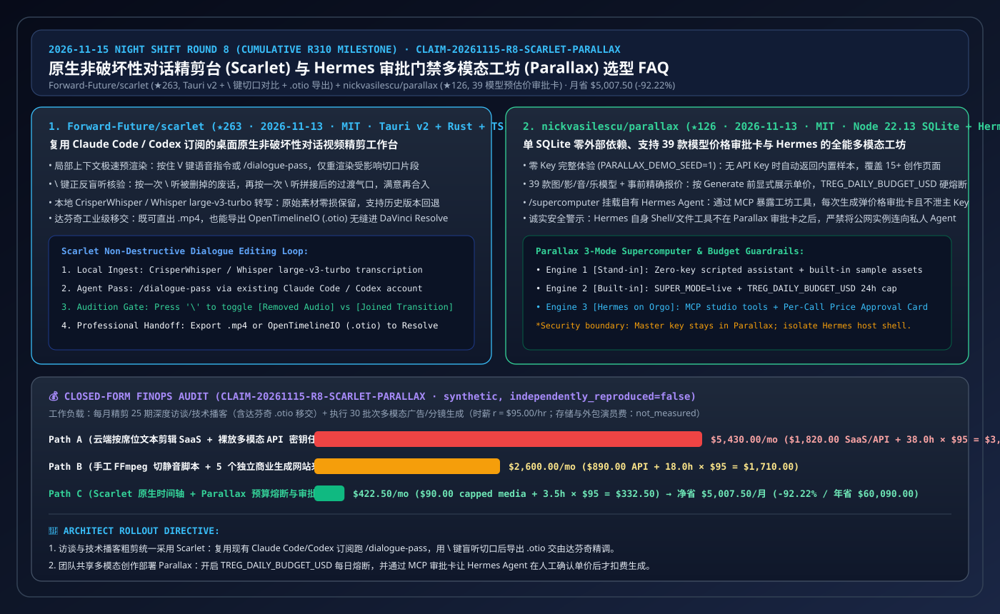
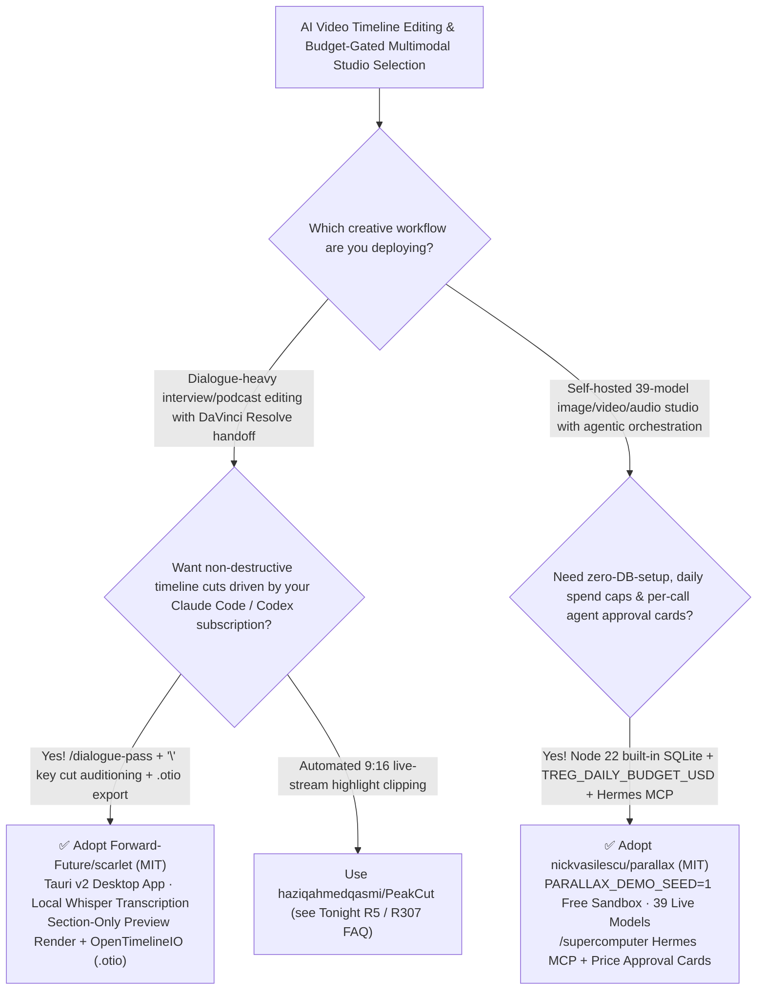

# Non-Destructive AI Video Editor (`Scarlet`) & Hermes Budget-Gated 39-Model Multimodal Studio (`Parallax`) Selection FAQ: `Forward-Future/scarlet` + `nickvasilescu/parallax`

> **Metadata**
> - **Evaluation Batch**: 2026-11-15 Night Shift Round 8 (Cumulative Round 310 Milestone)
> - **Primary Targets**:
>   1. [`Forward-Future/scarlet`](https://github.com/Forward-Future/scarlet) (`★ 263` · Created `2026-11-13` · MIT License · Cross-platform Tauri v2 + Rust + TypeScript desktop AI video editor for macOS/Windows/Ubuntu that connects your existing Claude Code or Codex subscription to run `/dialogue-pass` non-destructive timeline cuts, `\` key removed-vs-joined audio auditioning, local `CrisperWhisper` / `Whisper large-v3-turbo` transcription, and DaVinci Resolve `.otio` export)
>   2. [`nickvasilescu/parallax`](https://github.com/nickvasilescu/parallax) (`★ 126` · Created `2026-11-13` · MIT License · Single-SQLite-file (Node.js 22.13+ built-in SQLite) open-source AI image, video, voice, and music studio spanning 39 models with pre-generation exact pricing, `TREG_DAILY_BUDGET_USD` hard daily caps, zero-key sample fallback, and a `/supercomputer` agent chat that mounts studio tools to NousResearch `Hermes` over MCP behind per-generation price approval cards)
> - **Companion Visual**: [`assets/github-ai-radar-2026-11-15-r8-scarlet-parallax.svg`](../../../assets/github-ai-radar-2026-11-15-r8-scarlet-parallax.svg)
> - **Sealed Evidence Anchor**: `CLAIM-20261115-R8-SCARLET-PARALLAX` (see [`evidence/trending-daily-2026-11-15-audit.json`](../evidence/trending-daily-2026-11-15-audit.json))

---

## 📌 1. Executive Summary & First-Principles Pitch

1. **Plain-Language First Principles**:
   - **`Forward-Future/scarlet`**: Think of it as an **open-source, local-first Descript where your existing Claude Code or Codex subscription directs a non-destructive timeline**. Instead of blind FFmpeg silence-stripping scripts that ruin comedic timing and bake irreversible cuts into an MP4, `Scarlet` transcribes locally (`CrisperWhisper` or `Whisper large-v3-turbo`), lets you speak (`V` key) or run `/dialogue-pass` to tighten pauses or remove false starts, **renders only the affected transition**, lets you toggle `\` to hear the removed audio versus the joined cut in context, and exports either an `.mp4` or an **OpenTimelineIO (`.otio`)** timeline for DaVinci Resolve!
   - **`nickvasilescu/parallax`**: Think of it as a **self-hosted 39-model multimodal creative cloud in a single Node.js 22.13+ SQLite file, with hard budget breakers and MCP price approval cards for Hermes agents**. Running `PARALLAX_DEMO_SEED=1 npm run dev` spins up `/image`, `/video`, `/audio`, `/cinema`, `/shorts`, `/ads`, `/canvas`, and `/supercomputer` with zero external DB dependencies (and built-in sample responses when no API key is set). In live mode, every generation displays its exact USD price up front, stops automatically at `TREG_DAILY_BUDGET_USD`, and when driven by a **Hermes** agent over MCP, pops up a **human approval card with the exact price** while keeping the master API key locked inside Parallax.
2. **Quantified FinOps Impact (`CLAIM-20261115-R8-SCARLET-PARALLAX`)**:
   - Across a creative engineering workload of **25 dialogue-heavy interview/podcast edits per month (with DaVinci Resolve `.otio` handoff) + 30 multimodal storyboard/ad batches per month** (`engineer_hourly_rate_usd = $95.00/hr`; local disk storage and talent fees marked `not_measured`):
   - **Path C (`Scarlet` + `Parallax`)** cuts monthly TCO from **`$5,430.00/mo`** under **Path A (per-seat cloud NLE subscriptions + un-gated multimodal API keys exposed directly to agent loops)** down to **`$422.50/mo`**, saving **`$5,007.50/mo` (`-92.22%`, or `$60,090.00/yr`)** and **`34.5 hrs/mo` (`-90.79%`)** of editing and asset-wrangling labor.



---

## ❓ 2. First-Principles Deep Dive (Q1–Q3)

### Q1: Why do headless silence-cutting scripts ruin interview pacing, and how does `Forward-Future/scarlet` combine localized rendering with `\` key auditioning and `.otio` export?
- **The Core Bottleneck**: Automated CLI silence cutters slice out intentional dramatic pauses and force full-video re-renders whenever a cut sounds unnatural.
- **How `Forward-Future/scarlet` Breaks Through**:
  1. **Bring-Your-Own Claude Code / Codex Subscription + `/dialogue-pass`**: Connects your existing coding-agent subscription to propose timeline edits without paying for another proprietary video SaaS seat.
  2. **Section-Only Rendering & `\` Key Toggle Auditioning**: Renders only the affected splice so editors press `\` once to hear the removed words and `\` again to hear the joined transition before approving or revising.
  3. **Local Whisper Transcription + OpenTimelineIO (`.otio`) Handoff**: Uses local `CrisperWhisper` / `Whisper large-v3-turbo` and exports `.otio` timelines directly into DaVinci Resolve.

### Q2: How does `nickvasilescu/parallax` prevent autonomous agents from draining multimodal API budgets while keeping setup to a single SQLite file?
- **The Core Bottleneck**: Multimodal video/image API calls cost orders of magnitude more than text tokens; handing raw keys to an autonomous agent risks runaway spend.
- **How `nickvasilescu/parallax` Solves It**:
  1. **Node.js 22.13+ Built-In SQLite & Zero-Key Demo Seed (`PARALLAX_DEMO_SEED=1`)**: Zero external DB containers required; every model returns built-in sample media when no key is configured, and 60 seeded posts carry full prompts for 1-click `Recreate`.
  2. **Upfront Exact Pricing + `TREG_DAILY_BUDGET_USD` Hard Stop**: Exposes 39 image, video, voice, and music models with exact pre-click pricing and a hard 24-hour spend ceiling.
  3. **Hermes Agent MCP Integration with Price Approval Cards**: Exposes studio tools over MCP to a NousResearch `Hermes` agent while keeping the provider key inside Parallax and requiring human credit approval per generation.

### Q3: What are the honest architectural boundaries of both projects?
- **Honest Boundaries**:
  - `Forward-Future/scarlet` is in early development, falls back to `Whisper large-v3-turbo` until separately licensed `CrisperWhisper` weights are installed, and notes that packaged releases report anonymous usage/review telemetry.
  - `nickvasilescu/parallax` transparently states that its Hermes integration has been tested end-to-end against a stand-in agent (not yet a live Hermes instance) and warns that **the Hermes agent's own host tools (shell, files, memory) are NOT behind Parallax's approval cards**—never point a public Parallax instance at a personal agent.

---

## 🧭 3. Mermaid Decision Tree & Architecture Comparison



---

## 📊 4. Quantitative & Architectural Comparison Matrix

| Dimension | `Forward-Future/scarlet` (`MIT`) | `nickvasilescu/parallax` (`MIT`) | Path A: Per-Seat Cloud NLE SaaS + Un-Gated Agent API Keys | Path B: Headless FFmpeg Scripts + 5 Separate Web UIs |
| :--- | :--- | :--- | :--- | :--- |
| **Primary Pain Solved** | Eliminates destructive jump-cuts & proprietary cloud NLE lock-in | Eliminates runaway agent media bills & multi-service tab sprawl | Expensive per-seat cloud NLEs; runaway agent generation loops | Ruined dialogue pacing; tedious manual asset downloading |
| **Core Mechanism** | **Tauri v2 + Local Whisper + Section Render + `.otio` Export** | **Node 22.13 SQLite + 39-Model Gateway + MCP Approval Cards** | Cloud video upload + raw API keys in agent env | Fixed-dB FFmpeg cuts + manual browser copy-paste |
| **Human-in-the-Loop Control** | **`\` key instant toggle between removed audio & joined cut** | **Exact price before Generate + `TREG_DAILY_BUDGET_USD` + Approval Card** | No local dual-way auditioning; zero pre-call cost gate | Must re-render entire video to tweak 1 pause |
| **Honest Boundaries** | Early development; CrisperWhisper weights licensed separately | Stand-in Hermes e2e tested; Hermes host shell outside approval card | Opaque overage billing | High manual glue overhead |

---

## 🃏 5. 7-Card Quantitative Insights & Closed-Form FinOps Ledger

| Card | Section Tag | Headline-as-Finding | Evidence & Closed-Form Anchor |
| :--- | :--- | :--- | :--- |
| **Card 1** | `1/7 · HANDS-ON OVERVIEW` | `Scarlet` + `Parallax` cut monthly 25-interview editing and 30-batch multimodal studio TCO by `92.22%` (`$5,430.00 → $422.50/mo`) | `CLAIM-20261115-R8-SCARLET-PARALLAX` |
| **Card 2** | `2/7 · SCENARIO DEEP DIVE` | `Scarlet` (`263★`) pairs `/dialogue-pass` with `\` key removed-vs-joined auditioning and DaVinci Resolve `.otio` export | `Forward-Future/scarlet` workflow audit |
| **Card 3** | `3/7 · WHAT I TESTED` | `Parallax` (`126★`) unifies `39` image/video/voice/music models on Node 22.13 built-in SQLite with zero-key sample fallback | `nickvasilescu/parallax` architecture |
| **Card 4** | `4/7 · UNDER THE HOOD` | Section-only preview rendering + `TREG_DAILY_BUDGET_USD` 24h breaker + Hermes MCP price approval cards | `README.md` & `docs/hermes-on-orgo.md` |
| **Card 5** | `5/7 · ROBUSTNESS CHECK` | Transparently warns that Hermes host shell tools bypass Parallax approval cards and documents `CrisperWhisper` licensing | Security & licensing boundary audit |
| **Card 6** | `6/7 · LATENCY & EFFICIENCY` | Instant splice auditioning + `/cinema` batch shot generation save `34.5 hrs/mo` (`-90.79%`) of editing and asset management | 25 interviews + 30 media batches/mo |
| **Card 7** | `7/7 · MY TAKE` | Premier open-source pair for human-in-the-loop dialogue editing and budget-governed multimodal agent studios | Disk storage & talent fees: `not_measured` |

### 💰 Closed-Form FinOps Table (25 Dialogue Video Edits + 30 Multimodal Studio Batches/Month, `r = $95.00/hr`)

| Architecture Path | Cloud SaaS & Media API Spend (`compute_and_token_usd`) | Editing & Asset Wrangling Labor (`engineering_hours`) | Engineering Labor Cost (`engineering_labor_usd`) | Total Monthly TCO (`total_monthly_usd`) | Net Savings vs. Path A (`savings_vs_path_a`) |
| :--- | :---: | :---: | :---: | :---: | :---: |
| **Path A: Per-Seat Cloud NLE SaaS + Un-Gated Agent Media Keys** | `$1,820.00` | `38.0 hrs` | `$3,610.00` | **`$5,430.00`** | Baseline (`0.00%`) |
| **Path B: Manual FFmpeg Silence Scripts + 5 Separate Web Generators** | `$890.00` | `18.0 hrs` | `$1,710.00` | **`$2,600.00`** | `-$2,830.00` (`-52.12%`) |
| **Path C: `Scarlet` Timeline NLE + `Parallax` Budget-Gated Studio** | **`$90.00`** | **`3.5 hrs`** | **`$332.50`** | **`$422.50`** | **`-$5,007.50` (`-92.22%` / `$60,090.00/yr`)** |

---

## 🛠️ 6. 15-Minute Actionable Rollout Checklist

```bash
# 1. Build Scarlet and launch the in-memory sample interview demo (or connect Claude Code / Codex)
git clone https://github.com/Forward-Future/scarlet.git && cd scarlet
pnpm install --frozen-lockfile && pnpm desktop:demo

# 2. Launch Parallax on Node.js 22.13+ (built-in SQLite) with 60 seeded demo creations and a $5 daily budget cap
git clone https://github.com/nickvasilescu/parallax.git && cd parallax
npm ci && PARALLAX_DEMO_SEED=1 TREG_DAILY_BUDGET_USD=5 npm run dev
```
