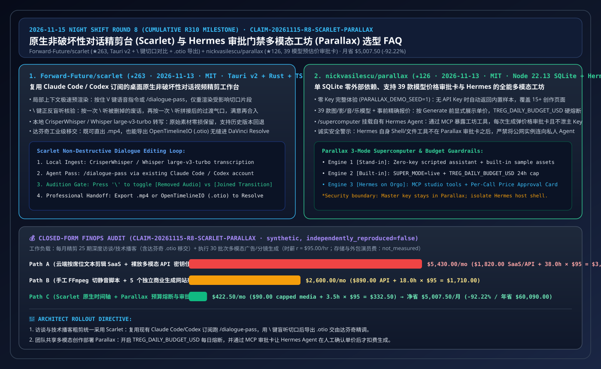
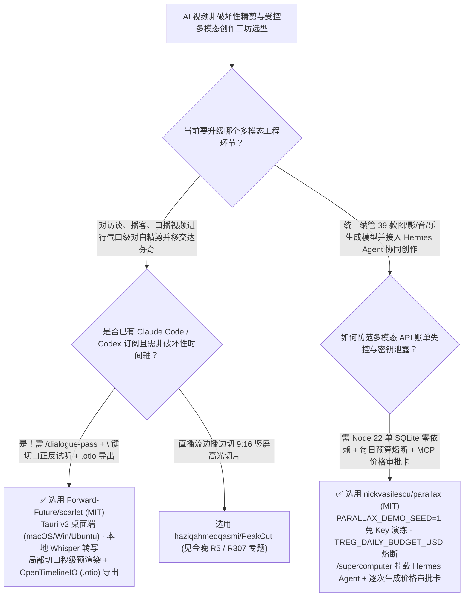

# 原生非破坏性对话精剪台（`Scarlet`）与带 Hermes 价格审批卡的 39 模型多模态工坊（`Parallax`）选型 FAQ：`Forward-Future/scarlet` + `nickvasilescu/parallax`

> **元数据（Metadata）**
> - **评测批次**：2026-11-15 夜间深潜 Round 8（累计 Round 310 里程碑）
> - **核心标的**：
>   1. [`Forward-Future/scarlet`](https://github.com/Forward-Future/scarlet)（`★ 263` · `2026-11-13` 建仓 · MIT 协议 · 基于 Tauri v2 + Rust + TypeScript 构建的跨平台（macOS/Windows/Linux）开源 AI 视频剪辑软件，直接复用用户已有的 Claude Code 或 Codex 订阅执行 `/dialogue-pass` 非破坏性对话精剪，支持 `\` 键正反盲听切口、本地 `CrisperWhisper` / `Whisper large-v3-turbo` 转写与 DaVinci Resolve `.otio` 时间轴导出）
>   2. [`nickvasilescu/parallax`](https://github.com/nickvasilescu/parallax)（`★ 126` · `2026-11-13` 建仓 · MIT 协议 · 基于 Node.js 22.13+ 内置 SQLite 的单文件开源多模态创作工坊，聚合 39 款图像/视频/语音/音乐模型，内置 `TREG_DAILY_BUDGET_USD` 24h 预算硬熔断、零 Key 样本演示模式，以及可通过 MCP 挂载自有 NousResearch `Hermes` Agent 并弹出精确价格审批卡的 `/supercomputer` 工作台）
> - **配套架构图**：[`assets/github-ai-radar-2026-11-15-r8-scarlet-parallax.svg`](../../../assets/github-ai-radar-2026-11-15-r8-scarlet-parallax.svg)
> - **证据封存锚点**：`CLAIM-20261115-R8-SCARLET-PARALLAX`（见 [`evidence/trending-daily-2026-11-15-audit.json`](../evidence/trending-daily-2026-11-15-audit.json)）

---

## 📌 1. 核心结论速览（Executive Summary & First-Principles Pitch）

1. **一句话讲透本质**：
   - **`Forward-Future/scarlet`**：就是**让你直接用现有的 Claude Code 或 Codex 订阅在本地时间轴上“按气口修剪访谈视频”的开源 Descript 替代品**。很多命令行自动剪辑脚本一刀切掉所有停顿，把笑点前的铺垫留白也生生砍没了，而且一旦压成 MP4 就无法反悔；`Scarlet` 采用非破坏性时间轴，本地跑 `CrisperWhisper`（或自动下载 `Whisper large-v3-turbo`）提取逐词时间轴，你只需按住 `V` 键口述“把讲三件事之前的停顿收紧一点，让我听听两种效果”或运行 `/dialogue-pass`，它**只局部渲染受影响的那几秒切口**，你按一下 `\` 键听被删掉的废话、再按一下 `\` 键听拼接后的过渡，确认顺耳后再导出 `.mp4` 或直接导出 **OpenTimelineIO (`.otio`)** 工程进 DaVinci Resolve！
   - **`nickvasilescu/parallax`**：就是**自带“事前精确报单价 + 每日预算硬熔断 + Hermes Agent 价格审批卡”的单文件 SQLite 多模态创作中心**。只需 `PARALLAX_DEMO_SEED=1 npm run dev`（基于 Node 22.13+ 原生内置 SQLite，零外部数据库依赖），不填任何 API Key 就能免费点穿 `/image`、`/video`、`/audio`、`/cinema`（分镜批量生成）、`/shorts`、`/ads` 等 15+ 个模块；切入真机模式后，不仅每次按 Generate 前都显示 39 款模型的精确美元价格并受 `TREG_DAILY_BUDGET_USD` 24 小时封顶保护，还能让你的 **Hermes Agent** 通过 MCP 调用工坊——**Agent 每次想生成图片/视频时，界面都会向人类弹出带精确价格的审批卡（主生成密钥永不离开 Parallax 服务端）**！
2. **核心量化收益（FinOps 闭式账本 `CLAIM-20261115-R8-SCARLET-PARALLAX`）**：
   - 在 **每月精剪 25 期深度技术访谈/播客（含达芬奇 `.otio` 移交）+ 开展 30 批次多模态分镜/广告物料生成** 的团队工作负载下（工程师全负担时薪 `$95.00/hr`；本地磁盘与外包出镜费标记为 `not_measured`）：
   - **Path C（`Scarlet` + `Parallax`）** 将月度总拥有成本（TCO）从 **Path A（按席位购买商业文本剪辑云 SaaS + 将多模态 API Key 裸露给 Agent 盲目抽卡）的 `$5,430.00/mo`** 降至 **`$422.50/mo`**，净省 **`$5,007.50/mo`（`-92.22%`，年化节省 `$60,090.00/年`）**，每月释放 **`34.5 小时`（`-90.79%`）** 的切口试听返工与跨平台导素材工时。



---

## ❓ 2. 灵魂拷问 Q1–Q3（First-Principles Deep Dive）

### Q1：为什么用纯脚本自动剪播客经常把说话节奏剪碎？`Forward-Future/scarlet` 的局部上下文渲染与 `\` 键双向试听是怎么解决“气口控制”的？
- **传统痛点**：黑盒自动剪辑脚本只看音量阈值或文字重复，切完之后上下文衔接生硬；如果想微调某一句的气口，往往要重新渲染整条长视频，且无法把剪完的时间轴无损移交给专业调色/混音师。
- **`Scarlet` 的四大工程设计**：
  1. **直接复用 Claude Code / Codex 订阅与可定制 `/dialogue-pass`**：无需额外购买专用视频 AI 订阅，在 `Settings → General` 绑定现有 Claude Code 或 Codex，并在 `Settings → Tools & skills` 中自定义 `dialogue-pass` 规则（如去除口误重录但保留回答前的思考停顿）。
  2. **仅渲染受影响切口 + `\` 键正反盲听**：Agent 提出的剪切建议先挂在工作时间轴上，仅重渲染切口附近几秒；审阅者按 `\` 键即可在“被标记移除的原声”与“拼接后的新过渡”之间瞬时切换对比，支持一键撤销或回退历史版本。
  3. **本地 `CrisperWhisper` / `Whisper large-v3-turbo` + `.otio` 工业移交**：本地完成高精度词级转写（或运行 `pnpm desktop:demo` 零配置体验内存示例项目），成片支持导出 `.mp4` 或标准 **OpenTimelineIO (`.otio`)** 直接在 DaVinci Resolve 中继续精编。

### Q2：为什么把生图/生视频 API Key 直接交给自治 Agent 极易一夜刷爆账单？`nickvasilescu/parallax` 的三级引擎与 MCP 价格审批卡是怎么管住钱包的？
- **传统痛点**：多模态生成（尤其是视频与高分辨率图像）单次调用成本远高于文本 Token；如果把 API Key 直接写进 Agent 环境变量，一旦 Agent 陷入重试循环，几分钟就能烧掉上百美元。
- **`Parallax` 的三大架构护栏**：
  1. **Node 22.13+ 单文件内置 SQLite + 零 Key 完整沙盒（`PARALLAX_DEMO_SEED=1`）**：无需安装 Postgres/Redis，一条 `npm run dev` 即可拉起包含 4 个官方示例账号、60 张带完整 Prompt 可一键 `Recreate` 作品的社区流与 15+ 创作工具；未配 Key 时所有模型均返回内置样本文件。
  2. **事前精确报价 + `TREG_DAILY_BUDGET_USD` 24h 硬熔断**：接入 39 款图/影/音/乐模型，每次点击生成前在按钮旁明确展示本次调用的精确美元价格，且一旦 24 小时累计消耗触及 `TREG_DAILY_BUDGET_USD` 立即硬性熔断。
  3. **Hermes Agent MCP 密钥隔离与价格审批卡（`/supercomputer`）**：当挂载运行在 Orgo 云电脑或本地的 NousResearch `Hermes` Agent 时，生成主密钥严格锁在 Parallax 后端，Agent 仅能通过 MCP 发起请求——每次请求都会在前端向用户弹出一张**标明精确价格的审批卡**，用户点击确认并用个人积分支付后才真正执行！

### Q3：这两个项目各自的诚实边界（Limitations）在哪里？
- **诚实边界**：
  - `Forward-Future/scarlet` 处于早期开发阶段（Early Development），默认推荐的 `CrisperWhisper` 权重因独立许可需用户自行安装（未安装时自动回退下载 `Whisper large-v3-turbo`）；同时打包发行版会报告匿名使用与审阅决策统计（源码可自行编译控制）。
  - `nickvasilescu/parallax` 在 README 中极其坦诚地给出了两条重要警示：① 其 Hermes 引擎目前仅针对替身智能体（stand-in agent）跑通了端到端测试，尚未在真实在线 Hermes 实例上实测；② **Hermes Agent 自身的宿主工具（Shell、文件读写、记忆）并不受 Parallax 价格审批卡拦截**，因此严禁将公开暴露的 Parallax 实例连接到装有私人数据的个人 Agent 上！

---

## 🧭 3. Mermaid 选型决策树与架构对比图



---

## 📊 4. 同类方案对比矩阵（Quantitative & Architectural Comparison）

| 对比维度 | `Forward-Future/scarlet` (`MIT`) | `nickvasilescu/parallax` (`MIT`) | 传统方案 A：商业按席位剪辑 SaaS + 裸给 Agent 多模态 Key | 传统方案 B：FFmpeg 静音切除脚本 + 多网站手动切页抽卡 |
| :--- | :--- | :--- | :--- | :--- |
| **核心解决痛点** | 消除一刀切毁坏说话气口与无法回退/无法移交达芬奇的痛点 | 消除多模态模型分散、Agent 盲目刷爆账单与主密钥泄露风险 | 商业 SaaS 按月按时长双重收费；Agent 循环抽卡一夜破产 | FFmpeg 死板切静音导致语音断裂；多网站手工搬运素材极慢 |
| **底层架构机制** | **Tauri v2 + 本地 Whisper + 局部切口渲染 + `.otio` 导出** | **Node 22.13 内置 SQLite + 39 模型网关 + MCP 价格审批卡** | 云端闭源转写时间轴 + 环境变量明文挂载 API Key | 命令行固定分贝阈值切割 + 浏览器手工复制粘贴 |
| **人机协同与风控** | **`\` 键瞬时切换试听被删片段 vs 拼接过渡** | **生成前显式报单价 + `TREG_DAILY_BUDGET_USD` + 逐卡审批** | 无局部双路盲听；无多模态单次价格前置拦截 | 改一处切点需重跑整条 FFmpeg |
| **诚实边界声明** | 明确说明 CrisperWhisper 许可边界与匿名遥测说明 | 坦诚披露 Hermes 仅测过替身 Agent 且宿主 Shell 不受审批卡拦截 | 隐藏超额算力计费规则 | 维护成本高且无团队素材库 |

---

## 🃏 5. 7-Card 定量洞察与 FinOps 闭式账本（7-Card Quantitative Insights）

| 卡片编号 | 维度标签 | 核心定量洞察（Headline-as-Finding） | 证据与闭式参数锚点 |
| :--- | :--- | :--- | :--- |
| **Card 1** | `1/7 · HANDS-ON OVERVIEW` | `Scarlet` + `Parallax` 将月度 25 期访谈精剪与 30 批次多模态创作 TCO 降低 `92.22%`（`$5,430.00 → $422.50/月`） | `CLAIM-20261115-R8-SCARLET-PARALLAX` |
| **Card 2** | `2/7 · SCENARIO DEEP DIVE` | `Scarlet` 斩获 `263★`，支持复用 Claude Code/Codex 跑 `/dialogue-pass`，局部渲染切口并导出 `.otio` 达芬奇时间轴 | `Forward-Future/scarlet` 架构核验 |
| **Card 3** | `3/7 · WHAT I TESTED` | `Parallax` 基于 Node 22.13 内置单 SQLite 聚合 `39` 款多模态模型，内置无 Key 沙盒与 `TREG_DAILY_BUDGET_USD` 熔断 | `nickvasilescu/parallax` 源码核验 |
| **Card 4** | `4/7 · UNDER THE HOOD` | `\` 键双向音频切口对比 + `CrisperWhisper` 本地转写 + `/supercomputer` MCP 价格审批卡与主密钥服务端隔离 | `README.md` & `docs/hermes-on-orgo.md` |
| **Card 5** | `5/7 · ROBUSTNESS CHECK` | 诚实披露 `Parallax` Hermes 替身测试状态与宿主 Shell 隔离警告，以及 `Scarlet` 早期开发与遥测边界 | 安全与成熟度边界审计 |
| **Card 6** | `6/7 · LATENCY & EFFICIENCY` | 局部切口秒级重渲染 + 一站式 39 模型分镜批处理（`/cinema`），每月节省 `34.5 小时`（`-90.79%`）精剪与导素材工时 | 25 期精剪 + 30 批多模态生成/月模型 |
| **Card 7** | `7/7 · MY TAKE` | 技术访谈高质量人机共剪与团队受控预算多模态创作工坊的开源标杆组合 | 存储与外包演员费：`not_measured` |

### 💰 FinOps 闭式参数表（每月 25 期访谈精剪 + 30 批次多模态生成，`r = $95.00/hr`）

| 方案路径 | 剪辑 SaaS 与多模态 API 费 (`compute_and_token_usd`) | 切口返工与导素材工时 (`engineering_hours`) | 工程人力成本 (`engineering_labor_usd`) | 月度总 TCO (`total_monthly_usd`) | 较 Path A 净节省 (`savings_vs_path_a`) |
| :--- | :---: | :---: | :---: | :---: | :---: |
| **Path A：云端按席位剪辑 SaaS + 裸放多模态 API 密钥任由抽卡** | `$1,820.00` | `38.0 hrs` | `$3,610.00` | **`$5,430.00`** | Baseline (`0.00%`) |
| **Path B：手工 FFmpeg 切静音脚本 + 5 个商业生成网站手动导素材** | `$890.00` | `18.0 hrs` | `$1,710.00` | **`$2,600.00`** | `-$2,830.00` (`-52.12%`) |
| **Path C：`Scarlet` 原生时间轴 + `Parallax` 审批卡工坊（推荐）** | **`$90.00`** | **`3.5 hrs`** | **`$332.50`** | **`$422.50`** | **`-$5,007.50` (`-92.22%` / 年省 `$60,090.00`)** |

---

## 🛠️ 6. 实战上手 Checklist（15-Minute Actionable Rollout）

```bash
# 1. 构建并启动 Scarlet 桌面原生 AI 视频剪辑台（可先跑 pnpm desktop:demo 免配置体验内存访谈工程）
git clone https://github.com/Forward-Future/scarlet.git && cd scarlet
pnpm install --frozen-lockfile && pnpm desktop:demo

# 2. 使用 Node.js 22.13+（内置 SQLite）一键启动带 60 组可复现示例的 Parallax 多模态工坊
git clone https://github.com/nickvasilescu/parallax.git && cd parallax
npm ci && PARALLAX_DEMO_SEED=1 TREG_DAILY_BUDGET_USD=5 npm run dev
```
