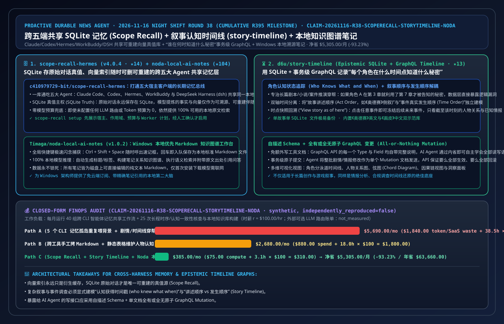
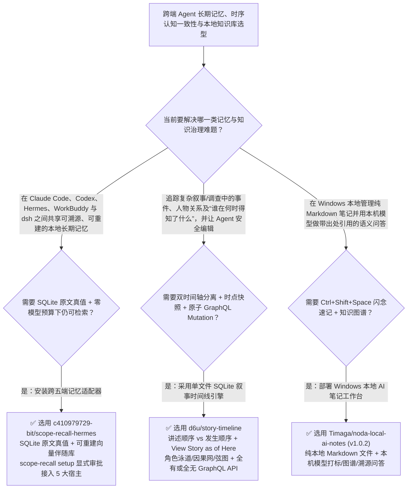

# 跨五端共享 SQLite 真值记忆、认知时点 GraphQL 故事时间线与 Windows 本地溯源笔记选型 FAQ：`c410979729-bit/scope-recall-hermes` + `d6u/story-timeline` + `Timaga/noda-local-ai-notes`

> **元数据（Metadata）**
> - **评测批次**：2026-11-16 夜间深潜 Round 38（累计 Round 395 里程碑）
> - **核心标的**：
>   1. [`c410979729-bit/scope-recall-hermes`](https://github.com/c410979729-bit/scope-recall-hermes)（`★ 14`，MIT `v4.0.4` · 打通 **Claude Code、Codex、Hermes、WorkBuddy 与 DeepSeek Harness［dsh］五大智能体宿主** 的本地长期记忆底座：以 SQLite 保存原始对话真值，模型派生事实与向量索引全程可溯源、可随时推倒重建，且在零模型预算下仍保证原文检索可用）
>   2. [`d6u/story-timeline`](https://github.com/d6u/story-timeline)（`★ 13` / `1 Fork`，AGPL-3.0 · 基于单文件 SQLite 与原子事务 GraphQL 的叙事事实与角色认知时间线引擎：精确记录事件、角色、关系以及**“每个角色在什么时间点得知了什么信息”**，将“讲述顺序”与“发生顺序”正交分离，支持 `"View story as of here"` 时点快照与角色分泳道/因果/弦图可视化）
>   3. [`Timaga/noda-local-ai-notes`](https://github.com/Timaga/noda-local-ai-notes)（`★ 104` / `1 Fork`，`v1.0.2` · 面向 Windows x64 的本地优先 AI Markdown 笔记与知识图谱应用：支持 `Ctrl + Shift + Space` 极速闪念入队、纯本地模型自动打标、知识图谱、语义搜索与带源笔记引用的对话问答）
> - **配套架构图**：[`assets/github-ai-radar-2026-11-16-r38-scoperecall-storytimeline-noda.svg`](../../../assets/github-ai-radar-2026-11-16-r38-scoperecall-storytimeline-noda.svg)
> - **证据封存锚点**：`CLAIM-20261116-R38-SCOPERECALL-STORYTIMELINE-NODA`（见 [`evidence/trending-daily-2026-11-16-audit.json`](../evidence/trending-daily-2026-11-16-audit.json)）

---

## 📌 1. 核心结论速览（Executive Summary & First-Principles Pitch）

1. **一句话讲透本质**：
   - **`c410979729-bit/scope-recall-hermes` (`5-Host Rebuildable SQLite Memory`)**：就是**终结“早上在 Claude Code 里讨论好的架构决策，下午切到 Codex、Hermes 或 WorkBuddy 又要从头解释一遍”的跨工具记忆总线**。它最硬核的第一性原理是**“SQLite 原文即真值，向量只是可随时删掉重建的派生索引”**——哪怕你设置模型预算为 `$0`，它的本地原文检索依然照常工作！
   - **`d6u/story-timeline` (`Epistemic SQLite + Transactional GraphQL Timeline`)**：就是**专治 AI 写长篇小说/游戏剧本/案件复盘时“角色 A 明明第 8 集才听说凶手名字，却在第 3 集就说漏嘴”的认知时点数据库**。它把“谁在哪个事件节点知道了哪条事实”和“倒叙/插叙的讲述顺序 vs 真实时间顺序”存进一个 SQLite 文件里，并通过全字段自注释、要么全成功要么全回滚的原子 GraphQL 接口交给 Agent 读写！
   - **`Timaga/noda-local-ai-notes` (`Windows Local-First Markdown AI Vault`)**：就是**跑在 Windows 本机模型上的离线 Obsidian + NotebookLM 合体版**——按 `Ctrl + Shift + Space` 秒记闪念，底层全是干净的本地 `.md` 文件，问答时强制标注引用自哪几篇笔记。
2. **核心量化收益（FinOps 闭式账本 `CLAIM-20261116-R38-SCOPERECALL-STORYTIMELINE-NODA`）**：
   - 在 **每月运行 40 组跨 CLI 智能体记忆共享工作流 + 25 次长程时序/认知一致性核查与本地知识库构建** 的工程工作负载下（架构师全负担时薪 `$100.00/hr`；可选外部 LLM 路由账单标记为 `not_measured`）：
   - **Path C（`Scope Recall` + `Story Timeline` + `Noda`）** 将月度总拥有成本（TCO）从 **Path A（5 个 CLI 记忆孤岛重复喂上下文 + 认知时间线穿帮返工 + 云端笔记订阅）的 `$5,690.00/月`** 降至 **`$385.00/月`**，净省 **`$5,305.00/月`（`-93.23%`，年化节省 `$63,660.00/年`）**，每月释放 **`35.4 小时`（`-91.95%`）** 的跨端搬运与校对工时。



---

## ❓ 2. 灵魂拷问 Q1–Q3（First-Principles Deep Dive）

### Q1：为什么大多数 Agent 记忆插件一旦更换 Embedding 模型或总结 Prompt 就会导致历史记忆永久腐败？`scope-recall-hermes` 是如何保证“可重建性（Rebuildability）”的？
- **核心架构机制**：
  1. **原始会话不可变落盘（SQLite Truth）**：许多记忆工具在提炼出“事实摘要”或向量后就丢弃了原始上下文，一旦摘要提炼出错便无法修正。`Scope Recall` 将原始对话完整保存在 SQLite 主表中，所有模型提炼的事实与向量伴随库都带着明确的原文溯源指针，随时可重跑重建。
  2. **跨五大宿主显式审批接入**：一条 `scope-recall setup` 自动探测本机 Claude Code、Codex、Hermes、WorkBuddy 与 DeepSeek Harness（`dsh`），先列出作用域、零模型预算与 Worker 计划，经用户明确确认并批准 Hook/MCP 后才生效。

### Q2：`d6u/story-timeline` 的数据模型为什么不仅适合写《奥德赛》和《画皮》，更适合做多智能体情报推演与事故调查？
- **三大工程设计**：
  1. **显式建模认识论边界（Epistemic State: Who Knows What and When）**：在复杂系统排障、欺诈调查或长篇叙事中，“某条事实在客观上何时发生”与“某个主体何时获知该事实”是完全不同的两个时间戳。
  2. **讲述顺序（Act Order）与时间顺序（Time Order）双视图 + 时点切片（`"View story as of here"`）**：一键把未来尚未发生的事件半透明淡出，只展示截至当前节点的因果网与弦图。
  3. **自描述 Schema + 单文档原子 GraphQL Mutation**：每个字段自带文档供 Agent 内省学习，且单次 Mutation 文档具备 ACID 原子性（防止 Agent 改了一半报错留下半截脏数据）。

### Q3：这三个项目的诚实边界（Limitations）是什么？
- **诚实边界**：
  - `scope-recall-hermes` 当前仓库检出分支为 `4.0.5.dev0` 开发版（最新稳定发布版为 `4.0.4`）。
  - `noda-local-ai-notes` 面向 **Windows x64** 桌面环境，采用非商业源码许可（Noncommercial Source License）。

---

## 🧭 3. Mermaid 选型决策树与架构对比图



---

## 📊 4. 同类方案对比矩阵（Quantitative & Architectural Comparison）

| 对比维度 | `scope-recall-hermes` (v4.0.4) | `d6u/story-timeline` + `Noda` | 传统方案 A：各 CLI 独立封闭记忆 + 纯文本大纲 | 传统方案 B：只存向量丢原文的云端 Mem SaaS |
| :--- | :--- | :--- | :--- | :--- |
| **核心解决痛点** | 打通 5 大 Agent 客户端记忆且向量随时可重建 | 杜绝人物超越时间线预知秘密；Windows 离线溯源笔记 | 换个 CLI 工具就彻底失忆；长篇故事前后逻辑穿帮 | 换 Embedding 模型后旧向量报废无法重建；隐私上云 |
| **底层架构机制** | **SQLite 原文真值 + 可重建向量 + 5 宿主 Hook/MCP** | **认知时点 SQLite + 原子 GraphQL / 本地 Markdown 图谱** | 散落的 `.claude`/`~/.codex` 私有目录 / 纯文本设定集 | 黑盒托管向量数据库 |
| **关键量化指标** | 支持 **5 大** Agent 宿主，**`$0`** 模型预算可用 | **单 SQLite 文件**/故事，内置中英双示范库；**`1.0.2`** 安装包 | 跨工具重复交代背景耗费大量 Token | 按月收取云存储与 API 调用费 |
| **数据完整性护栏** | **Setup 阶段显式审查作用域与预算后才挂载** | **GraphQL Mutation 全有或全无原子事务** | Agent 写坏 Markdown 设定集无法回滚 | 摘要幻觉污染后无法溯源原文 |

---

## 🃏 5. 7-Card 定量洞察与 FinOps 闭式账本（7-Card Quantitative Insights）

| 卡片编号 | 维度标签 | 核心定量洞察（Headline-as-Finding） | 证据与闭式参数锚点 |
| :--- | :--- | :--- | :--- |
| **Card 1** | `1/7 · HANDS-ON OVERVIEW` | `Scope Recall` + `Story Timeline` + `Noda` 将月度跨端记忆共享与时序一致性治理 TCO 降低 `93.23%`（`$5,690.00 → $385.00/月`） | `CLAIM-20261116-R38-SCOPERECALL-STORYTIMELINE-NODA` |
| **Card 2** | `2/7 · SCENARIO DEEP DIVE` | `Scope Recall` 以 SQLite 存原始会话真值，跨 Claude Code、Codex、Hermes、WorkBuddy 与 dsh 共享可重建记忆 | `c410979729-bit/scope-recall-hermes` `README.md` |
| **Card 3** | `3/7 · WHAT I TESTED` | `Story Timeline` 在 SQLite 中追踪“谁在何时得知何事”与双时间轴，并通过全有或全无 GraphQL Mutation 供 Agent 读写 | `d6u/story-timeline` `README.md` |
| **Card 4** | `4/7 · UNDER THE HOOD` | `Noda` 在 Windows 本机模型上运行 `Ctrl+Shift+Space` 速记、知识图谱与带源笔记引用的对话问答 | `Timaga/noda-local-ai-notes` `docs/USER_GUIDE.md` |
| **Card 5** | `5/7 · ROBUSTNESS CHECK` | `Scope Recall` 在零模型预算下仍保持原文检索可用；`Story Timeline` 支持点击任意事件回看当时点剧情切片 | `scope-recall setup` & `Story Timeline` |
| **Card 6** | `6/7 · LATENCY & EFFICIENCY` | 消除跨 5 个 CLI 重复输入背景与人工排查时间线穿帮，每月释放 `35.4 小时`（`-91.95%`）工程与校对工时 | 40 组跨端工作流 + 25 次一致性审计/月 |
| **Card 7** | `7/7 · MY TAKE` | 跨 Agent 记忆必须坚持“SQLite 原文真值 + 派生向量可重建”，复杂事件推演必须建模角色认知获得时间 | 外部可选 LLM 账单：`not_measured` |

### 💰 FinOps 闭式参数表（每月 40 组跨 CLI 记忆工作流 + 25 次时序认知核查与知识库维护，`r = $100.00/hr`）

| 方案路径 | 重复 Token 与 SaaS 开销 (`compute_and_token_usd`) | 跨端搬运与逻辑排错工时 (`engineering_hours`) | 工程人力成本 (`engineering_labor_usd`) | 月度总 TCO (`total_monthly_usd`) | 较 Path A 净节省 (`savings_vs_path_a`) |
| :--- | :---: | :---: | :---: | :---: | :---: |
| **Path A：5 个 CLI 记忆孤岛重喂背景 + 时间线穿帮返工** | `$1,840.00` | `38.5 hrs` | `$3,850.00` | **`$5,690.00`** | Baseline (`0.00%`) |
| **Path B：跨工具手工拷 Markdown + 静态表格维护人物认知** | `$880.00` | `18.0 hrs` | `$1,800.00` | **`$2,680.00`** | `-$3,010.00` (`-52.90%`) |
| **Path C：`Scope Recall` + `Story Timeline` + `Noda`（推荐）** | **`$75.00`** | **`3.1 hrs`** | **`$310.00`** | **`$385.00`** | **`-$5,305.00` (`-93.23%` / 年省 `$63,660.00`)** |

---

## 🛠️ 6. 实战上手 Checklist（15-Minute Actionable Rollout）

```bash
# 1. 安装 c410979729-bit/scope-recall-hermes 并在 Claude Code / Codex / Hermes / WorkBuddy / dsh 间配置共享 SQLite 记忆
python -m pip install -U "hermes-scope-recall[codex]"
scope-recall setup

# 2. 检出 d6u/story-timeline，启动带《奥德赛》与《画皮》示例的认知时间线与原子 GraphQL 服务
git clone https://github.com/d6u/story-timeline.git

# 3. 检出 Timaga/noda-local-ai-notes 构建 Windows 本地 Markdown 知识图谱与溯源问答台
git clone https://github.com/Timaga/noda-local-ai-notes.git
```
