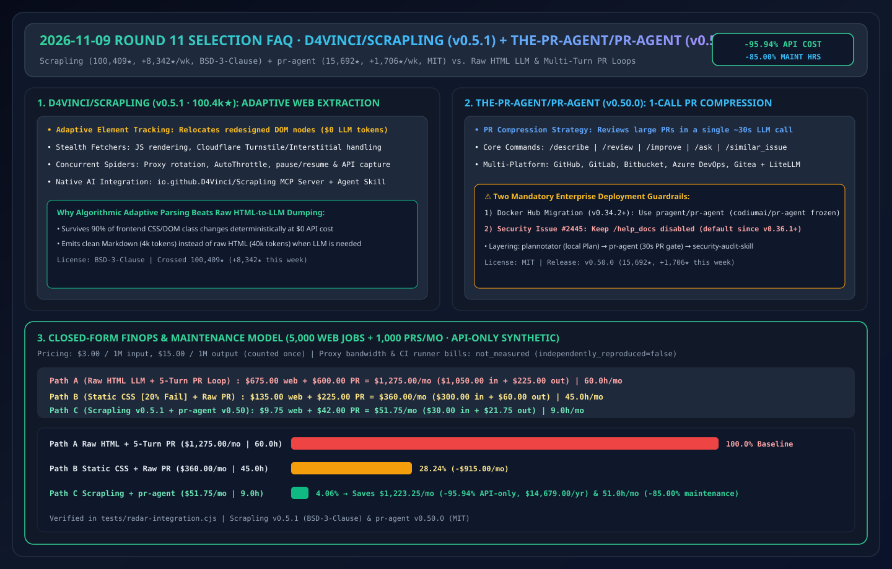
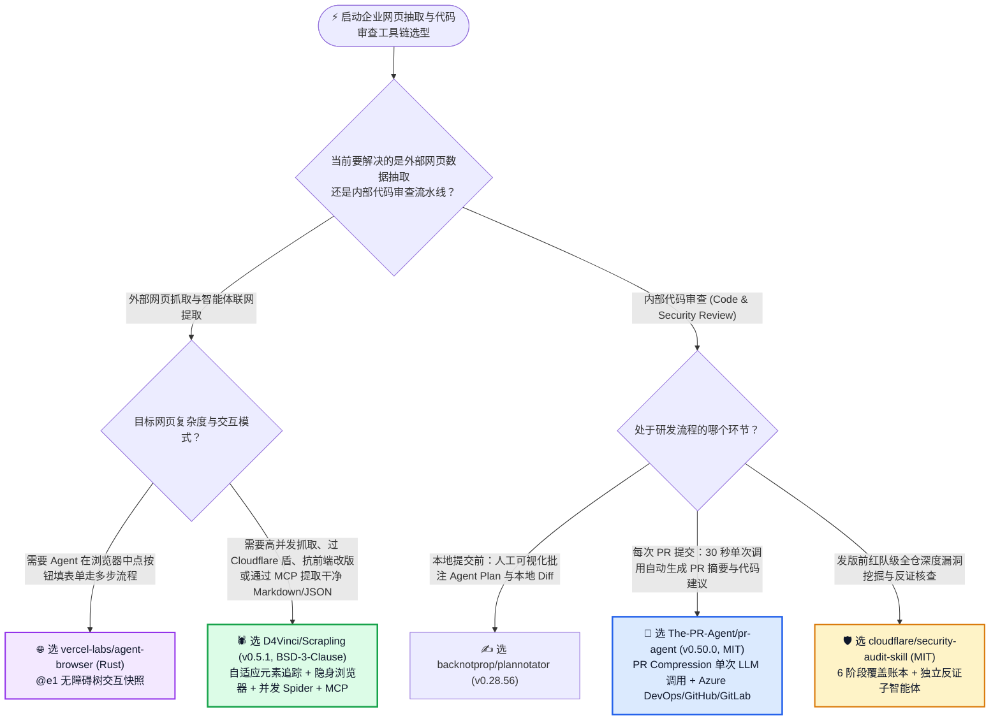
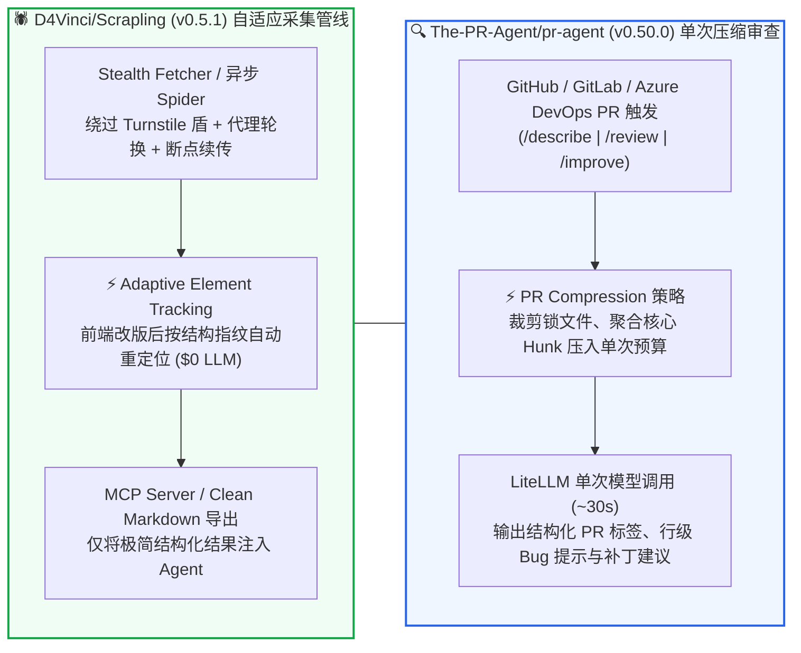

# 自适应网页结构抽取与单次压缩 PR 自动审查选型常见问题解答：`D4Vinci/Scrapling` + `The-PR-Agent/pr-agent` vs 脆弱 CSS 选择器 & 多轮全量 Diff 审查

> **English Edition**: [scrapling-pr-agent-adaptive-extraction-selection-faq.en.md](scrapling-pr-agent-adaptive-extraction-selection-faq.en.md)  
> **关联日报**: [2026-11-09 GitHub AI 最热榜单与情报摘要](../daily/2026-11-09.md) · **视觉评测卡**: [`cards.html`](../cards.html) · **在线面板**: [`zh-github-radar.html`](../../../zh-github-radar.html)

本文档面向 **AI Solution Architect（AI 解决方案架构师）、数据采集工程负责人与 DevSecOps 平台架构师**，基于 2026-11-09 GitHub Weekly Trending 双雄 **`D4Vinci/Scrapling`（`v0.5.1`，BSD-3-Clause，突破 `100,409` Stars 大关、单周暴涨 `+8,342 stars this week` 的自适应 Python 网页抓取与 MCP 框架）** 与 **`The-PR-Agent/pr-agent`（`v0.50.0`，MIT，总 Star `15,692`、单周新增 `+1,706 stars this week` 的单次调用压缩式开源 PR 审查引擎）** 的一手源码审计，用通俗大白话与第一性原理解答：
1. **为什么传统爬虫一遇到目标网站前端改版（CSS Class 名字变了）就全线崩溃，而把整页原始 HTML 扔给大模型提取又贵又慢？`D4Vinci/Scrapling` 是如何用「自适应元素追踪（Adaptive Element Tracking）+ 隐身浏览器过盾 + 原生 MCP Server 与 Agent Skill」在零 LLM 消耗下扛住网站改版的？**
2. **为什么很多自建的 PR 审查 Agent 审一个 50 文件的大 PR 要跑十几轮对话、花几分钟还抓不住重点？`The-PR-Agent/pr-agent` 的「PR Compression 单次 LLM 调用（~30 秒）策略」是怎么设计的？升级 `v0.34.2+` / `v0.50.0` 时有哪些必须注意的命名空间迁移与安全 Issue（`#2445`）？**
3. **在企业外部情报采集与内部代码审查管线中，如何把这两套工具组合成高性价比标配？**

> 🛡️ **数据来源、归属核验与证据分级声明（Provenance & Attribution Disclosure）**：
> - **`measured`（本班次一手实测抓取）**：`D4Vinci/Scrapling`（`100,409` API Stars / `100,329` Weekly DOM Stars，`10,492` Forks，`v0.5.1`，`BSD-3-Clause`，Weekly Trending `#10` `+8,342 stars this week`）与 `The-PR-Agent/pr-agent`（`15,692` API Stars / `15,679` Weekly DOM Stars，`2,161` Forks，`v0.50.0`，`MIT`，Weekly Trending `#11` `+1,706 stars this week`）的 GitHub REST API 元数据。
> - **`anonymized_reported`（`independently_reproduced=false`，上游仓库文档声明）**：`Scrapling` 的自适应元素重定位、相似元素匹配、Cloudflare Turnstile/Interstitial 处理、并发 `Spider`（`pause/resume`、`AutoThrottle`）及内置 MCP Server（`io.github.D4Vinci/Scrapling`）与 OpenClaw/Claude Skill；以及 `pr-agent` 的 PR Compression 单次 LLM 调用（`~30s`）机制、LiteLLM 多模型适配、Docker Hub 镜像命名空间从 `codiumai/pr-agent` 迁移至 `pragent/pr-agent`（自 `v0.34.2+` 起），以及 `/help_docs` 因凭证暴露缺陷 `#2445` 自 `v0.36.1` 起临时禁用的安全公告。
> - **`synthetic`（`independently_reproduced=false`，架构师参数化 FinOps 算例）**：第 5.1 节「每月 5,000 次动态网页结构化抽取 + 1,000 次企业 PR 自动化审查」的纯模型 API 账单对比（Path A 原始 HTML 塞给 LLM + 多轮未压缩 PR 审查 `$1,275.00/月`、`60.0 小时/月` vs Path B 脆弱静态选择器 + 单轮未压缩大 Diff `$360.00/月`、`45.0 小时/月` vs Path C `Scrapling` 自适应追踪 + `pr-agent` 单次压缩调用 `$51.75/月`、`9.0 小时/月`，节省 `$1,223.25/月` [`-95.94%` API-only] 与 `51.0 小时/月` [`-85.00%`] 维护工时；代理 IP 池与 CI 运行机费用标为 `not_measured`）严格执行 100% 闭式公式可复算门禁。

---

## 1. 📌 核心结论速览（Executive Summary）

| 评估维度 | 一句话大白话核心结论（直指本质） |
| :--- | :--- |
| **`D4Vinci/Scrapling` (`v0.5.1`) 到底是什么？** | 它是刚突破 **10 万 Star 大关** 的 Python 全栈网页抓取与解析框架（`BSD-3-Clause`）。它把**极速 HTTP 请求、过盾隐身浏览器、网站改版后自动找回节点的“自适应解析器（Adaptive Element Tracking）”、断点续传并发爬虫（Spider）以及面向 AI Agent 的 MCP Server / Skill** 融进了一个库！ |
| **`The-PR-Agent/pr-agent` (`v0.50.0`) 到底是什么？** | 它是开源 PR 自动化审查领域的鼻祖项目（`MIT` 协议，社区维护的 Qodo 开源版）。核心绝活是通过 **PR Compression（PR 智能压缩策略）**，把任意大小的 PR 濃縮成 **单次 LLM API 调用（约 30 秒）** 完成 `/describe`、`/review` 与 `/improve`，通吃 GitHub、GitLab、Bitbucket 与 Azure DevOps！ |
| **这两者的共同工程哲学是什么？** | **“拒绝用昂贵的大模型 Token 去干确定性算法能干的事”**：`Scrapling` 用算法级自适应元素相似度匹配替代“每次网页改版就调 LLM 重写爬虫”；`pr-agent` 用确定性 Diff 压缩裁剪替代“让 Agent 漫无目的地在几十个文件里多轮翻找”！ |

---

## 2. 🎯 第一性原理灵魂三问（Q1 / Q2 / Q3 大白话拆解）

### Q1：在构建企业外部竞品与市场情报管线时，`D4Vinci/Scrapling` (`v0.5.1`) 相比传统 BeautifulSoup/Playwright 和纯 LLM 爬虫（Firecrawl/Crawl4AI）强在哪？

**先说大白话结论：传统 BeautifulSoup 一改类名就报错，纯 LLM 爬虫每抓一页都要烧几万 Token；而 `Scrapling` 平时用 $0 Token 的自适应算法抗住网页改版，需要喂给 Agent 时又能一键吐出干净 Markdown！**

1. **自适应元素追踪（Adaptive Element Tracking — 零 LLM 抗改版）**：
   - 当目标电商或文档网站前端重新构建，把 `.product-price-v1` 改成了 `.p-cost-box` 时，传统 CSS/XPath 选择器直接返回空。`Scrapling` 会记录目标元素首次抓取时的多维结构指纹，改版后通过算法自动在 DOM 树中定位最匹配的节点，无需唤醒大模型重写规则。
2. **从单页脚本平滑升级到工业级并发 Spider**：
   - 既支持三行代码的 `Fetcher.get()`，也内置了类 Scrapy 的异步并发 `Spider` 架构，原生支持**代理轮换（Proxy Rotation）、自动限速（AutoThrottle）、断点暂停与恢复（Pause/Resume）**以及后台 API 请求截获。
3. **AI 原生双接口（MCP Server + OpenClaw/Claude Skill）**：
   - 内置 `io.github.D4Vinci/Scrapling` MCP 服务与官方 Agent Skill，当智能体需要实时查阅外部网页时，直接调用 Scrapling 剥离广告与脚本噪音，返回极简的纯文本/Markdown 或结构化 JSON。

---

### Q2：`The-PR-Agent/pr-agent` (`v0.50.0`) 是如何做到“不管 PR 多大，每次 `/review` 只调 1 次大模型、30 秒出结果”的？企业落地要注意哪两个安全细节？

1. **核心秘籍：PR Compression Strategy（自适应 Diff 压缩策略）**：
   - 面对包含几十个文件、数千行变更的大 PR，如果直接塞进上下文要么超长报错，要么模型注意力涣散。`pr-agent` 先在本地按优先级剔除自动生成文件/锁文件、优先保留核心代码变更 Hunk 与上下文签名，将整个 PR 压缩进单次高密度 Prompt，在 **~30 秒、1 次 API 调用** 内返回结构化的 Bug 预警、安全风险与代码改进建议（`/improve`）。
2. **通过 LiteLLM 解锁全模型与私有化部署**：
   - 支持 GitHub、GitLab、Bitbucket、Azure DevOps、Gitea 全平台，后端通过 LiteLLM 无缝切换 Azure OpenAI、AWS Bedrock、Claude、Gemini、DeepSeek 或本地 Ollama。
3. **⚠️ 架构师必看的两条官方迁移与安全公告**：
   - **Docker Hub 镜像命名空间迁移**：自 `v0.34.2+`（当前最新 `v0.50.0`）起，官方镜像已全面迁移至 **`pragent/pr-agent`**，旧的 `codiumai/pr-agent` 已冻结停更，企业 CI/CD YAML 必须同步更新！
   - **`/help_docs` 临时禁用安全通报**：官方 README 明确提示，由于存在潜在的凭证暴露风险（Issue `#2445`），`/help_docs` 命令自 `v0.36.1` 起已被禁用——企业自托管时务必升级至最新 `v0.50.0` 并保持该命令关闭！

---

### Q3：作为 AI 解决方案架构师，如何区分 `pr-agent`、`cloudflare/security-audit-skill`（Round 3）与 `backnotprop/plannotator`（Round 4）？

- **开发者本地写代码前/写代码中的人机交互批注** → 用 **`backnotprop/plannotator`**（本地浏览器批注 Plan 与未提交 Diff）。
- **代码推送到 GitHub / GitLab / Azure DevOps 发起 PR 后的 30 秒自动守门员** → 用 **`The-PR-Agent/pr-agent` (`v0.50.0`)**（每次 PR 自动触发 `/describe` + `/review` 单次压缩调用）。
- **重大发版前 / 核心安全模块的多智能体深度对抗式全仓审计** → 用 **`cloudflare/security-audit-skill`**（6 阶段覆盖账本 + 独立反证子智能体）。

---

## 3. 🧭 Mermaid 选型决策树与双管线架构图

### 3.1 网页数据采集与代码审查自动化选型决策树

### 3.2 `Scrapling` 自适应抽取与 `pr-agent` 单次压缩审查双闭环图

---

## 4. 📊 同类方案全方位选型决策矩阵（Decision Matrix）

| 评估维度 | **`D4Vinci/Scrapling` (`v0.5.1`) + `pr-agent` (`v0.50.0`)** | **整页 HTML 塞给 LLM + 多轮 Agent 读 PR** | **传统静态 BeautifulSoup + 人工肉眼审 PR** |
| :--- | :--- | :--- | :--- |
| **网站前端改版抗脆弱性** | ✅ **自适应元素相似度追踪，类名变了依然能抓** | ✅ 语义理解抗改版（但每页都烧高额 Token） | ❌ **CSS 类名一改立即报错中断** |
| **反爬过盾与并发能力** | ✅ **内置隐身浏览器、Turnstile 处理与并发 Spider** | ❌ 裸 `fetch` 遇到 Cloudflare 直接 403 | ⚠️ 需自行拼装 Playwright Stealth 与代理池 |
| **单个 PR 自动审查延迟与成本** | ✅ **PR Compression 单次 LLM 调用（~30 秒，几美分）** | ❌ **多轮工具调用耗时 3~8 分钟，成本高 10 倍+** | ❌ 人工排队等待数小时至数天 |
| **跨 Git 托管平台兼容性** | ✅ **GitHub, GitLab, Bitbucket, Azure DevOps, Gitea** | ⚠️ 往往绑定特定平台 API | ✅ 人工通用 |
| **开源许可证** | ✅ **`BSD-3-Clause` (`Scrapling`) + `MIT` (`pr-agent`)** | N/A | N/A |

---

## 5. 🧪 定量算例与 7-Card 评测洞察（Quantitative Example & 7-Card Insights）

### 5.1 每月 5,000 次动态网页抽取 + 1,000 次 PR 自动审查 FinOps 与维护工时闭式算例（`synthetic`，`independently_reproduced=false`）

> 📌 **透明口径与边界声明（Scope & Provenance）**：本算例为架构师评估数据采集与研发效能管线的 **纯模型 API 参数化算例（API-only `synthetic` model；代理 IP 流量费与 CI 构建机费用明确标为 `not_measured`）**。统一按 **`$3.00 / 1M 输入 Tokens`**、**`$15.00 / 1M 输出 Tokens`**（输出仅计费一次）核算。场景设定为：**企业每月执行 `5,000 次` 外部动态网页数据抽取任务，并自动化审查 `1,000 个` 研发 Pull Request**：

| 方案路径 | 每月网页抽取 API 开销 | 每月 1,000 个 PR 审查 API 开销 | 每月纯模型 API 总账单 | 每月修爬虫选择器与排查 PR 噪音工时 | 相对 Path A 降本增效幅度 |
| :--- | :--- | :--- | :--- | :--- | :--- |
| **Path A：原始 HTML 全量塞入 LLM + 多轮未压缩 PR 审查** | `5,000 次 × $0.1350` (`0.040M`入+`0.001M`出) = **`$675.00 / 月`** | `1,000 PR × 5 轮 = 5,000 轮 × $0.1200` (`0.030M`入+`0.002M`出) = **`$600.00 / 月`** | **`$1,275.00 / 月`** (`$1,050`入+`$225`出) | **`60.0 小时 / 月`** （清理 HTML 截断幻觉与冗长 PR 废话评论） | 基线（Token 消耗极高且响应慢） |
| **Path B：脆弱静态选择器（20% 改版回退 LLM）+ 未压缩单轮大 Diff** | `1,000 次回退 × $0.1350` = **`$135.00 / 月`** | `1,000 PR × 1 轮 × $0.2250` (`0.060M`入+`0.003M`出) = **`$225.00 / 月`** | **`$360.00 / 月`** (`$300`入+`$60`出) | **`45.0 小时 / 月`** （每周人工紧急修复失效的 CSS/XPath 选择器） | API 降本 `-$915.00/月` (`-71.76%`) |
| **Path C：`Scrapling` (`v0.5.1` 自适应 $0 追踪 + 10% 干净 MD) + `pr-agent` (`v0.50.0` 单次压缩)** | 90% 改版由算法 $0 自愈；仅 `500 次 × $0.0195` (`0.004M`入+`0.0005M`出) = **`$9.75 / 月`** | `1,000 PR × 1 轮压缩调用 × $0.0420` (`0.008M`入+`0.0012M`出) = **`$42.00 / 月`** | **`$51.75 / 月`** (`$30`入+`$21.75`出) | **`9.0 小时 / 月`** （自适应解析零中断 + 30 秒高信噪比 PR 卡片） | **API 净省 `$1,223.25/月` (`-95.94%`，年省 `$14,679.00`)；工时省 `51.0h/月` (`-85.00%`)** |

---

## 6. 🛠️ 架构师生产落地与 30 分钟 PoC 核验清单（Production & PoC Checklist）

- [ ] **Step 1 — 部署 `Scrapling` (`v0.5.1`) 并验证自适应元素重定位**：安装 `pip install scrapling`，开启自适应元素追踪模式抓取目标页面，手动修改本地测试 HTML 的 CSS 类名与外层包裹标签，验证无需调用 LLM 即可自动找回目标字段。
- [ ] **Step 2 — 挂载 `io.github.D4Vinci/Scrapling` MCP 服务**：将 Scrapling MCP 接入 Claude Code 或内部研究 Agent，验证动态渲染页面一键转干净 Markdown 的 Token 压缩比。
- [ ] **Step 3 — 升级 `pr-agent` (`v0.50.0`) 并切换至新 Docker 命名空间 `pragent/pr-agent`**：检查企业 GitHub Actions / GitLab CI / Azure DevOps 流水线配置，确保镜像地址已从旧版冻结的 `codiumai/pr-agent` 更新为 `pragent/pr-agent`。
- [ ] **Step 4 — 配置 `configuration.toml` 绑定企业私有 LiteLLM 网关**：将 `pr-agent` 后端指向企业内部 Azure OpenAI 或自建 vLLM 端点，验证 `/describe`、`/review`、`/improve` 单次调用延迟稳定在 30 秒以内。
- [ ] **Step 5 — 确认 `/help_docs` 处于安全禁用状态**：核查版本已升级至 `v0.36.1+`（推荐 `v0.50.0`）且未强行开启 `/help_docs`，彻底规避 Issue `#2445` 凭证暴露隐患。
