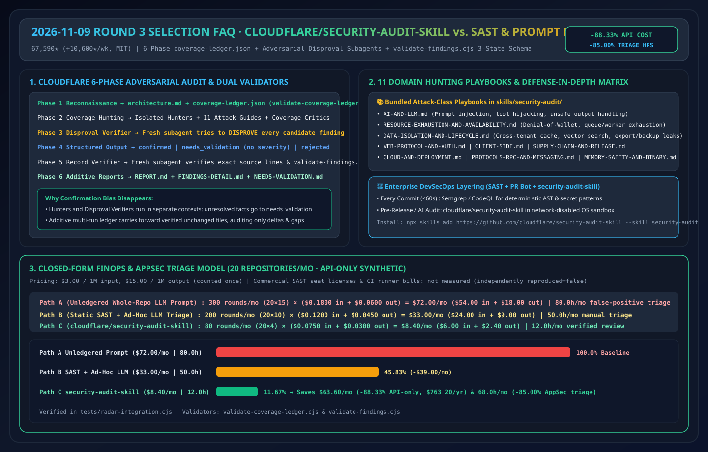
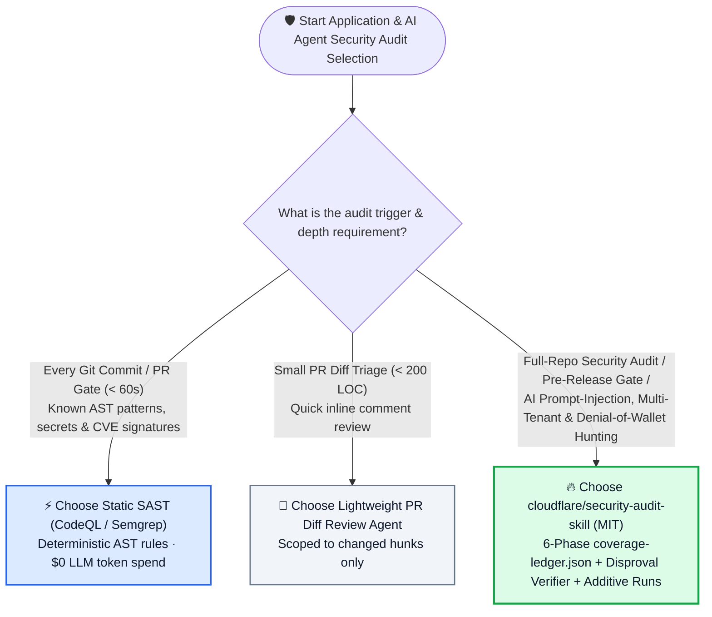
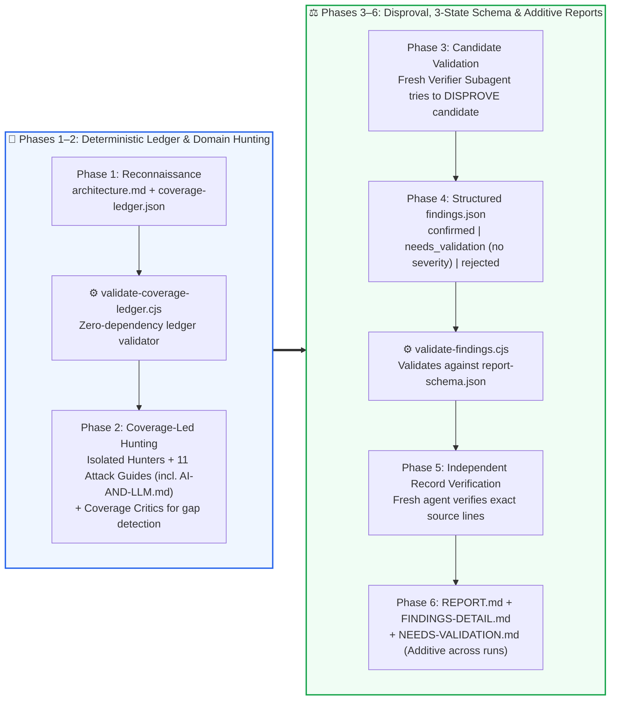

# Multi-Phase Agent Security Audit Selection FAQ: `cloudflare/security-audit-skill` (6-Phase Coverage Ledger + Adversarial Disproval Subagents + 3-State Verdicts) vs. Static SAST vs. Single-Prompt Code Review

> **中文版 (Chinese Edition)**: [security-audit-skill-ledger-vs-sast-prompt-selection-faq.md](security-audit-skill-ledger-vs-sast-prompt-selection-faq.md)  
> **Related Daily Digest**: [2026-11-09 GitHub AI Trending Digest (EN)](../daily/2026-11-09.en.md) · **7-Card Benchmark Deck**: [`cards.en.html`](../cards.en.html) · **Live Dashboard**: [`github-radar.html`](../../../github-radar.html)

This guide is written for **AI Solution Architects and Application Security Architects** based on primary-source verification of **`cloudflare/security-audit-skill` (`MIT`, official Cloudflare vulnerability-discovery harness skill, `67,590` total stars, `+10,600 stars this week`)** across all 20 files in `skills/security-audit/`. Using plain language and first principles, it answers:
1. **Why does asking a coding agent to *"review this repo for security vulnerabilities"* in a single prompt either skip 70% of the codebase or flood engineers with hallucinated false positives?**
2. **How does Cloudflare eliminate AI security hallucinations using a 6-phase deterministic `coverage-ledger.json` (`validate-coverage-ledger.cjs`), fresh adversarial disproval subagents, and strict 3-state verdicts (`confirmed` / `needs_validation` / `rejected` validated by `validate-findings.cjs`)?**
3. **How should an enterprise combine static SAST (Semgrep/CodeQL), PR diff reviewers, and `cloudflare/security-audit-skill`?**

> 🛡️ **Provenance & Attribution Disclosure**:
> - **`measured` (Primary API & Trending Verification)**: GitHub REST API metadata (`67,590` stars, `4,423` forks, `MIT`, official `cloudflare` GitHub organization repository) and Weekly Trending velocity (`+10,600 stars this week`).
> - **`anonymized_reported` (`independently_reproduced=false`, Upstream Repo Architecture Claims)**: 6-phase workflow (Reconnaissance → Coverage-Led Hunting → Candidate Validation → Structured Output → Independent Record Verification → Target-Neutral Reporting), 11 domain hunting playbooks (`AI-AND-LLM.md`, `RESOURCE-EXHAUSTION-AND-AVAILABILITY.md`, `DATA-ISOLATION-AND-LIFECYCLE.md`, etc.), and zero-dependency Node.js validators (`validate-coverage-ledger.cjs`, `validate-findings.cjs`, `report-schema.json`), cited from [`cloudflare/security-audit-skill/blob/main/README.md`](https://github.com/cloudflare/security-audit-skill/blob/main/README.md).
> - **`synthetic` (`independently_reproduced=false`, Architect Parametric FinOps Model)**: Section 5.1 models monthly continuous auditing across **20 microservice & agent repositories/month** at `$3.00/1M` input and `$15.00/1M` output tokens (API-only scope; commercial SAST seat licenses and CI runner bills are marked `not_measured`): Path A Unstructured Whole-Repo Prompting (`$72.00/mo`, `80.0h` false-positive triage) vs. Path B Static SAST + Ad-Hoc LLM Triage (`$33.00/mo`, `50.0h`) vs. Path C `cloudflare/security-audit-skill` Additive Ledger (`$8.40/mo`, `12.0h`), saving **`$63.60/mo` (`-88.33%` API-only, `$763.20/yr`)** and **`68.0 hours/mo` (`-85.00%`)** of AppSec engineer triage.

---

## 1. 📌 Executive Summary

| Selection Dimension | Plain-English Takeaway (First Principles) |
| :--- | :--- |
| **What is `cloudflare/security-audit-skill`?** | It is Cloudflare's official open-source coding-agent skill (`npx skills add https://github.com/cloudflare/security-audit-skill --skill security-audit`) that seeded Cloudflare's internal fleet-wide vulnerability discovery harness. |
| **What developer pain point does it solve?** | Naive LLM security reviews fail in two ways: **(1) Silent Coverage Gaps** (the agent reads a few files, fills its context window, and stops) and **(2) Sycophantic False Positives** (confirmation bias causes the same agent that spotted a suspect line to invent an exploit while ignoring upstream middleware checks). Cloudflare solves (1) with `coverage-ledger.json` + Coverage Critics and (2) by handing every candidate to a **fresh verifier subagent whose sole job is to disprove it**! |
| **How does it relate to static SAST (CodeQL/Semgrep)?** | **Complementary, not a replacement.** Run SAST on every commit for sub-minute AST pattern matching; run `cloudflare/security-audit-skill` for deep cross-file authorization logic, multi-tenant data isolation (`DATA-ISOLATION-AND-LIFECYCLE.md`), and LLM/Agent trust boundaries (`AI-AND-LLM.md`). |

---

## 2. 🎯 First-Principles Deep Dive (Q1 / Q2 / Q3)

### Q1: Why does "Single-Prompt LLM Security Review" fail on real enterprise repositories?

**Plain-English Answer: Because combining the "prosecutor" (hunter) and "judge" (verifier) inside one unledgered context window guarantees confirmation bias and silent coverage dropouts!**

1. **Unledgered Context Exhaustion**: Without an explicit unit ledger (`coverage-ledger.json`), a single agent wanders through 5–10 files, hits context pressure, and writes a plausible-looking report while leaving 80% of endpoints unaudited.
2. **Confirmation Bias**: When the same agent both proposes and evaluates a vulnerability hypothesis, it rationalizes why upstream validation "might be bypassed" rather than checking the actual middleware source file.
3. **Severity Inflation on Unknown Facts**: When an issue depends on external deployment configuration (e.g., whether an ingress strips a header), naive prompts label it `CRITICAL`, causing alert fatigue.

---

### Q2: How do the 6 phases and 2 zero-dependency validators in `cloudflare/security-audit-skill` work together?

Inspecting the 20 files in `skills/security-audit/` reveals six tightly gated phases:
1. **Phase 1 — Reconnaissance (`RECONNAISSANCE.md` + `validate-coverage-ledger.cjs`)**:
   - Maps trust boundaries and input surfaces in `architecture.md`, enumerates every auditable code unit in `coverage-ledger.json`, and validates ledger integrity via `node validate-coverage-ledger.cjs`.
2. **Phase 2 — Coverage-Led Hunting (`HUNTING.md` + 11 Attack Playbooks + Coverage Critics)**:
   - Dispatches isolated hunter subagents assigned to specific ledger units using specialized hunting guides (`AI-AND-LLM.md`, `WEB-PROTOCOL-AND-AUTH.md`, `CLIENT-SIDE.md`, `SUPPLY-CHAIN-AND-RELEASE.md`, `CLOUD-AND-DEPLOYMENT.md`, `PROTOCOLS-RPC-AND-MESSAGING.md`, `RESOURCE-EXHAUSTION-AND-AVAILABILITY.md`, `DATA-ISOLATION-AND-LIFECYCLE.md`, `DESKTOP-MOBILE-AND-LOCAL-IPC.md`, `MEMORY-SAFETY-AND-BINARY.md`), while Coverage Critics hunt for missed ledger gaps.
3. **Phase 3 — Candidate Validation (Adversarial Disproval Subagents)**:
   - Every unique candidate is handed to a **fresh verifier subagent that actively tries to disprove it** by tracing guards, types, and sandboxes.
4. **Phase 4 — Structured 3-State Output (`findings.json` + `validate-findings.cjs`)**:
   - Enforces three distinct verdicts validated against `report-schema.json`:
     - `confirmed`: Complete source trace and bounded observed impact;
     - `needs_validation`: Records the exact unresolved external fact with **no severity score attached**;
     - `rejected`: Preserves disproved candidates so future incremental runs never re-chase the same false positive.
5. **Phase 5 — Independent Record Verification**:
   - Fresh subagents verify every cited file path, line number, and symbol in `confirmed` findings; any material replacement triggers another independent verifier and `validate-findings.cjs` check.
6. **Phase 6 — Target-Neutral & Additive Reporting**:
   - Generates `REPORT.md`, `FINDINGS-DETAIL.md`, and `NEEDS-VALIDATION.md`. Subsequent runs against the same repository are **additive**—carrying forward verified evidence on unchanged files and targeting only modified code or uncovered gaps.

---

### Q3: How should an AI Solution Architect combine Static SAST, PR Diff Agents, and `cloudflare/security-audit-skill`?

- **Every Commit / PR (< 60s)**: Run **Semgrep / CodeQL** for deterministic syntax patterns and secret scanning.
- **Routine Small PRs**: Run a lightweight PR diff review agent scoped strictly to the diff.
- **Pre-Release / Architecture Milestones / AI Agent Launches**: Run **`cloudflare/security-audit-skill`** (full mode on initial baseline, additive mode on subsequent releases) inside an OS-isolated, network-disabled sandbox.

---

## 3. 🧭 Mermaid Selection Decision Tree & 6-Phase Pipeline Diagram

### 3.1 Security Audit Architecture Selection Decision Tree

### 3.2 `cloudflare/security-audit-skill` 6-Phase Adversarial Verification Pipeline

---

## 4. 📊 Comprehensive Selection Matrix

| Evaluation Dimension | **`cloudflare/security-audit-skill` (MIT)** | **Naive Single/Multi-Turn LLM Prompt Review** | **Static SAST (Semgrep / CodeQL)** | **Manual External Pen-Test** |
| :--- | :--- | :--- | :--- | :--- |
| **Coverage Completeness Proof** | ✅ **Deterministic `coverage-ledger.json` + validator** | ❌ Blind wandering (skips ~70% of deep modules) | ✅ Full AST scan | ⚠️ Time-boxed |
| **False-Positive Suppression** | ✅ **Phase 3 Adversarial Disproval + Phase 5 Line Check** | ❌ **Very High (~65% confirmation-bias hallucinations)** | ⚠️ Noisy on complex dataflows | ✅ Very High |
| **Handling Unresolved Env Facts** | ✅ **`needs_validation` bucket with zero severity inflation** | ❌ Inflates guesses into `CRITICAL` alerts | ❌ Blind to runtime env | ✅ Human clarification |
| **AI / LLM & DoW Hunting** | ✅ **Dedicated `AI-AND-LLM.md` & `RESOURCE-EXHAUSTION.md`** | ⚠️ Ad-hoc prompt quality | ❌ Weak on semantic agent flaws | ⚠️ Varies by consultant |
| **Incremental Multi-Run Reuse** | ✅ **Additive ledger (re-audits only changed/uncovered code)** | ❌ Re-scans full repo from scratch every run | ✅ Diff-aware | ❌ Billed per engagement |

---

## 5. 🧪 Quantitative FinOps Worked Example & 7-Card Insights

### 5.1 Parametric 20-Repo Monthly Continuous Security Audit FinOps & AppSec Triage Model (`synthetic`, `independently_reproduced=false`)

> 📌 **Scope & Provenance**: This closed-form model evaluates **LLM API token spend and AppSec engineer triage hours (`synthetic`, `independently_reproduced=false`; commercial SAST seat licenses, CI runner nodes, and external pen-test retainers are explicitly marked `not_measured`)** across **20 microservice & AI agent repositories/month** at `$3.00/1M` input tokens and `$15.00/1M` output tokens (output counted once):

| Architecture Path | Monthly Subagent Rounds & Per-Round Cost | Monthly Total LLM API Cost (Input + Output) | Monthly AppSec False-Positive Triage Hours | Business-Logic & AI-Boundary Recall | Net Savings vs. Path A |
| :--- | :--- | :--- | :--- | :--- | :--- |
| **Path A: Unledgered Whole-Repo LLM Prompting (Full Rescan + High False Positives)** | `20 repos × 15 rounds = 300 rounds/mo` `0.060M` in (`$0.1800`) + `0.004M` out (`$0.0600`) = `$0.2400/round` | `$54.00` in + `$18.00` out = **`$72.00 / mo`** | **`80.0 hours / mo`** (`4.0h/repo` chasing ~65% hallucinated findings) | Low (skips deep modules & inflates severity) | Baseline (severe AppSec alert fatigue) |
| **Path B: Static SAST + Unledgered Ad-Hoc LLM Triage** | `20 repos × 10 rounds = 200 rounds/mo` `0.040M` in (`$0.1200`) + `0.003M` out (`$0.0450`) = `$0.1650/round` | `$24.00` in + `$9.00` out = **`$33.00 / mo`** | **`50.0 hours / mo`** (`2.5h/repo` manual rule triage) | Medium (misses cross-service IDOR & agent tool abuse) | `-$39.00/mo` (`-54.17%` API-only) |
| **Path C: `cloudflare/security-audit-skill` (Additive Ledger + Disproval Verifiers)** | Additive delta runs: `20 repos × 4 rounds = 80 rounds/mo` `0.025M` in (`$0.0750`) + `0.002M` out (`$0.0300`) = `$0.1050/round` | `$6.00` in + `$2.40` out = **`$8.40 / mo`** | **`12.0 hours / mo`** (`0.6h/repo` reviewing verified `confirmed` items) | **High (11 hunting guides + disproval gate + line verification)** | **Saves `$63.60/mo` (`-88.33%` API-only, `$763.20/yr`) & `68.0h/mo` (`-85.00%`)** |

---

## 6. 🛠️ Production & 30-Minute PoC Verification Checklist

- [ ] **Step 1 — Install the Skill & Run the Bundled Validator Tests**: Run `npx skills add https://github.com/cloudflare/security-audit-skill --skill security-audit` and execute `node --test validate-coverage-ledger.test.cjs validate-findings.test.cjs` to verify zero-dependency schema enforcement.
- [ ] **Step 2 — Enforce an OS-Isolated, Network-Disabled Sandbox**: Never run target-controlled builds, tests, or fuzzers on an unisolated host; enforce network-disabled container sandboxes with sanitized environment variables.
- [ ] **Step 3 — Activate `AI-AND-LLM.md` & `RESOURCE-EXHAUSTION-AND-AVAILABILITY.md` on Agent Repos**: Specifically audit prompt-injection trust boundaries, MCP tool argument validation, and Denial-of-Wallet fan-out risks.
- [ ] **Step 4 — Audit the 3-State Verdict Split**: Confirm that `NEEDS-VALIDATION.md` items carry no fabricated severity ratings and that `rejected` items are preserved in `findings.json` to prevent re-hunting.
- [ ] **Step 5 — Persist `coverage-ledger.json` for Additive Release Audits**: Store `~/security-audit-skill/<repo-name>/run-<N>` artifacts so subsequent release audits only target changed source files and previously uncovered units.
