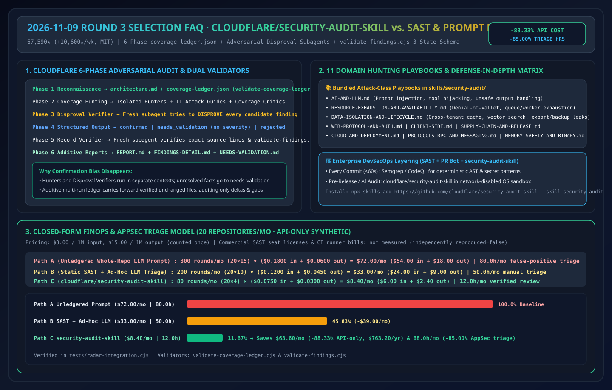
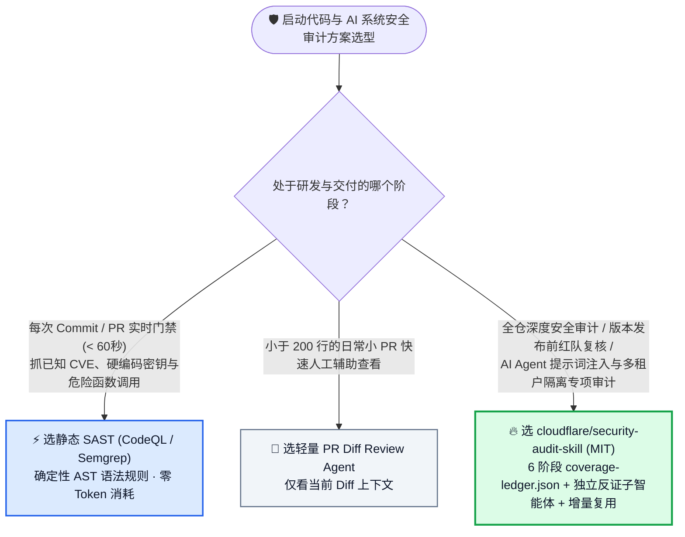
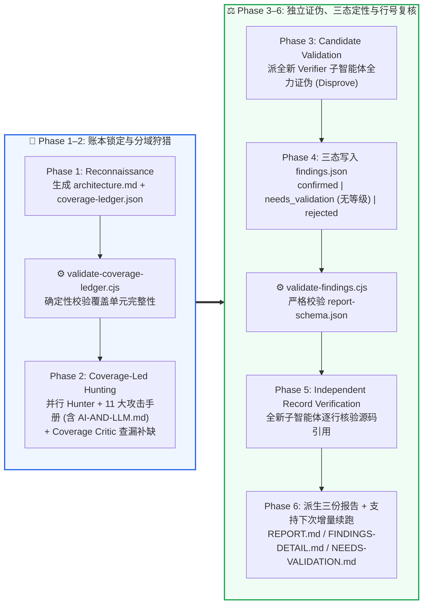

# AI 编码智能体多阶段安全审计选型常见问题解答：`cloudflare/security-audit-skill`（6 阶段确定性覆盖账本 + 独立反证子智能体 + 三态定性）vs 传统静态 SAST vs 单次 Prompt 代码审查

> **English Edition**: [security-audit-skill-ledger-vs-sast-prompt-selection-faq.en.md](security-audit-skill-ledger-vs-sast-prompt-selection-faq.en.md)  
> **关联日报**: [2026-11-09 GitHub AI 最热榜单与情报摘要](../daily/2026-11-09.md) · **视觉评测卡**: [`cards.html`](../cards.html) · **在线面板**: [`zh-github-radar.html`](../../../zh-github-radar.html)

本文档面向 **AI Solution Architect（AI 解决方案架构师）与企业安全架构师**，基于 2026-11-09 GitHub Weekly Trending 暴涨项目 **`cloudflare/security-audit-skill`（MIT，Cloudflare 官方开源漏洞挖掘 Harness 种子技能，总 Star `67,590`，单周暴涨 `+10,600 stars this week`）** 的一手源码审计（`skills/security-audit/` 下的 20 个核心文件），用通俗大白话与第一性原理解答：
1. **为什么直接让大模型“帮我审查这个仓库的安全漏洞（Single-Prompt Code Review）”，要么只看前几个文件就偷懒漏报，要么瞎报一堆根本触发不了的假漏洞（False Positives）把安全工程师累死？**
2. **Cloudflare 是如何用「6 阶段确定性覆盖账本 (`coverage-ledger.json` + `validate-coverage-ledger.cjs`) + 专门负责找茬推翻结论的独立反证子智能体（Disproval Verifier）+ 三态严格定性（`confirmed` / `needs_validation` / `rejected`）」彻底治好 AI 安全审计幻觉的？**
3. **在企业 DevSecOps 流水线中，如何把传统静态 SAST（Semgrep / CodeQL）、单次 PR 审查与 `cloudflare/security-audit-skill` 组合成黄金防线？**

> 🛡️ **数据来源、归属核验与证据分级声明（Provenance & Attribution Disclosure）**：
> - **`measured`（本班次一手实测抓取）**：`cloudflare/security-audit-skill` GitHub REST API 元数据（`67,590` Stars，`4,423` Forks，`MIT`，官方 `cloudflare` GitHub 组织仓库）及 Weekly Trending 周增量（`+10,600 stars this week`）。
> - **`anonymized_reported`（`independently_reproduced=false`，上游仓库文档与源码声明）**：6 阶段审计工作流（Reconnaissance → Coverage-Led Hunting → Candidate Validation → Structured Output → Independent Record Verification → Target-Neutral Reporting）、11 个专项攻击分类词典（含 `AI-AND-LLM.md`、`RESOURCE-EXHAUSTION-AND-AVAILABILITY.md`、`DATA-ISOLATION-AND-LIFECYCLE.md` 等）及零依赖 Node.js 校验器（`validate-coverage-ledger.cjs`、`validate-findings.cjs`、`report-schema.json`），引自 [`cloudflare/security-audit-skill/blob/main/README.md`](https://github.com/cloudflare/security-audit-skill/blob/main/README.md)。
> - **`synthetic`（`independently_reproduced=false`，架构师参数化 FinOps 算例）**：第 5.1 节「每月持续审计 20 个微服务仓库（含双周增量发版复测）」的纯模型 API 账单与安全工程师排障工时对比（Path A 无账本裸 Prompt 全量扫描 `$72.00/月`、`80.0 小时/月` 误报排查 vs Path B 传统 SAST + 零散 LLM 复核 `$33.00/月`、`50.0 小时/月` vs Path C `cloudflare/security-audit-skill` 增量覆盖账本 + 反证子智能体 `$8.40/月`、`12.0 小时/月`，节省 `$63.60/月` [`-88.33%` API-only] 与 `68.0 小时/月` [`-85.00%`] 误报甄别工时；商业 SAST 许可证与 CI 构建机费用标为 `not_measured`）严格执行 100% 闭式公式可复算门禁。

---

## 1. 📌 核心结论速览（Executive Summary）

| 评估维度 | 一句话大白话核心结论（直指本质） |
| :--- | :--- |
| **`cloudflare/security-audit-skill` 到底是什么？** | 它是 Cloudflare 安全团队从其内部大规模自动化漏洞挖掘平台（Vulnerability Discovery Harness）提炼并开源的**多智能体对抗式代码安全审计技能包（`npx skills add https://github.com/cloudflare/security-audit-skill --skill security-audit`）**。 |
| **它解决了以前 AI 代码审计的哪两大绝症？** | 以前用 LLM 审代码有两大绝症：**① 覆盖率黑洞**（模型看累了就跳过深层目录，你根本不知道它漏看了哪几个模块）；**② 讨好型误报幻觉**（为了显得自己有用，把已经在外层网关做过鉴权的内部函数硬吹成“高危未授权访问”）。Cloudflare 用 **`coverage-ledger.json` 强制记账防漏看**，再用**独立反证子智能体（专门试图证伪候选漏洞）防瞎报**！ |
| **它与传统静态 SAST（CodeQL/Semgrep）是替代还是互补？** | **严格互补！** 静态 SAST 擅长毫秒级扫出已知语法模式（如硬编码密钥、明显 SQL 拼接）；而 `security-audit-skill` 擅长发现 **跨文件业务逻辑越权（IDOR）、多租户缓存/导出串租、以及 AI Agent 提示词注入与工具权限逃逸（`AI-AND-LLM.md`）**。 |

---

## 2. 🎯 第一性原理灵魂三问（Q1 / Q2 / Q3 大白话拆解）

### Q1：为什么“单次 Prompt 让 Agent 找漏洞”在大型代码库上既漏报又误报？

**先说大白话结论：因为把“找线索的侦探”和“定罪的法官”塞进同一个上下文窗口，大模型必然陷入确认偏误（Confirmation Bias）与注意力衰减！**

1. **没有账本的漫游必漏检（Uncounted Wandering）**：一个 10 万行代码的仓库有上百个路由和 RPC 入口。单智能体顺着两三个文件往下读，上下文塞满后就直接输出报告，80% 的边缘模块根本没翻过。
2. **确认偏误导致误报泛滥（Confirmation Bias）**：当同一个 Agent 怀疑某行代码有 SSRF 漏洞时，它会顺着自己的怀疑拼命找理由证明自己是对的，而忽略了上游中间件早已拦截了私有 IP 段。
3. **对未知事实强行标高危（Severity Inflation）**：遇到一个依赖外部环境变量或网关配置才能判断是否可利用的点，普通 Prompt 会直接标上 `CRITICAL` 吓唬人，导致安全团队陷入“狼来了”疲劳。

---

### Q2：`cloudflare/security-audit-skill` 的「6 阶段流水线 + 双 Node.js 确定性校验器」是如何根治这些问题的？

审计其 `skills/security-audit/` 源码目录，Cloudflare 設計了一套极其严密的 **六阶段工业级分权流水线**：
1. **Phase 1 侦察与覆盖账本初始化（Reconnaissance & `coverage-ledger.json`）**：
   - 先绘出系统信任边界与输入面（`architecture.md`），把所有代码模块拆解为可度量的审计单元写入 `coverage-ledger.json`，并立即运行零依赖校验脚本 **`node validate-coverage-ledger.cjs`** 锁死分母。
2. **Phase 2 账本驱动的隔离狩猎 + 覆盖率批评家（Coverage-Led Hunting & Critics）**：
   - 按账本单元派发独立的 Hunter 子智能体，并挂载对应的专项攻击手册（仓库内置 **11 本实战猎杀指南**，特别包含针对大模型应用的 **`AI-AND-LLM.md`**、针对配额打爆/算力耗尽的 **`RESOURCE-EXHAUSTION-AND-AVAILABILITY.md`**、针对多租户数据残留的 **`DATA-ISOLATION-AND-LIFECYCLE.md`** 等）。同时启动 **Coverage Critic** 专门检查是否有被遗漏的死角。
3. **Phase 3 独立反证子智能体（Candidate Validation — Disproval First!）**：
   - **全场最惊艳的设计**：每一个候选漏洞都会被移交给一个**全新的、无历史包袱的 Verifier 子智能体**，它的唯一KPI是**“去源码里寻找上游校验、类型约束或沙盒隔离来推翻（Disprove）这个漏洞”**！凡是被推翻的，一律打入 `rejected`。
4. **Phase 4 三态结构化定性与 Schema 门禁（`findings.json` + `validate-findings.cjs`）**：
   - 严格区分三种互不妥协的结论：
     - **`confirmed`**：具备完整源码调用链追踪与明确可观测危害边界；
     - **`needs_validation`**：仅差某项外部环境事实（如线上网关配置）即可确认，**严禁给 `needs_validation` 乱打高危/中危等级（No Severity）**；
     - **`rejected`**：已被反证推翻的假阳性记录（保留在账本中防止下次重复踩坑）。
   - 必须通过 **`node validate-findings.cjs`**（对照 `report-schema.json`）100% 校验通过。
5. **Phase 5 独立源码行号复核（Independent Record Verification）**：
   - 再派一批全新 Agent 逐行核对最终报告中引用的文件名、行号与函数签名；任何实质性修改都会触发新一轮独立验证与 `validate-findings.cjs`。
6. **Phase 6 增量可叠加报告（Additive Multi-Run Reporting）**：
   - 自动从已验证记录派生 `REPORT.md`、`FINDINGS-DETAIL.md` 与 `NEEDS-VALIDATION.md`。后续代码更新再次运行时，**自动复用历史账本，只扫未覆盖单元与变更代码（Changed Source）**！

---

### Q3：作为 AI 解决方案架构师，如何在客户项目中组合 SAST、PR Review Agent 与 `cloudflare/security-audit-skill`？

- **每次 Git Push / PR 秒级门禁**：跑 **Semgrep / CodeQL + GitHub Code Scanning**，花几秒钟拦住已知语法级漏洞与密钥泄露。
- **每周发版 / 重大架构变更 / AI Agent 专项上线前审计**：运行 **`cloudflare/security-audit-skill` 全量或增量审计模式**（利用其增量账本只审变更模块与未覆盖死角），重点猎杀多租户越权、`AI-AND-LLM.md` 提示词注入与工具滥用、以及 `RESOURCE-EXHAUSTION-AND-AVAILABILITY.md` 钱包耗尽（Denial-of-Wallet）漏洞！

---

## 3. 🧭 Mermaid 选型决策树与 6 阶段对抗式审计时序图

### 3.1 企业代码与 AI 智能体安全审计方案选型决策树

### 3.2 `cloudflare/security-audit-skill` 六阶段对抗式核验与双校验器闭环图

---

## 4. 📊 同类方案全方位选型决策矩阵（Decision Matrix）

| 评估维度 | **`cloudflare/security-audit-skill` (MIT)** | **单次/多轮裸 Prompt LLM 代码审查** | **传统静态 SAST (Semgrep / CodeQL)** | **外部人工渗透测试 / 安全咨询** |
| :--- | :--- | :--- | :--- | :--- |
| **代码覆盖率可证明性** | ✅ **100% 账本化（`coverage-ledger.json` + 校验器）** | ❌ 黑盒随机漫游（常漏掉 70%+ 深层模块） | ✅ 全文件 AST 扫描 | ⚠️ 受限于人工时间窗口 |
| **抗误报机制（False Positives）** | ✅ **内置 Phase 3 独立反证子智能体 + Phase 5 行号复核** | ❌ **极高误报（确认偏误，常把正常逻辑吹成高危）** | ⚠️ 规则过宽时误报高，缺上下文理解 | ✅ 极低（人工验证） |
| **未决环境事实处理** | ✅ **单列 `needs_validation` 且强制禁止虚标严重等级** | ❌ 混在确诊漏洞里虚标 `CRITICAL` | ❌ 无法感知外部部署上下文 | ✅ 人工沟通确认 |
| **AI / LLM 专属漏洞猎杀能力** | ✅ **内置 `AI-AND-LLM.md` 与 `RESOURCE-EXHAUSTION` 手册** | ⚠️ 依赖临时提问词质量 | ❌ 传统 AST 规则极难检测 Prompt 注入与工具越权 | ⚠️ 取决于安全团队是否懂 AI Agent |
| **多轮版本迭代增量复用** | ✅ **原生 Additive 模式（复用旧账本，只审变更与缺口）** | ❌ 每次从头全量瞎扫，重复烧 Token | ✅ 支持增量 Diff 扫描 | ❌ 按次重新报价收费 |

---

## 5. 🧪 定量算例与 7-Card 评测洞察（Quantitative Example & 7-Card Insights）

### 5.1 20 个微服务仓库月度持续安全审计 FinOps 与 AppSec 排障工时闭式算例（`synthetic`，`independently_reproduced=false`）

> 📌 **透明口径与边界声明（Scope & Provenance）**：本算例为架构师评估研发安全流水线的 **纯模型 API 参数化算例（API-only `synthetic` model；商业 SAST 席位费、CI 容器运行机与人工外包渗透费用明确标注为 `not_measured`）**。统一按 **`$3.00 / 1M 输入 Tokens`**、**`$15.00 / 1M 输出 Tokens`**（输出仅计费一次）核算。场景设定为：**企业安全团队每月对 `20 个` 核心微服务与 AI Agent 仓库执行例行安全审计与版本增量复核**：

| 方案路径 | 每月总审计轮次与单轮 Token 开销 | 每月纯模型 API 账单（输入 + 输出） | 每月安全工程师甄别误报与复核源码工时 | 跨文件业务逻辑/AI 越权检出质量 | 相对 Path A 降本增效幅度 |
| :--- | :--- | :--- | :--- | :--- | :--- |
| **Path A：无账本裸 Prompt 全仓扫描（每次重扫 + 高误报）** | `20 仓 × 15 轮 = 300 轮/月` 单轮 `0.060M` 入 (`$0.1800`) + `0.004M` 出 (`$0.0600`) = `$0.2400/轮` | 输入 `$54.00` + 输出 `$18.00` = **`$72.00 / 月`** | **`80.0 小时 / 月`** （每仓 4.0h 排查 ~65% 幻觉假漏洞与错乱行号） | 低（漏扫深层目录，且严重等级注水） | 基线（工程师被海量假阳性告警淹没） |
| **Path B：传统 SAST + 零散无账本 LLM 复核** | `20 仓 × 10 轮 = 200 轮/月` 单轮 `0.040M` 入 (`$0.1200`) + `0.003M` 出 (`$0.0450`) = `$0.1650/轮` | 输入 `$24.00` + 输出 `$9.00` = **`$33.00 / 月`** | **`50.0 小时 / 月`** （每仓 2.5h 人工甄别 SAST 告警与补查逻辑漏洞） | 中（易漏检跨模块越权与 AI 工具链逃逸） | API 降本 `-$39.00/月` (`-54.17%`) |
| **Path C：`cloudflare/security-audit-skill`（增量覆盖账本 + 独立反证子智能体）** | 增量账本复用，`20 仓 × 4 轮 = 80 轮/月` 单轮 `0.025M` 入 (`$0.0750`) + `0.002M` 出 (`$0.0300`) = `$0.1050/轮` | 输入 `$6.00` + 输出 `$2.40` = **`$8.40 / 月`** | **`12.0 小时 / 月`** （每仓仅 0.6h 复核已过双校验器的 `confirmed` 项） | **极高（11 大领域手册 + 独立证伪 + 行号实锤）** | **API 净省 `$63.60/月` (`-88.33%`，年省 `$763.20`)；工时省 `68.0h/月` (`-85.00%`)** |

---

## 6. 🛠️ 架构师生产落地与 30 分钟 PoC 核验清单（Production & PoC Checklist）

- [ ] **Step 1 — 一行命令安装官方 Skill 并跑通内置单测**：执行 `npx skills add https://github.com/cloudflare/security-audit-skill --skill security-audit`，并在技能目录运行 `node --test validate-coverage-ledger.test.cjs validate-findings.test.cjs`，确认两个零依赖校验器 100% 通过。
- [ ] **Step 2 — 强制隔离审计沙盒环境（OS-Enforced Sandbox）**：严格遵循官方安全要求，在运行被审计目标项目的构建、测试或 Fuzzing 时，必须在**断网（Disable External Networking）、最小环境变量白名单与资源限额**的受控容器沙盒中执行，严防恶意仓库通过构建脚本反向攻击审计宿主机。
- [ ] **Step 3 — 针对企业 AI Agent 项目重点启用 3 本猎杀手册**：在审计内部智能体工作流时，重点检查 `AI-AND-LLM.md`（提示词注入与工具参数劫持）、`DATA-ISOLATION-AND-LIFECYCLE.md`（多租户缓存/向量库串租）与 `RESOURCE-EXHAUSTION-AND-AVAILABILITY.md`（子智能体死循环与钱包耗尽）。
- [ ] **Step 4 — 检查三态分流纪律（严禁给 `needs_validation` 标等级）**：在审查输出的 `findings.json` 与 `NEEDS-VALIDATION.md` 时，确认所有缺外部环境证据的条目均被诚实归入 `needs_validation`（无严重度），只有完成源码全链路实证且抗住 Phase 3 反证子智能体挑战的条目才进入 `confirmed`。
- [ ] **Step 5 — 归档 `coverage-ledger.json` 实现发版增量续跑**：将每次审计生成的 `~/security-audit-skill/<repo-name>/run-<N>` 账本归档，下次发版时让 Skill 自动基于上一轮账本只对新增/修改源码与未覆盖单元做增量猎杀。
