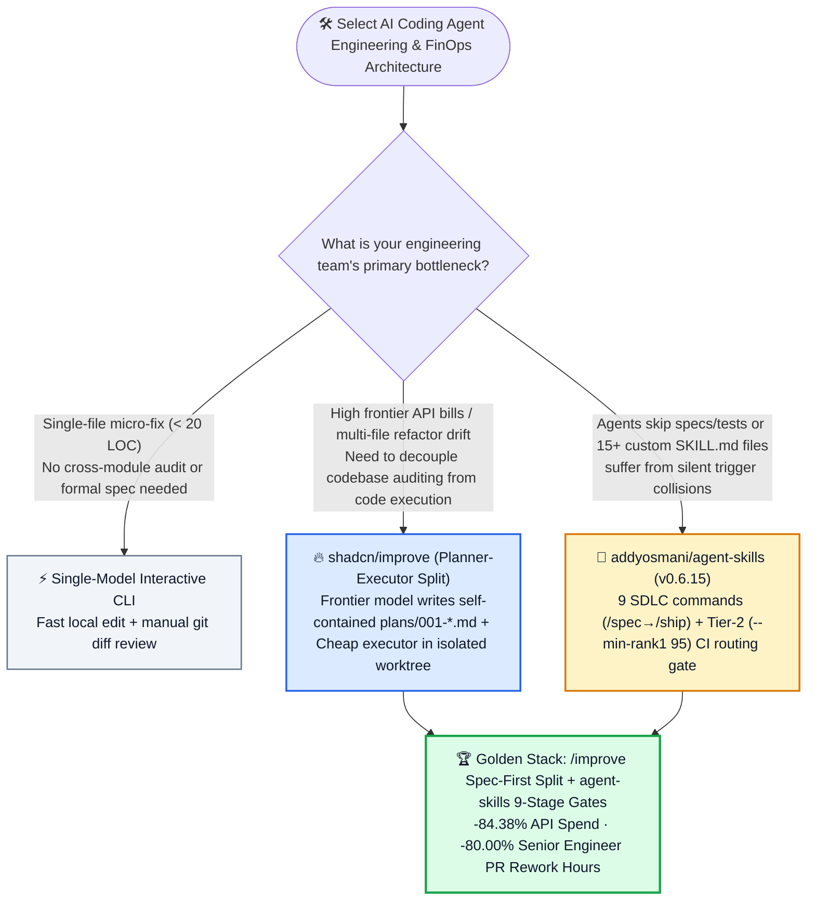
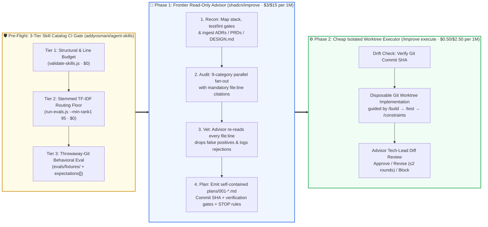

# AI Coding Agent Planner-Executor Split & SDLC Quality Gate Selection FAQ: `shadcn/improve` + `addyosmani/agent-skills` (`v0.6.15`) vs. Monolithic Single-Model Vibe Coding

> **中文版**: [shadcn-improve-addyosmani-agent-skills-sdlc-selection-faq.md](shadcn-improve-addyosmani-agent-skills-sdlc-selection-faq.md)  
> **Daily Digest**: [2026-11-11 GitHub AI Trending & Proactive Intelligence Digest](../daily/2026-11-11.en.md) · **Visual Deck**: [`cards.en.html`](../cards.en.html) · **Live Radar**: [`github-radar.html`](../../../github-radar.html)

Written for **AI Solution Architects**, this selection guide is grounded in primary-source audits of two breakout P0 repositories dominating the 2026-11-11 GitHub Daily Trending feed — **`shadcn/improve` (shadcn's official Planner-Executor split skill where an expensive frontier model audits the repo and writes self-contained `plans/001-*.md` specs for cheaper models to execute in isolated worktrees, MIT, Daily Trending DOM `#4`, `10,545` DOM / `10,546` API stars, `+333★ today`)** and **`addyosmani/agent-skills` (Addy Osmani's production-grade 9-stage SDLC engineering skill suite, `v0.6.15`, MIT, Daily Trending DOM `#5`, `115,656` DOM / `115,657` API stars, `+788★ today`)** — answering three foundational questions from first principles:
1. **Why does running a single expensive frontier model (`Opus 4.6` / `GPT-5.4`) for both codebase reconnaissance and line-by-line code editing ("Monolithic Vibe Coding") waste over 80% of monthly API spend while frequently breaking adjacent modules?**
2. **How does `shadcn/improve` combine a 5-stage read-only Advisor pipeline (`Recon → Audit → Vet → Prioritize → Self-Contained Plan`) with disposable git-worktree execution (`/improve execute`) so that intelligence compounds at the spec layer while execution stays cheap and bounded?**
3. **When an enterprise engineering organization scales past 20+ `SKILL.md` modules, how does `addyosmani/agent-skills` (`v0.6.15`) enforce full SDLC discipline (`/spec` → `/plan` → `/build` → `/test` → `/review` → `/ship`) and prevent skill routing collisions in CI at `$0` token cost using Tier-2 stemmed TF-IDF evaluations (`--min-rank1 95`)?**

> 🛡️ **Provenance & Attribution Disclosure**:
> - **`measured` (Primary-Source Verified in This Shift)**: Trending velocity and repository metadata for `shadcn/improve` (DOM `#4`, `+333 stars today`, DOM `10,545` / API `10,546` stars, MIT) and `addyosmani/agent-skills` (DOM `#5`, `+788 stars today`, DOM `115,656` / API `115,657` stars, `v0.6.15`, MIT) are verified directly from the archived 2026-11-11 GitHub Daily Trending HTML snapshot ([`workshops/github-trending-radar/evidence/trending-daily-2026-11-11-raw.html`](../evidence/trending-daily-2026-11-11-raw.html), `sha256: bacf15c20a7aca6007beeb3a6f284b0549a441a05dafa25b17a097dc8f4f1d8f`) and GitHub REST API source trees (`plugin.json`, `commands/*.toml`, `evals/README.md`, `examples/001-extract-shadow-config-resolution.md`).
> - **`anonymized_reported` (`independently_reproduced=false`, Upstream Repository Documentation & Benchmark Claims)**: Sample `shadcn/ui` audit outputs in `shadcn/improve/README.md` (identifying drifted shadow-config at `search.ts:31`, $O(n^2)$ icon migration at `migrate-icons.ts:168`, and explicitly rejecting `[SEC-01] https_proxy` SSRF false positives) and the 3-tier evaluation architecture in `addyosmani/agent-skills/evals/README.md` (Tier-1 structural checks, Tier-2 `run-evals.js --min-rank1 95` stemmed TF-IDF routing floor, and Tier-3 throwaway-git headless behavioral grading).
> - **`synthetic` (`independently_reproduced=false`, Architect Parametric FinOps Model)**: Section 5.1 models a **20-engineer product organization executing `120` feature/refactoring tasks per month (`120 tasks/mo`)** on an API-only basis (Path A Monolithic Expensive Vibe Coding `$345.60/mo` vs. Path B Single-Model Ad-Hoc Prompt `$162.00/mo` vs. Path C `shadcn/improve` Planner-Executor Split + `addyosmani/agent-skills` `$54.00/mo`, saving `$291.60/mo` [`-84.38%` API-only] and `72.0 hours/mo` [`-80.00%`] senior engineer PR rework/review time; developer workstation, GitHub Actions CI runner, and commercial IDE seat costs are explicitly labeled `not_measured`).

---

## 1. 📌 Executive Summary

| Dimension | Plain-Language Core Takeaway (First Principles) |
| :--- | :--- |
| **What are `shadcn/improve` and `addyosmani/agent-skills`?** | **`shadcn/improve`** is a Planner-Executor split skill where your most capable frontier model acts strictly as a read-only Principal Advisor—auditing the repo, filtering subagent false positives, and writing self-contained `plans/001-*.md` specs—before dispatching a cheaper model in an isolated git worktree (`/improve execute`) to implement the plan. **`addyosmani/agent-skills` (`v0.6.15`)** packages 9 lifecycle slash commands (`/spec` → `/ship`), 25 production engineering skills, and a **3-tier CI evaluation harness (`--min-rank1 95`)**. |
| **What developer pain point do they solve?** | They eliminate **"Monolithic Vibe Coding"**—using a `$3/$15 per 1M` frontier model to simultaneously rummage through files and improvise edits without a spec. Monolithic sessions burn 80%+ of tokens on mechanical edits, pollute implementation context with exploratory dead ends, and suffer from silent routing collisions when teams install 15+ overlapping `SKILL.md` files. |
| **How do they differ from raw prompting or heavy Python orchestration frameworks?** | **Three deterministic guardrails**: ① **Strict Read/Write Separation** (`/improve` never mutates source code; executors run only inside disposable git worktrees with a Tech-Lead verification loop capped at 2 revision rounds); ② **Advisor Vet Pass & Commit-Stamped Specs** (the advisor re-reads every `file:line` cited by subagents to drop false positives like `https_proxy` SSRF alerts, and stamps every plan with the target Git commit SHA); ③ **Zero-Token Tier-2 Routing CI (`--min-rank1 95`)** (stemmed TF-IDF in CI catches missing vocabulary and description collisions across 25 skills for `$0`). |

---

## 2. 🎯 First-Principles Q&A (Q1 / Q2 / Q3)

### Q1: Why is using a single expensive frontier model to "explore and edit in the same loop" an architectural anti-pattern?

**Plain-language answer: Because architectural judgment compounds with model intelligence, whereas mechanical code editing against a concrete spec does not—mixing both in one long context window wastes 80%+ of API budget and degrades code quality.**

1. **Intelligence Compounding Mismatch**: Reading ADRs (`docs/adr/`), tracing cross-package invariants, and deciding which technical debt is worth fixing requires your highest-reasoning model (`Opus 4.6` / `GPT-5.4`). Once the exact target files, code excerpts, and verification commands are locked into `plans/001-*.md`, a 6× cheaper executor model (`Haiku 4.5` / `GPT-5.4-mini`) can execute the steps deterministically.
2. **Subagent Over-Reporting & False-Positive Spirals**: Parallel audit subagents routinely over-report benign patterns as bugs (e.g., flagging standard CLI `https_proxy` support as `[SEC-01] SSRF`). Without a dedicated **Vet Pass** where the lead advisor re-reads the exact `file:line` and logs rejected findings, an unguided coding agent will waste turns breaking working proxy support.
3. **Improvisation Without `STOP` Conditions**: When reality diverges from assumptions mid-edit, an unguided agent improvises—weakening tests or touching out-of-scope files. A self-contained spec with explicit **`STOP` conditions** (*"if X does not match, stop and report"*) prevents runaway collateral damage.

---

### Q2: How does `shadcn/improve` implement its 5-stage read-only Advisor pipeline and disposable worktree execution loop?

**Plain-language analogy: The Advisor (expensive model) acts as the Structural Engineer who inspects the building, throws out false alarms, and stamps a blueprint (`plans/001-*.md`); the Executor (cheap model) works inside a fenced-off construction site (disposable git worktree), and the Advisor inspects every test gate before handing you the keys.**

1. **Five Read-Only Advisor Stages (`Recon → Audit → Vet → Prioritize → Plan`)**:
   - **① Recon**: Maps the repository stack, conventions, exact `build/test/lint` commands, and existing intent docs (`docs/adr/`, PRDs, `CONTEXT.md`, `DESIGN.md`, `PRODUCT.md`) so intentional tradeoffs are never re-flagged.
   - **② Audit**: Fans out parallel subagents across 9 categories (correctness, security, performance, test coverage, tech debt, dependencies & migrations, DX, docs, and repo-evidenced direction).
   - **③ Vet**: The advisor personally re-reads every cited `file:line`, drops false positives, corrects wrong attributions, and records rejected findings so they never resurface on subsequent runs.
   - **④ Prioritize**: Ranks verified findings by leverage (`impact ÷ effort`, weighted by confidence).
   - **⑤ Plan (`plans/001-*.md`)**: Writes one self-contained Markdown spec per selected finding—inlining current code excerpts, exemplar files, machine-checkable verification commands, explicit out-of-scope boundaries, `STOP` conditions, and the exact **Git commit SHA** the plan was authored against.
2. **Closed-Loop Execution & Backlog Reconciliation (`execute` & `reconcile`)**:
   - `/improve execute <plan>` runs a mechanical git drift check against the plan's stamped commit, spawns a cheaper executor in an isolated git worktree, re-runs all verification commands, and issues a Tech-Lead verdict (**Approve**, **Send back for revision [max 2 rounds]**, or **Block & refine plan**). `/improve reconcile` verifies landed plans and refreshes drifted specs.

---

### Q3: How does `addyosmani/agent-skills` (`v0.6.15`) enforce full SDLC quality gates and prevent multi-skill routing collisions?

**Plain-language answer: It maps the entire software lifecycle into 9 slash commands (`/spec` through `/ship`) backed by 25 specialized skills, and runs a 3-tier CI evaluation suite—including a `$0` stemmed TF-IDF routing check (`--min-rank1 95`)—to guarantee skills trigger accurately without colliding.**

1. **9 Slash Commands Across the Full SDLC**:
   - `/spec` (*Spec before code*), `/plan` (*Small, atomic tasks*), `/build` (*One slice at a time*, plus `/build auto` for single-approval full execution), `/test` (*Tests are proof*), `/constraints` (*Decide it once, enforce it everywhere*), `/review` (or `/agent-skills:review`), `/webperf` (*Measure before you optimize*), `/code-simplify`, and `/ship`.
2. **Three-Tier Skill Evaluation Harness (`evals/README.md` & `evals/skill-impact.md`)**:
   - **Tier 1 (Structural, Free in CI)**: `validate-skills.js`, `validate-reference-links.js`, `validate-commands.js`, `validate-artifact-paths.js`, `validate-versions.js`.
   - **Tier 2 (Trigger & Routing, Free Deterministic CI)**: `node scripts/run-evals.js --min-rank1 95` computes stemmed TF-IDF over skill descriptions against positive and negative prompt fixtures, enforcing a **>= 95% Rank-1 routing floor** and catching inter-skill description collisions before spending a single LLM token. Rejected PRs are logged in an append-only ledger (`evals/skill-impact.md`).
   - **Tier 3 (Behavioral, Token-Spending On-Demand)**: Materializes `evals/fixtures/` into a throwaway git repository, runs headless `claude -p --output-format stream-json --verbose --permission-mode acceptEdits`, fences execution traces as untrusted data, and grades against `expectations[]`.

---

## 3. 🧭 Mermaid Selection Decision Tree & Dual-Model SDLC Architecture

### 3.1 AI Coding Agent Engineering & Skill Governance Decision Tree

### 3.2 `shadcn/improve` Planner-Executor Split × `addyosmani/agent-skills` 3-Tier CI Gate Flow

---

## 4. 📊 Architecture Selection Decision Matrix

| Evaluation Dimension | **`shadcn/improve` + `addyosmani/agent-skills` (`v0.6.15`)** | **Monolithic Single-Model Vibe Coding** | **Static `CLAUDE.md` / Ad-Hoc Prompt Pack** | **Heavy Python Agent Frameworks (LangGraph / CrewAI)** |
| :--- | :--- | :--- | :--- | :--- |
| **Model Tier Cost Decoupling** | ✅ **Native split: Frontier model writes `plans/*.md`; cheap model executes in isolated worktree** | ❌ Burns frontier tokens on every mechanical edit | ❌ No planner/executor routing split | ⚠️ Requires custom Python orchestration code |
| **Subagent False-Positive Filtering** | ✅ **Built-in Advisor Vet Pass re-reads every `file:line` and records rejected findings** | ❌ Blindly acts on noisy subagent claims | ❌ No audit verification stage | ⚠️ Requires custom reflection nodes |
| **Scope Creep & Drift Guardrails** | ✅ **Commit-stamped self-contained specs with machine test gates & explicit `STOP` conditions** | ❌ Improvises when tests fail, breaking neighbors | ⚠️ Soft prose reminders easily forgotten | ⚠️ Disconnected from local git worktree lifecycle |
| **Full SDLC Phase Coverage** | ✅ **9 slash commands (`/spec` → `/plan` → `/build` → `/test` → `/review` → `/ship`)** | ❌ Jumps straight to code generation | ⚠️ Covers style rules only | ❌ Targets app workflows rather than dev lifecycle |
| **Skill Catalog Collision Testing** | ✅ **Zero-token CI Tier-2 stemmed TF-IDF routing check (`--min-rank1 95`) + `skill-impact.md`** | ❌ N/A | ❌ Silent trigger collisions past 10+ skills | ⚠️ Relies on token-consuming LLM routers |
| **Portability & Lock-In** | ✅ **Plain Markdown/TOML (`npx skills add`), works across Claude Code, Codex, Gemini, OpenCode** | ✅ Built-in | ✅ Plain text | ❌ Coupled to Python runtime & framework SDK |

---

## 5. 🧪 Quantitative FinOps Worked Example & 7-Card Insights (`synthetic`, `independently_reproduced=false`)

### 5.1 20-Engineer Team (120 Tasks/Month) API FinOps & Senior Review Rework Model (`synthetic`, `independently_reproduced=false`)

> 📌 **Scope & Provenance Disclosure**: This worked example is an **API-only parametric FinOps model (`synthetic`, `independently_reproduced=false`; developer workstation hardware, GitHub Actions CI runner minutes, and commercial IDE seat subscriptions are explicitly labeled `not_measured`)**. Pricing uses standard frontier Advisor rates (**`$3.00 / 1M input`**, **`$15.00 / 1M output`**) and cheap Executor rates (**`$0.50 / 1M input`**, **`$2.50 / 1M output`**, with output tokens billed once and never double-counted) across **`120` medium-to-large feature/refactoring tasks per month (`120 tasks/mo`)**:

| Architecture Path | Monthly Advisor / Planning Cost | Monthly Execution & CI Routing Cost | Monthly Total API Bill (Input + Output) | Senior Engineer PR Review & Rework Hours | Savings vs. Path A |
| :--- | :--- | :--- | :--- | :--- | :--- |
| **Path A: Monolithic Expensive Vibe Coding (Single Frontier Model)** | Mixed in-loop (no standalone spec) | `120 × 8 = 960 rounds` (`$3/$15` frontier model) Per round: `0.080M` in (`$0.2400`) + `0.008M` out (`$0.1200`) = `$0.3600/round` | Input `$230.40` + Output `$115.20` = **`$345.60 / mo`** | **`90.0 hours / mo`** (`120 × 0.75h` fixing scope creep & regressions) | Baseline (frontier tokens burned on mechanical retries) |
| **Path B: Single Frontier Model + Static Ad-Hoc Prompt (No Vet or Split)** | Mixed in-loop on frontier model | `120 × 5 = 600 rounds` (`$3/$15` frontier model) Per round: `0.060M` in (`$0.1800`) + `0.006M` out (`$0.0900`) = `$0.2700/round` | Input `$108.00` + Output `$54.00` = **`$162.00 / mo`** | **`48.0 hours / mo`** (`120 × 0.40h` manual false-positive triage) | API savings `-$183.60/mo` (`-53.12%`) |
| **Path C: `shadcn/improve` Planner-Executor Split + `addyosmani/agent-skills` (`v0.6.15`)** | Frontier Advisor `/improve`: `120 × 2 = 240 rounds` × (`0.040M` in `$0.1200` + `0.004M` out `$0.0600` = `$0.1800/round`) = **`$43.20 / mo`** (`$28.80` in + `$14.40` out) | Cheap Executor `/improve execute`: `120 × 3 = 360 rounds` × (`0.030M` in `$0.0150` + `0.006M` out `$0.0150` = `$0.0300/round`) = **`$10.80 / mo`** (`$5.40` in + `$5.40` out); CI Tier-1/2 evals **`$0.00`** | Advisor `$43.20` + Executor `$10.80` = **`$54.00 / mo`** (`$34.20` in + `$19.80` out) | **`18.0 hours / mo`** (`120 × 0.15h` reviewing pre-gated worktree diffs) | **API savings `$291.60/mo` (`-84.38%`, `$3,499.20/yr`); Review savings `72.0h/mo` (`-80.00%`)** |

---

## 6. 🛠️ Production Adoption & 30-Minute PoC Checklist

- [ ] **Step 1 — Install Both Skill Packages & Align Intent Docs**: Run `npx skills add shadcn/improve` and install `addyosmani/agent-skills` (`v0.6.15`), ensuring `docs/adr/` or `DESIGN.md` exists so `/improve` Recon ingests architectural decisions automatically.
- [ ] **Step 2 — Validate Read-Only `/improve quick` & Advisor Vet Filtering**: Run `/improve quick` with your frontier model, verify that every finding cites `file:line`, and confirm rejected false positives (such as by-design proxy env vars) are logged and excluded.
- [ ] **Step 3 — Audit Generated `plans/001-*.md` for the 3 Executable Properties**: Verify that each generated plan contains inlined code excerpts, exact machine-checkable `test/lint` commands, explicit `STOP` conditions, and the target Git commit SHA.
- [ ] **Step 4 — Run `/improve execute 001` with a Cheaper Model in an Isolated Worktree**: Dispatch a low-cost executor model via `/improve execute 001` and confirm the Advisor re-runs all verification gates before issuing an Approve/Revise/Block verdict.
- [ ] **Step 5 — Enforce Tier-1 & Tier-2 (`--min-rank1 95`) Skill Routing Gates in CI**: Add `node scripts/validate-skills.js` and `node scripts/run-evals.js --min-rank1 95` to GitHub Actions so any skill description change that drops Rank-1 routing accuracy below `95%` fails CI and is recorded in `evals/skill-impact.md`.
