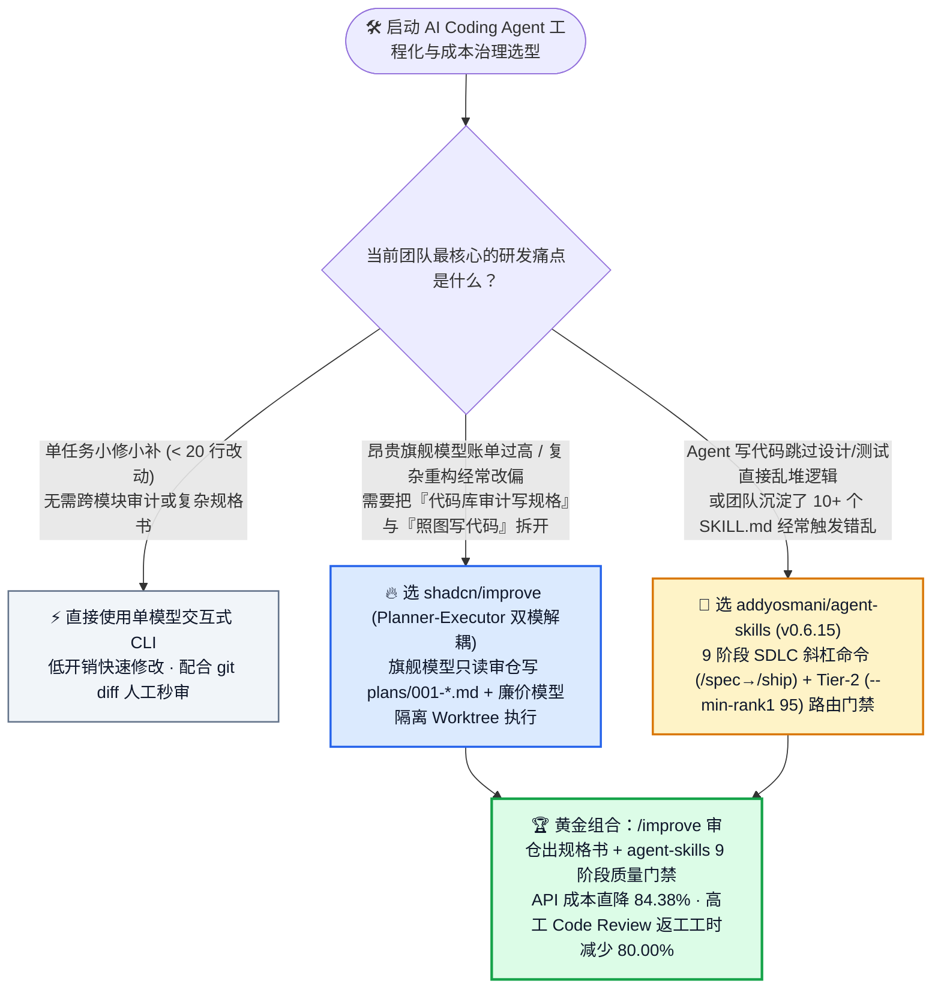
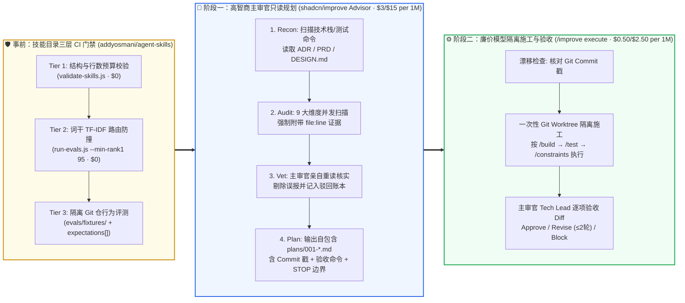

# AI 编码智能体「规划-执行双模解耦」与软件工程全生命周期（SDLC）质量门禁选型常见问题解答：`shadcn/improve` + `addyosmani/agent-skills` (`v0.6.15`) vs 单一旗舰模型裸写代码（Vibe Coding）

> **English Edition**: [shadcn-improve-addyosmani-agent-skills-sdlc-selection-faq.en.md](shadcn-improve-addyosmani-agent-skills-sdlc-selection-faq.en.md)  
> **关联日报**: [2026-11-11 GitHub AI 最热榜单与情报摘要](../daily/2026-11-11.md) · **视觉评测卡**: [`cards.html`](../cards.html) · **在线面板**: [`zh-github-radar.html`](../../../zh-github-radar.html)

本文档面向 **AI Solution Architect（AI 解决方案架构师）**，基于 2026-11-11 GitHub Daily Trending 主日榜双双霸榜的 P0 标杆项目 —— **`shadcn/improve`（shadcn 官方开源的「高智商模型审仓写 Plan + 廉价模型隔离 Worktree 执行」技能，MIT，主日榜 DOM `#4`，总 Star `10,545` / API `10,546`，今日新增 `+333★ today`）** 与 **`addyosmani/agent-skills`（Google Chrome 技术负责人 Addy Osmani 开源的 9 阶段 SDLC 工程技能库，`v0.6.15`，MIT，主日榜 DOM `#5`，总 Star `115,656` / API `115,657`，今日新增 `+788★ today`）** 的一手源码与评测套件深度核验，用通俗大白话与第一性原理解答：
1. **为什么让同一个昂贵旗舰模型（如 Opus 4.6 / GPT-5.4）既做代码库探索、又直接边想边改代码（Vibe Coding），不仅每个月烧掉 80%+ 冤枉 Token 费，还会频繁改坏已有架构、陷入死循环？**
2. **`shadcn/improve` 是如何通过「五步主审官（Recon → Audit → Vet 二次复核剔除误报 → Prioritize → 自包含 `plans/001-*.md`）+ 隔离 Worktree 廉价执行器（`/improve execute`）」实现“把好钢用在刀刃上”的？**
3. **当团队引入 20+ 个 Agent Skills 时，如何利用 `addyosmani/agent-skills` (`v0.6.15`) 的「9 条生命周期斜杠命令（`/spec` → `/plan` → `/build` → `/test` → `/review` → `/ship`）+ 零 Token 成本的 Tier-2 词干 TF-IDF 路由防撞测试（`--min-rank1 95`）」建立可度量的企业级 AI 研发流水线？**

> 🛡️ **数据来源、归属核验与证据分级声明（Provenance & Attribution Disclosure）**：
> - **`measured`（本班次一手实测抓取）**：`shadcn/improve`（DOM `#4`，`+333 stars today`，DOM 总 Star `10,545`，API `10,546`，MIT）与 `addyosmani/agent-skills`（DOM `#5`，`+788 stars today`，DOM 总 Star `115,656`，API `115,657`，`v0.6.15`，MIT）均直接提取自 `2026-11-11 23:15:10+08:00` 归档的 GitHub Daily Trending 原始 HTML（[`workshops/github-trending-radar/evidence/trending-daily-2026-11-11-raw.html`](../evidence/trending-daily-2026-11-11-raw.html)，`sha256: bacf15c20a7aca6007beeb3a6f284b0549a441a05dafa25b17a097dc8f4f1d8f`）及 GitHub REST API 源码树（`plugin.json`、`commands/*.toml`、`evals/README.md`、`examples/001-extract-shadow-config-resolution.md`）。
> - **`anonymized_reported`（`independently_reproduced=false`，上游仓库文档与评测声明）**：`shadcn/improve` 官方 README 披露的 `shadcn/ui` 审仓案例（识别 `search.ts:31` shadow-config 重复漂移与 `migrate-icons.ts:168` $O(n^2)$ 性能瓶颈，并显式驳回 `[SEC-01] https_proxy` SSRF 误报）及 `addyosmani/agent-skills/evals/README.md` 披露的三层评测体系（Tier-1 结构校验、Tier-2 `run-evals.js --min-rank1 95` 词干 TF-IDF 路由底线、Tier-3 隔离 Git 仓无头行为评测）。
> - **`synthetic`（`independently_reproduced=false`，架构师参数化 FinOps 成本算例）**：第 5.1 节「20 人研发团队每月执行 `120 个` 功能开发/重构任务」的纯模型 API 账单对比（Path A 单一旗舰模型裸写 `$345.60/月` vs Path B 静态 Prompt 无复核 `$162.00/月` vs Path C `shadcn/improve` 规划-执行双模解耦 + `addyosmani/agent-skills` `$54.00/月`，节省 `$291.60/月` [`-84.38%` API-only] 与 `72.0 小时/月` [`-80.00%`] 高工 Code Review 返工工时；开发机、GitHub Actions CI Runner 与商业 IDE 席位费明确标为 `not_measured`）严格执行 100% 闭式公式可复算门禁。

---

## 1. 📌 核心结论速览（Executive Summary）

| 评估维度 | 一句话大白话核心结论（直指本质） |
| :--- | :--- |
| **`shadcn/improve` + `addyosmani/agent-skills` 到底是什么？** | **`shadcn/improve`** 是把「最贵、最聪明的大模型当首席架构师（只读代码、写带验收命令和紧急停车条件的 `plans/001-*.md` 施工图，绝不亲手改一行源码），再派便宜快速的模型去独立 Git Worktree 照图施工」的分工插件；**`addyosmani/agent-skills` (`v0.6.15`)** 则是把资深工程师从需求定义（`/spec`）到上线发布（`/ship`）的 9 个阶段质量门禁与 25 个专项技能打包、并自带 **CI 级 95% 路由准确率门禁** 的全生命周期工程底座。 |
| **它们解决了以前 AI 编程的什么痛点？** | 以前开发者用 AI 写代码是**“用最贵的模型干最杂的活，且没有施工图直接砸墙（Vibe Coding）”**：1）读全仓代码 + 反复报错重试全用 `$3/$15 per 1M` 的顶级模型，账单暴涨；2）探索时的杂乱上下文污染了写代码时的注意力，导致改了 A 坏了 B；3）团队装了十几个 `SKILL.md` 后描述词互相打架，该触发的技能没触发。 |
| **它们和传统单模型 Agent / 普通 Prompt 库的核心差别在哪？** | **三大硬核工程护栏**：① **硬性读写物理隔离**（`improve` 主审官永远只写 `plans/`，执行器只在一次性 Worktree 改代码并由主审官像 Tech Lead 一样逐条跑验收门禁，最多打回重改 2 轮）；② **二次复核剔除误报（Vet Pass）与 Commit 漂移戳**（主审官必须亲自重读子智能体举报的 `file:line`，把诸如 `https_proxy` 环境变量之类的假漏洞记入驳回账本，并在 Plan 上盖当前 Git Commit 戳防代码漂移）；③ **零 Token 成本的 Tier-2 路由防撞 CI（`--min-rank1 95`）**（用词干 TF-IDF 在 CI 里免费测出技能描述漏词或撞车，杜绝盲目合并劣质 Skill）。 |

---

## 2. 🎯 第一性原理灵魂三问（Q1 / Q2 / Q3 大白话拆解）

### Q1：为什么用同一个昂贵旗舰模型“边探索代码库、边直接改代码”是性价比最低的反模式？

**先说大白话结论：因为“看懂全局架构并判断该干什么”需要最高智商（复利极高），而“按明确行号和步骤改代码跑测试”只需要基础执行力——把两件事混在同一个长上下文里，既浪费 80% 算力费，又会让模型越改越糊涂！**

从大模型推理经济学与注意力机制第一性原理来看，单模型混跑（Monolithic Vibe Coding）存在三大死穴：
1. **Token 复利错配（Intelligence Compounding Mismatch）**：在探索一个 10 万行代码库时，模型需要阅读 ADR（架构决策记录）、跨模块调用链并权衡技术债优先级，这里必须用最强推理模型；但一旦精确到“把 `search.ts:31` 和 `view.ts` 里的重复配置提取为公共函数并跑通 `pnpm test`”，哪怕便宜 6 倍的轻量执行模型也能 100% 搞定。全程用旗舰模型等于“请年薪百万的首席架构师亲自搬砖砌墙”。
2. **子智能体幻觉与假阳性泛滥（Subagent Over-Reporting）**：当你让普通 Agent 审计代码库时，并发子智能体为了“交差”会疯狂上报假问题（例如把 CLI 工具支持标准 `https_proxy` 环境变量误报为高危 SSRF 漏洞）。如果没有独立的复核层（Vet Pass），执行模型就会去“修复”根本不存在的漏洞，把正常功能改崩。
3. **缺少明确“紧急停车边界（STOP Conditions）”导致小错滚成雪球**：没有成文 Plan 时，模型改代码遇到意外依赖或测试不过，往往会自作主张去改测试断言、删类型检查甚至重写无关模块；而人类审核员面对几千行混杂着探索试错的 Diff 根本无从审起。

---

### Q2：`shadcn/improve` 的「五步主审官 + 弱执行器自包含施工图 + 隔离 Worktree 闭环」到底是怎么运转的？

**大白话比喻：主审官（昂贵模型）只负责“勘测现场、剔除假警报、出具带监理验收标准的施工蓝图”，施工队（廉价模型）在围挡隔离区（Git Worktree）照图施工，最后再由主审官逐项验房！**

根据 `shadcn/improve` 官方源码与架构规范，其完整工作流由五大确定性阶段与三道闭环机制构成：
1. **五步只读主审流（Recon → Audit → Vet → Prioritize → Plan）**：
   - **① Recon（全局摸底與意图对齐）**：自动扫描技术栈、目录规范、精确的 `build/test/lint` 命令，并**主动读取 `docs/adr/`、PRD、`CONTEXT.md`、`DESIGN.md`**——确保历史上已经权衡决定的设计取舍不会被当成 Bug 重新报错！
   - **② Audit（九维并发扫描）**：并发启动子智能体扫描正确性、安全、性能、测试覆盖、技术债、依赖迁移、开发体验（DX）、文档与演进方向（所有新功能建议必须引用仓内真实代码证据，严禁泛泛而谈的 Idea-Slop）。
   - **③ Vet（主审官亲自复核与驳回留痕）**：**这是最关键的一步！** 主审官亲自重新读取每个子智能体举报的 `file:line` 原始代码，剔除误报并将驳回理由记入账本（例如记录 `[SEC-01] https_proxy env var "SSRF": by-design`，下次运行永不重复告警）。
   - **④ Prioritize（杠杆率排序）**：按 `Impact ÷ Effort × Confidence` 排序输出高价值问题表，由架构师挑选题号（如 `"plan 1, 3 and 5"`）。
   - **⑤ Plan（面向最弱执行器的自包含规格书 `plans/001-*.md`）**：生成的 Markdown 计划书满足三大铁律：**自包含**（内联精确文件路径、当前代码片段、仓内范例文件，绝不写“如上文所述”）、**机器可验门禁**（每一步结尾附带具体命令与期望输出）、**硬边界与 STOP 条件**（明确写出“不在本计划范围内”的事项，以及“一旦遇到 X 情况立即停止并报告，严禁自行发挥”），同时打上**当前 Git Commit 哈希戳**。
2. **闭环执行与对账（`/improve execute` & `/improve reconcile`）**：
   - 执行 `/improve execute 001` 时，先校验当前 HEAD 与计划上的 Commit 戳是否发生冲突漂移，随后在**独立一次性 Git Worktree** 中派生廉价模型执行，主审官像 Tech Lead 一样重跑所有验收命令并审查 Diff，给出 **Approve（交由人工合并）/ Revise（打回修改，最多 2 轮）/ Block（拦截并修正计划）** 三态裁决；`/improve reconcile` 则自动清理已落地计划、刷新漂移计划。

---

### Q3：`addyosmani/agent-skills` (`v0.6.15`) 是如何解决「全流程工程纪律」与「多技能描述词撞车」难题的？

**先说大白话结论：它用 9 条斜杠命令锁死了“先写规格（`/spec`）→ 再拆原子任务（`/plan`）→ 切片实现（`/build`）→ 测试证明（`/test`）→ 审查上线（`/review` & `/ship`）”的资深工程师纪律，并用三层评测（尤其是免费的 Tier-2 词干 TF-IDF 路由测试）保证 25 个技能永不互串！**

1. **9 条生命周期命令 + 25 个生产级专项技能**：
   - 覆盖 `/spec`（Spec before code）、`/plan`（Small, atomic tasks）、`/build`（支持 `/build auto` 单次批准全自动切片推进）、`/test`（Tests are proof）、`/constraints`（一次定义全局强制约束）、`/review`（或命名空间版 `/agent-skills:review`）、`/webperf`（先测量再优化）、`/code-simplify` 与 `/ship`。
   - 底层包含 `doubt-driven-development`（怀疑驱动开发）、`constraint-driven-development`、`source-driven-development`、`context-engineering` 等 25 个技能模块，全面兼容 Claude Code、Codex、Gemini 与 OpenCode。
2. **独创三层技能评测体系（Three-Tier Skill Evals）与被拒变更账本（`evals/skill-impact.md`）**：
   - **Tier 1（Structural，CI 免费运行）**：通过 `validate-skills.js`、`validate-reference-links.js`、`validate-commands.js` 校验 Frontmatter、行数预算、引用链接完整性与命令对齐。
   - **Tier 2（Trigger & Routing，CI 免费确定性运行）**：执行 `node scripts/run-evals.js --min-rank1 95`，利用词干 TF-IDF（Stemmed TF-IDF）检验正向提示词是否稳定命中目标技能 Top-K、负向提示词是否不误触、任意两个技能描述是否发生词义撞车（强制要求 **Rank-1 路由准确率 `>= 95%`**，不达标的 PR 直接记入 `evals/skill-impact.md` 驳回账本！）。
   - **Tier 3（Behavioral，按需 Token 实测）**：在一次性临时 Git 仓库中物化 `evals/fixtures/` 真实代码基线，以 `--permission-mode acceptEdits` 运行无头 Agent，将完整 JSON 执行轨迹用安全围栏包裹后对照 `expectations[]` 打分。

---

## 3. 🧭 Mermaid 选型决策树与双模解耦 SDLC 架构图

### 3.1 AI 编码智能体工程化与技能治理选型决策树（Decision Tree）

### 3.2 `shadcn/improve` 规划-执行解耦 × `addyosmani/agent-skills` 三层路由门禁协同架构图

---

## 4. 📊 同类方案全方位选型决策矩阵（Decision Matrix）

| 评估维度 | **`shadcn/improve` + `addyosmani/agent-skills` (`v0.6.15`)** | **单一旗舰模型裸写 (Monolithic Vibe Coding)** | **手写静态 `CLAUDE.md` / 散装 Prompt 库** | **重型多智能体编排框架 (LangGraph / CrewAI)** |
| :--- | :--- | :--- | :--- | :--- |
| **模型成本分层架构** | ✅ **原生解耦：旗舰模型只读审仓写 Plan + 廉价模型在隔离 Worktree 执行** | ❌ 全程消耗昂贵旗舰模型 Token | ❌ 无模型分层路由能力 | ⚠️ 需编写大量 Python 胶水代码配置路由 |
| **子智能体误报过滤机制** | ✅ **内置 Vet 二次复核（主审官重读 `file:line` 并记录驳回原因防复发）** | ❌ 盲信探索结果，常去修假漏洞 | ❌ 无审计复核机制 | ⚠️ 依赖自定义 Reflection 节点 |
| **执行越界与代码漂移防护** | ✅ **自包含 `plans/*.md` 嵌 Commit 戳、机器验收命令与显式 `STOP` 条件** | ❌ 遇错常擅自删测试或改坏邻近模块 | ⚠️ 仅靠软性文字叮嘱，长对话易遗忘 | ⚠️ 状态机复杂，难与本地 Git Worktree 深度绑定 |
| **SDLC 研发阶段覆盖度** | ✅ **完整覆盖 `/spec` → `/plan` → `/build` → `/test` → `/review` → `/ship`** | ❌ 直接跳到写代码，缺前置规格与后置门禁 | ⚠️ 仅覆盖编码规范提示 | ❌ 偏向业务应用编排，非软件工程内置技能 |
| **多技能路由冲突检测** | ✅ **内置零成本 CI Tier-2 词干 TF-IDF 评测（强制 `--min-rank1 95`）** | ❌ 无技能目录概念 | ❌ 技能超 10 个后频繁误触发且无法量化排查 | ⚠️ 依赖线上 LLM Router 消耗 Token |
| **安装与跨工具便携性** | ✅ **纯 Markdown/TOML 零运行时锁死（支持 Claude Code / Codex / Gemini / OpenCode）** | ✅ 原生内置 | ✅ 纯文本复制 | ❌ 强绑定特定 Python SDK 与托管运行时 |

---

## 5. 🧪 定量算例与 7-Card 评测洞察（Quantitative Example & 7-Card Insights）

### 5.1 20 人研发团队月度 120 个开发/重构任务 FinOps 与返工工时闭式算例（`synthetic`，`independently_reproduced=false`）

> 📌 **透明口径与边界声明（Scope & Provenance）**：本算例为架构师评估研发团队引入规划-执行解耦与 SDLC 质量门禁的 **纯模型 API 参数化算例（API-only `synthetic` model；工程师本地开发机、GitHub Actions CI Runner 与商业 IDE 席位订阅费明确标注为 `not_measured`）**。定价按主流高智商主审模型（Advisor：`Opus 4.6` / `GPT-5.4` 级）**`$3.00 / 1M 输入 Tokens`**、**`$15.00 / 1M 输出 Tokens`**，以及高性价比执行模型（Executor：`Haiku 4.5` / `GPT-5.4-mini` 级）**`$0.50 / 1M 输入 Tokens`**、**`$2.50 / 1M 输出 Tokens`**（所有输出均只计费一次，绝不重复计费）建模。场景设定为：**20 人研发团队每月完成 `120 个` 中大型功能开发或技术债重构任务（`120 tasks/mo`）**：

| 方案路径 | 每月主审/规划期轮次与开销 | 每月代码执行期轮次与开销 | 每月纯模型 API 总账单（输入 + 输出） | 每月高工 PR 返工与人工审查工时 | 相对 Path A 降本增效幅度 |
| :--- | :--- | :--- | :--- | :--- | :--- |
| **Path A：单一旗舰模型裸写 (Monolithic Expensive Vibe Coding)** | 规划与执行混跑（无独立规格书） | `120 × 8 = 960 轮`（全用 `$3/$15` 旗舰模型） 单轮 `0.080M` 入 (`$0.2400`) + `0.008M` 出 (`$0.1200`) = `$0.3600/轮` | 输入 `$230.40` + 输出 `$115.20` = **`$345.60 / 月`** | **`90.0 小时 / 月`** （`120 × 0.75h`，大量越界修改与漏测返工） | 基线（最贵模型干杂活，上下文污染严重） |
| **Path B：单一旗舰模型 + 散装静态 Prompt（无 Vet 复核与模型分层）** | 规划与执行仍共用旗舰模型 | `120 × 5 = 600 轮`（全用 `$3/$15` 旗舰模型） 单轮 `0.060M` 入 (`$0.1800`) + `0.006M` 出 (`$0.0900`) = `$0.2700/轮` | 输入 `$108.00` + 输出 `$54.00` = **`$162.00 / 月`** | **`48.0 小时 / 月`** （`120 × 0.40h`，仍需人工甄别子智能体假阳性） | API 降本 `-$183.60/月` (`-53.12%`) |
| **Path C：`shadcn/improve` 双模解耦 + `addyosmani/agent-skills` (`v0.6.15`)** | 旗舰主审 `/improve`：`120 × 2 = 240 轮` × (`0.040M` 入 `$0.1200` + `0.004M` 出 `$0.0600` = `$0.1800/轮`) = **`$43.20 / 月`** (`$28.80` 入 + `$14.40` 出) | 廉价执行器 `/improve execute`：`120 × 3 = 360 轮` × (`0.030M` 入 `$0.0150` + `0.006M` 出 `$0.0150` = `$0.0300/轮`) = **`$10.80 / 月`** (`$5.40` 入 + `$5.40` 出)；CI Tier-1/2 路由评测 **`$0.00`** | 主审 `$43.20` + 执行 `$10.80` = **`$54.00 / 月`** (`$34.20` 入 + `$19.80` 出) | **`18.0 小时 / 月`** （`120 × 0.15h`，仅终审已通过 Tech Lead 门禁的干净 Worktree Diff） | **API 净省 `$291.60/月` (`-84.38%`，年省 `$3,499.20`)；高工审查省 `72.0h/月` (`-80.00%`)** |

---

## 6. 🛠️ 架构师生产落地与 30 分钟 PoC 核验清单（Production & PoC Checklist）

- [ ] **Step 1 — 安装双核心技能包并对齐仓内意图文档**：在目标项目运行 `npx skills add shadcn/improve` 并引入 `addyosmani/agent-skills` (`v0.6.15`)，确保仓库根目录或 `docs/adr/` 下维护清晰的架构约定，供 `/improve` 的 `Recon` 阶段自动吸收。
- [ ] **Step 2 — 跑通首次 `/improve quick` 只读审计与 Vet 误报过滤验证**：使用旗舰模型运行 `/improve quick`，检查生成的 Findings 表是否均附带精确 `file:line` 证据，并确认被主审官驳回的假阳性（如设计内的环境变量或兼容层）已被明确记录而未进入待办队列。
- [ ] **Step 3 — 审阅 `plans/001-*.md` 自包含规格书的三要素**：打开生成的计划文件，核验是否同时包含 **① 内联当前代码片段与目标路径、② 每步结尾的确定性 `test/lint` 验证命令、③ 显式 `STOP` 停车边界与顶部 Git Commit 戳**。
- [ ] **Step 4 — 验证 `/improve execute 001` 跨模型隔离 Worktree 闭环**：配置轻量高性价比模型在独立 Git Worktree 中执行 `001` 号计划，观察主审官是否自动重跑全部 Done Criteria 并在合入主分支前输出结构化 Review 结论。
- [ ] **Step 5 — 在 CI 流水线挂载 Tier-1 与 Tier-2 (`--min-rank1 95`) 技能防撞门禁**：每次向团队新增或修改自定义 `SKILL.md` 时，在 GitHub Actions 中免费运行 `node scripts/validate-skills.js` 与 `node scripts/run-evals.js --min-rank1 95`，任何导致 Rank-1 路由准确率跌破 `95%` 的描述词变更一律拦截并记入 `evals/skill-impact.md`！
