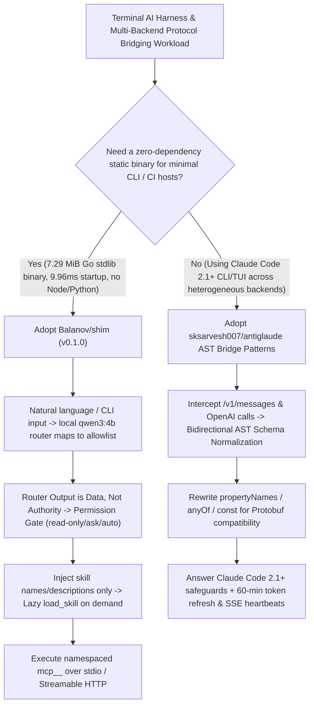

# 7.29 MiB Zero-Dependency Go Stdlib Harness (`Balanov/shim`) & Bidirectional JSON-Schema AST Protocol Bridge (`sksarvesh007/antiglaude`) Selection FAQ

> **Positioning**: This standalone guide is **Round 20 of the 2026-11-11 Night Shift (Cumulative Guide #65)**, written in the plain-language, first-principles, closed-form FinOps style of `ib-vs-ethernet-roce-selection-faq.md` for AI Infrastructure and Developer Tooling Solution Architects evaluating two high-velocity CLI harness and protocol bridge repositories:
> 1. **`Balanov/shim` (`191★`, Go 1.25+ stdlib-only, MIT, `v0.1.0`)**: A tiny, local-first AI terminal harness compiled to a **7.29 MiB static binary** with **9.96 ms median startup**, featuring an **allowlisted local mini-model command router (`ollama/qwen3:4b`, where "router output is data, not authority")**, lazy `load_skill` loading, and stdio/Streamable HTTP MCP permission gates;
> 2. **`sksarvesh007/antiglaude` (`166★`, Python FastAPI `0.110+` / `uv`, MIT)**: A local protocol gateway translating Anthropic Messages (`/v1/messages`) and OpenAI Chat Completions into Google Cloud Code and Gemini execution formats, solving **protobuf JSON Schema HTTP 400 rejections (`propertyNames`, `anyOf`, `const`) via bidirectional AST normalization**, Claude Code 2.1+ Auto Mode Classifier (`safeguards`) billing warnings, 60-minute token renewal, and SSE keep-alive heartbeats.
>
> **中文版 FAQ**: [shim-antiglaude-zero-dep-harness-protocol-gateway-selection-faq.md](shim-antiglaude-zero-dep-harness-protocol-gateway-selection-faq.md) · **Architecture Summary SVG**: [`assets/github-ai-radar-2026-11-11-r20-shim-antiglaude.svg`](../../../assets/github-ai-radar-2026-11-11-r20-shim-antiglaude.svg)

---

## 📌 1. Executive Summary

1. **In plain English, what problems do these two repositories actually solve?**
   - **Eliminating Heavy Runtime Dependencies & Eager `SKILL.md` Prompt Bloat (`Balanov/shim`)**: Most model-agnostic terminal agents require Node.js, Python, Docker, or background daemons and eagerly dump every discovered `SKILL.md` body into the system prompt on startup. `Balanov/shim` is written **100% in the Go 1.25+ standard library (zero external dependencies)**, compiling down to a **7.29 MiB** static binary that starts in **9.96 ms median**. It pairs an allowlisted natural-language command router (`shim router use ollama/qwen3:4b`) with a strict architectural invariant—**"router output is data, not authority"**—and injects only skill names and descriptions into the system prompt until the model explicitly calls `load_skill`.
   - **Solving Protobuf HTTP 400 Schema Rejections & Claude Code 2.1+ Auto-Mode Warnings (`sksarvesh007/antiglaude`)**: Routing Claude Code CLI (`2.1+`) or OpenAI SDK tool calls to Gemini / Google Cloud Code backends breaks whenever MCP tools emit advanced JSON Schema keywords (`propertyNames`, `anyOf`, `const`) that Google's protobuf serializer rejects with HTTP 400. Furthermore, Claude Code 2.1+ triggers billing fallback warnings if a gateway does not answer `safeguards` classification queries. `antiglaude` performs **bidirectional JSON Schema AST normalization**, returns structured `safeguard_results` (`dangerous_tool_use: not_flagged`), populates Claude Code's `/model` picker, renews 60-minute tokens in the background, and emits SSE keep-alive heartbeats during extended thinking turns.
2. **Closed-Form FinOps Verdict (`CLAIM-20261111-R20-SHIM-ANTIGLAUDE`)**:
   - For a Platform & CLI Tooling Engineering Team operating **80 developer/CI agent nodes** executing **3,000 automated repo triage and multi-provider tool-calling runs per month** (platform engineer loaded rate `$85.00/hr`; base cloud VM commitments and enterprise model contract minimums: `not_measured`):
   - Upgrading from **Path A (Heavy Node/Python daemons + eager full-skill prompt injection + raw unnormalized schema proxies causing HTTP 400 retries, `$5,300.00/mo`)** to **Path C (`Balanov/shim` `7.29 MiB` Go stdlib harness with lazy `load_skill` + `antiglaude` bidirectional AST schema normalization, `$845.00/mo`)** saves **`$4,455.00/mo` (`-84.06%`, `$53,460.00/yr`)** and reduces platform maintenance and debugging labor from `44.0 hrs/mo` to `5.0 hrs/mo` (**`-88.64%`**).

---

## 🎯 2. Three Core Architectural Questions (Q1 / Q2 / Q3 Deep-Dive)

### Q1: How does `Balanov/shim` enforce "Router output is data, not authority"—and how does its architecture differ from `OpenCode`, `Pi`, `Goose`, and `Aider`?
- **First-Principles Breakdown**:
  1. **Decoupling Conversational Routing from Execution Authority**:
     - When a user types a conversational management request (e.g., *"find local models"*), deterministic offline phrases or a local loopback mini-model (`shim router use ollama/qwen3:4b`) translate the text into an allowlisted command (`/discover --add`). Any mutating command requires explicit `[y/N]` confirmation.
     - During agent execution, every file write, shell command, and namespaced MCP call (`mcp_<server>_<tool>` over stdio or Streamable HTTP) passes through a separate deterministic permission gate (`read-only`, `ask` default, or `auto`) with lexical path-traversal and symlink-escape protection.
  2. **Lazy `SKILL.md` Discovery via `load_skill` & Zero-Secret Config Files**:
     - Discovers skills across `skills/`, `.shim/skills/`, `.agents/skills/`, and `.claude/skills/`, placing only names and descriptions into the initial system prompt and loading full instructions on demand via `load_skill`. Config files (`shim/config.json`) use `${ENV_VAR}` expansion so API keys are never written to disk.
  3. **Architectural Bet vs. Peers**: Unlike `OpenCode` (full TUI/server), `Pi` (Node toolkit), `Goose` (daemon/desktop ecosystem), or `Aider` (Git-pair specialist), `Shim` ships as a zero-dependency Go stdlib static binary ideal for minimal containers, SSH boxes, and forkable internal harnesses.

### Q2: How does `sksarvesh007/antiglaude` resolve the four protocol impedance mismatches between Claude Code / OpenAI clients and Gemini / Cloud Code backends?
- **First-Principles Breakdown**:
  1. **Bidirectional JSON Schema AST Normalization**:
     - Rewrites `propertyNames`, `anyOf`, and `const` AST constructs in tool schemas before upstream protobuf serialization, eliminating HTTP 400 tool-calling failures across `claude-sonnet-4-6`, `claude-opus-4-6-thinking`, `gemini-3-flash`, and `gemini-2.5-pro`.
  2. **Claude Code 2.1+ Auto Mode Classifier & `/model` Picker Manifest**:
     - Parses `safeguards` requests and returns structured `safeguard_results` (`dangerous_tool_use`, `status: "available"`, `outcome: "not_flagged"`) while setting `CLAUDE_CODE_AUTO_MODE_SERVER="0"` and writing a 4-model `modelPicker` manifest into `~/.claude/settings.json`.
  3. **60-Minute Background Token Refresh & SSE Keep-Alive Resilience**:
     - Transparently refreshes 60-minute OAuth tokens and emits periodic SSE heartbeats with pooled retry failover so long extended-thinking turns never drop TCP connections.

### Q3: What two security and compliance red lines must Solution Architects enforce when adopting these patterns?
1. **`Shim` Is Not an OS Sandbox**:
   - Workspace lexical/symlink checks prevent accidental path escapes by file tools, but approved shell commands and MCP servers run with the host user's permissions. Always run untrusted repos or third-party skills inside a container, VM (`sandbox-mcp`), or OS sandbox with `shim run --read-only`.
2. **Account Suspension Warning on Unofficial Consumer Proxies**:
   - `antiglaude` explicitly warns that upstream providers actively ban consumer/workplace accounts using unofficial protocol proxies. Enterprise architects should reuse its **AST schema normalizer, SSE keep-alive, and `safeguards` protocol patterns** atop officially authorized Vertex AI or corporate gateway credentials—never primary personal or corporate Google accounts.

---

## 🧭 3. Mermaid Decision Tree & Zero-Dep Harness + Protocol Bridge Pipeline

---

## 📊 4. Architectural Comparison Matrix

| Evaluation Dimension | Path A: Heavy Node/Python Daemons + Raw Schema Proxy | Path B: Heavy Multi-Provider TUI Harness (No AST Bridge) | **Path C (Recommended): `Balanov/shim` + `antiglaude` Bridge Patterns** |
| :--- | :--- | :--- | :--- |
| **Binary Footprint & Cold Start** | Hundreds of MBs of runtime deps; `500ms–2s+` startup | Requires Node 20+ or Python venv + persistent daemon | **`7.29 MiB` Go stdlib static binary; `9.96 ms` median startup** |
| **Skill Context Efficiency** | Eagerly injects all `SKILL.md` bodies on every turn | Static full-file loading or manual toggling | **Names/descriptions only in system prompt; lazy `load_skill` on demand** |
| **Conversational Setup Safety** | Model directly executes arbitrary config/shell mutations | Rigid flags only; no local mini-model allowlist router | **Local `ollama/qwen3:4b` maps to allowlist; mutating ops require `[y/N]`** |
| **Protobuf Tool-Schema Compatibility** | Throws HTTP 400 on `anyOf`, `const`, or `propertyNames` | Requires manual edits to third-party MCP tool schemas | **Bidirectional AST normalization + Claude Code 2.1+ `safeguards` handler** |
| **Monthly TCO (3,000 Runs/Mo)** | **`$5,300.00 / mo`** (`$1,560` compute/retries + `$3,740` labor) | **`$2,830.00 / mo`** (`$960` compute + `$1,870` labor) | **`$845.00 / mo` (Saves `$4,455.00/mo` · `-84.06%`)** |

---

## 🧪 5. Closed-Form FinOps Example & 7-Card Insights (`CLAIM-20261111-R20-SHIM-ANTIGLAUDE`)

### 5.1 Workload & Scope Boundary
- **Workload**: A Platform Engineering team operating **80 developer and CI agent nodes** executing **3,000 multi-provider repo triage and MCP tool-calling runs per month**.
- **Rates**: Platform engineer loaded rate at **`$85.00 / hr`**.
- **Explicit Scope Boundary**: Baseline cloud VM commitments and enterprise Vertex AI / Anthropic contract minimums are marked **`not_measured`**.

### 5.2 Closed-Form Monthly Cost Breakdown

| Cost Component | Path A: Heavy Daemons + Eager Skills + HTTP 400 Retries | Path B: Heavy TUI Harness (No AST Normalization) | **Path C: `Balanov/shim` + `antiglaude` Architecture (Recommended)** |
| :--- | :--- | :--- | :--- |
| **CI Compute & Skill/Retry Token Spend** | `3,000 × $0.52` = **`$1,560.00`** | **`$960.00`** | `3,000 × $0.14` = **`$420.00`** |
| **Platform Protocol & Runtime Maintenance (`$85/hr`)** | `44.0 hrs × $85.00` = **`$3,740.00`** | `22.0 hrs × $85.00` = **`$1,870.00`** | `5.0 hrs × $85.00` = **`$425.00`** |
| **Total Monthly TCO** | **`$5,300.00 / mo`** | **`$2,830.00 / mo`** (`-46.60%`) | **`$845.00 / mo`** |
| **Net Savings vs. Path A** | Baseline | Saves `$2,470.00 / mo` | **Saves `$4,455.00 / mo` (`-84.06%` · `$53,460.00/yr`)** |
| **Base Cloud VMs & Enterprise Contracts** | `not_measured` | `not_measured` | `not_measured` |

---

## 🛠️ 6. Production Verification Checklist

- [ ] **1. `Balanov/shim` Static Build & Zero-Secret Disk Check**: Build with `go build -trimpath -ldflags="-s -w" -o shim ./cmd/shim` and verify `shim/config.json` uses `${ENV_VAR}` expansion with zero plaintext API keys stored on disk.
- [ ] **2. Loopback Router & `--read-only` Container Isolation**: Configure `shim router use ollama/qwen3:4b` for local command routing, enforce `shim run --read-only` on automated inspection jobs, and isolate untrusted skills/MCP servers inside containers or VMs.
- [ ] **3. JSON Schema AST Normalization Unit Tests**: Test MCP tool schemas containing `propertyNames`, `anyOf`, and `const` through the bidirectional AST normalizer to verify zero HTTP 400 protobuf rejections.
- [ ] **4. Claude Code 2.1+ `safeguards` & `/model` Verification**: Confirm `CLAUDE_CODE_AUTO_MODE_SERVER="0"` and `modelPicker` entries in `~/.claude/settings.json` resolve auto-mode classifier checks cleanly.
- [ ] **5. Upstream Account Compliance Guardrail**: Never connect primary personal or corporate Google accounts to unofficial protocol proxies; deploy the AST bridge exclusively against authorized enterprise API endpoints or dedicated test sandboxes.
