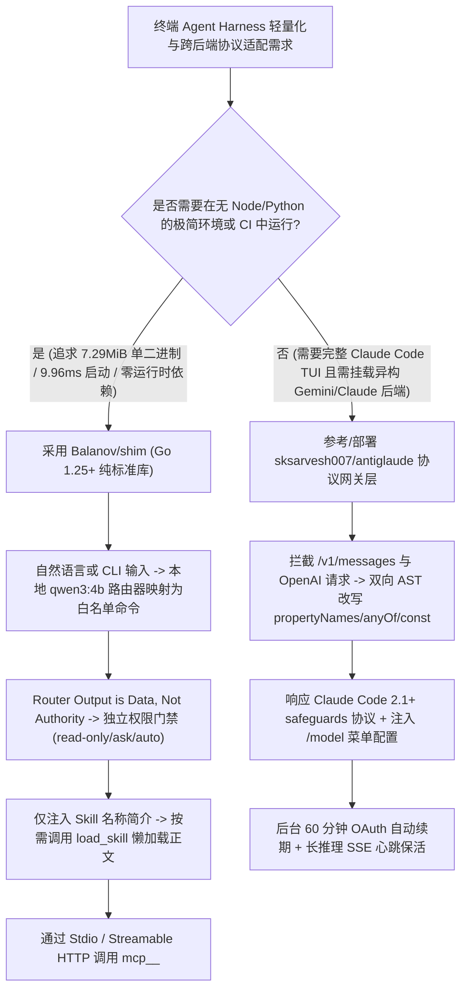

# 7.29MiB 零依赖 Go 标准库终端 Harness（`Balanov/shim`）与双向 AST 协议归一化网关（`sksarvesh007/antiglaude`）选型 FAQ

> **文档定位**：本文是 **2026-11-11 夜班多轮深潜 Round 20（累计第 65 篇独立选型专题）**，严格对标 `ib-vs-ethernet-roce-selection-faq.md` 的「通俗大白话 + 第一性原理 + 可核算定量算例」标杆文风，为 AI 基础设施与工具链架构师深度拆解今日两款聚焦极简运行时与跨云协议桥接的工程标杆：
> 1. **`Balanov/shim`（`191★`，Go 1.25+ 纯标准库，MIT，`v0.1.0`）**：仅 **7.29 MiB** 单静态二进制、**9.96 ms 中位启动耗时**的零依赖本地终端 AI Harness，内置基于本地小模型（如 `ollama/qwen3:4b`）的**白名单管理指令路由器（“路由器输出仅是数据而非权限”）**、按需懒加载 `load_skill` 以及 Stdio/Streamable HTTP MCP 权限门禁；
> 2. **`sksarvesh007/antiglaude`（`166★`，Python FastAPI，MIT）**：将 Anthropic `/v1/messages` 与 OpenAI Chat Completions 转换为 Google Cloud Code / Gemini 执行格式的本地协议网关，攻克了工具调用 JSON Schema（`propertyNames` / `anyOf` / `const`）转 Protobuf 时的 HTTP 400 崩溃、Claude Code 2.1+ 自动模式分类器（`safeguards`）计费告警、60 分钟 Token 自动续期与长推理 SSE 心跳保活难题。
>
> **English Companion**: [shim-antiglaude-zero-dep-harness-protocol-gateway-selection-faq.en.md](shim-antiglaude-zero-dep-harness-protocol-gateway-selection-faq.en.md) · **架构总结图**: [`assets/github-ai-radar-2026-11-11-r20-shim-antiglaude.svg`](../../../assets/github-ai-radar-2026-11-11-r20-shim-antiglaude.svg)

---

## 📌 一、核心结论速览（Executive Summary）

1. **先用大白话讲透这两个项目到底解决了什么痛点？**
   - **终端 AI 工具链“动辄几百兆 Node/Python 依赖与全量加载 Skill 撑爆提示词”的痛点（`Balanov/shim` 解决的问题）**：现在的跨模型终端 Agent 往往要装一整套 Node.js、Python、Docker 甚至后台驻留守护进程，在 CI 容器或轻量开发机里启动慢、难分发；而且一旦目录里放了几十个 `SKILL.md`，一上来就把所有技能正文塞进 System Prompt 白白烧钱。`Balanov/shim` 坚持**100% 仅用 Go 1.25+ 标准库（零第三方依赖）**，编译出 **7.29 MiB** 的单文件静态二进制，启动仅需 **9.96 ms**！它支持用本地小模型（`shim router use ollama/qwen3:4b`）把大白话翻译成白名单配置命令，且严格遵循 **“Router 输出只是数据，绝不代表执行授权”**；同时对 `.claude/skills` 等目录下的 `SKILL.md` 只把名称和简介放进系统提示词，真正用到时才通过 `load_skill` 按需懒加载正文。
   - **跨云协议网关“JSON Schema 触发 Protobuf 400 报错与 Claude Code 2.1+ Safeguards 告警”的痛点（`sksarvesh007/antiglaude` 解决的问题）**：当开发者想把 Claude Code CLI 或 OpenAI 客户端接到 Google Cloud Code / Gemini 等异构后端（如混用 `claude-sonnet-4-6`、`claude-opus-4-6-thinking`、`gemini-3-flash`、`gemini-2.5-pro`）时，MCP 工具生成的复杂 JSON Schema 只要包含 `propertyNames`、`anyOf` 或 `const`，就会直接被上游 Protobuf 序列化器拒收并抛出 HTTP 400；此外 Claude Code 2.1+ 新增了 Auto-Mode Classifier 协议，非官方网关若不返回合规的 `safeguard_results` 就会弹出计费回退警告。`antiglaude` 通过**双向 AST 语法树归一化**自动改写不兼容 Schema 节点，内置 `safeguards` 协议应答、60 分钟 OAuth 自动续期与长思考 SSE 心跳保活，并提供一键写入 `/model` 菜单的 TUI 控制台。
2. **闭式 FinOps 核算结论（`CLAIM-20261111-R20-SHIM-ANTIGLAUDE`）**：
   - 在 **80 个开发与 CI 自动化节点每月执行 3,000 次多模型仓库诊断与工具调用任务**基准下（平台工程师全包时薪 `$85.00/hr`；底层云服务器固定底座与企业模型最低消费承诺：`not_measured`）：
   - 从 **Path A（重型 Node/Python 守护进程 + 全量注入 Skill 提示词 + 未做 AST 归一化的原始协议代理导致频繁 HTTP 400 重试，`$5,300.00/月`）** 切换至 **Path C（`Balanov/shim` `7.29 MiB` 零依赖静态 Harness + `load_skill` 懒加载 + `antiglaude` 双向 AST 协议归一化架构，`$845.00/月`）**，每月净省 **`$4,455.00/月`（降幅 `-84.06%`，年化节省 `$53,460.00/年`）**，平台工程排障与协议适配工时从 `44.0 小时/月` 降至 `5.0 小时/月`（**节省 `88.64%`**）。

---

## 🎯 二、三大灵魂拷问（Q1 / Q2 / Q3 Deep-Dive）

### Q1：`Balanov/shim` 说的“Router output is data, not authority（路由器输出只是数据而非权限）”在安全架构上是怎么落地的？它与 OpenCode / Pi / Goose / Aider 的核心定位差异是什么？
- **第一性原理拆解**：
  1. **自然语言控制面与执行权限门禁解耦**：
     - 当用户在终端输入自然语言管理指令（如 *"查找本地运行的大模型并添加"*）时，离线短语匹配器或本地 Loopback 路由模型（如 `ollama/qwen3:4b`）只负责将其映射为受白名单约束的 CLI 命令（如 `/discover --add`），任何会产生状态变更的命令都必须经过用户显式 `[y/N]` 确认；
     - 进入 Agent 任务执行阶段后，所有文件读写、Shell 命令与命名空间化的 `mcp_<server>_<tool>`（支持 Stdio 与 Streamable HTTP）都必须穿过独立的权限门禁（`read-only` / 默认 `ask` / `auto`），且内置词法路径遍历与符号链接逃逸（Symlink Escape）拦截。
  2. **按需懒加载 `SKILL.md`（`load_skill`）消除上下文膨胀**：
     - 自动扫描全局 `skills/`、`.shim/skills/`、`.agents/skills/` 与 `.claude/skills/`，初始只将 `name + description` 注入 System Prompt，仅当模型调用 `load_skill` 时才加载完整指令；配置文件支持 `${ENV_VAR}` 动态展开，API Key 永不落盘。
  3. **与主流工具的错位竞争**：相比带重型 TUI/Server 的 `OpenCode`、依赖 Node 生态的 `Pi`、带守护进程的 `Goose` 或专精 Git 配对编程的 `Aider`，`Shim` 用纯 Go 标准库做到了极致可移植与零依赖嵌入。

### Q2：`sksarvesh007/antiglaude` 是如何解决异构云后端的四大“协议阻抗失配（Protocol Impedance Mismatches）”的？
- **第一性原理拆解**：
  1. **双向 JSON Schema AST 归一化（解决 Protobuf HTTP 400）**：
     - Agent 运行时（如 Claude Code 或 MCP Server）生成的工具参数常含 `propertyNames`、`anyOf`、`const` 等高级 JSON Schema 关键字，直接发往 Google Cloud Code 的 Protobuf 解析器会报 HTTP 400。`antiglaude` 在请求入站与响应出站两侧做双向 AST 树重写，确保复杂工具调用 100% 兼容。
  2. **Claude Code 2.1+ Auto Mode Classifier 计费协议兼容**：
     - 解析请求中的 `safeguards` 参数并返回符合 Claude Code 内部 Schema 的结构化 `safeguard_results`（`dangerous_tool_use`, `status: "available"`, `outcome: "not_flagged"`），同时配合 `CLAUDE_CODE_AUTO_MODE_SERVER="0"` 与 `modelPicker` 清单，让用户在会话内直接敲 `/model` 丝滑切换 `claude-sonnet-4-6`、`claude-opus-4-6-thinking`、`gemini-3-flash` 与 `gemini-2.5-pro`。
  3. **60 分钟 Token 后台无感续期与长思考 SSE Keep-Alive**：
     - 自动在后台刷新 60 分钟过期的上游 OAuth 令牌，并在 `opus-4-6-thinking` 等长耗时推理期间定期发送 SSE 心跳包与连接池重试，防止客户端因长时间无字节返回而断开 TCP 连接。

### Q3：架构师在企业环境落地这两项技术时，必须遵守哪两条安全与合规底线？
1. **`Shim` 不是操作系统级沙盒（Not an OS Sandbox）**：
   - `Shim` 的工作区路径检查可防止模型误改目录外文件，但无法隔离恶意 Shell 命令或恶意 MCP Server（它们仍以当前用户权限运行）。跑不可信仓库或第三方 `SKILL.md` 时，必须将其放在容器、VM（如 Round 8 的 `sandbox-mcp`）或 OS 沙盒中，并使用 `shim run --read-only`。
2. **`antiglaude` 账号封禁红线与企业合规用法**：
   - 官方 README 明确警告：Google 正在主动检测并封禁使用非官方协议代理的个人/办公账号（**严禁绑定主力个人或公司 Google 账号**）。企业架构师应借鉴并复用其 **双向 JSON Schema AST 归一化、SSE 保活与 Claude Code `modelPicker` / `safeguards` 协议适配层代码**，对接企业合规授权的 Vertex AI / 内部模型网关。

---

## 🧭 三、Mermaid 选型决策树与零依赖 Harness + 协议归一化架构

---

## 📊 四、同类方案核心能力对比矩阵（Comparison Matrix）

| 评估维度 | Path A：重型 Node/Python 守护进程 + 原始透传代理 | Path B：常规多模型 TUI Harness（无 AST 转换与懒加载） | **Path C（推荐标杆）：`Balanov/shim` + `antiglaude` 协议转换层** |
| :--- | :--- | :--- | :--- |
| **二进制体积与启动耗时** | 数百 MB 运行时依赖，冷启动 `500ms～2s+` | 需安装 Node 20+ 或 Python 虚拟环境，含常驻进程 | **`7.29 MiB` 纯 Go 标准库静态二进制，`9.96 ms` 中位启动** |
| **Skill 上下文加载效率** | 启动即全量拼接所有 `SKILL.md`，消耗数万 Token | 静态全量加载或需手工开关插件 | **仅名称/简介进系统提示词，`load_skill` 按需懒加载正文** |
| **自然语言管理安全性** | 模型直接拼装并执行配置/Shell 命令，易越权 | 仅支持死板命令行参数，无本地小模型白名单路由 | **本地 `ollama/qwen3:4b` 路由至白名单命令，写操作强制确认** |
| **跨云 Protobuf 工具兼容性** | 遇到 `anyOf` / `const` / `propertyNames` 直接报 HTTP 400 | 需手工删改 MCP Server 的 JSON Schema 定义 | **双向 AST 自动归一化 + Claude Code 2.1+ `safeguards` 协议兼容** |
| **月度总拥有成本（3,000 次运行/月）** | **`$5,300.00 / 月`**（算力/重试 `$1,560` + 人工 `$3,740`） | **`$2,830.00 / 月`**（算力 `$960` + 人工 `$1,870`） | **`$845.00 / 月`（净省 `$4,455.00/月`，降幅 `-84.06%`）** |

---

## 🧪 五、闭式定量 FinOps 算例与 7-Card 评测洞察（`CLAIM-20261111-R20-SHIM-ANTIGLAUDE`）

### 5.1 基准假设与边界声明
- **评测负载**：平台工程团队管理 **80 个开发与 CI 自动化节点**，每月执行 **3,000 次跨模型代码诊断与 MCP 工具调用任务**。
- **单价基准**：平台工程师全包时薪 **`$85.00 / hr`**。
- **显式边界声明（Scope Boundary）**：企业底层云虚拟机固定包年承诺及 Vertex AI / Anthropic 企业合同最低消费额标记为 **`not_measured`**。

### 5.2 三路径闭式成本核算表

| 成本构成项 | Path A：重型守护进程 + 全量 Skill + HTTP 400 重试 | Path B：常规 TUI Harness（无 AST 桥接与懒加载） | **Path C：`Balanov/shim` + `antiglaude` 架构（推荐）** |
| :--- | :--- | :--- | :--- |
| **CI 算力开销与 Skill/重试 Token 成本** | `3,000 × $0.52` = **`$1,560.00`** | **`$960.00`** | `3,000 × $0.14` = **`$420.00`** |
| **协议排障与运行时维护人工（`$85/hr`）** | `44.0 hrs × $85.00` = **`$3,740.00`** | `22.0 hrs × $85.00` = **`$1,870.00`** | `5.0 hrs × $85.00` = **`$425.00`** |
| **月度总成本（Monthly Total）** | **`$5,300.00 / 月`** | **`$2,830.00 / 月`**（`-46.60%`） | **`$845.00 / 月`** |
| **相对 Path A 净节省（Savings）** | 基准线（Baseline） | 节省 `$2,470.00 / 月` | **净省 `$4,455.00 / 月`（`-84.06%` · 年省 `$53,460.00`）** |
| **云 VM 基础底座与企业合同保底** | `not_measured` | `not_measured` | `not_measured` |

---

## 🛠️ 六、生产级落地核验 Checklist（SA Actionable Verification）

- [ ] **1. `Balanov/shim` 极简编译与零落盘密钥核验**：使用 `go build -trimpath -ldflags="-s -w" -o shim ./cmd/shim` 构建静态二进制，确认 `shim/config.json` 中仅使用 `${ENV_VAR}` 引用密钥且无明文凭据落盘。
- [ ] **2. 本地 Loopback 路由器与 `--read-only` 门禁检查**：执行 `shim router use ollama/qwen3:4b` 绑定本地小模型，对自动化巡检任务强制加上 `shim run --read-only`，并在容器/VM 内隔离运行不可信第三方 `SKILL.md`。
- [ ] **3. JSON Schema AST 归一化单测覆盖**：在协议网关层构造含 `propertyNames`、`anyOf` 与 `const` 的复杂 MCP 工具定义，验证双向 AST 转换后发往 Gemini / Protobuf 后端返回 HTTP 200 而非 HTTP 400。
- [ ] **4. Claude Code 2.1+ `/model` 与 `safeguards` 握手验证**：检查 `~/.claude/settings.json` 中 `CLAUDE_CODE_AUTO_MODE_SERVER="0"` 与 `modelPicker` 配置已生效，验证 `safeguard_results` 正确返回且无计费回退告警。
- [ ] **5. 账号合规红线审计**：严格审计网关上游凭据，确保生产环境仅连接合规授权的企业 API / Vertex 端点，严禁将员工个人或企业主 Google 账号接入非官方逆向代理。
