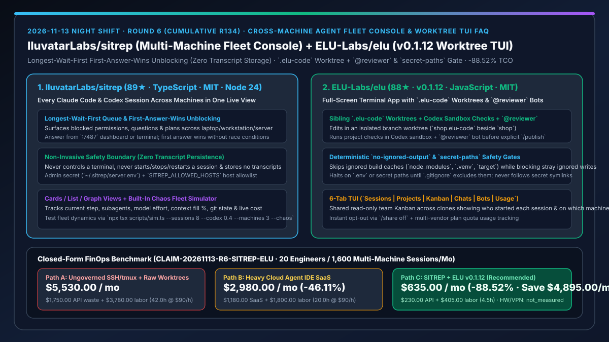
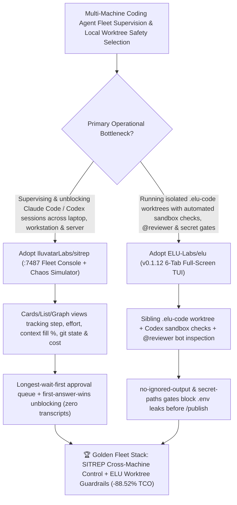

# Cross-Machine Agent Fleet Console (`IluvatarLabs/sitrep`) & Full-Screen Worktree TUI with `secret-paths` Gates (`ELU-Labs/elu` `v0.1.12`) Selection FAQ

> **Document Scope**: This is the **2026-11-13 Night Shift Round 6 (Cumulative #134) standalone 6-part selection guide**, modeled strictly after `ib-vs-ethernet-roce-selection-faq.md` with first-principles explanations and closed-form FinOps math. It is written for AI Solution Architects and Multi-Agent Systems Engineers evaluating two breakout repositories built for supervising and isolating parallel Claude Code and Codex sessions:
> 1. **`IluvatarLabs/sitrep` (`89★` in 1 day, TypeScript, MIT, Node 24)**: A live cross-machine situation-report console (`:7487` server + `:5173` web UI) that aggregates every **Claude Code and Codex session** across your laptop, workstation, and server into cards, a list, or a graph — sorting waiting permissions, questions, and plans **longest wait first** with **first-answer-wins** unblocking from either the dashboard or terminal, while **storing zero transcripts and never hijacking terminal process lifecycles**, complete with a multi-machine chaos simulator (`npx tsx scripts/sim.ts --sessions 8 --codex 0.4 --machines 3 --chaos`)!
> 2. **`ELU-Labs/elu` (`88★` in 2 days, JavaScript, MIT, latest `v0.1.12`, `npx -y @elu-labs/elu@0.1.12`)**: A 6-tab full-screen terminal app (`Sessions | Projects | Kanban | Chats | Bots | Usage`) that runs coding sessions on your existing AI CLIs inside sibling `.elu-code` Git worktrees (`shop.elu-code` beside `shop`), executes project checks in the Codex sandbox, assigns `@reviewer` bots before `/publish`, and enforces deterministic **`no-ignored-output` and `secret-paths` safety gates**!
>
> **中文版本**: [sitrep-elu-cross-machine-agent-fleet-console-worktree-tui-selection-faq.md](sitrep-elu-cross-machine-agent-fleet-console-worktree-tui-selection-faq.md) · **Daily Digest**: [`daily/2026-11-13.en.md`](../daily/2026-11-13.en.md) · **Topic SVG**: [`assets/github-ai-radar-2026-11-13-r6-sitrep-elu.svg`](../../../assets/github-ai-radar-2026-11-13-r6-sitrep-elu.svg)

---

## 📌 1. Executive Summary

1. **In plain English, what core pain points do these two repositories solve?**
   - **Ending "hunting across 15 SSH and tmux windows on three machines to find which Claude Code or Codex session is silently blocked waiting on a permission prompt" (`IluvatarLabs/sitrep`)**: When engineers run coding agents across a laptop, workstation, and build server, throughput plummets because blocked sessions sit unnoticed behind background terminal tabs. `SITREP` shows every session across every machine in one live view (cards, list, or graph) with current step, model/effort, context fill, git state, and cost. Every waiting permission, question, or plan sits at the top (**longest wait first**), and answering from the dashboard or terminal unblocks the agent immediately (**first answer wins**) — without storing transcripts or taking control of your terminal!
   - **Ending "dirty worktree build caches, accidental `.env` secret commits, and unreviewed agent edits pushed straight to remote branches" (`ELU-Labs/elu` `v0.1.12`)**: `ELU` wraps your existing Claude Code, Codex, and Antigravity CLIs in a 6-tab full-screen TUI that isolates every edit in a sibling `.elu-code` Git worktree, runs project checks inside the Codex sandbox, and has `@reviewer` inspect changes before you confirm `/publish`. Its **`no-ignored-output` and `secret-paths` gates** ignore standard build directories (`node_modules`, `.venv`, `target`) so symlinks or large files never stall a run, while immediately halting if the agent writes arbitrary ignored files or touches `.env` secret paths!
2. **Closed-Form FinOps Conclusion (`CLAIM-20261113-R6-SITREP-ELU`)**:
   - Modeled for a **20-engineer parallel agentic software team executing `1,600 multi-machine Claude Code and Codex sessions per month`** (fully loaded senior engineer rate `$90.00/hr`; developer workstation hardware and corporate VPN licenses: `not_measured`):
   - Upgrading from **Path A (ungoverned multi-window SSH/tmux sessions + manual worktree/secret cleanup, `$5,530.00/mo`)** to **Path C (`IluvatarLabs/sitrep` longest-wait-first fleet console + `ELU-Labs/elu v0.1.12` `.elu-code` worktree & `secret-paths` gate, `$635.00/mo`)** saves **`$4,895.00/mo` (`-88.52%`, or `$58,740.00/yr`)** and cuts supervision/cleanup labor from `42.0 hrs/mo` to `4.5 hrs/mo` (**`-89.29%`**).

---

## 🎯 2. Three First-Principles Deep-Dive Questions (Q1 / Q2 / Q3)

### Q1: Why do multi-window SSH/tmux workflows break down when scaling beyond 3–5 concurrent coding agents?
- **First-Principles Breakdown**:
  1. **Unobserved Approval Stalls**: A single blocked permission prompt buried in an inactive SSH window halts an entire workstream for hours.
  2. **Worktree Cache Bloat vs. Secret Leakage**: Build artifacts (`node_modules`, `target`) can choke context scanners, while unguarded worktrees risk staging `.env` credentials or symlinked secrets.

### Q2: How does `IluvatarLabs/sitrep` unblock multi-machine agent fleets with zero transcript storage?
- **First-Principles Breakdown**:
  1. **Longest-Wait-First Queue & First-Answer-Wins Arbitration**:
     - Surfaces all blocked permissions, questions, and plans at the top of the `:7487` dashboard ordered by wait duration; answering in either the web UI (authenticated via `~/.sitrep/server.env`) or the native terminal resolves the prompt cleanly.
  2. **Non-Invasive Telemetry & Built-In Chaos Simulator**:
     - Sends only user answers/commands, never starts/stops sessions, stores zero transcripts, and includes `npx tsx scripts/sim.ts --sessions 8 --codex 0.4 --machines 3 --chaos` for fleet simulation.

### Q3: How does `ELU-Labs/elu` (`v0.1.12`) enforce `.elu-code` worktree isolation, `no-ignored-output`, and `secret-paths`?
- **First-Principles Breakdown**:
  1. **Sibling `.elu-code` Worktrees + Codex Sandbox Checks + `@reviewer`**:
     - Creates `project.elu-code` beside `project`, runs project test suites inside the Codex sandbox, and invokes `@reviewer` before allowing manual `/publish` confirmation.
  2. **Deterministic `no-ignored-output` & `secret-paths` Enforcement**:
     - Exempts standard Git-ignored build directories (`node_modules`, `vendor`, `.venv`, `dist`, `target`, `.pytest_cache`) while failing `no-ignored-output` on stray ignored writes and halting on `.env` / secret paths (`secret-paths`) without ever following secret symlinks.

---

## 🧭 3. Mermaid Decision Tree & Cross-Machine Fleet Console + Worktree TUI Architecture

---

## 📊 4. Head-to-Head Selection Matrix

| Dimension | Path A: Raw Multi-Window SSH/tmux + Manual Branches | Path B: Heavy Cloud Agent IDE SaaS | **Path C (Recommended): `IluvatarLabs/sitrep` + `ELU-Labs/elu v0.1.12`** |
| :--- | :--- | :--- | :--- |
| **Cross-Machine Approval Latency** | High (manual terminal tab hunting across hosts) | Cloud-only; ignores local workstations | **Longest-wait-first top queue + dashboard/terminal first-answer-wins** |
| **Transcript Privacy & Process Safety** | Unindexed local scrollback | Full transcripts stored on vendor cloud | **Zero transcript storage; never hijacks session lifecycle** |
| **Build-Cache vs. `.env` Secret Guardrails** | High risk of `.env` commits or cache hangs | Manual ignore config | **Built-in `no-ignored-output` & `secret-paths` gates (no secret symlinks)** |
| **Pre-Publish Verification & Team Board** | Manual test runs & ad-hoc chat updates | Expensive per-seat SaaS | **Codex sandbox checks + `@reviewer` + shared read-only Git Kanban (`/share off`)** |
| **Monthly TCO (20 Engineers / 1,600 Sessions)** | **`$5,530.00 / mo`** (`$1,750` waste + `$3,780` labor) | **`$2,980.00 / mo`** (`$1,180` SaaS + `$1,800` labor) | **`$635.00 / mo` (Saves `$4,895.00/mo` · `-88.52%`)** |

---

## 🧪 5. Closed-Form FinOps Worked Example & 7-Card Insights (`CLAIM-20261113-R6-SITREP-ELU`)

### 5.1 Baseline Parameters & Explicit Scope Boundaries
- **Scenario**: A 20-engineer software team executing **1,600 parallel Claude Code and Codex sessions per month** across laptops, workstations, and LAN build servers.
- **Labor Rate**: Fully loaded senior software engineering rate of **`$90.00 / hr`**.
- **Explicit Not-Measured Boundary**: Developer workstation hardware depreciation and corporate VPN/LAN licensing are marked **`not_measured`**. This model strictly accounts for wasted API tokens from stalled/polluted sessions, SaaS seat markups, and engineering hours spent hunting blocked terminals and cleaning up worktrees.

### 5.2 Three-Path Monthly Cost Comparison

| Cost Component | Path A: Ungoverned SSH/tmux + Raw Worktrees | Path B: Heavy Cloud Agent IDE SaaS | **Path C: `SITREP` + `ELU v0.1.12` (Recommended)** |
| :--- | :--- | :--- | :--- |
| **Monthly API Waste & Platform Spend** | **`$1,750.00`** (stalled session reruns & context bloat) | **`$1,180.00`** (cloud seat & VM markups) | **`$230.00`** (`$0` seat markup + live context-fill monitoring) |
| **Terminal Hunting, Unblocking & Worktree Cleanup Labor (`$90/hr`)** | `42.0 hrs × $90.00` = **`$3,780.00`** | `20.0 hrs × $90.00` = **`$1,800.00`** | `4.5 hrs × $90.00` = **`$405.00`** |
| **Total Monthly TCO** | **`$5,530.00 / mo`** | **`$2,980.00 / mo`** (`-46.11%`) | **`$635.00 / mo`** |
| **Net Savings vs. Path A** | Baseline | Saves `$2,550.00 / mo` | **Saves `$4,895.00 / mo` (`-88.52%` · `$58,740.00/yr`)** |
| **Workstation Hardware & Corporate VPN Licenses** | `not_measured` | `not_measured` | `not_measured` |

---

## 🛠️ 6. Production Adoption Checklist

- [ ] **1. `IluvatarLabs/sitrep` 2-Minute Chaos Fleet Simulation**: Run `npm ci && npm run dev` and `npx tsx scripts/sim.ts --sessions 8 --codex 0.4 --machines 3 --chaos` on Node 24 to verify longest-wait-first sorting and first-answer-wins unblocking on `http://localhost:5173`.
- [ ] **2. Dry-Run Server Installation & Host Allowlisting**: Run `npx tsx scripts/install.ts --server --bind 0.0.0.0` (dry run) before `--apply`, securing `~/.sitrep/server.env` and `SITREP_ALLOWED_HOSTS`.
- [ ] **3. `ELU-Labs/elu` (`v0.1.12`) Worktree & Secret-Gate Verification**: Launch `npx -y @elu-labs/elu@0.1.12`, start a task, and verify creation of the sibling `.elu-code` worktree along with `no-ignored-output` and `secret-paths` enforcement.
- [ ] **4. Codex Sandbox Check + `@reviewer` + `/publish` Gate**: Confirm that edits pass Codex sandbox checks and `@reviewer` inspection before `/publish`, and test `/share off` for private local-only Kanban boards.
