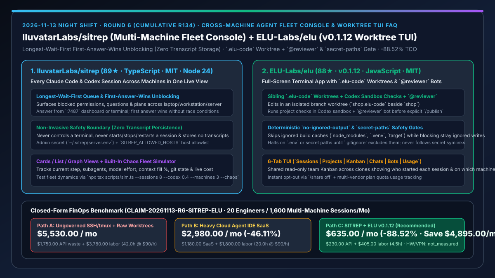
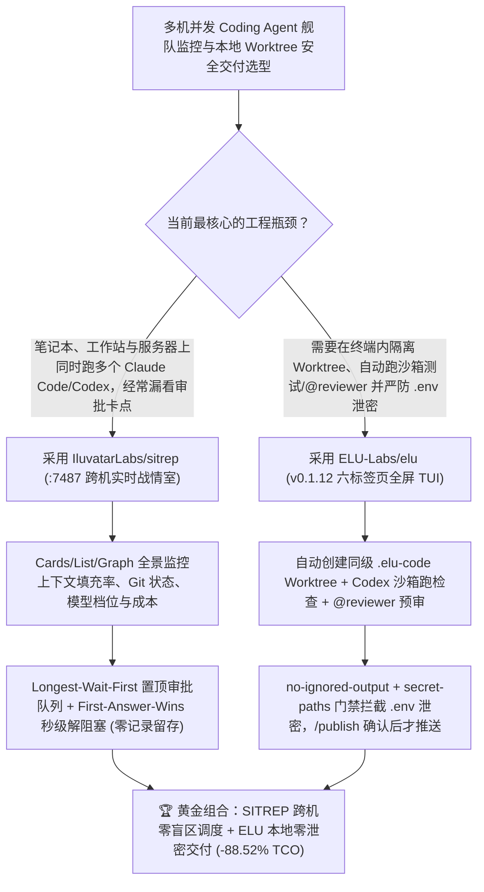

# 跨机器智能体舰队实时战情室（`IluvatarLabs/sitrep`）与带 `secret-paths` 门禁的全屏 Worktree 协同终端（`ELU-Labs/elu` `v0.1.12`）深度选型 FAQ

> **文档定位**：本专题是 **2026-11-13 夜班第 6 轮（累计第 134 篇）独立六段式选型指南**，严格对标 `ib-vs-ethernet-roce-selection-faq.md` 的通俗第一性原理与闭式 FinOps 核算规范，面向多机并发 Agent 开发者与 AI Solution Architect，深度拆解今日新仓爆发榜中专门解决“一人同时在笔记本、工作站和服务器上跑十几个 Claude Code / Codex 会话时如何防卡死、防泄密、防混乱”的两大硬核工具：
> 1. **`IluvatarLabs/sitrep`（1 天新建获 `89★`，TypeScript，MIT，Node 24）**：把分布在笔记本、主力工作站和远端服务器上的所有 **Claude Code 与 Codex 会话汇总到单一实时视图（Cards / List / Graph）** 的战情室（`:7487` 服务端 + `:5173` 面板）——将所有卡在等待权限、提问或计划审批的会话按**等待时长倒序置顶（Longest Wait First）**，支持在面板或原终端任意一处直接拍板回复且**先答生效（First Answer Wins）**；严格恪守安全边界：**从不劫持终端、从不启停会话、不落盘保存任何对话历史（Stores No Transcripts）**，并内置多机混沌模拟器（`npx tsx scripts/sim.ts --sessions 8 --codex 0.4 --machines 3 --chaos`）！
> 2. **`ELU-Labs/elu`（2 天新建获 `88★`，JavaScript，MIT，最新版 `v0.1.12`）**：复用你本机已安装的 Claude Code、Codex 与 Antigravity 的**六标签页全屏终端工作台（`Sessions | Projects | Kanban | Chats | Bots | Usage`）**——每次任务自动在同级 `.elu-code` 独立 Git Worktree 分支上修改代码，自动调起 Codex 沙箱跑项目检查并由 **`@reviewer` Bot** 审查，直到人工输入 `/publish` 确认前绝不推送；更内置极严密的 **`no-ignored-output` 与 `secret-paths` 双重安全门禁**（自动跳过 `node_modules`/`.venv`/`target` 等忽略目录中的巨型文件与软链，但严禁模型写入未声明的忽略文件或 `.env` 密钥路径）！
>
> **English Version**: [sitrep-elu-cross-machine-agent-fleet-console-worktree-tui-selection-faq.en.md](sitrep-elu-cross-machine-agent-fleet-console-worktree-tui-selection-faq.en.md) · **关联日报**: [`daily/2026-11-13.md`](../daily/2026-11-13.md) · **专题架构图**: [`assets/github-ai-radar-2026-11-13-r6-sitrep-elu.svg`](../../../assets/github-ai-radar-2026-11-13-r6-sitrep-elu.svg)

---

## 📌 一、核心结论速览（Executive Summary）

1. **一句话大白话讲透这两个项目到底解决了什么痛点？**
   - **终结“同时在笔记本、台式机和远程开发机开了 10 个 tmux 窗口跑 Claude Code 和 Codex，结果某台机器上的 Agent 停下来等一个 Y/N 权限确认，你隔了两个小时才翻到那个黑窗口，白白耽误半天进度”的痛点（`IluvatarLabs/sitrep`）**：当你跨多台机器并行调度智能体时，最大的瓶颈不是模型慢，而是“找不到哪个终端正在等你拍板”。`SITREP` 在你局域网常开的机器上起一个极轻量的 `:7487` 服务，把所有机器上 Claude Code 和 Codex 的当前步骤、模型档位、上下文填充百分比、Git 状态和开销画在一张表或拓扑图上；**所有卡住等审批/提问的会话按等待时间最长优先排在最顶上（Longest wait first）**，你直接在网页里点确认就能继续推进，而且它**不存任何聊天记录、不接管终端进程生命周期**，安全克制到了极致！
   - **终结“Agent 在项目里跑测试留下一堆缓存垃圾、不小心把 `.env` 密钥写进提交、或者团队多人对同一个仓库跑 Agent 时互相不知道对方在改哪块”的痛点（`ELU-Labs/elu` `v0.1.12`）**：`ELU`（`npx -y @elu-labs/elu@0.1.12`）给现有的命令行 Agent 套上了一层纪律严明的全屏 TUI 装甲：所有修改自动落在旁边的 `项目名.elu-code` 独立 Git Worktree 中，改完后自动用 Codex 的沙箱跑项目测试并请 `@reviewer` Bot 审代码；它的 **`no-ignored-output` 与 `secret-paths` 规则**极其聪明——既不会因为 `node_modules`/`.venv`/`target` 里的软链和大文件卡死，又会在发现 `.env` 等疑似密钥文件未进 `.gitignore` 时立即熔断拦截，还自带按克隆仓库自动同步的团队只读 **Kanban** 看板！
2. **闭式 FinOps 投资回报结论（`CLAIM-20261113-R6-SITREP-ELU`）**：
   - 以 **20 人规模的高并发 Agent 研发团队每月跨笔记本与构建机运行 `1,600 次` Claude Code / Codex 会话** 为基准（资深工程师全包时薪 `$90.00/hr`；开发机硬件折旧与企业内网 VPN 许可费：`not_measured`）：
   - 从 **Path A（多终端裸跑 SSH/tmux 无集中等待队列 + 人工排查 `.env` 误提交与 Worktree 脏缓存，月均 `$5,530.00`）** 升级至 **Path C（`IluvatarLabs/sitrep` 跨机最长等待优先控制台 + `ELU-Labs/elu v0.1.12` `.elu-code` 沙箱自检与 `secret-paths` 门禁，月均 `$635.00`）**，每月净省 **`$4,895.00/mo`（降幅 `-88.52%`，年省 `$58,740.00/yr`）**，并将找窗口解阻塞与清理脏分支的损耗工时从 `42.0 hrs/mo` 压缩至 `4.5 hrs/mo`（节省 **`-89.29%`**）。

---

## 🎯 二、三大灵魂拷问（Q1 / Q2 / Q3 深度原理解析）

### Q1：为什么当开发者同时驾驭 5–10 个跨机器 Coding Agent 时，传统的“多标签页终端 + 原生 Git 分支”会迅速失控？
- **第一性原理拆解**：
  1. **阻塞队列不可见导致的人机死锁（Hidden HITL Stalls）**：一个会话在远端服务器上弹出权限确认或计划提问，隐藏在十几个 SSH 标签页背后，直到几小时后开发者切换过去才发现，吞吐量断崖式下跌。
  2. **构建产物噪音与 `.env` 软链泄密隐患**：Agent 在工作树里执行 `npm install`、`pytest` 或 `cargo build` 会产生大量忽略目录，若无精确区分，要么把大文件读爆上下文，要么把模型临时生成的敏感 `.env` 或未忽略垃圾文件一并推上远端。

### Q2：`IluvatarLabs/sitrep` 是如何在“不存聊天记录、不劫持终端”的前提下实现跨机秒级解阻塞的？
- **第一性原理拆解**：
  1. **Longest-Wait-First 置顶仲裁与 First-Answer-Wins 并发一致性**：
     - 无论是权限请求、澄清问题还是实施计划，所有等待人工介入的项统一按等待时长倒序排列在面板顶部；开发者既可在 Dashboard 凭 `~/.sitrep/server.env` 管理员密钥作答，也可在原终端作答，先到达的回复立即解除阻塞，绝不产生重复注入。
  2. **零转录留存（Zero Transcripts）与内置多机混沌演练器**：
     - 严格遵守最小权限原则：只向会话转发用户本人的回答与指令，不存储会话正文、不启停进程，并附带 `scripts/sim.ts --sessions 8 --codex 0.4 --machines 3 --chaos` 供架构师在 2 分钟内压测多机乱序故障场景。

### Q3：`ELU-Labs/elu` (`v0.1.12`) 的 `.elu-code` 同级 Worktree、`no-ignored-output` 与 `secret-paths` 门禁是如何运作的？
- **第一性原理拆解**：
  1. **同级 `.elu-code` Worktree 隔离 + Codex 沙箱测试 + `@reviewer` 双检**：
     - 在原仓库旁自动创建 `repo.elu-code` 独立分支工作树；模型改完代码后自动调用本地 Codex 沙箱执行项目检查，并由 `@reviewer` 复核，未经人工显式输入 `/publish` 绝不触发远端推送。
  2. **白名单构建缓存豁免 vs 未知忽略文件与密钥硬拦截**：
     - 对 Git 已忽略的标准构建目录（`node_modules`、`vendor`、`.venv`、`dist`、`target`、`.pytest_cache` 等）完全跳过读取与发布；但若模型写入任何其他被忽略文件则触发 `no-ignored-output` 失败，若触碰 `.env` 等疑似密钥路径则触发 `secret-paths` 硬拦截且绝不跟随密钥软链接！

---

## 🧭 三、Mermaid 选型决策树与「SITREP 跨机战情室 + ELU Worktree 安全门禁」架构图

---

## 📊 四、同类方案核心能力对比矩阵（Selection Matrix）

| 评估维度 | Path A：多窗口裸跑 SSH/tmux + 手工管理 Git 分支 | Path B：重型云端托管 Agent IDE SaaS | **Path C（推荐）：`IluvatarLabs/sitrep` + `ELU-Labs/elu v0.1.12`** |
| :--- | :--- | :--- | :--- |
| **跨机器阻塞提问与权限发现延迟** | 需人工逐个切 tmux 窗口排查，平均滞后数十分钟 | 仅限云端自身容器，无法纳管本地工作站 | **Longest-Wait-First 全局置顶 + 网页/终端双端 First-Answer-Wins** |
| **隐私边界与会话记录留存** | 本地散落无索引 | 全量代码与对话上传第三方云端存储 | **SITREP 零对话记录落盘（Stores No Transcripts），运行在自有局域网主机** |
| **构建缓存豁免与 `.env` 防泄密** | 极易误提交 `.env` 或被 `node_modules` 软链卡死 | 依赖手工配置忽略列表 | **内置 `no-ignored-output` 与 `secret-paths` 硬门禁 + 禁追密钥软链** |
| **合入前自动复核与团队看板同步** | 靠人工跑测试与口头同步 | 按席位高价收费 | **Codex 沙箱自检 + `@reviewer` 机器人 + 跨克隆只读共享 Kanban（支持 `/share off`）** |
| **月度总拥有成本（20 人 / 1,600 会话）** | **`$5,530.00 / mo`**（`$1,750` 浪费 + `$3,780` 工时） | **`$2,980.00 / mo`**（`$1,180` 席位 + `$1,800` 工时） | **`$635.00 / mo`（净省 `$4,895.00/mo` · `-88.52%`）** |

---

## 🧪 五、定量 FinOps 算例与 7-Card 洞察（`CLAIM-20261113-R6-SITREP-ELU`）

### 5.1 测算基准与显式边界（Scope & Boundaries）
- **场景设定**：20 人规模的研发团队，每月跨个人笔记本、本地 GPU 工作站与内网服务器并发运行 **1,600 次 Claude Code 与 Codex 编码会话**。
- **费率假设**：资深软件工程师全包时薪 **`$90.00 / hr`**。
- **显式边界声明（Explicit Not-Measured Boundary）**：开发工作站硬件采购折旧与企业内网 VPN/Tailscale 基础许可费标记为 **`not_measured`**，本表严格核算因会话卡死超时重跑、误提交回滚产生的 API 消耗以及人工巡检/清理工时。

### 5.2 三路径月度成本闭式对照表

| 成本分项 | Path A：裸跑多窗口 SSH/tmux + 手工分支清理 | Path B：重型云端托管 Agent IDE SaaS | **Path C：`SITREP` + `ELU v0.1.12`（推荐）** |
| :--- | :--- | :--- | :--- |
| **月度模型 API 与平台席位净支出** | **`$1,750.00`**（卡死超时重跑与脏上下文重复计费） | **`$1,180.00`**（高昂云端容器与按席位订阅溢价） | **`$230.00`**（零 SaaS 溢价 + 实时监控上下文填充率防爆窗） |
| **巡检解阻塞、清理脏 Worktree 与 `.env` 审计工时（`$90/hr`）** | `42.0 hrs × $90.00` = **`$3,780.00`** | `20.0 hrs × $90.00` = **`$1,800.00`** | `4.5 hrs × $90.00` = **`$405.00`** |
| **月度总成本（Monthly TCO）** | **`$5,530.00 / mo`** | **`$2,980.00 / mo`**（`-46.11%`） | **`$635.00 / mo`** |
| **相对 Path A 净节省** | 基准线（Baseline） | 净省 `$2,550.00 / mo` | **净省 `$4,895.00 / mo`（`-88.52%` · 年省 `$58,740.00/yr`）** |
| **工作站硬件折旧与企业 VPN 许可费** | `not_measured` | `not_measured` | `not_measured` |

---

## 🛠️ 六、生产级落地核验 Checklist

- [ ] **1. `IluvatarLabs/sitrep` 多机混沌模拟器快速压测**：在 Node 24 环境下克隆仓库执行 `npm ci && npm run dev`，另开终端运行 `npx tsx scripts/sim.ts --sessions 8 --codex 0.4 --machines 3 --chaos`，验证 `:5173` 面板按等待时长置顶阻塞项且回复后秒级消解。
- [ ] **2. 局域网安全加固部署（`SITREP_ALLOWED_HOSTS` + Admin Secret）**：通过 `npx tsx scripts/install.ts --server --bind 0.0.0.0` 先干跑审查生成的全部命令，再加 `--apply` 写入 `~/.sitrep/server.env` 密钥并配置允许访问的主机白名单。
- [ ] **3. `ELU-Labs/elu` (`v0.1.12`) 同级 `.elu-code` Worktree 与双门禁验证**：在家目录执行 `npx -y @elu-labs/elu@0.1.12` 启动六标签页 TUI，发起编码任务并验证自动生成 `.elu-code` 工作树、触发 `no-ignored-output` 与 `secret-paths` 检查。
- [ ] **4. Codex 沙箱检查 + `@reviewer` 复核 + `/publish` 人工拍板闭环**：确认每次代码改动必须先通过 Codex 沙箱测试与 `@reviewer` 审查，并在敏感私有项目上验证 `/share off` 关闭跨机只读 Kanban 同步。
