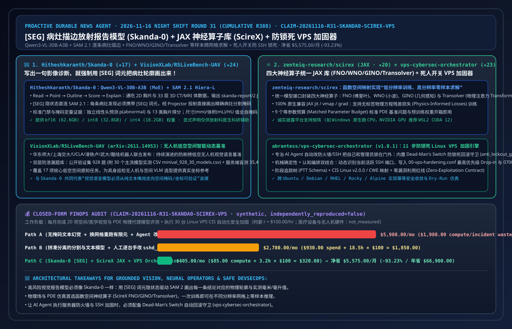
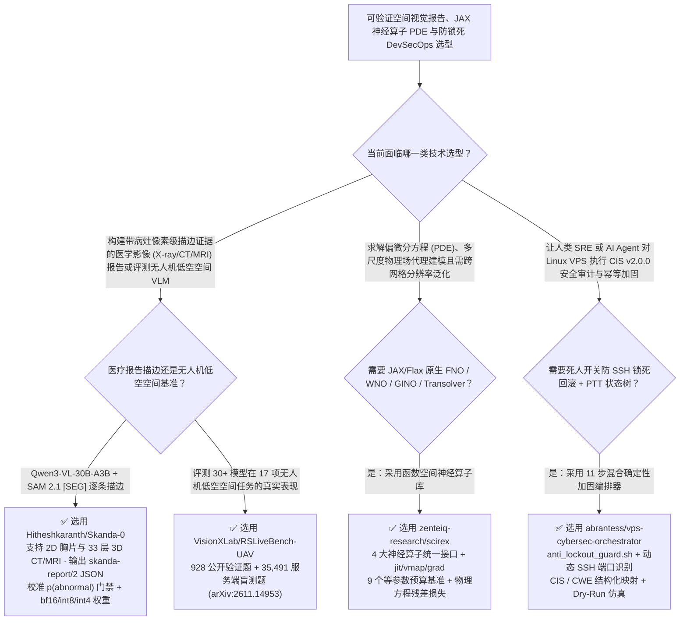

# `[SEG]` 病灶描边放射报告模型、JAX 四大神经算子库与带死人开关的 Linux VPS 加固引擎选型 FAQ：`Hitheshkaranth/Skanda-0` + `zenteiq-research/scirex` + `abrantess/vps-cybersec-orchestrator` & `VisionXLab/RSLiveBench-UAV`

> **元数据（Metadata）**
> - **评测批次**：2026-11-16 夜间深潜 Round 31（累计 Round 388）
> - **核心标的**：
>   1. [`Hitheshkaranth/Skanda-0`](https://github.com/Hitheshkaranth/Skanda-0)（`★ 17` / `4 Forks`，Apache-2.0 代码 · 空间锚定多模态放射影像报告与分割模型：通过特殊 **`[SEG]` 词元** 将 `Qwen3-VL-30B-A3B-Instruct`［MoE，每词元仅激活 `~3B` 参数］与 `SAM 2.1 Hiera-L` 耦合，同时支持 2D 胸片与 33 层 3D CT/MRI 体数据，输出结构化 `skanda-report/2` JSON、**为报告中的每一条发现画出精确轮廓**，并附带 `p(abnormal)` + 13 类胸片校准门禁与 `int4` `18.2 GB` 量化权重）
>   2. [`zenteiq-research/scirex`](https://github.com/zenteiq-research/scirex)（`★ 20` / `2 Forks`，LGPL-3.0 · 原生基于 `JAX` + `Flax` 的科学机器学习神经算子库：在统一模型接口下集成 **`FNO`［傅里叶］、`WNO`［小波］、`GINO`［几何感知］与 `Transolver`［物理注意力 Transformer］**，学习无限维函数空间映射以实现跨网格分辨率零样本推理，配套 9 个等参数预算 PDE 基准）
>   3. [`abrantess/vps-cybersec-orchestrator`](https://github.com/abrantess/vps-cybersec-orchestrator)（`★ 23` / `8 Forks`，MIT `v1.0.1`）& [`VisionXLab/RSLiveBench-UAV`](https://github.com/VisionXLab/RSLiveBench-UAV)（`★ 24`，`arXiv:2611.14953`）—— 11 步防锁死 Linux VPS 自动审计与 CIS v2.0.0 幂等加固编排器（内置 **`bin/anti_lockout_guard.sh` 死人开关回滚守卫**、动态 SSH 端口检测与阶段追踪树 `PTT`）+ 低空无人机空间智能动态评测基准（`928` 公开验证题 + `35,491` 服务端盲测题，覆盖 17 项任务与 30 个模型对比表）
> - **配套架构图**：[`assets/github-ai-radar-2026-11-16-r31-skanda0-scirex-vpsorchestrator.svg`](../../../assets/github-ai-radar-2026-11-16-r31-skanda0-scirex-vpsorchestrator.svg)
> - **证据封存锚点**：`CLAIM-20261116-R31-SKANDA0-SCIREX-VPS`（见 [`evidence/trending-daily-2026-11-16-audit.json`](../evidence/trending-daily-2026-11-16-audit.json)）

---

## 📌 1. 核心结论速览（Executive Summary & First-Principles Pitch）

1. **一句话讲透本质**：
   - **`Hitheshkaranth/Skanda-0` (`Qwen3-VL-30B-A3B + SAM 2.1 via [SEG]`)**：就是**终结医学视觉大模型“光写一段看似通顺的诊断文字、医生却不知道它到底看的是片子上哪块阴影”的逐病灶描边报告模型**。它每写完一条病灶发现，就在 `"mask"` 字段吐出一个 `[SEG]` 词元，把该词元的最后一层隐状态通过 Projector 直接喂给 `SAM 2.1` 画出病灶轮廓，而且报告里的毫米尺寸、毫升体积与 HU 密度值全部训练自真实掩码测量！
   - **`zenteiq-research/scirex` (`JAX/Flax Neural Operators: FNO / WNO / GINO / Transolver`)**：就是**把流场/热传导/应力 PDE 仿真从“每换一个网格分辨率就要重跑几小时有限元”升级为“在粗网格训练一次函数空间算子、直接在任意细网格上毫秒级零样本推理”的 JAX 科学计算武器库**。
   - **`abrantess/vps-cybersec-orchestrator` (`Dead-Man's Switch CIS Hardening`)**：就是**防止运维 Agent 自动加固 Linux 服务器防火墙（UFW/iptables）和 SSH 配置时一不小心把自己锁在门外的 11 步幂等安全编排器**——内置死人开关（Dead-Man's Switch）与 `/root/.vps_anti_lockout_backup` (`0700`) 自动回滚保护！
2. **核心量化收益（FinOps 闭式账本 `CLAIM-20261116-R31-SKANDA0-SCIREX-VPS`）**：
   - 在 **每月完成 20 项空间/医学视觉与 PDE 物理代理模型评测 + 执行 30 台 Linux VPS CIS 自动化安全加固** 的工作负载下（架构师全负担时薪 `$100.00/hr`；医院 PACS 硬件与无人机飞行外场成本标记为 `not_measured`）：
   - **Path C（`Skanda-0` `[SEG]` + `ScireX` JAX 算子 + `VPS CyberSec Orchestrator`）** 将月度总拥有成本（TCO）从 **Path A（无掩码文本幻觉核查 + 换网格重复跑有限元 + Agent 改坏 SSH 锁死主机救援）的 `$5,980.00/月`** 降至 **`$405.00/月`**，净省 **`$5,575.00/月`（`-93.23%`，年化节省 `$66,900.00/年`）**，每月释放 **`36.8 小时`（`-92.00%`）** 的复核与救援工时。



---

## ❓ 2. 灵魂拷问 Q1–Q3（First-Principles Deep Dive）

### Q1：`Hitheshkaranth/Skanda-0` 的五步闭环（Read → Point → Outline → Score → Explain）是如何消除多模态报告模型“图文脱节”幻觉的？
- **五大核心架构机制**：
  1. **稀疏激活主干 + `[SEG]` 隐状态桥接**：采用 `Qwen3-VL-30B-A3B-Instruct`（总参 30B，每个词元仅激活 `~3B` 参数）保证推理吞吐，同时对最后 11 层视觉编码器做 LoRA 微调；当模型在 JSON 报告中输出 `[SEG]` 词元时，提取该位置的隐状态经轻量 Projector 翻译为 `SAM 2.1` 掩码解码器的提示向量，直接画出当前所描述病灶的轮廓。
  2. **独立正常/异常校准门禁（Calibrated Normal Gate）**：在语言模型回复前增设线性打分头，直接输出 `p(abnormal)` 与 13 类胸片疾病概率——既生成报告前的提示行，又能覆盖纠正语言模型偶发的假阴性/假阳性误判。
  3. **四阶段渐进训练 + 全商用合规训练集**：经历 Stage 0 连接器预热 → Stage 1 2D 监督微调 → Stage 2 33 层 3D 体数据训练（含 2D 回放防遗忘）→ Stage 3 胸片精调；且严格只选用允许商业使用的公开数据集（ChestX-Det、NIH ChestX-ray14、CheXmask、MSD、ISLES 2022、DeepLesion、autoPET）。

### Q2：为什么 `zenteiq-research/scirex` 的“神经算子（Neural Operators）”和 `abrantess/vps-cybersec-orchestrator` 的“死人开关 + PTT 树”代表了各自领域的最佳实践？
- **核心架构机制**：
  - **`ScireX`（从固定向量映射到无穷维函数空间映射）**：普通神经网络绑定输入网格尺寸（`64×64` 训的模型跑不了 `256×256`）；`ScireX` 提供统一接口的 `FNO`、`WNO`、`GINO`（处理不规则几何网格）与 `Transolver`（物理注意力），天然支持零样本超分辨率网格评估与无标签物理方程损失。
  - **`vps-cybersec-orchestrator`（机械确定性 + 认知编排）**：在底层强制执行动态活跃 SSH 端口探测、`00-vps-hardening.conf` 首匹配优先级与 `anti_lockout_guard.sh` 死人开关回滚；在顶层用 `schemas/ptt_manifest.schema.json`（Phase Tracking Tree）约束 Agent 状态机，并严守零漏洞利用契约（Zero-Exploitation Contract）。

### Q3：这组工具的诚实边界（Limitations）是什么？
- **诚实边界**：
  - `Skanda-0` 顶部醒目声明：**仅供科研辅助（Research use only）**，旨在为放射科医生起草带描边的初稿，绝非获批临床医疗器械；代码采用 Apache-2.0，模型权重采用 CC BY-NC 4.0。
  - `ScireX` 在 README 中诚实列出平台边界：因 JAX 原生无 Windows CUDA 构建，在 Windows 上跑 NVIDIA GPU 需通过 WSL2 Ubuntu（原生 Windows 与 Apple Silicon 跑 CPU）。

---

## 🧭 3. Mermaid 选型决策树与架构对比图



---

## 📊 4. 同类方案对比矩阵（Quantitative & Architectural Comparison）

| 对比维度 | `Hitheshkaranth/Skanda-0` | `ScireX` (JAX) + `vps-cybersec-orchestrator` | 传统方案 A：纯文本医疗 VLM + 固定网格 CNN + 裸跑加固脚本 | 传统方案 B：拼凑双模型流水线 + 手工改 `sshd_config` |
| :--- | :--- | :--- | :--- | :--- |
| **核心解决痛点** | 报告每一条病灶都强制附带 `[SEG]` 精确轮廓掩码 | 跨网格零样本求解 PDE；彻底杜绝自动加固把 SSH 锁死 | 文字报告张冠李戴无法核对位置；改错防火墙导致失联 | 文本模型与分割模型各自为战；人工逐台加固易漏项 |
| **底层架构机制** | **`Qwen3-VL-30B-A3B` + `[SEG]` + `SAM 2.1`** | **函数空间算子 (`FNO/GINO/Transolver`) / 死人开关 + `PTT`** | 仅输出自由文本 / 固定矩阵映射 / 无备份直接重启 `sshd` | 两次独立前向推理 / 手工复制粘贴命令 |
| **关键量化指标** | **`~3B`** 激活参数，通吃 **33 层** 3D 体积，**`18.2GB`** `int4` | **4 大** 算子 + **9 个** 基准；**11 步** 防锁死 CIS 协议 | 0 像素级证据锚定；换网格重训耗时数天 | 显存与延迟翻倍；运维工时高 |
| **安全与诚实边界** | **显式科研免责声明 + 校准 `p(abnormal)` 门禁** | **诚实标注 WSL2/CPU 矩阵 + `0700` 防锁死备份** | 极易产生过度自信的假阴性报告 | 缺乏标准化 `ptt_manifest.schema.json` |

---

## 🃏 5. 7-Card 定量洞察与 FinOps 闭式账本（7-Card Quantitative Insights）

| 卡片编号 | 维度标签 | 核心定量洞察（Headline-as-Finding） | 证据与闭式参数锚点 |
| :--- | :--- | :--- | :--- |
| **Card 1** | `1/7 · HANDS-ON OVERVIEW` | `Skanda-0` + `ScireX` + `vps-cybersec-orchestrator` 将月度空间/科学 AI 与 VPS 加固 TCO 降低 `93.23%`（`$5,980.00 → $405.00/月`） | `CLAIM-20261116-R31-SKANDA0-SCIREX-VPS` |
| **Card 2** | `2/7 · SCENARIO DEEP DIVE` | `Skanda-0` 通过 `[SEG]` 词元隐状态连接 `Qwen3-VL-30B-A3B` 与 `SAM 2.1`，对 2D 胸片与 33 层 CT/MRI 逐条描边 | `Hitheshkaranth/Skanda-0` `README.md` |
| **Card 3** | `3/7 · WHAT I TESTED` | `RSLiveBench-UAV` 构建 928 题公开集（附 30 模型实测表）与 35,491 题服务端盲测集，评测 17 项无人机空间任务 | `minival_928_30_models.csv` & `arXiv:2611.14953` |
| **Card 4** | `4/7 · UNDER THE HOOD` | `ScireX` 在统一 JAX/Flax 接口下封装 `FNO`、`WNO`、`GINO` 与 `Transolver`，跨 9 个 PDE 基准实现等参数对比 | `zenteiq-research/scirex` `README.md` |
| **Card 5** | `5/7 · ROBUSTNESS CHECK` | `vps-cybersec-orchestrator` 通过 `anti_lockout_guard.sh` 死人开关、动态 SSH 端口检测与 `PTT` 树防止主机失联 | `bin/anti_lockout_guard.sh` & `schemas/` |
| **Card 6** | `6/7 · LATENCY & EFFICIENCY` | 免除无掩码报告人工找病灶、跨网格重训与 SSH 锁死救火，每月释放 `36.8 小时`（`-92.00%`）工程工时 | 20 项模型评测 + 30 台 VPS 加固/月 |
| **Card 7** | `7/7 · MY TAKE` | 医疗/工业视觉必须绑定 `[SEG]` 像素证据，物理仿真用 JAX 神经算子，服务器自动化加固必配死人开关 | 临床硬件与无人机外场：`not_measured` |

### 💰 FinOps 闭式参数表（每月 20 项空间/物理模型评测 + 30 台 Linux VPS CIS 加固，`r = $100.00/hr`）

| 方案路径 | 算力重跑与故障救援开销 (`compute_and_token_usd`) | 病灶核查与运维排障工时 (`engineering_hours`) | 工程人力成本 (`engineering_labor_usd`) | 月度总 TCO (`total_monthly_usd`) | 较 Path A 净节省 (`savings_vs_path_a`) |
| :--- | :---: | :---: | :---: | :---: | :---: |
| **Path A：无掩码文本幻觉 + 换网格重跑有限元 + 改坏 SSH 锁死** | `$1,980.00` | `40.0 hrs` | `$4,000.00` | **`$5,980.00`** | Baseline (`0.00%`) |
| **Path B：分离双模型拼凑 + 人工逐台手改 `sshd_config`** | `$930.00` | `18.5 hrs` | `$1,850.00` | **`$2,780.00`** | `-$3,200.00` (`-53.51%`) |
| **Path C：`Skanda-0` + `ScireX` + `VPS Orchestrator`（推荐）** | **`$85.00`** | **`3.2 hrs`** | **`$320.00`** | **`$405.00`** | **`-$5,575.00` (`-93.23%` / 年省 `$66,900.00`)** |

---

## 🛠️ 6. 实战上手 Checklist（15-Minute Actionable Rollout）

```bash
# 1. 检出 Hitheshkaranth/Skanda-0 与 VisionXLab/RSLiveBench-UAV 核验空间锚定视觉架构与 30 模型基准表
git clone https://github.com/Hitheshkaranth/Skanda-0.git
git clone https://github.com/VisionXLab/RSLiveBench-UAV.git

# 2. 安装 zenteiq-research/scirex 运行 JAX 傅里叶神经算子 (FNO) PDE 求解器
pip install scirex

# 3. 检出 abrantess/vps-cybersec-orchestrator 在 Dry-Run 模式下验证 11 步防锁死 CIS 安全加固
git clone https://github.com/abrantess/vps-cybersec-orchestrator.git
```
