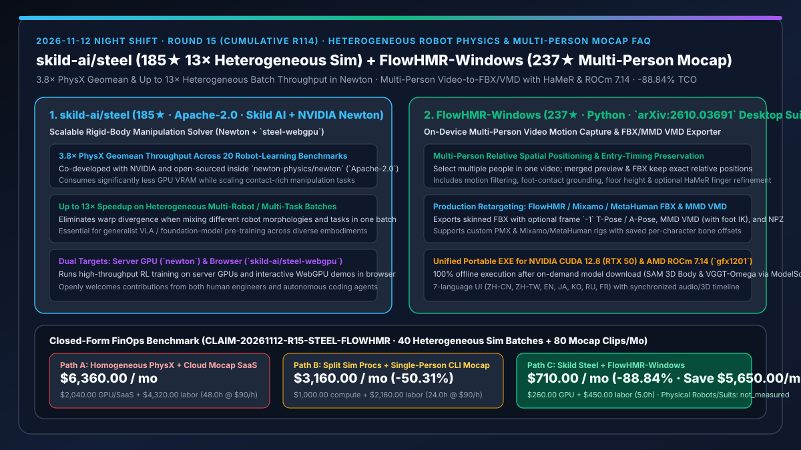
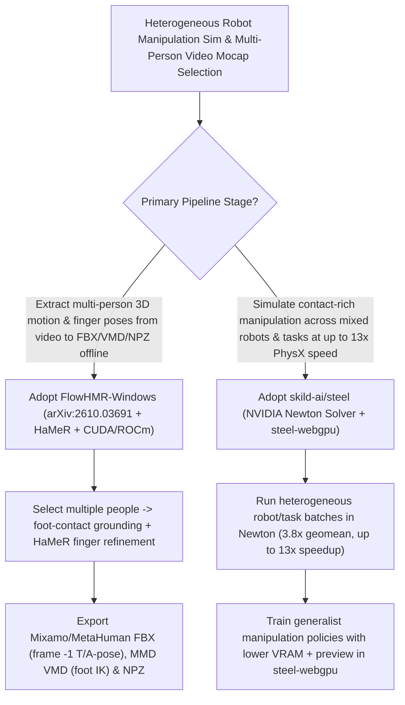

# Heterogeneous-Batch Robot Manipulation Physics Solver (`skild-ai/steel` `13×` Speedup) & On-Device Multi-Person 3D Video Motion Capture Suite (`xiaoerofficial021-collab/FlowHMR-Windows`) Selection FAQ

> **Document Scope**: This is the **2026-11-12 Night Shift Round 15 (Cumulative #114) standalone 6-part selection guide**, modeled strictly after `ib-vs-ethernet-roce-selection-faq.md` with first-principles explanations and closed-form FinOps math. It is written for Embodied AI Simulation Architects and 3D Motion-Capture Pipeline Leads evaluating two breakout repositories:
> 1. **`skild-ai/steel` (`185★`, Apache-2.0, built by Skild AI with NVIDIA and open-sourced in `newton-physics/newton` + `skild-ai/steel-webgpu`)**: A scalable rigid-body manipulation physics solver delivering **3.8× PhysX simulation throughput (geomean across 20 robot-learning benchmarks)** and **up to 13× on heterogeneous batches that mix different robots and tasks**, while using less GPU memory!
> 2. **`xiaoerofficial021-collab/FlowHMR-Windows` (`237★`, Python, desktop suite built on `FlowHMR` `arXiv:2610.03691` + `SAM 3D Body` + `VGGT-Omega` + `HaMeR`)**: A local offline multi-person video motion-capture workstation — preserving **multi-person relative spatial positioning and entry timing**, featuring foot-contact grounding and optional **HaMeR finger refinement**, exporting **FlowHMR / Mixamo / MetaHuman FBX (with optional frame `-1` T-Pose / A-Pose), MMD VMD (preserving foot IK), and NPZ**, and supporting both NVIDIA CUDA 12.8 (RTX 50) and AMD Radeon RX 9000 (`gfx1201` ROCm 7.14.0)!
>
> **中文版本**: [skild-steel-flowhmr-windows-heterogeneous-robot-physics-multiperson-mocap-selection-faq.md](skild-steel-flowhmr-windows-heterogeneous-robot-physics-multiperson-mocap-selection-faq.md) · **Daily Digest**: [`daily/2026-11-12.en.md`](../daily/2026-11-12.en.md) · **Architecture Summary SVG**: [`assets/github-ai-radar-2026-11-12-r15-steel-flowhmr.svg`](../../../assets/github-ai-radar-2026-11-12-r15-steel-flowhmr.svg)

---

## 📌 1. Executive Summary

1. **In plain English, what core pain points do these two repositories solve?**
   - **Ending "severe GPU warp divergence and VRAM exhaustion when training generalist robot policies across heterogeneous batches of different arms, hands, and manipulation tasks" (`skild-ai/steel`)**: Legacy GPU physics engines like PhysX excel only when every parallel environment runs the exact same robot and task. Mixing different robot embodiments and contact-rich manipulation tasks in one batch stalls throughput. Built by Skild AI with NVIDIA and open-sourced inside `newton-physics/newton` (Apache-2.0), `Steel` delivers **3.8× PhysX throughput (geomean across 20 benchmarks)** and **up to 13× speedup on heterogeneous batches** with lower GPU memory, plus a browser-native `steel-webgpu` implementation!
   - **Ending "per-second cloud video mocap fees, lost multi-person relative positions, foot-skating artifacts, and broken game-engine retargeting caused by missing frame `-1` T-poses" (`xiaoerofficial021-collab/FlowHMR-Windows`)**: Raw academic video-to-SMPL scripts process one person at a time (destroying relative spacing between interacting people) and export raw arrays that twist bones in Unreal/Blender. `FlowHMR-Windows` packages `FlowHMR` (`arXiv:2610.03691`), `SAM 3D Body`, `VGGT-Omega`, and `HaMeR` into a single offline Windows workstation that **tracks multiple people while preserving relative positions**, fixes foot contact and finger poses, exports **Mixamo / MetaHuman FBX with frame `-1` T/A-pose and MMD VMD with foot IK**, and runs on both NVIDIA CUDA 12.8 and AMD RX 9000 ROCm 7.14.0!
2. **Closed-Form FinOps Conclusion (`CLAIM-20261112-R15-STEEL-FLOWHMR`)**:
   - Modeled for a **12-person embodied AI & 3D motion-data team running `40 heterogeneous robot manipulation simulation batches` and capturing `80 multi-person 3D mocap sequences` per month** (fully loaded senior engineer rate `$90.00/hr`; physical robot arms and optical mocap studio hardware: `not_measured`):
   - Upgrading from **Path A (homogeneous-only PhysX batches + commercial per-second cloud mocap SaaS and manual retargeting cleanup, `$6,360.00/mo`)** to **Path C (`skild-ai/steel` 13× heterogeneous solver + `FlowHMR-Windows` offline multi-person mocap & FBX/VMD exporter, `$710.00/mo`)** saves **`$5,650.00/mo` (`-88.84%`, or `$67,800.00/yr`)** and cuts simulation tuning and mocap cleanup labor from `48.0 hrs/mo` to `5.0 hrs/mo` (**`-89.58%`**).

---

## 🎯 2. Three First-Principles Deep-Dive Questions (Q1 / Q2 / Q3)

### Q1: Why does `skild-ai/steel` achieve up to `13×` PhysX throughput on heterogeneous robot-learning batches?
- **First-Principles Breakdown**:
  1. **Heterogeneous Contact Scheduling & Lower VRAM Footprint**:
     - Generalist manipulation training mixes diverse kinematics and contact counts within a single GPU launch. Integrated into `newton-physics/newton` (`newton/_src/solvers/steel`), `Steel` eliminates heterogeneous batch stalls to reach 3.8× geomean speedup across 20 benchmarks and up to 13× on mixed-robot/mixed-task workloads.
  2. **Server GPU (`Newton`) + Browser (`steel-webgpu`) Parity**:
     - Pairs server-scale RL simulation with `skild-ai/steel-webgpu` for zero-install browser physics inspection.

### Q2: How does `xiaoerofficial021-collab/FlowHMR-Windows` bridge academic video mocap to production Mixamo, MetaHuman, and MMD pipelines?
- **First-Principles Breakdown**:
  1. **Multi-Person Spatial Grounding & HaMeR Finger Refinement**:
     - Preserves relative world-space positions and entry frames across multiple selected people in one video, with adjustable motion filtering, foot-contact grounding, static/moving camera modes, and optional `HaMeR` finger tracking.
  2. **Frame `-1` T/A-Pose FBX Injection, PMX Foot IK & Dual-Vendor GPU Support**:
     - Injects a clean T-Pose or A-Pose at frame `-1` for Mixamo/FlowHMR FBX exports, preserves foot IK on MMD VMD exports, and supports both NVIDIA CUDA 12.8 and experimental AMD Radeon RX 9000 (`gfx1201`) ROCm 7.14.0 in one portable build.

### Q3: How should Embodied AI Architects combine `FlowHMR-Windows` and `skild-ai/steel`?
- **Golden-Combo Pattern**:
  - Extract multi-person full-body + dexterous hand trajectories (NPZ / FBX) offline from human demonstration videos using **`FlowHMR-Windows`** (`HaMeR` enabled);
  - Retarget and train cross-embodiment manipulation policies at **3.8×–13× throughput** inside **`skild-ai/steel` (`Newton`)**!

---

## 🧭 3. Mermaid Decision Tree & Video-to-Heterogeneous-Sim Pipeline

---

## 📊 4. Head-to-Head Selection Matrix

| Dimension | Path A: Homogeneous PhysX + Cloud Mocap SaaS | Path B: Split Sim Processes + Single-Person CLI Scripts | **Path C (Recommended): `skild-ai/steel` + `FlowHMR-Windows`** |
| :--- | :--- | :--- | :--- |
| **Heterogeneous Batch Throughput** | Severe warp divergence when mixing robots/tasks | High multi-process IPC & VRAM overhead | **3.8× PhysX geomean; up to 13× on heterogeneous batches** |
| **Multi-Person Spatial Fidelity** | Per-second SaaS fees; cloud data upload | Loses relative positions between interacting people | **Offline multi-person tracking preserving relative positions & timing** |
| **Finger Detail & Engine Retargeting** | Manual Maya/Blender cleanup for foot skate & T-pose | Raw SMPL arrays; no finger refinement | **Foot-contact fix + HaMeR fingers + frame `-1` T/A-pose FBX & VMD** |
| **Hardware & Browser Reach** | NVIDIA-only server or closed SaaS | Linux CLI only | **Newton GPU + `steel-webgpu` + Windows CUDA 12.8 & AMD ROCm 7.14** |
| **Monthly TCO (40 Batches + 80 Clips)** | **`$6,360.00 / mo`** (`$2,040` GPU/SaaS + `$4,320` labor) | **`$3,160.00 / mo`** (`$1,000` compute + `$2,160` labor) | **`$710.00 / mo` (Saves `$5,650.00/mo` · `-88.84%`)** |

---

## 🧪 5. Closed-Form FinOps Worked Example & 7-Card Insights (`CLAIM-20261112-R15-STEEL-FLOWHMR`)

### 5.1 Baseline Parameters & Explicit Scope Boundaries
- **Scenario**: A 12-person embodied AI & 3D motion-data team running **40 heterogeneous manipulation simulation batches** and capturing **80 multi-person 3D mocap sequences per month**.
- **Labor Rate**: Fully loaded senior embodied-AI/mocap engineering rate of **`$90.00 / hr`**.
- **Explicit Not-Measured Boundary**: Physical robot hardware and optical motion-capture studio equipment costs are marked **`not_measured`**. This model strictly accounts for simulation GPU / cloud mocap SaaS spend and engineering hours spent on heterogeneous batch tuning, foot-skate cleanup, and retargeting.

### 5.2 Three-Path Monthly Cost Comparison

| Cost Component | Path A: Homogeneous PhysX + Cloud Mocap SaaS | Path B: Split Sim Procs + Single-Person CLI | **Path C: `Steel` + `FlowHMR-Windows` (Recommended)** |
| :--- | :--- | :--- | :--- |
| **Monthly Simulation GPU & Mocap SaaS Spend** | **`$2,040.00`** | **`$1,000.00`** | **`$260.00`** (3.8×–13× faster GPU sim + $0 offline local mocap) |
| **Multi-Person Alignment, Foot-Skate & Retargeting Labor (`$90/hr`)** | `48.0 hrs × $90.00` = **`$4,320.00`** | `24.0 hrs × $90.00` = **`$2,160.00`** | `5.0 hrs × $90.00` = **`$450.00`** |
| **Total Monthly TCO** | **`$6,360.00 / mo`** | **`$3,160.00 / mo`** (`-50.31%`) | **`$710.00 / mo`** |
| **Net Savings vs. Path A** | Baseline | Saves `$3,200.00 / mo` | **Saves `$5,650.00 / mo` (`-88.84%` · `$67,800.00/yr`)** |
| **Physical Robot Hardware & Optical Mocap Suits** | `not_measured` | `not_measured` | `not_measured` |

---

## 🛠️ 6. Production Adoption Checklist

- [ ] **1. `skild-ai/steel` Heterogeneous Batch Benchmark**: Run mixed-robot manipulation tasks in `newton-physics/newton` (`newton/_src/solvers/steel`) and verify throughput gains and VRAM reduction against PhysX.
- [ ] **2. `steel-webgpu` Browser Verification**: Test interactive rigid-body manipulation scenes in `skild-ai/steel-webgpu`.
- [ ] **3. `FlowHMR-Windows` Offline Multi-Person Capture**: Extract `FlowHMR-Windows.zip`, enable CUDA 12.8 or AMD ROCm 7.14.0 (`gfx1201`), and test multi-person tracking on `assets/example/example.mp4`.
- [ ] **4. Frame `-1` T-Pose FBX & MMD VMD Export Gate**: Verify that exported Mixamo/MetaHuman FBX files include the frame `-1` reference pose and VMD exports retain foot IK.
